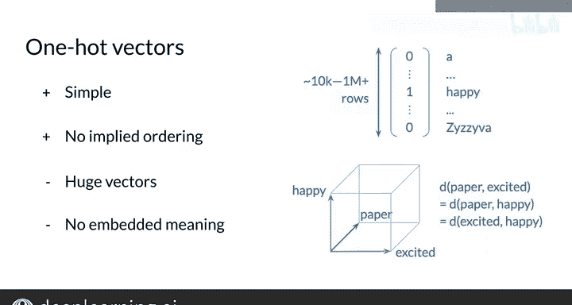

# 吴恩达《自然语言处理｜natural language processing》中英字幕 - P87：37_基本词表示.zh_en - GPT中英字幕课程资源 - BV1Hc5ezDEWQ

You will now be able to create a matrix to represent all the words in your vocabulary。

 Each vector of your matrix will correspond to one of the words。

 Let me show you how you can build this matrix。 The simplest way to represent words as numbers is for a given vocabulary to assign a unique integer to each word。

 for example， based on a vocabulary of 1000 basic English words。

 you could assign the number one to the word a to to able and so on up to 1000 for zebra。

 While this numbering scheme is simple， one of the problems is that the order of the words。

 alphabetical in this example doesn't make much sense from a semantic perspective。 For example。

 there is no reason why happy should be assigned a greater number than hand， for instance。

 or a smaller one than zebra。😊，Instead of using a numerical index to encode each word。

 you can represent the words using a column vector where each element corresponds to a word of the vocabulary using the previous example with a vocabulary of 1000 words。

Each vector would contain 1000 elements， and each row would be labeled with one of the words。

You can now encode each word with a unique column vector by putting a1 in the row that has the same label and a0 everywhere else。

 For example， the word happy would be represented as a vector with a1 in the row corresponding to happy and 0 in all of the other rows。

And for all the other words in the vocabulary。I'll call these vectors one hot vectors to distinguish them from other types of vectors that you'll encounter。

 You can consider words as a categorical variable。You can easily go from integers to one hot vectors and back by simply mapping the words in the rows to their corresponding row number。

In this way， happy word number 621 would be represented as a one hot vector with a1 in row 621。

 which corresponds to the word happy conversely。The vector for H with a one in row 621 would be represented by integer 621。

 which corresponds to happy1 hot vectors have an advantage over using integers because one hot vectors do not imply any relationship between any two words。

Each vector says the word is either happy， or it's not。Or the word is either zebra or it's not。

 however， one hot vectors have two major limitations for most NLP use cases。For one。

 barring anything but the simplest vocabulary。 These parrse vectors are going to be huge。

 This means that working with one house vectors on a computer would require a lot of space and processing time。

If your vectors are created with English words， you could end up with upwards of a million rows。

 one row for each word in the English vocabulary。Another limitation is that this representation doesn't carry the word meaning。

For instance， if you attempt to determine how similar two words are by calculating the distance between their one hot vectors。

 then you will always get the same distance between any two pairs of words。For example。

 using one hot vectors， the word happy is just as similar to the word paper as it is to the word excited。

 intuitivetuitively， you would think that happy is more similar to excited than it is to paper。

This is where word embeddings come into play， as I'll explain next To recap。

 you saw the pro the phonehouse vectors， which are pretty simple and require no implied ordering。

You also saw the cons of onehouse vectors， which are huge and encode no meaning。 In the next video。

 I will show you word embeddings， which will help us solve these issues。

