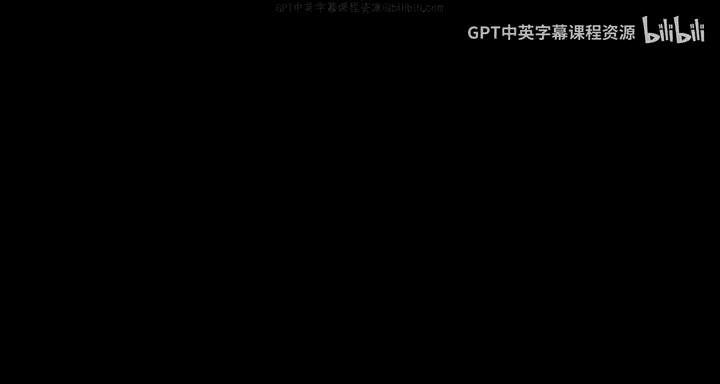
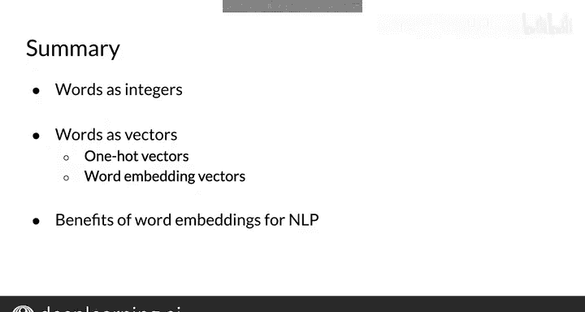

# 吴恩达《自然语言处理｜natural language processing》中英字幕 - P88：38_词嵌入.zh_en - GPT中英字幕课程资源 - BV1Hc5ezDEWQ

Im about to show you a method that can encode meaning in a relatively low dimensional vector。

 In other words， a vector whose dimension is not necessarily v dimensional。

Words on the left are considered negative in some way。

 and words on the right are considered positive in some way。

 Word that are much more negative are further to the left。

 and words that are much more positive are further to the right。

You could store their positions as numbers in a single vector of length 1。

 Notice that you can now use any decimal value instead of 0 and 1。 This is quite useful。In that now。

 you can say that happy and excited are more similar to each other compared to with a word paper。

 because the number representing happy is closer to the number representing excited。

You can extend this by adding a vertical number line。

 Words that are higher on this line are more concrete physical objects。

 whereas words lower on this line are more abstract ideas。 Again。

 you can arrange each word along both of these number lines and see how words that are both more concrete and positive。

 like poppe and kitten， are closer together。You can store the two numbers that represent your position on the two number lines as a vector of length2。

What you've done here is to represent the vocabulary of words with a small vector of length sum。

You gained a little bit of meaning while also giving up some precision。

This vector representation is less precise than one hot vectors in that its possible for two words to be located on the same point in this 2D plot。

Like snake and Sp， for example。What you created just now is an example of a word embedding Word embeddings represent words in a vector form that both has a relatively low dimension。

 saying the hundreds to load thousands， making it practical for calculations。

And carries the meaning of words， making it possible to determine how semantically close words are in general purpose vocabularies。

 the vector for forest would usually be similar to the vector for tree。

 but very dissimilar to the vector for ticket。 You will visualize such similarities as part of this week's assignment。

 It also makes it possible to work out analogies。 such as finding the missing word in Paris is to France as Rome is to。

Encoding the meaning of words is also the first step towards encoding the meaning of entire sentences。

 which is the foundation for more complex NLP cases like question answering and translation。

 creating word embeddings is one of the main objectives of this module in this week's lecture。

 you will implement word embeddings from simpler to more advanced methods。

 youll also begin to build upon the simpler representations。 Finally。

 in note on terminology In theory， all vector representations of words including oneho vectors and word embedding vectors are known as word vectors。

But the term word vector and word embeddings are used as well to refer to word embedding vectors。

 So don't be surprised if you also see these terms in the wild。

Now that you can transform words into integers and vectors。

 specifically one hot vectors and word embeddings， you can explain why word embeddings are better suited to real world applications of NLP。

So in this video， I have shown how a vectorter with two dimensions can tell you something about a word。

 maybe the first coordinate will tell you if the word is positive or negative。

 and the second coordinate will tell you if it is abstract or concrete。The more coordinates you have。

 the more things you can capture in the next video， I will show you how to learn these coordinates。

