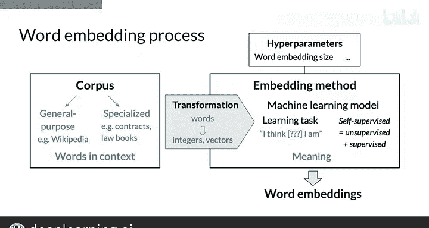

# 吴恩达《自然语言处理｜natural language processing》中英字幕 - P89：39_如何创建词嵌入.zh_en - GPT中英字幕课程资源 - BV1Hc5ezDEWQ

When creating word embeddings， the corpus you are using to create them will affect your word embeddings。

 This is something we will explore later in the weeks。 But first。

 let us see what is required to create these embeddings。To create word embeddings。

 you always need two things， a corpus of text and an embedding method。

The corpus contains the words you want to embed， organized in the same way as they would be used in the context of interest。

For example， if you want to generate word embeddings based on Shakespeare。

 then your corpus would be the full and original text of Shakespeare and not study notes。

 slide presentations or keywords from Shakespeare。The context of a word refers to what other words or combination of words tend to occur around that particular word。

 The context is important， as this is what will give meaning to each word embedding。

A simple vocabulary list of Shakespeare's most common words would not be enough to create embeddings。

 The corpus would be a general purpose sets of documents such as Wikipedia articles。

 or it could be more specialized， such as an industry or enterprise specific corpus to capture the nuances of the context。

For NLP use cases on legal topics， you could use contracts and law books as the corpus。

 The embedding method creates the word embeddings from the corpus。

 There are many types of possible methods， but in this course。

 I will focus on modern methods based on machine learning models which are set to learn the word embeddings。

 the machine learning model performs a learning task。

 and the main byproduct of this task are the word embeddings。 For instance。

 the task could be to learn to predict a word based on the surrounding words in a sentence of the corpus。

As in the case of the continuous bag of words approach that I will describe in the next videos that you will implement this week。

 the specific of the task are what will ultimately define the meaning of the individual words。

I'll get back to this in one of the next videos。The task is said to be self supervised。

 It is both unsupervised in the sense that the input data。

 the corpus is unlabeled and supervised in the sense that the data itself provides the necessary context。

 which would ordinarily make up the labels。So the corpus is a self-contained data set that contains both the training data and the data that enables the supervision of the task。

 word embeddings can be tuned by a number of hyperparameters。

 just like in any machine learning model， one of these hyperparmeters is the dimension of the word embedding vectors。

 in practice， this dimension typically ranges from a few hundred to the low thousands。

 using higher dimensions captures more nuanced meanings， but is more computationally expensive。

 both as training time and later down the line when using the word embedding vectors。

This eventually leads to diminishing returns。 Finally。

 to feed the corpus into the machine learning model。

 the contents of the corpus must first be transformed into a suitable mathematical representation from words。

 into numbers。The representation depends on the specifics of the model。

 but it is usually based on the simple representations that I presented in the previous video。

 such as Integer based word indices or one hot vectors。In this video。

 you learned about high level process to create context embeddings For the next step。

 I'll introduce you to several word embedding methods。

 including the continuous bag of words approach that you will be implementing in this week's assignment。

 So far， we have learned a new term known as self supervised learning。

 This term will show up again and again in the field of machine learning。

 It is a mix of unsupervised learning and supervised learning。 Now， in the next video。

 we will see some of the methods used for word embeddings。😊。

