# 吴恩达《自然语言处理｜natural language processing》中英字幕 - P8：7_预处理.zh_en - GPT中英字幕课程资源 - BV1Hc5ezDEWQ

Hello， you will now learn about two major concepts of preprocessing。

 The first thing youll learn about is called stemming and the second thing you will learn about is called stop wordss and specifically you will learn how to use stemming and stopboard to preprocess your text。

 Let's take a look at how you can do this。Let's process this tweet。 First。

 I remove all the words that don't add significant meaning to the tweet， A K A。

 stop words and punctuation marks。

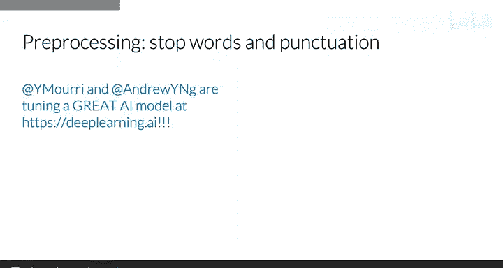

In practice， you would have to compare your tweet against two lists。

 One with stop words in English and another with punctuation。 These lists are usually much larger。

 but for the purpose of this example， they will do just fine。

Every word from the tweet that's also appears on the list of stop words should be eliminated。

 So you'd have to eliminate the word and the word R， the word a。

And the word at the tweet without stop wordss looks like this。

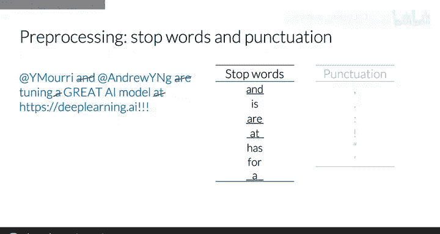

Note that the overall meaning of the sentence could be inferred without any effort。

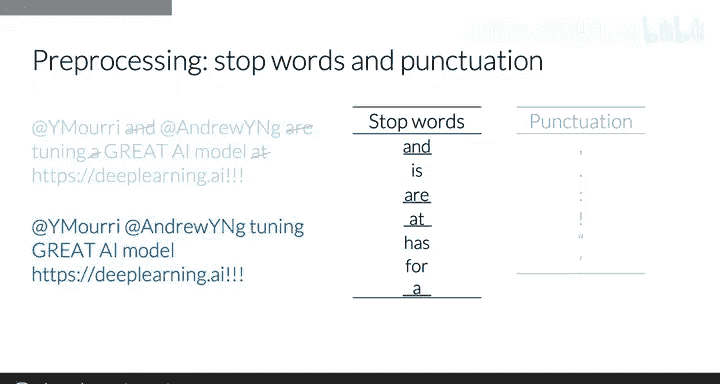

Now， let's eliminate every re punctuation mark。In this example， there are only exclamation points。

 The tweets without stop words and punctuation looks like this。

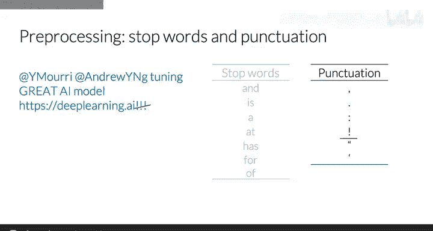

However， note that in some context， you won't have to eliminate punctuation。

 so you should think carefully about whether punctuation adds important information to your specific MLLP task or not。

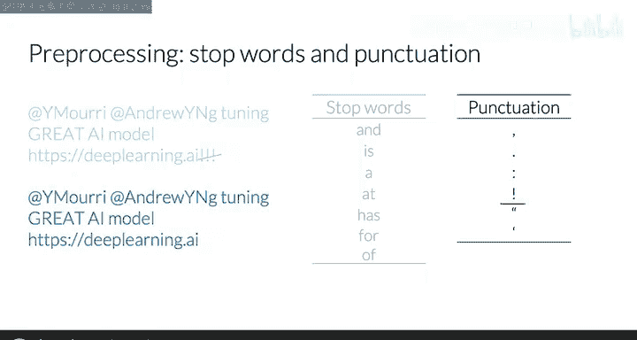

Tweets and other types of text often have handles and URLs。

 but these don't add any value for the task of sentiment analysis。 Let's eliminate these two handles。

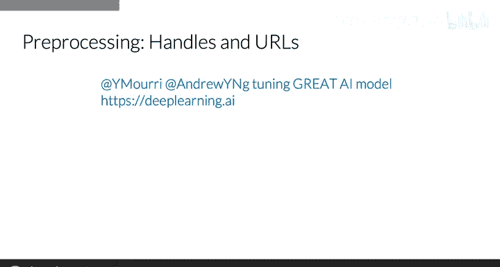

And this URL。At the end of this process， the resulting tweets contains all the important information related to its sentiment。

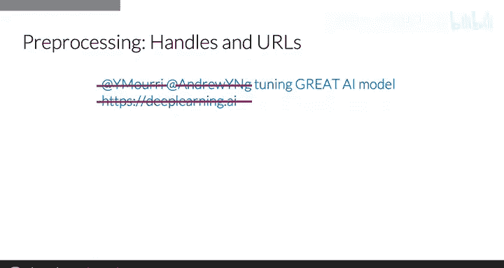

Tunening great AI model is clearly a positive tweet and is sufficiently。

 good model should be able to classify it。

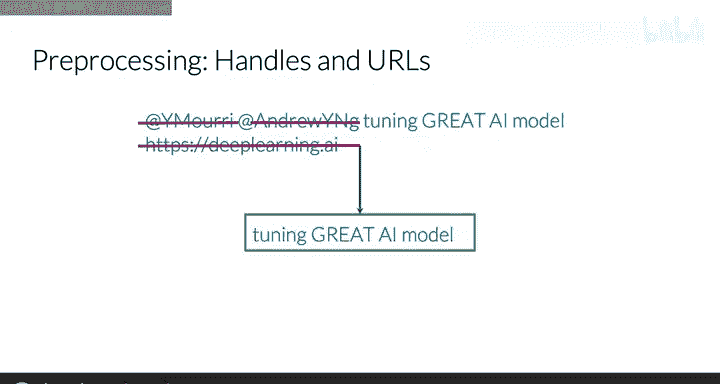

Now that the tweet from the example has only the necessary information。

 I will perform stemming for every word。

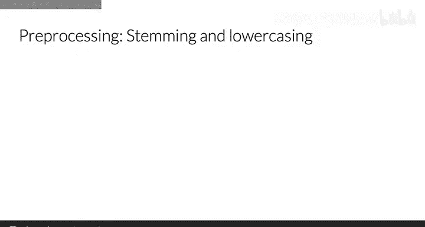

Stemming in N LP is simply transforming any word to its base stem。

 which you could define as the sets of characters that are used to construct the word and its derivatives。

 Let's take the first word from the example。Its stem is done because adding the letter E。

It forms the word tune。Adding the suffix ED。Forms the word tuned and adding the suffix I N G。

 It forms the word tuning。After you perform stemming on your corpus， the words tune。

 tuned and tuning will be reduced to the stem to。 So your vocabulary would be significantly reduced when you perform this process for every word in the corpus。

To reduce your vocabulary even further without losing valuable information。

 you would have to lowercase every one of your words。So， the word great。Great。

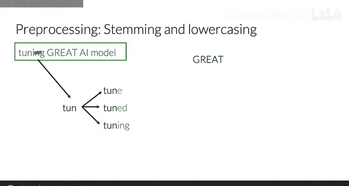

And great would be treated as the same exact word。

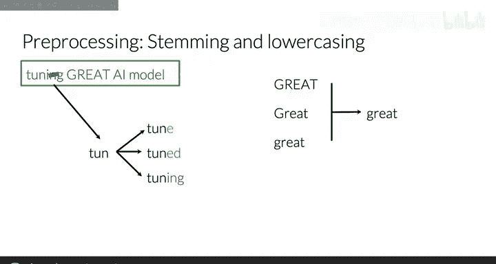

So this is the final pre process tweet as a list of words。

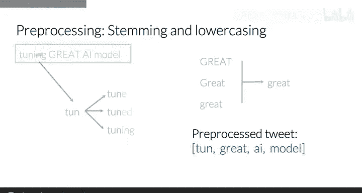

Now that you're familiar with stemming and stopWs， you know the basics of text processing in the next video。

 you can use your processed tweet function to extract a matrix X which represents all the tweets in your dataset。

