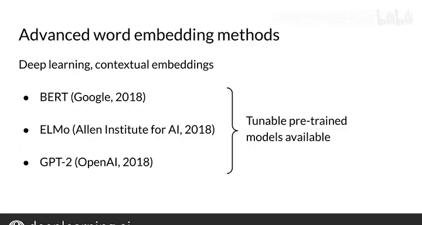

# 吴恩达《自然语言处理｜natural language processing》中英字幕 - P90：40_词嵌入方法.zh_en - GPT中英字幕课程资源 - BV1Hc5ezDEWQ

There are a lot of word embedding methods。 As time goes by。

 scientists keep discovering better methods that allow us to capture more and more meaning。

 So let's dive in and take a look at some of these methods。

 Wheretovec uses a shallow neural network to learn word embeddings。

 It proposes two model architectures。 continuousinuous bag of words。

 which is a simple but efficient approach that you will implement this week。😊。

The objective of the model is to learn to predict a missing word， given the surrounding words。

Continuous skipogramm， also known as the skipogramm with negative sampling。

 which does the reverse of the continuous bag of words method。

 The model learns to predict the words surrounding a given input word。

Global vectors or glove by Stanford， which involves factorizing the logarithm of the corpus's word coherance matrix。

 which is similar to the count matrix you've used before。 Fast text by Facebook。

 which is based on the skipgram model and takes into account the structure of words by representing words as an engram of characters。

 This enables the model to support previously unseen words。

 known as out of vocabulary words by inferring their embedding from the sequence of characters they are made of and the corresponding sequences that it was initially trained on。

 for example， it would create similar embeddings for kittty and Kitten。

 even if it had never seen the word kittty before。 as kittty and kittten are made of similar sequences of characters。

Another benefit of fast text is that word embedding vectors can be averaged together to make vector representations of phrases and sentences。

 Next up， some more sophisticated modeling approaches。

 These methods use advanced deep neural network architectures to refine the representation of the words meaning。

 according to their context。In the previous models， a given word always has the same embedding。

In these more advanced models， the words have different embeddings depending on their context。

 This ad supports for polysammi or words with similar meanings。

 such as the word plants which can refer to an organism like a flower。

 a factory or which can be an adverb with yet more different meanings。

 a few examples of advanced models that generate word embeddings are Bt or bydirectal encoder representations from transformers by Google Elmo for embeddings from language models by the Allen Institute for AI or DptT2 or generative pretraining tool by openaiI。

 if you want to use these advanced methods， you can find off the shelf pretrained models on the internet。

 and you can find tune in these models using your own corpus to generate high quality domainspecific word embeddings。

To recap， you now have some tools in your toolbox for creating word embeddings。

 en coding some pretty sophisticated new models。 That's nice Up next。

 I will introduce the continuous bag of words model that you'll be using for this week's assignment。

You have now seen a little history for embedding methods。

 We went all the way from more to Vc to the latest transformer methods。 Currently。

 transformers are one of the most advanced AI methods。

