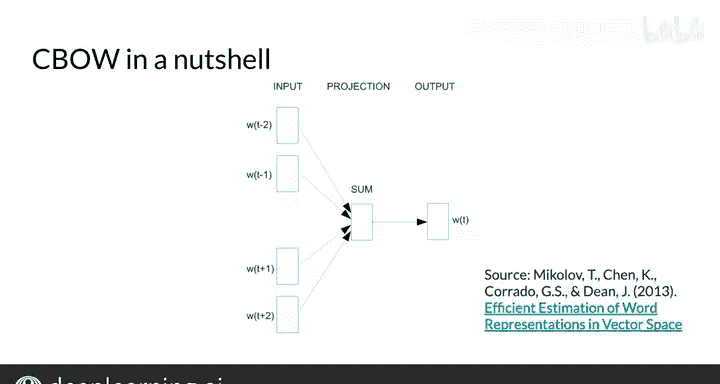

# 吴恩达《自然语言处理｜natural language processing》中英字幕 - P91：41_连续词袋模型.zh_en - GPT中英字幕课程资源 - BV1Hc5ezDEWQ

You'll now see the overall structure of the algorithm you'll be implementing this week。

 you'll see how you can initialize your word vectors to predict new word vectors。

 Let's dive in and see how you can do this。

I'll start with the overall process for machine learning model based word embeddings and then move on to how it's instantiated for the continuous bag of words model As a reminder to create word embeddings。

 you need a corpus and a machine learning model that performs a learning task one by product of the learning task is a set of forward embeddings。

 You also need a way to transform the corpus into a representation that is suited to the machine learning model。

In the case of the continuous bag of words model， the objective of the task is to predict a missing word based on the surrounding words。

The rationale is that if two unique words are both frequently surrounded by a similar set of words when used in various sentences。

 then those two words tend to be related in their meaning。

Another way to say this is that they are related semantically。For example， in the sentence。

 the little something is barking with a large enough corpus。

 The model will learn to predict that the missing word is related to dogs such as the word dog itself or puppy hound。

 terrier and so on。So the model will end up learning the meaning of words based on their context。

So how do you use the corpus to create training data for the prediction task？

Let's say that the corpus is the sentence。I am happy because I am learning。

 and you can ignore the punctuation for now for a given word of a corpus。 H， for example。

 which I'll call the centre word。 I'll define the context words as forwards。

 the two words before the center word and the two words after it。😊。

And I'll note this as c equals2 for the two words before or after。Where see。

 iss called the half size of the context， and it is a hyperparameter of the model。

 You could use another number of words。 This is just an example。

 So here the context words for the center word happy R I am because I Let's also define the window as the count of the center word plus the context words。

 So here， the size of the window equal to one center word plus two context words before。

 plus two context words after which equals to5。 to train the model。 you will need a set of examples。

 and each example will be made of context words and the center word to be predicted。

In this first example， the window is I am happy because I。

 and the model will take the context towards I am because I and should predict the center word happy。

You can now slide the window by one word。 And the next training example that you have is amm happy。

 something I am。The input to the model will be the context words。 Im happy。 I am。

 And the target center word to predict is because。And sliding the window by one again。

 the model will take happy because I'm learning and should predict the target， I。

And this is basically how the continuous bag of words model works。

 As you can see in the model architecture from the original paper。

 context words as input and center words as output。To recap。

 you just learned how the continuous bag of words model broadly works for the rest of the week。

 you will focus on preparing a training data set starting from a corpus。

 and then you'll dive into the math， powering the models。

To recap in a continuous bag of wordss model， you try to predict the center word using the context words or the surrounding words。

 and as a byproduct of the algorithm， you end up getting the word embeddings in the next videos we will show you how this actually works。

