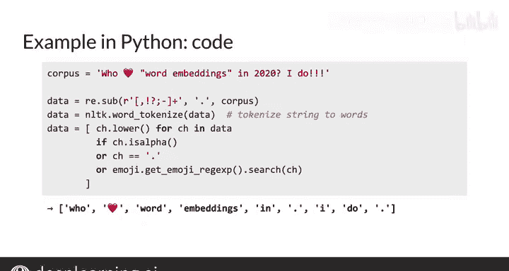

# 吴恩达《自然语言处理｜natural language processing》中英字幕 - P92：42_清洗与分词.zh_en - GPT中英字幕课程资源 - BV1Hc5ezDEWQ

We will now explore cleaning and tokenization。 I already spoke about this a little bit in course 1。

 but it is important to touch it again for a little bit。 So let's get started。

 I'll give you some practical advice on how to clean a corpus and split it into words or more accurately tokens through a process known as tokenization。

 In course 1， I previously spoke about data preparation， cleaning and tokenization。

 but now I'll go into some more details。 First， you should consider the words of your corpus as case insensitive。

 For instance， the word the should be represented identically， regardless of its case。 For example。

 whether it begins with a capital T。 say at the beginning of the sentence or not。

 you can do this by converting the corpus to either all lower case or all upper case。 Secondly。

 you should handle punctuation。 you could， for instance。

 represent all interrupting punctuation marks such as full stops。

 commas and question marks as a single special word of。😊。

CabularyYou could ignore noninterrupting punctuation marks such as quotation marks。

 You could collapse multis marks， such as triple question marks into a single mark。 and so on。 Next。

 you want to handle numbers。 For example， if numbers do not carry an important meaning in your use case。

 you could drop all of the numbers。 However， numbers may have significant meaning that is relevant to your use case。

 For instance， 3。14 is the number for pi9210 is the name of a television show and the area code for Beverly Hills。

 California。 So you can keep these numbers in your corpora as is。

 if your corpora has many unique numbers such as many area code。

 you may find that it makes more sense to replace all the numbers with a special token。

 such as number。 This allows the model to know that the important thing is that it's a number。

 instead of trying to distinguish between 9210 and other area codes or phone numbers。

Also need to handle special characters such as mathematical symbols， currency symbols。

 section and paragraph signs， end line markup signs and so on。It's usually safe to drop them。

 Finally， and especially if you are working on modern corpus of user inputs such as tweets or consumer reviews。

 you should handle special words， such as emojis and hashtags， hashtag N LP。

 depending on if and how you want your model to confirm meaning to them。 You could， for example。

 consider that each emoji or hashtag should be considered as an individual word。

 I'll give a basic example in Python to demonstrate a few of these recommendations。

 The corpus in this example is who loves word embeddings in 2020。 I do with an emoji。

 punctuation marks and a number。 Heres the code to important and initialized the libraries。

 I'm using the popular N LT K library to perform tokenization。

It has a smart tokenization module named punct to handle commonspec uses of punctuation。 For example。

 it knows that full stops which are periods in abbreviations and middle names do not signify the end of a sentence。

 I am also using the emoji library。 just to give you an idea of how you could handle emojis。

 Next comes the actual logic。 First， using irregular expression。

 I' am collapsing all interrupting punctuation signs and replacing them with a full stop。

 The outcome here is who loves word embeddings in 2020。

 I do with the question and exclamation marks replaced with a single full stop。 Next。

 Im using N L T K's word tokenized function to split this string into an array of tokens。

 As you can see， the punctuation signs have been separated as individual tokens。

 including the quotation marks。 Finally， using a list comprehension。

 I am keeping tokens and converting them to lowercase if they are one of the following。😊。

Alphabetical， a full stop so previously an interrupting punctuation mark， an emoji。

 So this gets rid of numbers such as 2020 and unknown special characters。

 And this is the resulting array。 You can now use this array to extract center words and their surrounding context words。

 which you'll dive into in more detail next。

After looking at cleaning and tolkkenization， we are ready to move on to the next parts of the continuous bag of Fors model In the next video。

 we will explore the sliding window， what you can think of as a window going over the text corpus。

 we will talk more about it。 See you there。😊。