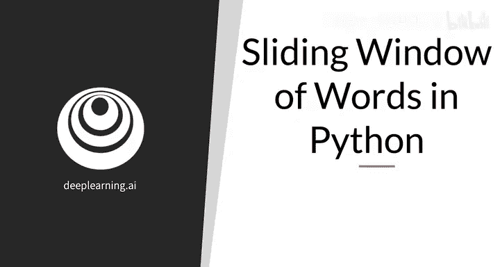
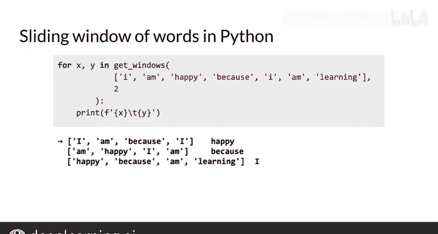

# 吴恩达《自然语言处理｜natural language processing》中英字幕 - P93：43_Python中的滑动窗口.zh_en - GPT中英字幕课程资源 - BV1Hc5ezDEWQ

I had previously mentioned that you need context words and center words to train your continuous bag of words model。

The question now is， how do you actually get these words， Let's dive in。Previously。

 you cleaned and tokenize a corpus， and you now have this clean corpus as an array of words or tokens。

 Now， I will show you how to extract center words and their context words。

 which will serve as examples to train the continuous bag of words model。

 Here is the code to do this in Python。😊。

The get Windows function takes two arguments， words， which is an array of words。Or tokens。

 but I'll stick with the term words here。 The context half size stored in the variable C。

 which is the number of words to be taken on each side of the center word。

 This was two in the previous video for a total window size of 5。

 The function initializes a counter with the index of the first word that has enough words before it。

So in the working example， I am happy because I am learning the tokenized array would be。

 I am happy because I am learning where I has the index 0， M， index 1。

 and so on for a context half size of two or the context words are the two words before and after the center word。

The first center word thus can be used is happy。 Its index is too， which is the size of the context。

I then start a loop in this index， which will run until it reaches the last possible center word。

 which is the last word that has two words after it。

 stopping just before it reaches the index corresponding to the number of words in the array minus the size of the context。

In each iteration of the loop， I extract the center word， which is the word at the current index。

 Next， I create an array with the Cword before the center word and the C words after it。

 I can now return the context word and center words。

 I'm using a special way of returning value in python。 As you can see。

 I' am using the yield keyword instead of return without going into too much detail where return would immediately exit the function yield returns the values and simply pauses the main get windows function and the function known as a generator function。

 the use of yield。 will then continue running if more values are needed。 simply put with the yield。

 I can return values from a function several times。

 which is what I' am doing at each iteration of the while loop。 Finally。

 I increase my index by one to move my sliding window one word to the right。

 So just to recap the get windows function takes in a corpus and context size。😊。

And returns the context words and center words for each successive window。

 Here's how to use this function。 I'm using a loop to get the successive twoples of context words and center words into x and Y。

 And then displaying these words。 you will notice that I am using the usual machine learning notation for features and target。

 as this is what the context words and center words are for the continuous bag of words model。

 So if I run the code on the array。 I am happy because I am learning。

 which I got by tokenizing the sentence I am happy because I' am learning。

 and a context half size of two。 This is the output up next。

 you will convert this set of words into a set of vectors this can be consumed by the continuous bag of words model。

😊。

You have seen how to extract center words and context words using a sliding window in Python This is useful for the programming assignment you also saw how you can use the yield functionality in Python which is commonly used for data generators or you can think of them as functions that keep giving you data in small batches。

