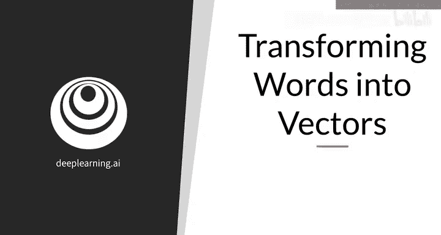
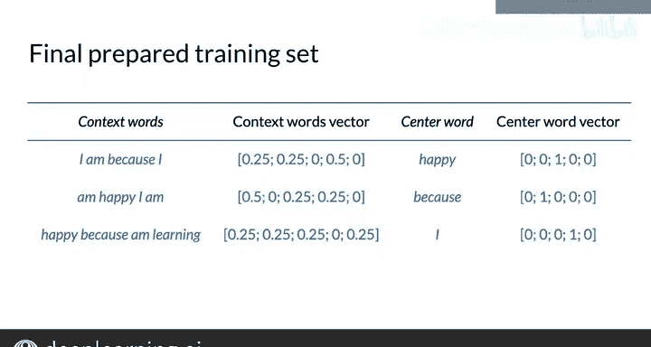

# 吴恩达《自然语言处理｜natural language processing》中英字幕 - P94：44_将词转换为向量.zh_en - GPT中英字幕课程资源 - BV1Hc5ezDEWQ

Given some context words， we need to feed them into a model and predict the center word。 However。

 since we might have several words as are context words， we have to find a way to represent them。

 We also need to find a way to represent the center word。 So let's take a look at how to do that。

 So far， you've cleaned and tokenized the corpus and extracted the context words and center word from a window that slides across your prepared corpus。

 Now， youre ready to transform the center words and context words into a mathematical form。

 that can be consumed by the continuous bag of words model。 Let's start with a center words。

 for the sample corpus， which is the sentence。 I am happy because I am learning。

 you first create a vocabulary， which is the sets of unique words in the corpus。

 So here you get a five word vocabulary。 M because happy I and learning you can now encode each word as a column one hot vector。

 where each row of the vector corresponds to。😊。

Word of the vocabulary。 So five rows in total here。 By the way， here。

 the words corresponding to the rows are arranged in alphabetical order。

 but any other order would be fine。 In this way， the vector for M will have a1 in the row corresponding to M and 0 everywhere else。

 because will have a one in the row for because and 0 in the other rows。And so on。

 this is how you will input the center words into the model。For the context words。

 you will create a single vector that represents the context from all of the context words。

To create this vector for the entire context， take the average of one0 vectors of each context word。

 For example， if the context words are I am because I the one hot vector for the individual words are。

0，0，0，1，0 for I 1，0，0，0，0 for m 0，1，0，0，0 for because and0，0，0，1，0 again for I and their average is。

One fourth， one， fourth，0， half and 0， which yields the vector representation of I am because I to be used with a model。

So for the first window， I am happy because I， the final vector representations that you will actually use to train the continuous bag of words model will look like this。

 These are column vectors， by the way， I am just writing them in a single row to make everything fits on the slide and so on for the rest of the training dataset set。

😊，By now， you've concluded the preparation phase starting from the rock corpus。

 you now have data that you can use to train a continuous bag of words model。

 congratulations up next， you will examine the details of this model and get ready to apply your new skills to this week's assignment。

Since you have fully represented the context words and center word each as a vector。

 you are now ready to learn more about the model in the next video we will learn about the architecture of the CB model。

