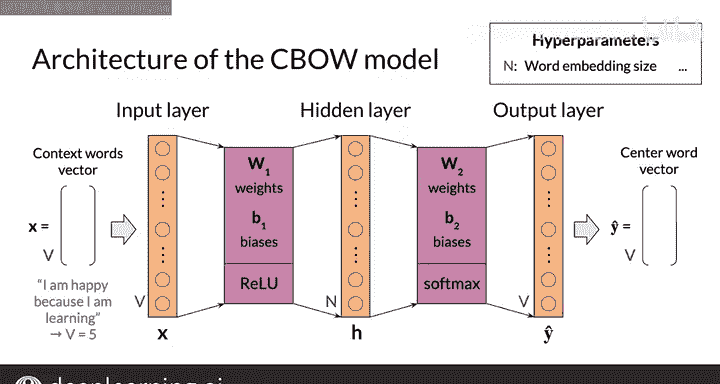

# 吴恩达《自然语言处理｜natural language processing》中英字幕 - P95：45_CBOW模型架构.zh_en - GPT中英字幕课程资源 - BV1Hc5ezDEWQ

I have been talking about the CB model for a while。

Now is finally the time to actually show you the architecture that is used to train this model。

Without further ado， let's dive in。 The continuous bag of words model is based on a shallow dense neural network with an input layer。

 a single hidden layer and an output layer。 As you remember。

 the input of the model is a vector of context words， which I'll call X。

 and the output is the vector of the predicted center word， which I'll call y hat。

 The size of these vectors is equal to the size of the vocabulary， which I'll call V。

 So the input and output size of this neural network is equal to V。 For instance， if the corpus is。

 I am happy because I am learning， you have a five word vocabulary。 So V equals 5。

 and you'll create a neural network where the input and output layers， each have five neurons。

 in a real world corporal。 This number will typically be in the thousands。 Next is the hidden layer。

 If you remember from the lesson on the word embedding process。

 the size or dimension of the word embeddings is a hyperpy。😊，Of the model would you select yourself。

 Let's call the size of the word embedding capital n， where capital n can typically be hundred2000。

 You will choose the size of the hidden layer to equal the size of the expected word embedding。

 So if you choose the size of the word embedding to be N。

 Then you will choose the hidden layer of this network to have n neurons。

 I'll call the vector presenting the hidden layer H。

 This is a regular feet forward network Also called a dense neural network。

 So the three layer are fully connected。 I'll call the weight matrix between the input layer and hidden layer W1。

 and the bias vector of the hidden layer is B1。 Similarly。

 W2 is the weighting matrix between the hidden layer and the output layer and B2 is the bias vector of the output layer。

 These are the matrices and vectors that the neural network will be learning as you train it to give you a little preview of where you are going。

 you will derive the word embeddings from the。Marices of this neural network。

 you will see more about this layer。 You now need activation functions for the hidden layer and output layer。

 The result of the activation of the hidden layer is what gets sent to the next layer。

 which in this case is the output layer。 Similarlyly。

 the outcome of the activation of the output layer is what will be shown as the model's prediction for the hidden layer。

 you will use the rectified linear unit function Orello for the output layer。

 you will use the softmax function。 The activation functions themselves deserve a proper discussion。

 So I'll describe them in one of the next videos。 So there you have it。

 The architecture of the continuous bag of words model。Next up。

 I'll go through the dimensions of the matrices and vectors I mentioned。

 Another important component you'll need for completing this week's fun assignment。

In this video， you have seen the overall structure of your algorithm。

 You are trying to predict the middle word， given the words outside or the context words。 However。

 you have the possible ways that you can predict。 you cannot use a logistic regression in this case。

 because a logistic regression outputs two possibilities。

