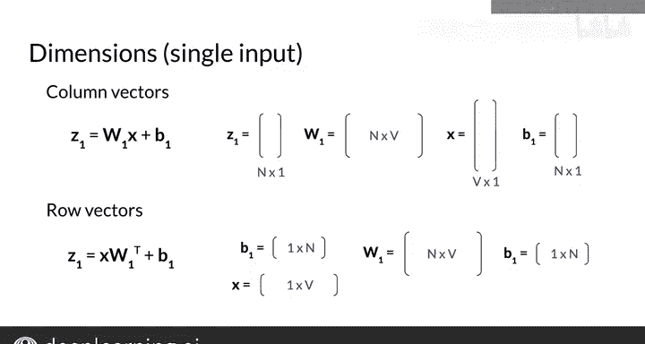

# 吴恩达《自然语言处理｜natural language processing》中英字幕 - P96：46_CBOW模型维度架构.zh_en - GPT中英字幕课程资源 - BV1Hc5ezDEWQ

Sometimes I find it easier to understand how models work by looking at their dimensions at each step。

 I personally find it easier to follow along the equations while keeping the dimensions in mind。

 so I thought this would help you too。Let's take a look at the dimensions of the layers at each step of the model。

You just saw the architecture of the continuous bag of words model and the vectors and matrices that are involved to make calculations on it。

 Now， I'll introduce you to the dimensions of these vectors and matrices。

 Heres the architecture of the neural network again。 First。

 the input layer is represented by lowercase X。 A column vector with V rows where capital v is the size of the vocabulary to get the values that will be stored in the hidden layer You first calculate the weighted sum of the values from the input layer and add the bias。

 So W1 times x。 plus B1。 and I'll call the result Z1。

 lowercase H refers to the column of values stored in the hidden layer。

To get H， you pass the values of z1 into a re activation。 So in terms of dimensions， W1。

 the weighting matrix between the input layer and the hidden layer has n rows and V columns where n is the size of the word embeddings。

B1， the bias vector for the hidden layer has one row for each neuron and the hidden layer。

 So n in total。 So when you multiply W1 by x and add the bias vector V1。

 you get a column vector with n rows and passing it through Relu preserves the dimensions。

 So as expected， the hidden layer is represented by a column vector with n rows。 next。

 to get the values of the output layer， you first need to calculate the weighted sum of the values from the hidden layer and add the bias So W2 times H plus B2。

 which I'll call z2， the values in z2 are sometimes referred to as logs to get the output y hat。

 you pass the values of the z2 logs through a softmax activation function again。

 you will see details of the activation functions later in the lecture。 W2。

 the weighting matrix between the hidden layer and the output layer has V rows and n。

Columns B2 the bias vector for the output layer has one row for each output neuron。

 So Vs when you multiply W2 by the vector for the hidden layer H and add the bias vector B2 you get a column vector with Vs and again no change when you pass it through softmax activation So finally you get the output column vector y hat with Vs。

 if you have a situation where instead of column vectors you're working with row vectors。

 then you'll need to perform the calculations with transposed matrices and inverted terms in the matrix multiplication。

 So for instance， instead of calculating h equals w1 times x plus B1 as you did with the column vectors if x and B1 are row vectors then you would calculate x times w1 transpoposed plus B1 to get z1 and then H as a row vector next。

 I'll show you how to use the neural network with。The batches of several examples instead of just one example at a time。

Now that you know the dimensions， this will help you in your programming assignments。

 Hopefully you'll not get the famous dimension mismatch anymore。

 Let's look into this model a little bit more in the next video。😊。

