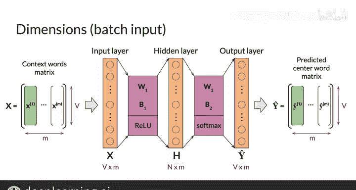

# 吴恩达《自然语言处理｜natural language processing》中英字幕 - P97：47_CBOW模型维度架构2.zh_en - GPT中英字幕课程资源 - BV1Hc5ezDEWQ

We have mainly been speaking about the C bow model by using one example as an input。 However。

 what happens if we decide to feed in several inputs and get several outputs at the same time。

 How do we vectorize By now， you are familiar with the dimensions of the vectors and matrices used in the neural network for the continuous bag of words model when feeding in a single example。

 Instead of passing input vectors representing individual examples。

 you may want to pass in several examples at a time。

 This usually makes the learning process quicker for a few reasons。 For brevity。

 I won't get into them right now， Feing several examples into the neural net at the same time is known as a batch processing and you're going to be doing it yourself in this week's assignment。

 say that you want to feed M input context word vectors into the neural network during each itation。

 M is called the batch size。 and it's a hyperparmeter for the model that you define at training time。

 You can join。😊。

These M column vectors side by side to form a matrix with Vs and m columns。

 which I'll note is capital x， you can then pass this matrix through the network and you will get capital H a matrix representing the M values of the hidden layer equals Relu the weight matrix capital z1 where z1 is w1 times x plus B1。

 It's an n rows by M columns matrix。Note that you need to replace the original B1 by vector with a bias matrix capital B1 where you duplicate the column vector M times to have an n by M matrix so that the bias terms are added to each of the weighted sums just as a tip。

When you're working on the assignment， this is known as broadcasting the vector to a matrix。

 and it's performed automatically by Nmpy when adding a matrix to a column vector with the same number of rows。

 Next， capital y hat the matrix containing the M outputs It is equal to the softmax of w times H plus B2。

 and again， you're replicating the bias vector lowercase B2 M times to get the bias matrix capital B2 Y hat has zeros and M columns。

 you can break y hat down into M column vectors。 Each one corresponding to one of the input context word vectors from the input matrix。

 So the vector from the first column of the input matrix is transformed into the vector corresponding to the first column of the output matrix。

 and similarly， for the other M-1 vectors。 Next， I'll introduce the activation functions used by the continuous bag of words model you。

Closer to a working model， you are an expert in figuring out the dimensions of the C bow model and can vectorize your inputs and outputs。

 This is really exciting stuff。 In the next video， you will take a deep dive into the activation functions used by this model。

😊。

