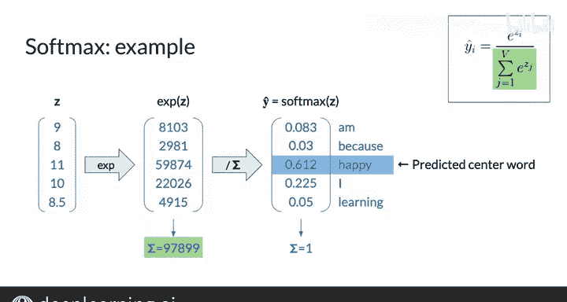

# 吴恩达《自然语言处理｜natural language processing》中英字幕 - P98：48_CBOW模型激活函数架构.zh_en - GPT中英字幕课程资源 - BV1Hc5ezDEWQ

Good to see you again。 I am about to explain arguably the two most important activation functions used in AI。

 the rectified linear unit， also known as the Res and the Somax function。 So let's get started。😊。

Before jumping into the softm function， I want to talk a little bit about the relu function or thetified linear unit。

 Apart from the input neurons， which are used as is each layer first calculates the weighted sum of its inputs and add a bias then passes the result into an activation function So for the hidden layer。

 you first calculate z1 equals w1 times x plus B1 and to get H you pass z1 into an activation function。

 which is thetified linear unit function or relu for this layer Relu is a popular general purpose activation function that only activates the neuron Every sum of its weighted inputs is positive and passes through this result。

 if that's the case mathematicalally relu of x where x is a real number is equal to the maximum of0 and x you can see the graph for this function here。

 Here's an example for vector z1 to get vector。H representing the value of the hidden layer。

 you apply the relative function。 The rows from z1 that are negative， like negative 0。

3 and negative 4。6 become 0s in H and deposit positive values stay as is。 So， for instance，5。

1 stays 5。1 and 0。2 is 0。2。 Now for the output layer。

 you calculate the weighted sum of the values from the hidden layer。 and add the bias vector。

 That's w2 times H plus B2。 which I'll call z instead of z2 in the previous slides for reasons that will soon become apparent。

 You then pass the into the activation function， which is the soft max function for this layer to get the outputs vector Y hat。

The softm function works as follows。 Its input is a vector of real numbers， as opposed to Relu。

 which in its original form， is a function of a singleial number。

Its outputs a vector of real numbers in the interval 0 to 1， which sum up to one。

And can be interpreted as probabilities of exclusive events。

 In the case of the continuous bag of words model， When you apply Somax to Z。

 you obtain an output vector Y hat with vers， where each row corresponds to a word of the vocabulary of the corpus。

 The values of the vector can be interpreted as the probability that the center word。

 which is what the model strength to predict， I the word that is assigned to each of the rows。

Mathematically， if the input to softmax is vector Z with elementzi with I ranging from1 to v。

 and the resulting vector is y hat with elements y hat of I then y hat I equals E to the Z divided by the sum over j of E to the Zj the exponential transforms all our inputs to positive numbers。

 and the divisor normalizes the vector so that the row sum up to 1。

 to illustrate softmax with a numerical example， let's say that z is equal to this vector。

 taking the exponential of these values gives you this vector。And there row sum up to 97899。

 which will be the denominator in the softmax function。

You can now get the values of the Y hat vector by dividing the previous vector by the sum of its elements。

 so the first element will be 8103， divided by 97899， which is 0。083。

 and similarly for the other rows。And the sum is， of course， equal to one。

 So mapping the rows to the vocabulary， you would interpret this output vector as meaning that given a specific input context words vector X。

 the probability that the center word is m is 0。083 for because the probability is 0。03 and so on。

 Now the highest value in the vector is 0。61 for the row corresponding to happy So this would mean that the model is predicting that the center word is happy。

 you'll get to implement both Relu and softm function in this week's assignment。

So you have seen the two functions described the Re function changes all the negative numbers to0。

 and the soft max function allows you to get a vector of probabilities over K classes that tells you how likely an example is to belong to each class。

 Of course， the probabilities for each class have to sum up to one。

