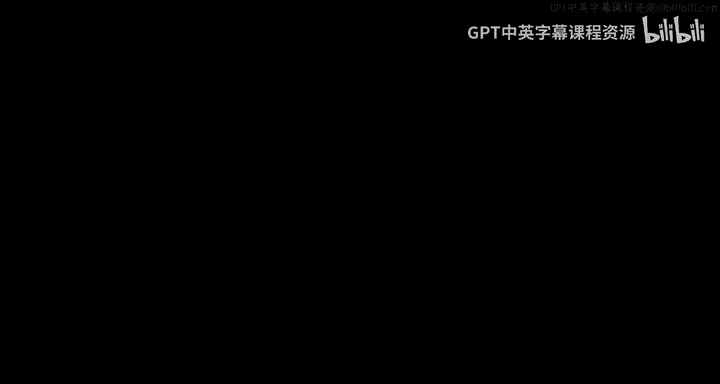
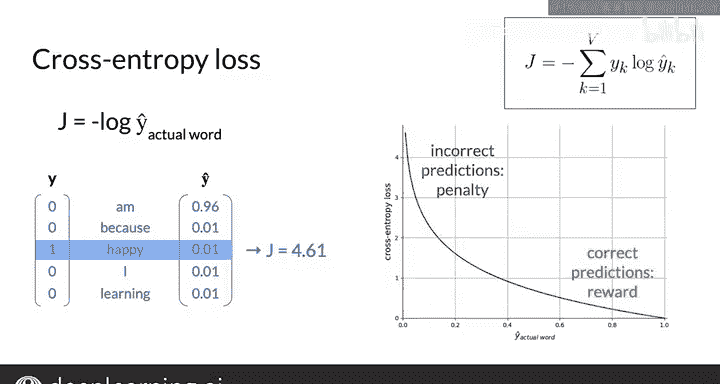

# 吴恩达《自然语言处理｜natural language processing》中英字幕 - P99：49_训练CBOW模型成本函数.zh_en - GPT中英字幕课程资源 - BV1Hc5ezDEWQ

I'll now show you the cost function for the softmax。 You'll understand why it is a cost function。

 and you'll see why you are learning it。 You basically have to predict one of the possible words in order for you to be able to predict one of these V possible words。

 You need to minimize a certain cost function In this video。

 you'll understand what cost function you are minimizing and why you' are doing that So let's take a look。

 consider a machine learning model。 a single training example made of an input and a true target and the value predicted by the model based on the input。

 T a loss function， which measures the error between the prediction and the true value for a single input training example with the continuous bag of words model for a set of input context words represented by vector X。

 for which the actual value is the vector Y that represents the actual center words。

 The prediction is the vector Y hat。 The objective of the learning process is to find the parameters that minimize the loss。

Given the training dataset set in the case of the continuous bag of words model。

 the parameters being adjusted by the learning process are the weighting matrices W1 and W2 and also the bias vectors B1 and B2 the loss function you will be using is the crossenttropy loss I won't get into the theory。

 you should just know that the crossenttropy loss function is often used with classification models。

 which often go hand in hand with a softmax output layer in neural networks。

 Just like the one you' are using in the continuous bag of words model If you've already worked with logistic regression。

 you probably already know a simple form of the crossenttropy loss function Aka log loss when there are just two classes。

 with the notation I used for the continuous bag of words model。

 the formula for cross entropy loss for a training example is J equals the negative of the sum over K from1 to v of Y K times the log of Y hat K as an。

Example， consider the input context words I am because I where the actual center word is happy。

 The corresponding vector is this vector y with a1 in the row corresponding to the word happy。

 The prediction could be this vector y hat。 as the largest value is in0 corresponding to the word happy。

 This vector would be interpreted as predicting happy as the central word。

 which is the correct prediction In this case。 So let's calculate the cross entropis。

 the log of y hat is this vector， multiplying each element by the corresponding element of y gives us this vector。

 and I'm using the circle dot to the note elementwise multiplication。 Note。

 there is only one nonze value。 which is negative 0。49。

 The sum is therefore this value and the loss is minus the sum。 So 0。49。 Now。

 what if the prediction was wrong。 say that the predicted vector was 0。960。010。010。01。

 predicting m instead of happy the log would be this vector。

 multiplying element wise by y would give us this vector。 Then the sum is negative 4。61。

 and the loss is negative one times this so positive 4。

61 So you can see that the loss is larger when the prediction is incorrect。 more generally。

 the cross entropy loss boils down to negative one times the log of the value of the prediction element corresponding to the actual central word。

 So if you plot across entropy loss as a function of the value of the prediction for the actual central word。

 you can see that if the model is predicting correctly with a y hat value closer to1。

 then the loss will be closer to 0。 This is because log of one is equal to0。 If on the other hand。

 the model is predicting incorrectly， then the y hat for the actual word will be closer to0。

 resulting in a high loss value。 The reason for this is that the limit of log。X is x approaches 0。

 is minus infinity。 So for the loss， which uses negative1 times the log as y hat approaches 0。

 the loss approaches positive infinity。 So the loss is rewarding correct predictions and penalizing incorrect predictions。

 You have computed the cross entropy loss for one training example and have seen the plot of the cross entropy loss versus the actual prediction。

In the next video， we will be looking at the forward propagation of the Xbao model。

