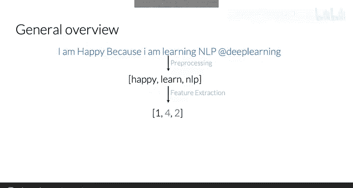
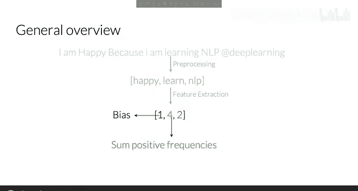
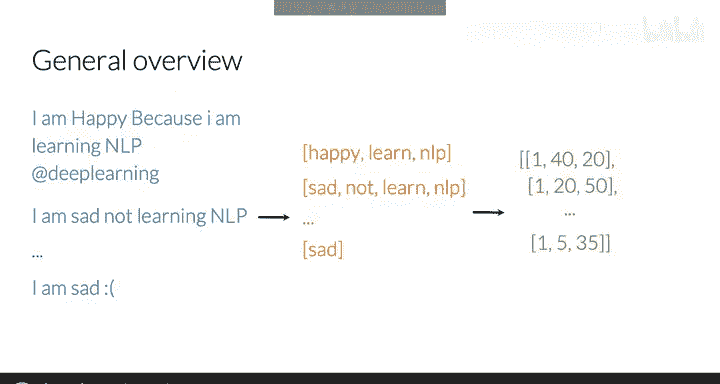
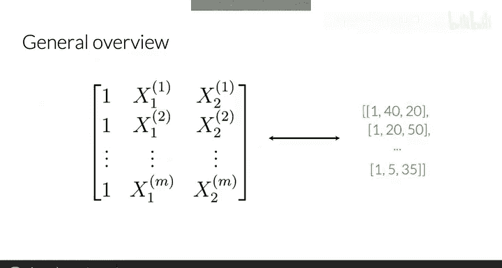
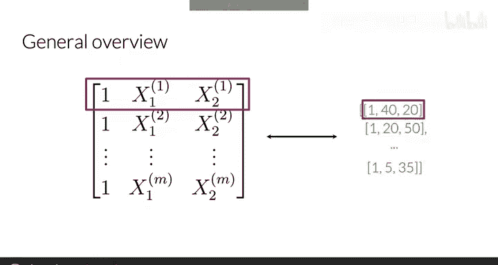
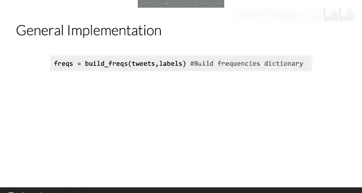
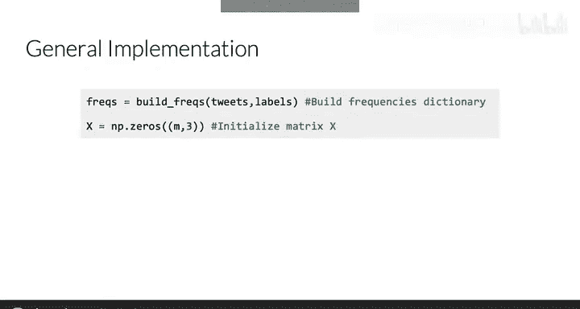
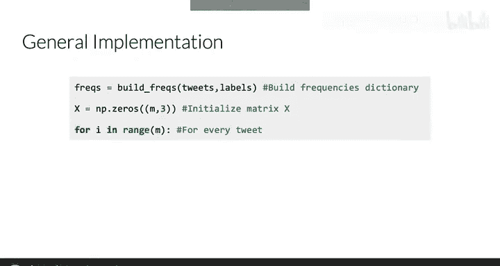
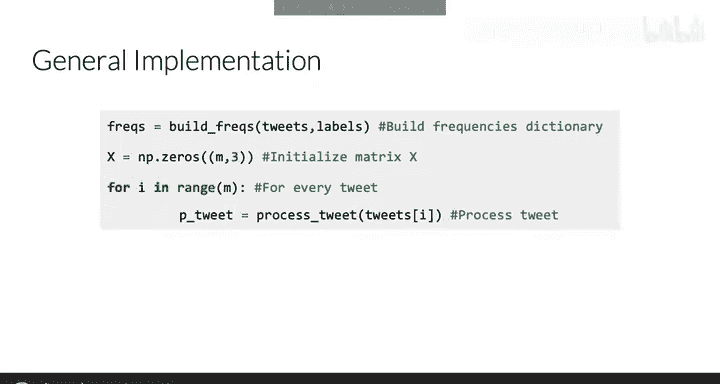
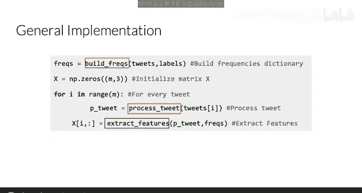

# 吴恩达《自然语言处理｜natural language processing》中英字幕 - P9：8_整合所有内容.zh_en - GPT中英字幕课程资源 - BV1Hc5ezDEWQ

You will now use everything that you learn to create a matrix that corresponds to all the features of your training example。

 specifically I will walk you through an algorithm that allows you to generate this X matrix。

 Let's take a look at how you can build it。Previously。

 you saw how to preprocess a tweet like this one to get a list of words that contain all the relevant information for the sentiment analysis task in NLP With that list of words。

 you would be able to get a nice representation using a frequency dictionary mapping and finally get a vector with a bias unit and two additional features that store the sum of the number of times that every word on your process tweets appear in positive tweets and the sum of the number of times they appear in negative ones。

😊。

In practice， you would have to perform this process on a set of M tweets。

 So given a set of multiple raw tweets， you would have to preproces them one by one to get a set of lists of words。

 one for each of your tweets。And finally， you'd be able to extract features using a frequencys dictionary mapping。

😊。

At the end， you'd have a matrix X with M rows and three columns where every row would contain the features for each one of your tweets。

The general implementation of this process is rather easy。 First， you build a frequencies dictionary。

Then initialize the matrix X to match your number of tweets。

After that， you'll want to go over through your sets of tweets carefully。😊。

Deleting stop wordss， stemming， deleting URLs and handles， and lower casing。

And finally， extract the features by summing up the positive and negative frequencies of the tweet。😊。

For this week's assignment， you've been provided some helper functions。

 build freaks and processed suites。However， you'll have to implement the function to extract the features of a single tweet。

 That was a lot of code。 but at least now you have your X matrix。 and in the next video。

 we will show you how you can feed in that X matrix into your logistic regression classifier。

 Let's take a look at how you can do that。😊。

