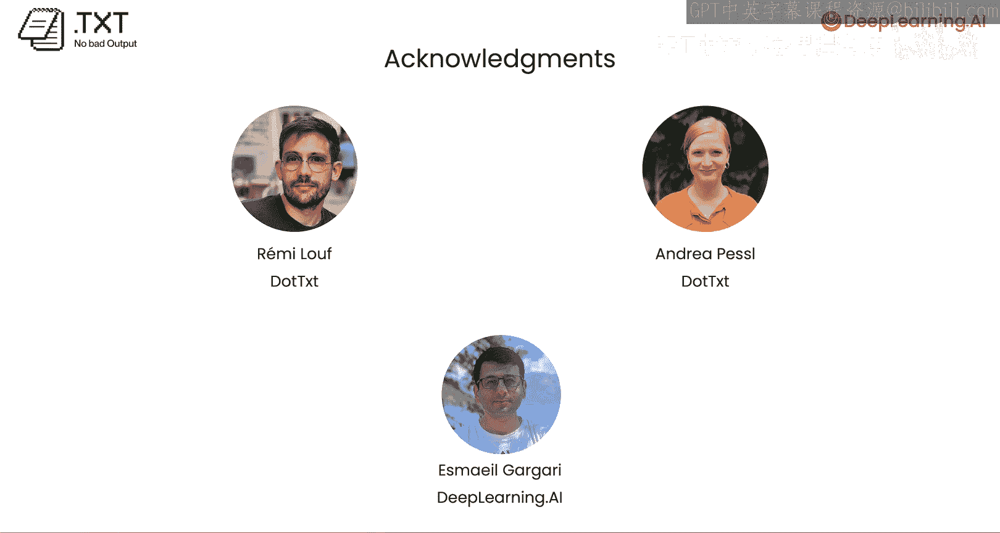

# 吴恩达《获取大语言模型格式化输出｜Getting Structured LLM Output》中英字幕（Claude-3.7 - P1：1.intro.zh_en - GPT中英字幕课程资源 - BV1EFZUYnE6m

Welcome to Getting structured ElM output built in partnership with dot text。

 When working of Oms in a typical chat interface， unstructured text output is fine。

 But if you're building software， it becomes much harder to pause and rely on freeform text output。

 That's where structured outputs such as JSO become very important。

 they provide a clear format that the machine can read and process。 For example。

 if you want your OEMM to look at the proudly review and generate a couple of fields。

 say the product name and whether the sentiment is positive or negative。

 then output in those two fields in JSson lets downstream software read and process these fields for library。

😊，In this course， you learn how to obtain structured outputs using several approaches。

 The basic idea is you can tell an LM that you like the data in a particular format and you provide the format clearly specifically using what computer scientists call a rex or regular expression。

 then there'll be an efficient way to get an Elm to reliably generate output in that format because Reex can be used and force constraints on the next token to be generated one token at a time。

 I'm delighted to introduce the instructors workert and Karen PFA Well is a founding engineer at dottex and Cameron is a developer relations engineer and they help developers like you build and integrate reliable structure formats into their LM maps thanks Andrew。

😊，In this course， you will first get structured output from models that support structured responses you also learn about the limitations of this approach to address some of these limitations well use instructor an open source library that reprots the model until a valid Json structure is produced。

 You will also learn how constrained decoding works。 This is the underlying concept behind outlines。

 our open source library that you will use in this course。

 while learning all the concepts in this course， you'll work on several cool examples and use cases。

 including a social media analysis agent。 The agent reads user posts identifies the sentiment and decides whether or not a response is needed。

 It can even generate a customer support ticket if there's an issue。 All as a Json output。

 After working with retrybased methods， you'll learn how you can get the structured output from the get go with outlines。

 a library that constrains model outputs at the token level。 by intercepting the logits。

 the probabilities the model assigns to the next token。

 outlines blocks any tokens that don't fit your defined schema or format。😊。

This guarantees a valid output without any dueovers。 In the last lesson。

 you will learn how you can generate beyond normal Json。 For example。

 you will learn how to generate valid phone numbers， email addresses， or even ASI Titac to boards。

 And basically， any format you can express in a reex。 Many people have worked to create the course。

 I like to thank Remi Louf and Andre Pesso from dot text from deep learning AI Eb Gagari has also contributed to this course。

 The first lesson will be an introduction to structured output generation。 That sounds great。

 Let's go on to the next video and let's get structured。😊。

