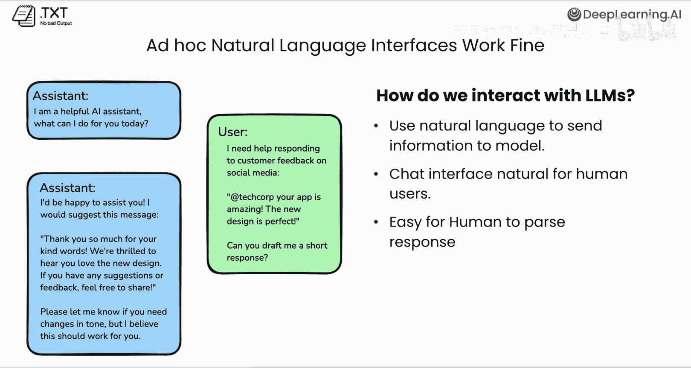
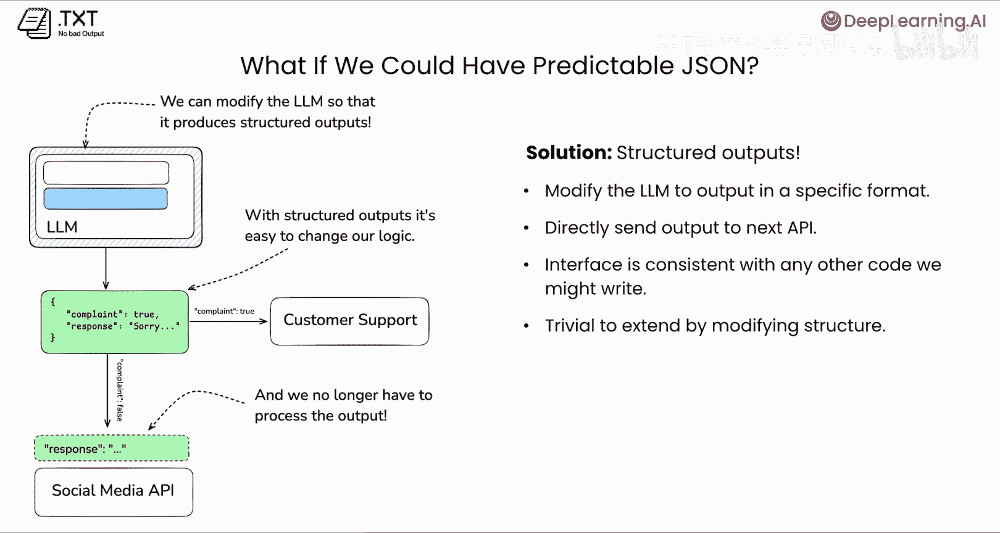
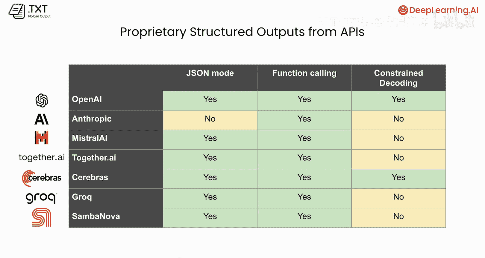
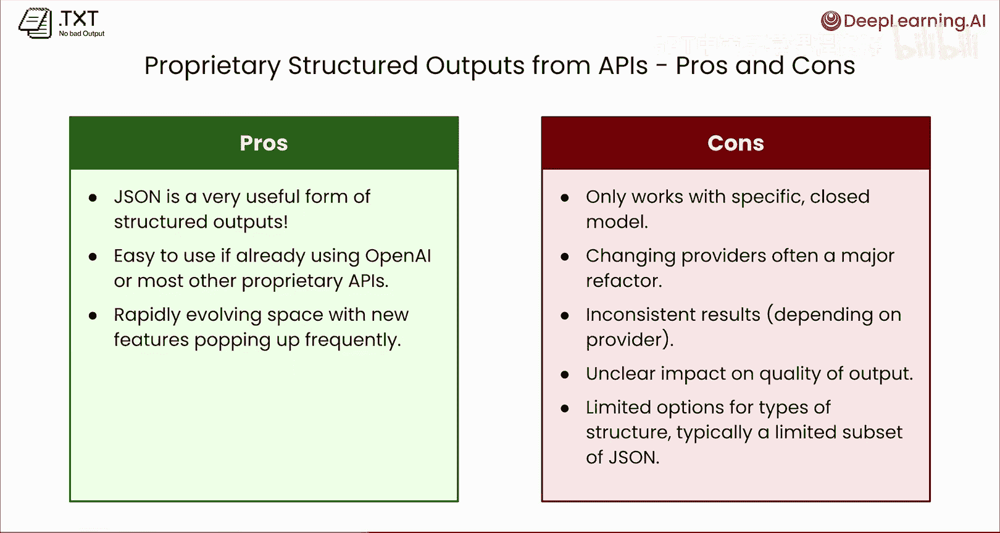
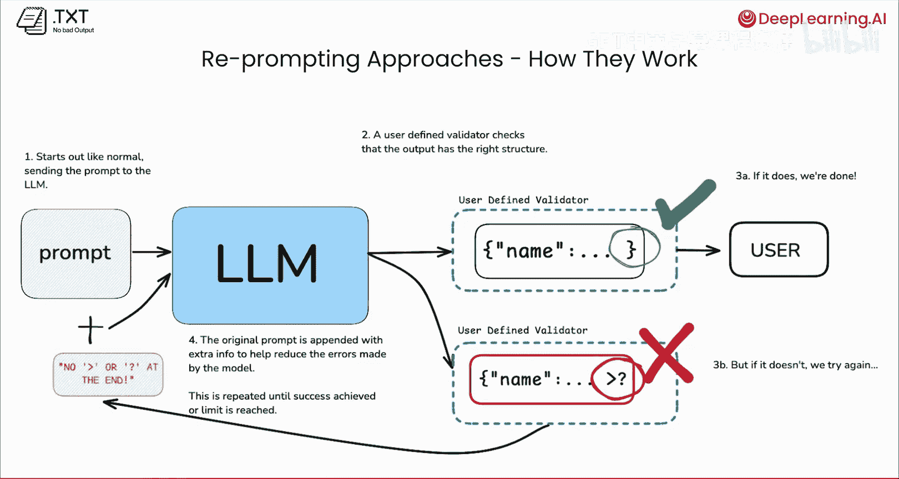
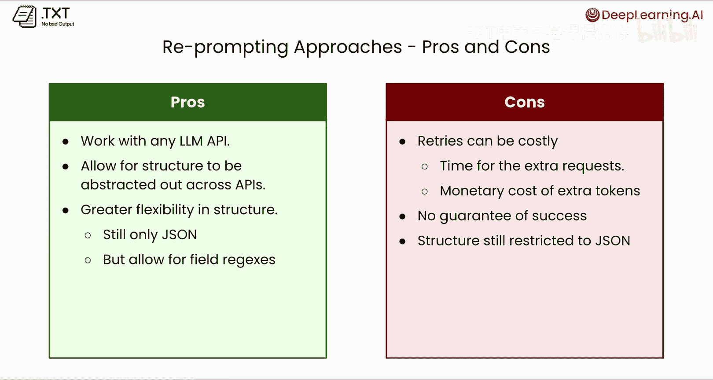
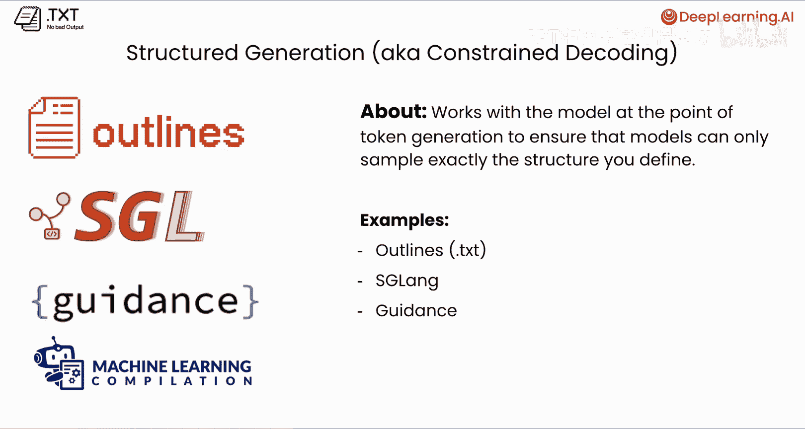
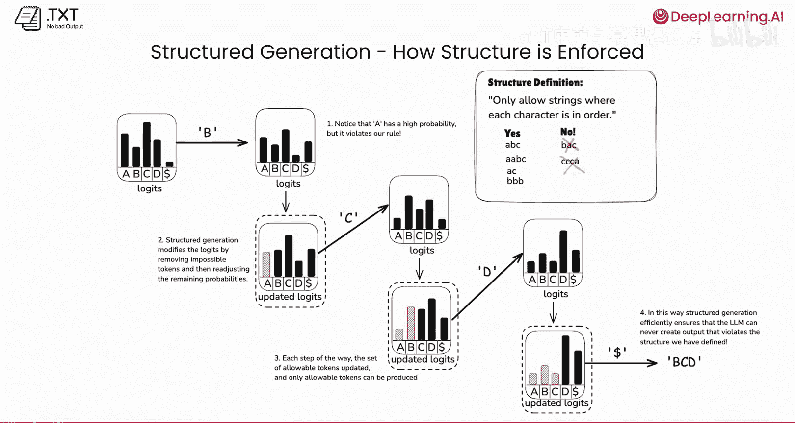
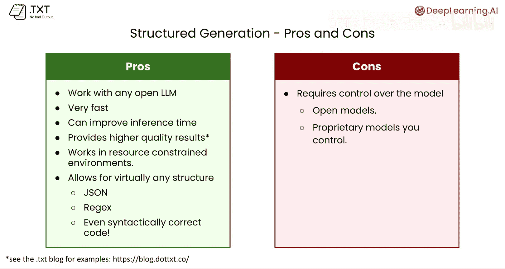
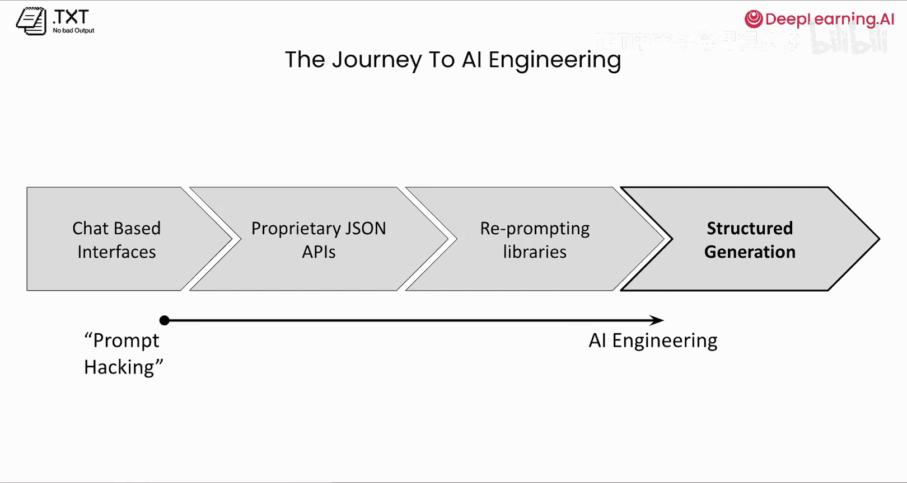

# 吴恩达《获取大语言模型格式化输出｜Getting Structured LLM Output》中英字幕（Claude-3.7 - P2：2.introduction-to-structured-output-generation.zh_en - GPT中英字幕课程资源 - BV1EFZUYnE6m

In this lesson， look at an overview of structured outputs。

 why they are important and the different approaches to generating them。

 You'll see how structured outputs allow for scalable software development with LLMs。

 You'll learn how the various approaches to structured outputs will lead you from prompt hacking to true AI engineering。

 Let's dive in。 I' start by saying what we mean when we say structured outputs。

 When we work on an LLM， typically the output of the LLM is in some sort of free form text。

 There's no particular structure to that。 It's just text。

 Strd outputs just mean we have some structure that is adhered to by the model In this case， Json。

 Json's very common form of structured output， but there are many others。

 An obvious first question when working in structured outputs is why do we need to use these in the first place。

 If you've been using LLms for a long time， you're probably very familiar with the common chat interface In this format。

 the model interacts with us as though it's a human being talking to us。

 typicallyy an assistant has a prompt。 We follow up with a question we have In this case。

 I'm asking it to provide a response to a social media。😊。

ss I got and the model falls up with an answer as human beings。

 it's very easy to parse these responses， understand what the model is telling us and use that information。

 Let's take a look at this in a programming environment。

 when working with LOms in code we use a very similar interface called the instruct interface。

 This mirrors the chat interface but it's slightly different so we're actually sending in request to the model and getting a response。

 This is the same content we had in the last slide but it's just in a different format and once again we get the response from the model so this allows us to work with the model and code but we still need to work with the response from the model how are we gonna parse out this information that the model has sent back to us as human beings it's very easy to do this but we need to be able to do this programmatically let's talk a little bit about building systems with LOm so we can better understand the need for structured outputs and how they help us build scalable software Let's build an LOm powered social media agent This agent is going to take responses we've gotten on social media and write its own response to them to automate this process。

Of handling our social media accounts。 we have a very simple application here。

 We have an LLm with the prompt。 We're going to append to it the messages from our users。

 and we're going to get the response as the LLm pass that into our social media API and then it will post the response on our social media。

 But the question is how are we going to handle this raw data。 As we mentioned earlier。

 we need some way to actually pull this data out。 a naive solution to this problem is to actually just add a layer that parses this。

 This is a very common first pass and handling this problem when working with LLms we'll just write some simple rules that will allow us to parse out the answer。

 Unfortunately， this is extremely time consuming。 if you've ever handwritten a parser like this。

 you'll know that it takes a long time to write this。

 And that's partly because the process is very error prone。

 It's very easy to miss things or make mistakes or find those outputs you weren't expecting。

 and this can be very tricky to get right。 And because of this。

 it's not easily extendable to see this， let's look at a different version of our agent。

 So suppose we have a PM that comes in and requests that we modify our social media agent。

 They want it so that if。Response from a user is a complaint。

 We are going to send that complaint to customer support。

 We don't want our model automatically replying to people that are having a problem。

 We want to use a human being to make sure we like the response。

 but for all other comments or messages to us， we can go ahead and have our agent respond to them。

 This requires a simple forking of our process。 This seems easy to implement but using our technique from before。

 we find it it's actually quite messy。 Now we need to parse out both the is it or is it not a complaint as well as our original parsing out of the response itself if we need it。

 Clearly， this is not a scalable solution to writing software with LLms but what if we could have predictable JSO in the output。

 In this case， it's very simple to implement this we have a complaint field and a response field。

 if the complaint field is true， which we can check just like we check any other JSson。

 we can send to customer support。 If it's not a complaint。

 we can go ahead and pass the response to our social media API and it's easy for the API to extract this using JSO。

 The next question is how do we get structured outputs。

The easiest way to get started with structured outputs is working with the proprietary APIs you probably already use。

 and every infant provider offers a different solution to how they provide structured outputs。

 We're going to talk about those a little bit。

One method of doing this is called logicbased message or constrained decoding。

 This is when the model itself is modified to only allow tokens to be generated that meet the requirements of the structure。

 We're going to talk more about this at the end of the lesson。

 another common practice is called function calling or tool use。 when doing function calling。

 the model is provided with a list of functions that it can call or respond with that are usually done in Json format。

 There is also something called Json mode， where a model is simply fine tuned to return Json when prompted to do so。

 And， of course， there always may be some magic we don't understand。

 This is actually part of the problem with proprietary Apis。

 because we don't have access to what they're doing behind the scenes all the time。

 So let's talk about the pros and cons of working with proprietary structured outputs from Apis。

 The pros are we are working with Json， which is great。

 We were working with unstructured text before， and we have Json Now。

 that is a huge leap forward as far as creating reliable systems with Lms。

 These techniques are also easy to use if you're already using one of these major providers。

 If you're already using open AI for your。😊，Application it's not a lot of extra work or code to add support for structure。

 Another benefit is these providers are always working on new techniques and improve the quality of these outputs。

 Getting Json from OpenaiI has already improved tremendously in the last year。

 There are some drawbacks as these approaches。 The major one is your code is now tied to a very specific model provider。

 This means that changing providers can be a major refactor if your codes written to work with openaiI and you want to try experimenting with instructor。

 you may have to write a significant amount of your structured code again。

 Another issue is inconsistent results。 This depends on the provider， of course。

 but some providers do not consistently to return the structure you are expecting。

 which can be a major problem if you're trying to build scalable systems。

 Another issue is the unclear impact on the quality of the output。

 for many evaluations there are some people that have found that working with structured outputs from certain providers sometimes hurts the performance on these evaluations。

 This is not universal and is not necessarily proven。

 but this is something people have suspected and can be an issue。 Additionally， there are。

Limited options for the types of structure that you can use。 Typically。

 you're only working with a subset of proper Json。 You can get names and fields。

 but you cant get detailed regular expressions around your field。

 such as making sure a date matches a certain format。

 One solution to these problems is to use what we called reprompting libraries。

 proprietary models only work with a specific API， but reprompting libraries are designed to work with any major LLM provider。

 Ex of these type of tools are instructor and L chain。 Repromping is very interesting。

 The way it works is we start with a regular pass with the LLM。

 We provide a prompt and the LM provides an output。 Additionally。

 we provide the model with a validator。 This is just a description of how we expect a Json to look。

 If the output of the model conforms to our validator。 The data sent straight to us。 This is great。

 But whatever it is a problem in the output。 In this case。

 we see there's an angle bracket being generated where we expect a curly bracket。

 This is not valid output。 The repromping library， we will automatically take that information about why this failed to parse a。

😊。

To the prompt and try again。 There are many upsides of this approach。

 One is that now you can work with any L API。 That's a huge step forward in making great software that can be reused。

 This allows for that structure you wrote code for to be used across As。

 oftentimes switching providers all requires us changing the key and the name of the provider。

 We also get greater flexibility in our structure than we do with most proprietary providers。

 So it's still only Json， but we're allowed to use redxexs for the field so we can enforce constraints like a specific date format or making sure that the user's email address is a valid email address。

 There are some drawbacks to this approach as well。

 The biggest one is that retriries can be quite costly both in terms of money and time for many developers of LLM applications。

 time is a bigger consideration because you're making your users wait for results。

 Following from this， there is not even a guarantee of success。

 If after a certain number of retriries， the library is not succeeded， it will simply fail。

 And once again， while we do have more control over our structure。

 we still only have Json as a viable output structure。😊。

Also known as constrained decoding is a method for working directly with the model to get the output we want。

 We use the term structured generation because we are actually controlling the generation of the tokens to get our structured output in the end。

 There are many libraries to support this， including outlines by dot text。

 S G Lang Microsoft's guidance and X grammar。 to understand how these work。

 Let's refresh a little bit on how LMs generate tokens。 We start with the prompt。

 which is transformed into a bunch of tokens that are passed into the LLM to be processed all at once。

 The LLM then transforms those tokens into a distribution of what the next token is going to be。

 These weights called Logis， describe how likely each given token is。

 A token is then sampled from these weights。 and app to the prompt。

 Then tokens are continued to be sampled until we reach the end of the statement。 token。

 This is how structured generation works behind the scenes。

 supposeuppose we want to define our structure as only allow strings where each character is in order。

 We'll talk a bit later on in the course about how we actually do that。 But for now， just。😊。

But this is the constraint we have validid strings under this structure would be ABC， A， A，BC。

 A and BBB， In all of those cases， each letter is in order。 Inval examples would be B A or CC A。

 Both of those have characters that are out of order and therefore don't follow the rules of our structure。

 So let's walk through how this actually works。 Look at this distribution of logits here。

 for our first character。 We actually have no constraints because any character can be a valid first character。

 Let's assume we sample B。 Now we have new logs that are generated as B is append to our prompt and the processes rerun。

 but these logicits do not work for our constraints。

 because there's a certain amount of probability assigned to A。

 A is not valid according to the rules of our structure。 And this is how structure generation works。

 It actually modifies those logicits， removing the ones that are invalid and reweighting the ones that are allowed。

 We an another token， A C， and once again have new logits and have the same problem once again。

 A and B now are not valid next tokens in the sequence。So once again。

 structure generation simply removes those from the possibilities of what can be sampled。

 renormalizes the probabilities。 and we continue this process until we finally generate a string that is guaranteed to adhere to the rules of our structure。

 Let's talk about the pros and cons of structure generation。

 There are many virtues of this technique。 It works with any open LLM out there。

 So if you use models from hugging face。 Any of those models。

 including models like vision models will work with structured generation。

 because we are working directly with the model， it is extremely fast。

 The cost during inference is basically zero。 In fact。

 there is research that it can even be used to improve inference time by taking advantage of structure that is inherent and tokens that can be skipped。

 It provides higher quality results。 You can check on our blog for more details。

 but over and over again， when we run evaluations head to head between structured generation and nonstructured generation。

 we have found structure generation improved benchmark performances。

 This also works very well in resource constrained environments。

 because it's very lightweight and very efficient even。😊。

On very small devices that have tiny LLMs， you can still use structure generation to guarantee the outputs of your model。

 and we can produce a huge range of structure。 of course， Json。

 but also regular expressions or even syntactically correct code。

 There is a drawback to working with structure generation。

 and because we are using the logicits directly。 It means you need to have control over those logicits。

 So that means either youre working with open models。

 or you yourself are hosting proprietary model and you control the logicits。

 Another way to view the things we've discussed is this is a journey from prompt hacking to AI engineering。

 when we're working with just chatbased interfaces， were really doing the epitome of prompt hacking。

 where changing the messages we send to the LLM。 we're interpreting the results。

 and we keep iterating on this process until we're happy with the output。 but this is not scalable。

 This is not even repeatable。 So we're very far from real software at this point。

 moving to proprietary Json Abis opens up a whole new world of possibility for us。

 We can now start writing real software。 we're getting predictable responses from our model。

Allow us to integrate code using an LLM into other parts of our software， but there is a hangup。

 Most of our code for doing this is tied to a single provider。

 Repromping libraries solves this by making it possible for us to create reusable software libraries that can use a variety of different LLM providers。

 This is a huge step forward in creating scalable software that works with LLms。 However。

 theres still a big gap between our code and the model itself。

 We're relying on this clever but limited repromping trick to get the results we need。

 And that's where structured generation is really arriving a true AI engineering。

 We're working directly with the model to get exactly the results we want。

 We can write code that is easy to understand。 easy to scale and easy to improve。 So in this lesson。

 we covered the basics of what structured outputs are。

 We learned why they're useful and how they allow us to write scalable software。

 We also learned about the different varieties of structured outputs there are。

 including vendor provided Apis repromping。😊，Libraries and structure generation Lastly。

 we saw how all this comes together to make it possible to create truly amazing software using LLMs In the next lesson。

 you'll see how this all works by building a social media agent using open AI's Strd outputs API Stay tuned and see you the next lesson。

