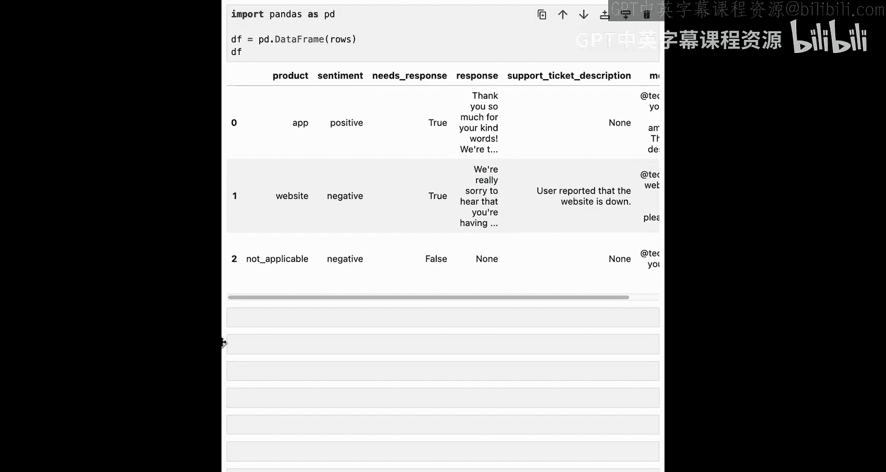

# 吴恩达《获取大语言模型格式化输出｜Getting Structured LLM Output》中英字幕（Claude-3.7 - P3：3.how-to-use-structured-outputs.zh_en - GPT中英字幕课程资源 - BV1EFZUYnE6m

In this lesson， you'll build a simple social media management agent using Open AI structured output API。

 You'll also learn the basics of specifying your desired output structure using pedantic。 All right。

 let's delve M Strd output often uses what is called a Json schema to enforce output structure。

 Json schemas or standards that describe the shape of a JsonN message。

 So these schemas provide the type information that is required for structured output as an example。

 here's a JSsonN message with Dolly Parton's name， age and email address。 As we can see here。

 we have keys on the left， such as name， age and email followed by their values On the right Dolly Parton age 79 and Dollyott com。

Let's take a look at an example of a JSON schema that describes a person like Dolly Parton here we can see this is also JSsonN It includes all of our keys such as name。

 age and email， as well as the types of those keys such as title equals name and type equals string Let's talk a little bit about pedantic maintaining JSON schemas by hand is difficult and prone to error As you saw they're pretty complicated and for anything that's nontrivial they can be an enormous pain to work with So AI engineers often use pedantic to describe model output structure pedantic is an open source data validation library where you can flexibly define data structures for use in your application It's also feature rich you should go check out all the things that it supports in the documentation we won't be able to cover all of the tools that it has available using pedantic makes language model outputs programmable as we'll see in just a second So here is how you would write a user class inside of pant。

Inheriting from base model is all you need to make a user a pedantic class。 Next。

 you're going to use type annotations to define the structure that your model should generate。

 For example， name can be any string like Dolly Parton age can be any integer like 79 and email can be either nothing or a string Note however that Open AI does not allow you to enforce the formatting of email i。

e。 always in the form of test att co outlines instructor and a few other tools do So let's build a social media customer support agent we have a lot of users who like to tweet at us saying at techcorp。

 your app is amazing。 the new design is perfect and then we're going to put this inside of our customer support agent and then we're going to output some structured data telling us what product it's about what the sentiment it is from the user whether or not we should respond and a support ticket if anything happens to be broken so let's go to the code。

We're going to start with a little bit of housekeeping here。

 So these two lines just filter out some warnings that we may not want to see while we're learning。

 And here's how you load the open AI API key that we're going to use These three lines go and set up your open AI API key that deep learning AI has configured。

 Here's how you initialize the openaiI client using the openaiI key。

 So let's see an example of how we define structure with pedantic。

 We'll start by pasting in this user class that we added from the slides。

 So let's generate a user objectject using openaiI here。

 we're going to use the client that we defined。 Then we're going to call do beta do chat completions do parse。

 we're going to select our model here we're going to use G40 mini。

 Then we're going provide some messages here。 the first message is the system prompt。

 which says you're helpful assistant。 and then we're going to pass the user prompt that you might type into chat G。

 Then we're just going to say make up user。 Then in response format。

ify the user class we just made when we run this that'll take a second and then open AI will provide us a user。

 Let's look at this user by taking it out of our completion object。

 normally openaiI returns a list of choices when you request multiple values。

 but here we've only requested one completion。 Then we're going to extract the message and then the parsed object inside of parst。

 we run this we see we got a user named John Doe age 30 with an email John Doe example co Let's build our social media management agent。

 Anytime you're working with structured output。 you typically defined the structure that you want to see before you start working with the rest of your code In this case。

 we've added a mention which is a pedantic class that has product and sentiment and you'll see here that these are literals which means that the language model has to choose between app website or not applicable。

 same thing with sentiment has to be positive negative or neutral。 Next。

 the model can choose to respond to the user。It is allowed to choose true or false。

 whether or not the company needs to respond and then it has a response which is an optional string so that can be either a string or nothing。

 This is the response that we would provide to the user Lastly if the model determines that a support ticket needs to be open the model can write a description for the developers and this may also be either nothing or string Now let's give ourselves some example data I'm going to call this the mentions list and it includes a few examples so we have a positive review of our app they like the design next there's a user letting us know that the website is down and that we need to fix it and then lastly we have at techcorp you're so evil which we probably don't want to respond to so we might wish to generally address concerns about our evilness so here's how you add an analyze mention function This is how we take the user messages that they sent to us and then we construct this mention object that。

Just designed so here we're going to define a function called analyze mention。

 we're going to provide the post that the user sent to us and then an optional keyword argument for the personality。

 which we'll talk about in just a second by default this is friendly as before we're going to use beta do chat completions parse select our model and provide a few messages in this case we provided the system prompt。

 which says what we expect from the model we want the model to provide the product mention the mention sentiment whether or not to respond we we let the model know that it should not respond to inform messages or bait and we asked to for a customized message to send to the user Lastly we ask the model to provide an optional support ticket description to upload to our ticket management system then finally we let the model know what its personality is and then inside of the user prompt we just add the mention Lastly。

 we request a mention object then we're just going return the parsed object at the end。

So let's go ahead and use this analyze mention function We're going to use the first mention which if you remember was the positive review about our app。

 We're going to pass that to our analyze mention function and put it in process mention when we run this we'll see hey Tcorp your app is so amazing and then we see the models provided us with product app so it's identified that it's about the app as well as positive sentiment。

 the model has flag that there needs to be a response and then it includes a response that we can choose to send back to the user we're thrilled to hear that you love the new design and then lastly there's no support ticket because there's no obvious issues to address with our software if you would like to adjust the personality of this model。

 you can simply change the personality I've changed the personality here to be rude in which case the model says thanks for the praise we're glad you love the new design but don't get too comfy we' constantly improving which could be ruder try playing around with the different personalityities and for those who are curious the underlying content that was generated by the model。

JSO so when we print these out using pedantics model dump JSON method。

 we can see what was generated by the language model before it was parsed into the pedantic object that we have this case we can see the raw text。

Here's an example of something you can play with on your own In this example。

 you're going to create a user post which has just a message inside of it。

 and then you're going ask a language model to act as if it was a person and then provide tweets to techcort。

 We describe roughly what's going on there and then we can see the output。

 hey just wanted to shout out to techcort for their amazing app。

 Now we can provide that output from the user and put it back into our analyzemention function。

 when we see this， we're going to get app positive sentiment， thanks so much for your kind words。

 and of course， the language model just seems to like saying thanks so much for your kind words。

So try adjusting this user post class in this example， I've added a user post with extras class。

 which' is also a pistic class that includes a couple of extra fields such as user mood which has to be between awful。

 bad and evil product also has to be app website not applicable as in the mention class and then we can also include a internal monologue which includes a list of strings Now when we run this we'll get user post with extras user Mo is awful sentiment is negative。

 can't believe how buggy the app is etc and then the user just says it's very frustrated was the latest version of your app and then of course we can pass this back into our social media analyzer and see what it says and as we can see here。

 the social media analysis bo detects that it's about the app that the sentiment is negative provides an example response that hopefully placates the user and then as a support ticket where we note that the user has reported constant crashes with the latest version of the app。

purposeurpose of structured output is to turn language model responses into programmable data。

 So here's an example of a way that we can program with our language model outputs here we're going to construct a list to contain all of the rows that we generate we're going to iterate across the mentions that our users have provided we're going analyze those mention by creating these mention objects if there's a response that is needed。

 we can print out that we're responding to that user message using the standard attributes from any python class such as processed mentioned sentiment if there's a support ticket we can print that out as well。

 let's take a look at how we program with our mentions here we're going to iterate through each of the mentions that we have available we're going to call the LLm to get a mention object that we can program with right here then we're going print out some information about that process mention that's in the helper file if you want to take a look we're going to convert our processed data to a dictionary using pyedantic tools in this case。

 the model dump method next we're going to store this original message。

Data frame row so we'll basically just be adding it to this processed died object then we're going to add that dictionary to our list of rows and then print out a blank row so that we can read everything that gets printed out so let's run this and see what the result looks like as we go through we can see the model responding to positive app feedback the negative website feedback it'll describe its responses and add support tickets if relevant such as right here the user has reported our website is down and then of course the user who is specified hey at Techcorp you're so evil we've chosen not to respond to it。

And lastly， the advantage of working with structured output is that you know that it follows an exact format。

 which means that you can put it into various other data formats such as a data frame。

 so in here we're going to import pandas and construct a data frame using the dictionaries here we can see that it's extremely simple we have the product。

 the website， the sentiment， whether it needs a response。

 the original mention and whatever other features we might wish to add in the future in this example。

 you've learned how to define a model's output structure using pedantic。

 how to use openAI's structured output API and basic programming with language model outputs Next。

 you're going to use instructor to get structured output from various other inference providers。

