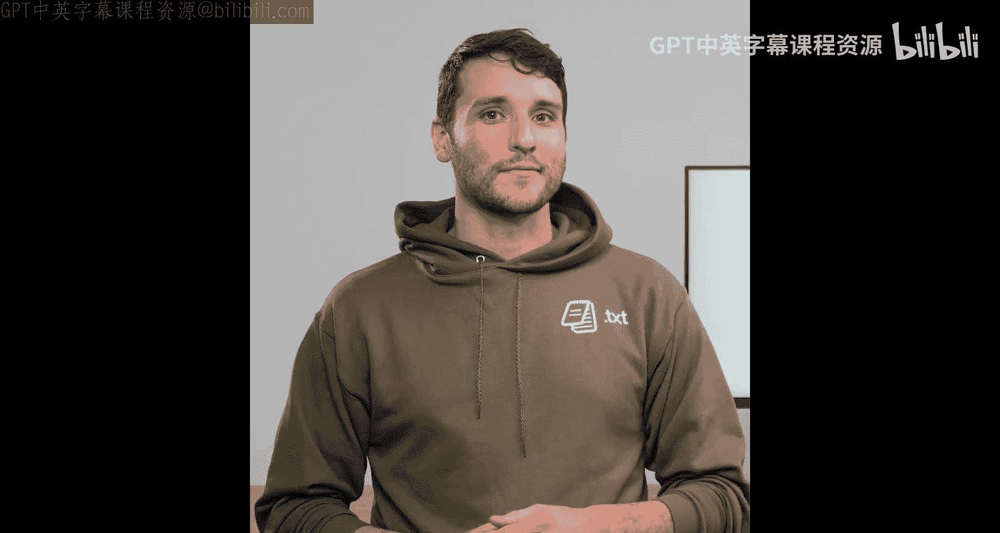
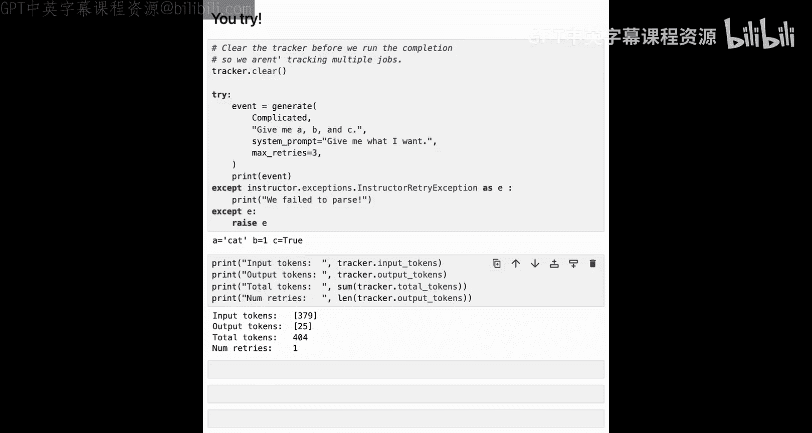

# 吴恩达《获取大语言模型格式化输出｜Getting Structured LLM Output》中英字幕（Claude-3.7 - P4：4.retry-based-structured-output.zh_en - GPT中英字幕课程资源 - BV1EFZUYnE6m

In this lesson， you learn how to use the open source library instructor to generate structured output from model providers that don't support formal structured output。

All right， let's dive into the code。 Let's talk about instructor。

 Instruct is an open source reprompting base structured output library。

 If model output doesn't match the format we requested， we try again here。

 we can see our prompt goes into our language model。 We get some form of output。

 then we check whether or not its valid syntax。 If it is， we return it to the user If not。

 we provide the output in the error back to the language model and try to get output again。

 until we get valid output。 Let's talk about some pros and cons of instructor。

 Instruct is simple to use。 It has a wide range of provider support like anthropic openaiI together do AI fireworks do AI。

 etc ceter。 it has consistent Apis across providers so you can avoid vendor lock in。

 and it supports everything that pyedantic does on the downside。

 instructor can't fully enforce structure。 So parsing failures will occur。

 retries can unexpectedly increase costs in both money and time。

 Every time there's a parsing failure。 you have to。

Send the entire prompt back to the model Instruct is not easily transparent in repromping and or retries used。

 You have to kind of hack into the internals a little bit to try and understand what's going on and instructor only works with instruction tuneed models with function calling or tool use or JSO mode。

 other approaches like outlines can use any model whether or not their instructor tuneed。

 So in this lab， we're going to demonstrate some simple use of instructor to get structured output from together do AI。

 which doesn't support formal structure generation。

 Then we're going to highlight some limitations of instructors。

 So you can kind of make some analysis as to whether it makes sense in your application。

 So let's go to the code。Let's start by getting our together API key as long as you're on the deep learning AI platform。

 this key will be available to you if you're working on your own platform。

 you'll need to use your own API key。 here's how you connect to the Together AI server we're going import instructor and then open AI you'll note that we're importing open AI rather than some other together AI A and the reason for this is that most inference providers use the open AI standard for language model inference and what that means is you can use the openaiI SDK by just changing the base URL to pointing to whatever your language model provider is So when you run this you'll pull in your together client to generate unstructured text from together you can use the standard openaiI tools chat completions do create then you provide any model that together AI serves In this case we're going to use Lama 3。

1 the 8 billion parameter model and the instruction。If you see instruct in a model name。

 note that it has nothing to do with instructor Instruct inside of a model name just means that the model has been instruction tuned to have chatbot like functionality like Claude or chat GBT Next。

 we're going to provide a user prompt and we're just going say then when we run this we'll see that the language model says back atcha。

 how's your day going so far I would say pretty good robot。To use together。

 all you have to do is wrap whatever your client is in one of instructors do from methods。

 So for example， here we're using instructor。 from Open AI。

 and then we're passing it art together client this will create a new client called instructor client which will use instructor tools to get structured output。

To try out instructor， what's define a really simple structure。 In this case。

 we're going to define greeting here， which just has a field hello， which is a string to use this。

 we simply call instructor client chat completions do create as before we're going to pass the same model name and the same messages。

 So nothing's changed from the unstructured version。

 The only thing that we're adding is response model equals greeting。

 That's the class that we expect to receive。 If you're using openaiI structured output。

 you'll note that they use response format is the keyword argument rather than instructor's response model。

 So make sure you pay attention to that。 when we run this we'll see that we get greeting with s inside of the hello field。

 let's write a simple calendar event extractor to test instructor out。

 So here what we want to do is provide a rough description of event to the model and then get back some kind of structured output containing the name of the event the date that the event is concurring a list of participants where the event is occurring as well as some additional。

😊，Addss information like state code and zip code。 You'll note here that name can be any string inside of calendar event。

 we have a date field with a date type， which comes from the Python standard library。

 Open AI doesn't support the use of specialized types like this。

 Open AI would require that you have a string here。

 In is much more general than open AI And so you can use far more of pedantics typing support than Open eye supports。

 So if you ended up using Open eye structured output tooling。

 you will get an error if you try to use date， at least for the moment next。

 we have a list of participants。 and this is a list of person and we have class person here with only a name field。

 you'll note here that there's only a name field。 So why don't we just make this a list of strings。

 Well， the reason for that is that if you have a person class。

 you can easily extend it later with additional information and like email address as needed。

 Just following kind of good software engineering practices。 then we have address number。Street name。

 city name， nothing complicated there。 And then the remaining two have a few interesting points we need to address。

 you'll note here that these are equals field。 This is a tool inside of pedantic。

 You can specify a regular expression that defines the values that state code may take。 In this case。

 we're requiring that state code be only exactly to capital letters such as or for Oregon NY for New York These are all US state codes。

 This regular expression here requires that anything inside of zip code must have five digits。

 You'll learn a little bit more about regular expressions at the end of the course。

 Then let's write an example event description。 So Alice and Bob are going to science fair on Friday。

 Science fair is hosted at the gymnasium of the Hzeldale Elary school which is my elementary school growing up。

 Next， let's write a function called generate and generate is going to accept the format that we want to return the user prompt and then the system prompt。

😊，If you' would like to change it， it will also provide a default model with a billion parameter model。

 but you can change this to use the 70 billion parameter model if you like。

 we can also set max retriries to three， but we'll talk about that in just a second All this function does is it makes it a little more convenient to call the instructor client。

Now， let's actually generate a calendar event here we specify a system prompt。

 We say make a calendar event， respond in JSON with the event name。

 date list of participants in the address。 know here that I've kind of roughly communicated the structure that the model expected to return you don't have to tell it exactly what it's supposed to return the exact like provide an example of JSON but it can help usually anytime you're requesting structured output。

 make sure you kind of communicate what the models is expected to return。s generally best practice。

 then we'll provide a user prompt which is just event description plus whatever event description you wrote and then we're gonna to call our generate function here to get an event Now let's take a look at the event that we got back。

 we can see here we got calendar event name science fair， we got dates。

 participants with a list of people the address number， the street name， the city name。

 state code and the zip code you'll notice here the zip code is 970。

05 even though we didn't actually specify it inside of the prompt This is an example of。

How you can elicit additional information from your model by providing structure the model was actually able to guess the zip code within a rough distance the correct zip code here is 97005 if you change the model to use the 70 billion parameter model this should probably get the exact right zip code of 97007 even though it's not provided in the prompt why don't you play around with this a little bit by going to change the event description see what else you can get the model to print out。

Let's talk about retriries。 In can use more tokens than other forms of structured output。

 So when an output fails to validate， instructor will provide feedback to the model。

 request new output until the response pares correctly。

 Instruct doesn't make it super easy to track the number of retries and the number of tokens used across retriries。

 So I've provided some utility functions here to track retries and token usage。

 Let's extract the same calendar event to see how many attempts it took and we're going to clear the tracker here so that we make sure we're not tracking retry across multiple completions。

we run this， we see that we get the exact same calendar event。

 but let's detect the number of tokens and retes used here。

 we see that there was only one retry used， 671 input tokens and 85 output tokens。

 Great instructor was able to get the model to produce the output correctly without any retries required。

In cases where the schema is complicated or the prompting is insufficient。

 the model output will require multiple retries and possibly never generate the correct output to see this。

 let's define a complicated class。 It's not actually that complicated。

 but it will be annoying for the model to try to generate。

 We're going add just an a field which has to be cat dog or hat。

 an integer and a booleium with A B and C。 Next， we're going to try and break instructor to demonstrate retriries。

 So this might not reflect common usage， but you should note that parsing failures will happen by chance if you're performing hundreds or thousands of language model calls here。

 we've requested the complicated class。 We have a user prompt here that says please write me a short essay and Dolly Parton。

 And then the system prompt， don't give me what I want。 note in here。

 we're actually shooting ourselves in the foot。 We haven't communicated the structure of complicated to the model and we're intentionally help it asking at the sabotages。

 We're limiting instructor to three maximum tries here。And here we see that it failed to parse。

 We gave our model an opportunity to produce a correct output three times。

 and it failed all three times， And this was pretty costly for us because we had to triple our token usage。

 didnn't get the correct output and still had to wait here we see that we have 383 input tokens used three times and three output tokens that presumably contained short essays about Dolly Parton。

 We used a total of 2600 tokens， and it required three retriries。

 You can imagine this gets very costly for much larger prompts in the order of thousands or tens of thousands of tokens。

So when don't you take a shot at fixing this。 look at this code here we're doing the exact same thing。

 All you need to do is modify the user prompt in the system prompt so that we get the correct output。

 Take a shot at that Now。 So hopefully you got a chance to play around with this a little bit。

 I was able to fix this by saying give me a B and C。

 I didn't communicate too much about the structure。 And then I said， just give me what I want。

 Nothing complicated。 And when we run this， we see we get a equals cat B equals1 C equals true。

 Lastly， we can see that we did this pretty efficiently。 We required only one retry。 In this lesson。

 you learned how to use instructor to get structured output from any model provider。

 And some possible limitations of instructor that you should consider when youre building your software In the next lesson。

 you'll go into the hood of outlines to see how structured generation is able to quickly generate reliable structured output with no retryries required。

😊。

