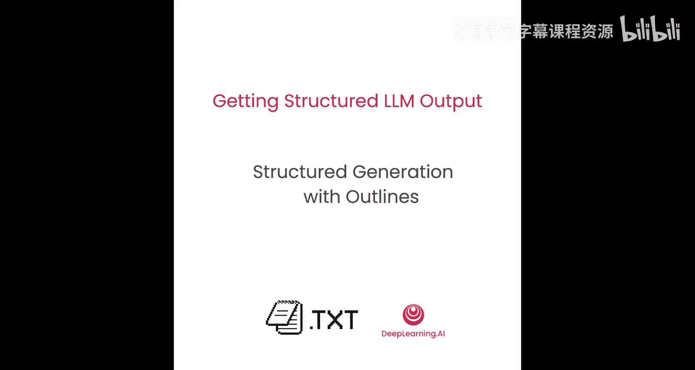
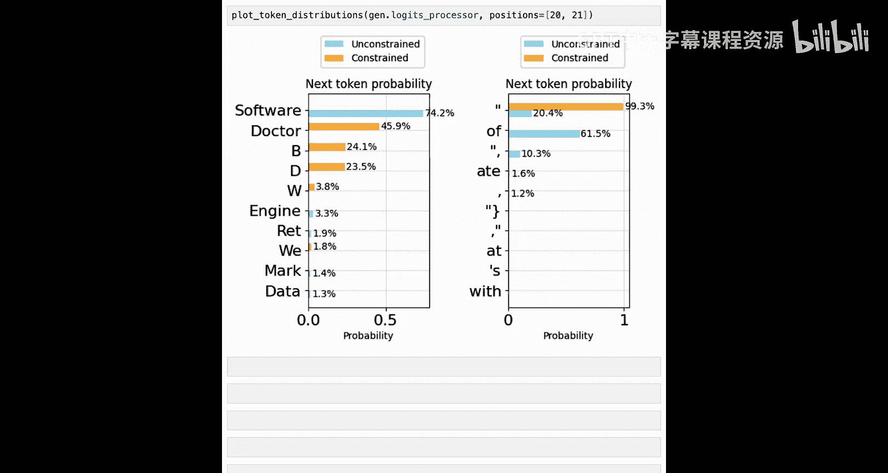

# 吴恩达《获取大语言模型格式化输出｜Getting Structured LLM Output》中英字幕（Claude-3.7 - P5：5.structured-generation-with-outlines.zh_en - GPT中英字幕课程资源 - BV1EFZUYnE6m

This lesson is all about how structured generation with outlines works under the hood。

 You'll learn how structured generation works using an Lms logits。

 Then you'll dive into the code and see exactly how structured generation chooses the next token。

 Let's have some fun。 Loitbased structure generation is a much more efficient and flexible method for structuring your outputs。

 It's also known as constrained decoding or it can be just called logicit based methods。

 and recall that what we're doing here。 We talked about this briefly in the first lesson。

 What we're doing is actually intercepting the logicits in the model and changing them to effect the probabilities that come out of the model。

 Let's quickly refresh on many of the benefits of working with structured generation。

 It modifies the Lm outputs directly。 This means that you always get the structure you defined。

 recall that working with proprietary models using their Json mode and repromping techniques can sometimes fail and result you not getting back the structure you wanted。

 Another huge benefit is that the time cost during inference from working with structured generation is basically0。

 It is very。😊。

Very， very lightweight。 And you will not notice that you're using it during inference。

 You also get a much wider range of structure。 We'll talk about this more in the next lesson。

 but you're not limited to strictly working with Json。 Now。

 there is one slight catch when working with structure generation to keep in mind。

 because were working with thelogits。 You need to have access to thelogs。

 This means you're either using an open weight model。

 or you are in yourself a proprietary model provider。 Let's refresh on how LMs generate text。

 You provide the LLM with a prompt that's broken out into a of tokens。

 The tokens are fed in all at once into the LLM。 The LLM then produces a bunch of waste representing the relative probabilities of each possible next token。

 A token is sampled and then append to the prompt， and this process is repeated until we eventually reach the end of statement。

 token terminating generation。 Additionally， you can set up fixed token limit。😊。

Let's step through a real task and see how an L O M would generate tokens。 In this case。

 we're using a visual language model， and we're providing an image along with a text prompt。

 Our prompt is asking the model to produce either hot dog or not hot dog using only those labels。

 Here is a feasible distribution of what the initial token logicicits might look like for this prompt。

 We have H ham hamburger， hot hot dog and not。 These all make sense。

 because it is an image of a hamburger， even though we ask the model to respond only with hot dog or not hot dog。

 It's quite possible the model is thinking that this is a hamburger。

 And so it wants to reply hamburger。 After the logics are generated。

 the token chosen is actually chosen by a sampler， not to Los themselves。

 There are many different sampling strategies that can have different impacts on the quality of generation。

 Here are two。 The first one is a greedy sampler， which simply always chooses the highest probability token。

 In this case is choosing hamburger。😊，In the other case， we have a multinoial sampler。

 which is going to choose from the Los proportion as to how strong thelogits are。 In this case。

 we might have chosen ham。 But， of course， we didn't get the structure we wanted from that case。

 We wanted only hot dog or not hot dog。 And we were going to choose probably hamburger。

 So let's talk about how structure generation works by modifying theselogs directly。

 Here's thelogs we saw in the last slide。 But we only want to use the labels hot dog or not hot dog。

 So we're going to remove ham and hamburger from these。

 noticeice that H is still valid because it's starting of the word hot dog。 That's okay。

 So we're left with H hot hot dog and not。 Now we still use the same sample we used before。

 We only change the logicits themselves， not the sampling process。 So again。

 a greedy sampler might choose not in this case。 and a multinomial sampler might choose H。 Now。

 let's go see how this works in practice。😊，So let's begin by pasting some code in here that's going to ignore some warnings that you might see here。

 next， we're going to load a small local model into memory in order to do so。

 all you have to do is import outlines and then use outlines models transformers and pick any language model from hugging face In this case。

 we're going use hugging faces small Lm2135 million parameter model This is an extremely small model we chose this mostly so it can fit on these notebooks。

 but you can use any language model as long as you have access to the final output layer As per usual。

 we begin by defining the structure we want our model to generate in this case。

 we define a person with fields name an age name maybe any string and age maybe any integer Next。

 you're going to construct a token generation function a generator in outlines is a function that accepts any string prompt and returns an object of the specified structure we can see here we're using outlines generate。

son we provide the model that we loaded into memory， the object that we wish to receive。

 and then we're gonna to set the exr to greedy。 so we take the most likely token at every step。

 We're doing this mostly so that every person in the course has access to the exact same results。

 Lastly， we're going to call tracklogits tracklogits is utility function that allows us to observe the token probabilities at every step in the sequence。

 Allright， let's generate a random person。 First， we need to cover what's called prompt tempating。

 So language models use specialized tokens to indicate the beginning of a system prompt or the beginning of a user prompt and the language model's response。

 Most Sks handle the addition of these tokens for you， but outlines does not。

 This is because managing your prompts at a low level gives you more control over the generation process。

 So we've included this handy utility function called template that accept your model it accepts a prompt and an optional system prompt。

 when you apply chatd templating you'll see this。 This is the text。

That usually goes to a language model。 It's often hidden。

 We don't usually see the templated text like this。

 but it's useful to know that this is what's happening on the back end。

 So here' is how you actually generate a random person We're going to take this prompt and pass it to the generator that we just constructed and then we're going take a look at the person。

 and it's worth noting here that generator Loitt docle removes any previously tracked Loits。

 If you're gonna to call this function multiple times make sure you clear the Loits tracker each time As we can see here。

 we got a person named John John is a 30 year old person But how did we get the text that allows us to have a person named John at age 30 that we can parse perfectly every time First。

 let's take a look at the underlying Json because person is a pedantic class we can convert person into its underlying Json using pedantics model dump Json If you set Indent equal to2。

 you can kind of pretty printed so it's nicer to look at We know that the first part of this Json。

Sting has to be exactly this curly brace quote name quote colon beginning name has to be there because it's the very first field in the person class that we specified the thing to the right of that can be any string so it has to be enclosed in quotes and then we have to have an age field again because it's in our person class followed by an integer So let's take a look at the probability of each token being generated this code here will show the probability of each token at the very first position this is the first token the model wants to generate what you're seeing here is orange bars representing the probability of selecting a token on the y axis after outlines applies constraints。

 the blue bars here indicate the probability of the token being selected as if no constraints were applied As you can see here。

 the curly brace and curly brace both of which our orange bars have very high probabilities under constraints90。

8% pro for just the curly brace and then curly。Bce quote as a 9。2% probability unconstrained。

 the model wants to respond with hear I and meet， neither of which are permissible under the format that we've specified in our Json structure generation in this case is turning off the model's natural propensity to respond in natural language here I and meet You try this。

 So try changing the K argument to show a different number of tokens。 So if I set K equal to 10。

 I can see the 10 most probable tokens that the model is considering again。

 curly Brace both of those are very high probability under constraints。

 but the remaining tokens have a very high probability without constraints being applied all of which are natural language responses。

 We know that the first field name has to be name and that the value of that name can be any string。

 So when the model reaches the first field it has to choose tokens that combined to the string name Let's look again at the tokens available at position4 we。

Run this we'll see that the name token is by far the most likely under constraints at 99。

7% probability without constraints， the model may choose user name with a capital n person or user but outlines has turned off all of these tokens because they're not consistent with the format that we expect。

 you'll note here that this is not 100%。 There's a 0。3% probability somewhere else。

 and that's because it's allocated to the remaining tokens N NA and NA all of which can be combined to make the phrase name So let's take a look at the sequence that we've generated so far。

 we can do this with generator do Loits process do sequence。

 and we can see that we have curly brace name after this has been sampled we know that the part following has to be quote Col because that's valid Json syntax when we take a look at the available tokens at this point。

 We see that we have a very high probability of anything that would combine。

To quote quote such as quote， just a quote etc。 You'll notice here that the constrained and unconstrained probabilities are actually very close。

 And the reason is that by the time the language model gets to this point。

 it knows that the thing following should probably be quote colon。

 because most of the time your language model has seen a lot of Json this point。

 we have the string like this。 we now have an open quote。

 which means that it's time for the model to start generating our name。

 So hopefully the thing that gets picked next looks something like a name。

 When we take a look at the tokens at this position。

 we see that the model has a very high probability of picking John 7% probability E A and M。

 John has a high enough probability and we're using greedy sampling。 So we' just take John。

 you'll note here that the orange and blue bars are essentially the same。

 That's because within a string field such as the name field。 the constrained and。

Constrained logits are roughly in agreement。We can also take a look at how the model chooses to end the name field by looking at the tokens in position 7 here。

 And as we can see， the model has a very high percent probability of choosing comma。

 This would stop the name field and move on to the next field。

 There's a 26% probability of choosing Do O， which would probably end up constructing the name Do Oe or Don Do。

Let's also quickly take a look at the age tokens so you can see this here in this case we're going to look at the positions 9 and 12 when we print this out。

 we can see that age will be printed with 100% probability under constraints because that's the field name that we requested and then we can see that the first token under age to be generated is going to be a 3。

 we know that the one if you add a 13 appear or change 12 to a 13 you can see that the next token will be a0。

After the name and age has been generated， we know that the remaining tokens have to be curly brace。

 as well as the end of sequence token that indicates of the models done generating。

 So let's take a look。 Here are the last two token probabilities。

 The first one here is a closing curly brace with a 94% probability under constraints。

 And then the other constrained option is a closing curly brace that includes a space before it。

 both of which are valid Json syntax， the unconstrained tokens that are not allowed are comma curly brace comma and then curly brace comma preceded by a space。

 then on the right hand side， you'll see no real tokens。

 but this is because most of these are unprintable white space， including the end of sentence token。

 which is here at the top with 100% probability。So I want you to experiment with this。

 try changing the allowed job types inside of this employed person class here we have class employed person that also has a name and age。

 but we've added a job field which is a literal and literal inside of pedantic means that the model has to choose doctor。

 basketball player or welder， it can't pick anything other than those three try changing the job titles that you have in here。

 such as adding dogcatcher， something like that then you'll run this code here。

 once you've modified the job inside of employed person take a look at the logits that are available at this location you can do this by printing it out at positions 20 and 21 make sure that you don't modify the name or age fields。

 otherwise these positions won't be accurate。Here we can see that software is shut down by our constraints and the next most likely token is doctor。

 so try playing around with that and see what happens when you change the allowed job types in this lesson。

 you dove into the internals of the model and saw how structured generation really works under the hood in the next lesson you'll extend this to generate other forms of structured output。

 including phone numbers， email addresses and Titact toe boards。

