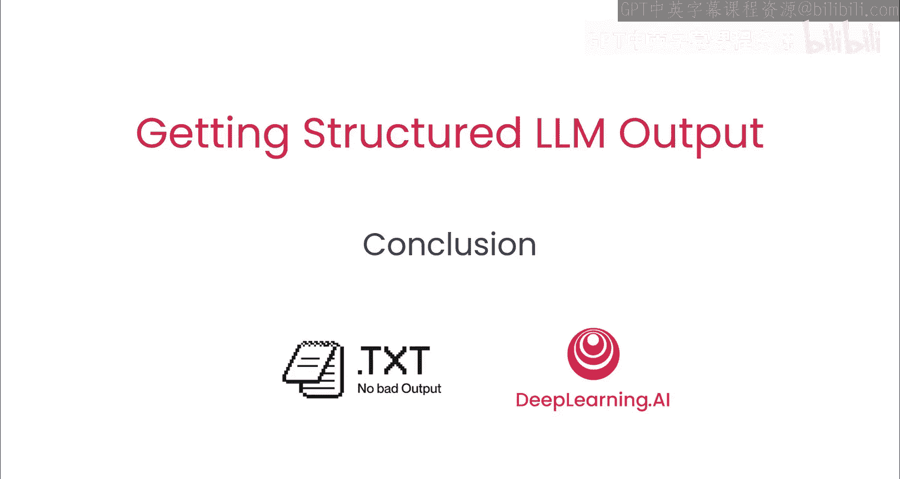

# 吴恩达《获取大语言模型格式化输出｜Getting Structured LLM Output》中英字幕（Claude-3.7 - P7：7.conclusion.zh_en - GPT中英字幕课程资源 - BV1EFZUYnE6m

Congratulations on completing this course In this course。

 you learned about writing reliable software using structured outputs for LLms。

 You used open AI structured outputs to build a social media agent。

 You learned how to use repromping methods to structure output from any inference provider。

 You opened up an LLM and saw the inner workings of how outlines perform structure generation。

 You saw that structure generation can do so much more than just produce Json。

 We're looking forward to seeing what to build。😊。