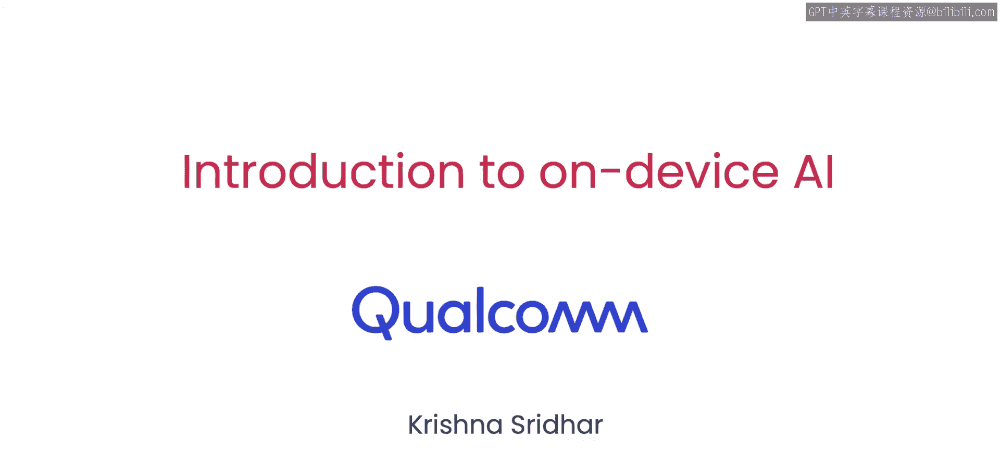
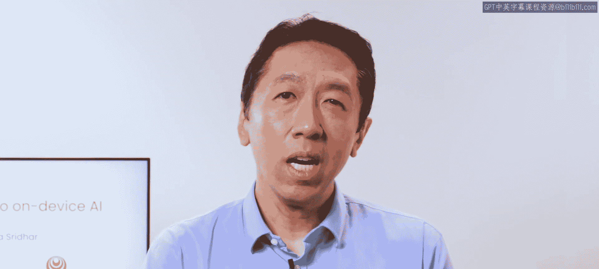
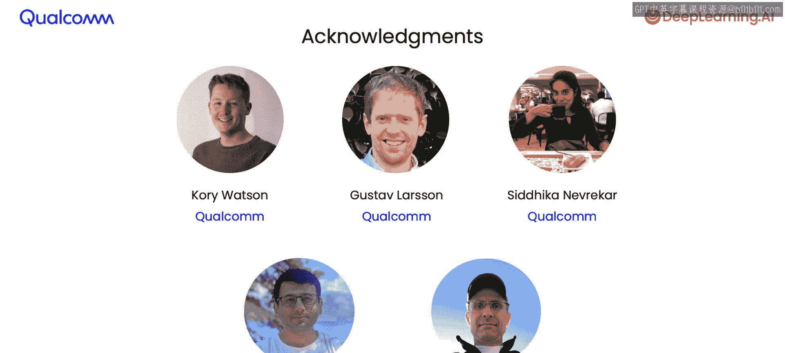

# 吴恩达《设备端人工智能简介｜Introduction to On-Device AI》中英字幕（英文可关） - P1：1.Introduction.zh - GPT中英字幕课程资源 - BV18m421K7uc

Welcome to introductions on device AI built in partnership with Qualcomm and taught by Krisishna Ser A modern smartphone may have 10 to 30 terralos of compute power When you take a picture that smartphone may be running dozens of AI models simultaneously for realtime semantic segmentation and seen understanding In this course。

 you learn how to create AI applications that run on device These techniques are applicable not only to making your app potentially run on the about 7 billion smartphones out there。

 but also potentially billions of other devices including cameras， robots， drones。

 A VR headsets and many more。Despite the differences in hardware and operating systems among all these devices。

 the principles of the key technical steps for deploying on deviceice are actually quite similar for many of these devices given the model of the very trained。

 perhaps in the cloud to deploy it on device， the first step is model conversion。

 which means converting your model from say a Pytoial tensor file framework into a format compatible with the on deviceice runtime In Decept。

 the model is frozen into a neural network graph which is then converted into an executable 4D device。

Devices such as smartphones and edge devices often contain a mix of processing units， including CPUs。

 GPs and neuro processingces units or NPUs， knowing the exact devices your app will run on allows optimizations that can dramatically enhance performance。

 sometimes making models run up to 10 times faster。

 you also learn tools that help you accomplish this across many different devices。

And this is important because there are a lot of different smartphone brands and models with your mobile app potentially running on maybe over 300 different smartphone types。

 It's then also important to ensure that your model performs consistently across these many different devices。

 This might mean validating the ondeved numerical correctness across a broad range of devices to prevent cases where model operates correctly on one device but not in another due to hardware differences。

 You learn how to do all this。 and then lastly， quantization is also a common step of running on deviceev AI models。

 As you see in the realtime segmentation app and discourse。

 quantization can make your app runs several times faster while resulting in much smaller model size。

 In our case， about four times faster with also four times smaller model size。

 Our instructor Trina Sheda is senior director of engineering at Quallcomm。

 He's been doing ondevice AI for about the。

It has got critical deployment on device infrastructure that might well be running on your smartphone right now。

Krishna has directly helped deploy over a thousand models on devices and over 100。

000 applications have used the tech he and his team have built。Thanks Andrew。

 in this course you will first learn how to deploy an on device model in order to reduce latency。

 improve privacy as well as improve efficiency， you will deploy your first model on device with just a few lines of code the model will do realtime segmentation。

From your camera stream， you will learn four key concepts as part of this course。

 The first one is how to capture your model as a graph that can be portable and runable on a device。

 the process of compilation of that graph for a specific device。

The hardware acceleration of that model in order to run it efficiently on device。

 as well as the process of validating that particular model for numerical correctness on device。

Finally， you will learn how to quantize a model so you can improve the performance by nearly 4 x while also reducing the footprint of that particular model。

Finally， we will integrate this particular model in an Android application that you can play around with。

Many people have worked to create this course I'd like to thank from Qualcomm， Corey Watson。

 Gustaav Larson and Civicica Nafrca， also Eshmael Gegari and Jeff Ladwig from Dbilal AI also contributed to this course on deviceev deployment of AI models is taking off and opens up a lot of exciting capabilities for builders of AI System。

 Let's go on to the next video to get started。

