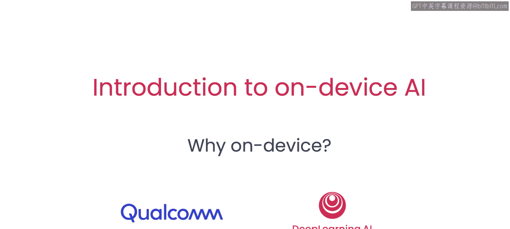
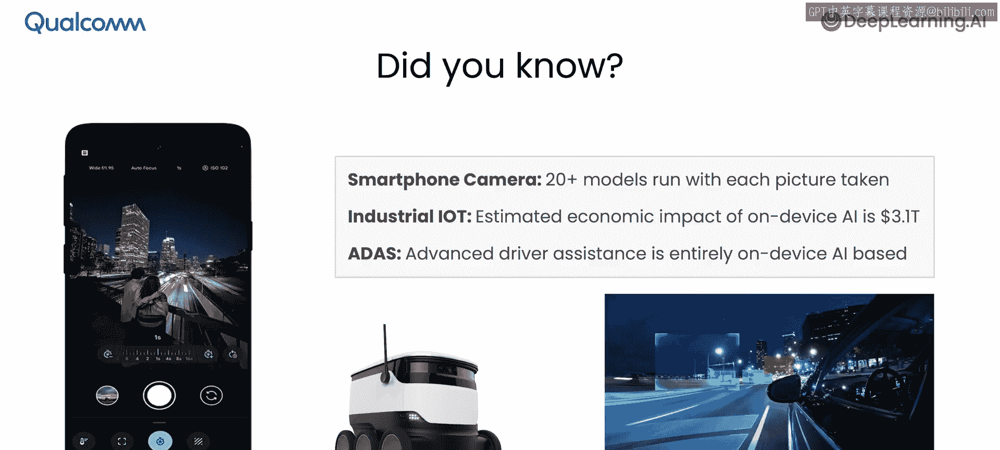
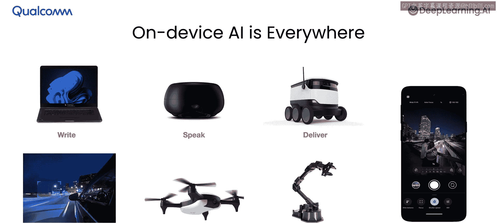
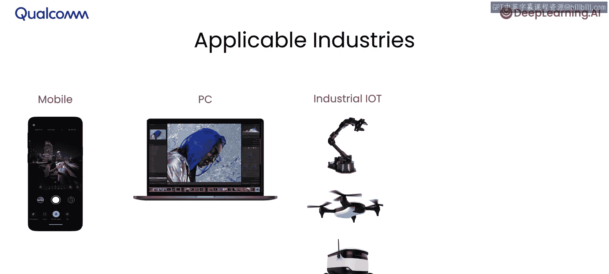
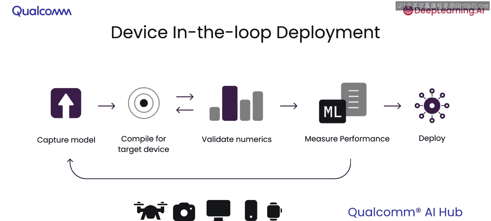
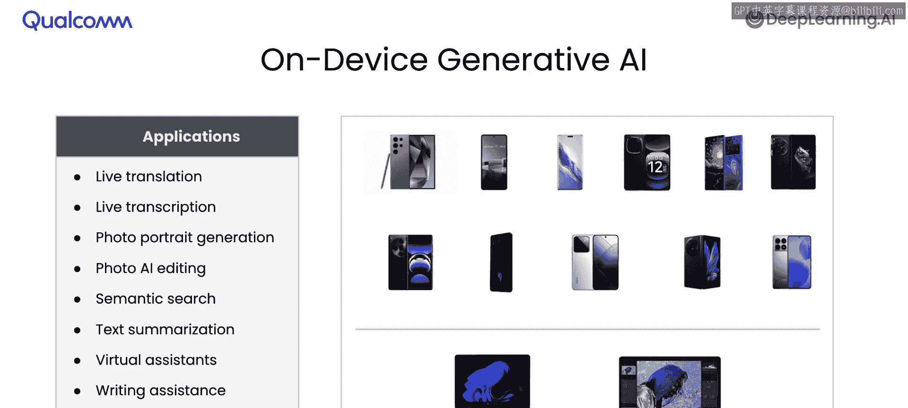
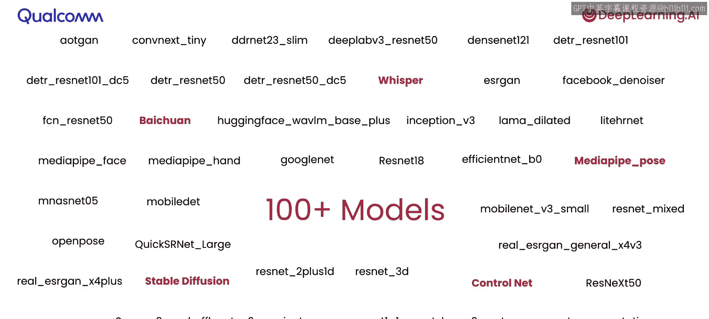

# 吴恩达《设备端人工智能简介｜Introduction to On-Device AI》中英字幕（英文可关） - P2：2.why.zh - GPT中英字幕课程资源 - BV18m421K7uc

In this lesson， you will learn about why on device AI is so popular。

You will learn about various benefits such as reduced latency， improved efficiency， reduced cost。

 and privacy preservation。You will also learn about various applications on device AI in the real world today。

 including real time speech detection， real time seman segmentation， real time object detection。

 as well as physical activity detection。Let's dive right in。

Let's start with a few fun facts about on deviceev AI Did you know that every time you take a picture with your smartphone over 20 AI models run to capture the perfect picture within a few hundred milliseconds in the industrial IUD segment the estimated economic impact of ondevice AI is about $3 trillion dollars and every time you drive a car that's equipped with advanced driver assistance it's entirely based on ondevice AI。

And on deviceev AI is everywhere when you type on a keyboard on a laptop。

 it's powered by a language model that runs on device， When you talk to a smart speaker。

 the text speech is entirely powered on device， robots that deliver and assemble have a lot of ondev AI drones that can scan landscapes for industrial and agricultural use cases。

 use ondevice AI， every time you edit a picture on a smartphone or a laptop that's powered by ondev AI and every time you drive a car that's also powered by ondev AI。

And here are a few of the applicable use cases with audio with image as well as sensors。

 the popular audio and speech applications include text to speech， speech recognition。

 machine translation， audio noise removal， when you work with images and video。

 you have photoclassification， Qr code detection， virtual background segmentation。

 and when you work with sensors， your physical activity detection， keyboard models。

 digital handwriting recognition are all powered by on- deviceevice AI。

 and what's fascinating about this is you can even mix multiple modalities with audio with image with video and speech and sensors。

 and produce multimodal on deviceev AI models。And the most popular industries where on device A is applicable include the mobile smartphone industry。

 your PC industry， your industrial IoT industry， as well as the automotive industry。

Now let's look at why you would want to run models on device there are four main reasons the first one is that it's cost effective because you can utilize all the computational resources that are available locally without any additional cloud computing resources。

The second one is efficiency because you can process data locally and not need to send it to the cloud。

 receive the results and then process it again locally。

 this whole process becomes computationally much more efficient。

The third is about privacy because your data will remain on your device and never leave it。

 and that ties into our fourth reason which is personalization。

 because having models being customized locally on your device without any external data can create uniquely personalized experiences。

In this lesson， we're going walk through a new way to deploy models on device that makes it extremely easy to take a model that you've trained in the cloud and make it work on the device within about five minutes。

 and there are four main steps as part of this process In the first one。

 you will capture the model as a computational graph。

 and you will take that computational graph and compile it for your target device。

 you will then validate the numerics of that model on the device that you're trying to deploy to。

 and then finally， you will measure performance on the device。 Now。

 all of this requires an actual device in the loop。

 That's why you will be using a device in the loop to go through each of these four steps。

 And finally， when these four steps are done。 you will have an artifact that you can deploy on a device and integrate it in your application。

To make this extremely seamless， you will be using Qualcomm's AI hub that automates all of these four steps。

 the capture， the compilation， the validation and the performance measurement。

 along with the device that's provided to you so you can go through this process in about five minutes。

Now on device AI is also extremely popular for generative AI applications。

 this includes things like live translation， live transcription， photo generation。

 AI based photo editing， semantic searched， text sumization， various virtual assistant。

 writing assistance， as well as image generation， all of these are commercially deployed applications of on device AI。

 on your smartphone or laptop。

And these are a collection of all the various models that are all deployable today on a smartphone。

 a laptop， an IoT device or a car。 This includes language models like Lama and Bichn。

 speech models like whisper， face detection models like media pipepe。

 stable diffusion and over 100 plus models that are all very easy to deploy on device today。

