# 吴恩达《设备端人工智能简介｜Introduction to On-Device AI》中英字幕（英文可关） - P3：3.L2 Deploying Segmentation Models On-Device.zh - GPT中英字幕课程资源 - BV18m421K7uc

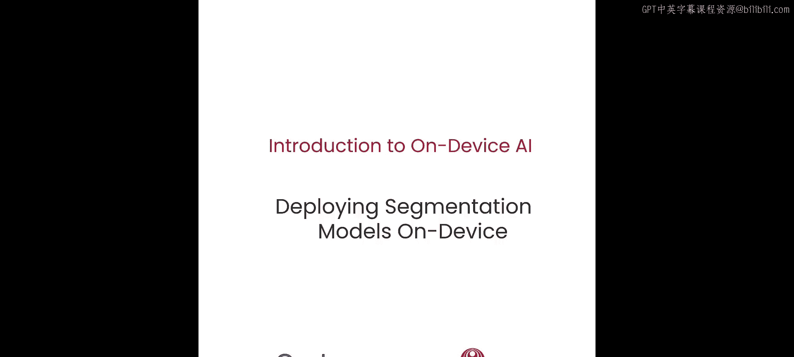

In this lesson you will deploy your first on device model with just a few lines of code。

 you will get introduced to real time image segmentation and all the models that are popular for this particular task。

You will pick a state of the art model and deploy it on device。

 validate numerical correctness and performance testing。

 and see the inference performing on a real smartphone。

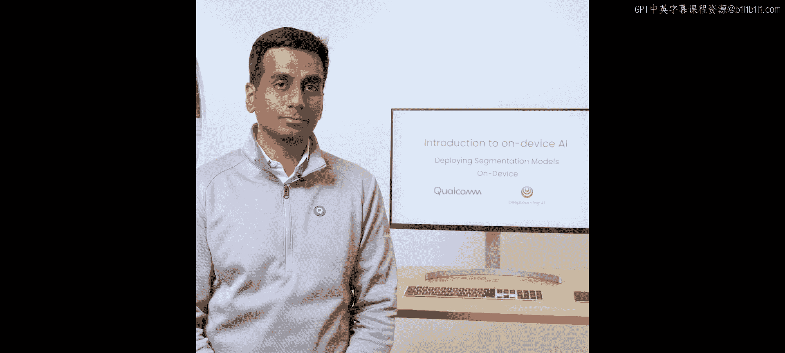

All right， let's get started。There are several applications of ondeevice AI。

 This includes things like realtime object detection where you can detect people and faces and QR codes。

 speech recognition which translates your speech input into text pose estimation that can predict the human pose based on a realtime image or video stream。

 image generation where you can type a text and get a picture of that particular text rendered by generative AI super resolution to take a low resolution image and create content that's higher resolution and image segmentation which will be the focus of today's lesson。

 you can explore various models for all of these topics at AIhub。callcomm。 co。

There are recipes and Github， as well as hugging face for you to get all of these models running on device。

 So what is image segmentation。 It's the task where given an image。

 you can break it down into all the meaningful segments so you can do analysis and easier object identification。

 So to give you an example， let's say you have this particular image of a street。

 the image segmentation model consumes this image and provides various different segments of the predicted areas of this image。

 For example， the colors in pink refers to roads， green refers to trees。

 the lighter green refers to sidewalks and red refers to people。

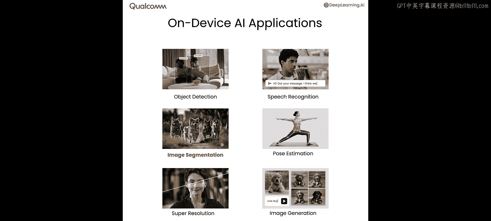

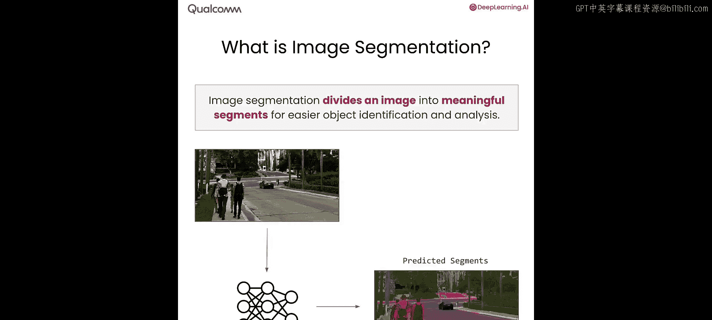

There are many types of image segmentation。 The two most popular ones are semantic segmentation and instant segmentation。

 Now， in semantic segmentation， as described by the image on the left in blue。

 every pixel refers to a specific class。 So here， the yellow refers to the table and the pink refers to people。

 An instant segmentation， every pixel refers to not only a class。

 but also an individual instance within the same category。 So with your image on the right。

 every one of those people are marked in a different color。

 and they are depicted to be a separate instance of the person category。

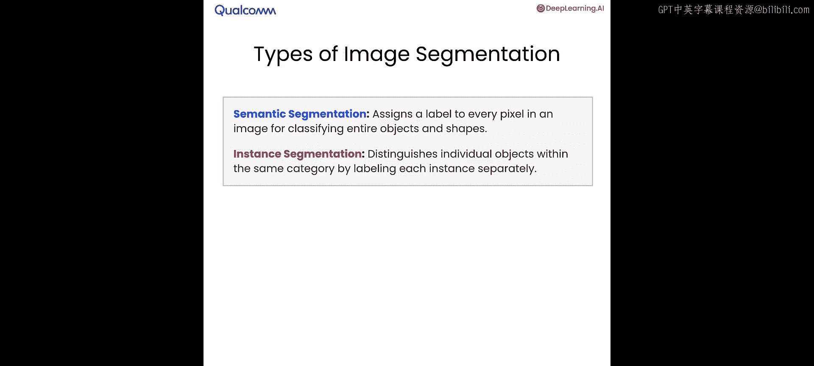

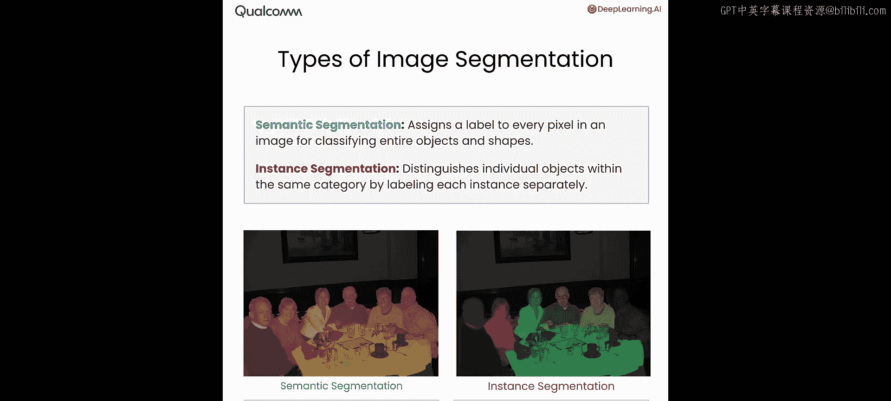

So there are many applications of image segmentation。

 it is deployed for all advanced driving assistance systems to mark the roads and the cars and the people separately。

 it's used extremely popularly in image editing software to apply filters let's see on your hair or your face or to blur out backgrounds。

 it's also used everywhere in videoconferencing software to blur out your backgrounds as you're speaking on calls and finally it's also used in drones to map out landscapes。

 especially for agricultural and industrial applications。

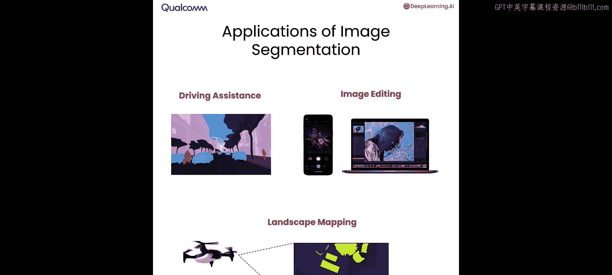

So in this lesson， you will deploy a real time segmentation model here。

 the processing and segmentation of the image must happen instantaneously and must be done frame by frame。

 This particular video depicts real time segmentation being performed on a street view camera。

 The light blue are the cars。 The gray is the road。 The darker green are the trees。

 the pink are the purple and the blue is the sky。 All of this has to be applied on a frame by frame basis。

 This makes it extremely challenging from a systems perspective。 To give you an example。

 Let's assume you have to process all of this data at 30 frames per second。 Now。

30 frames per second implies that you have about 33 milliseconds to process that entire frame before the next frame arrives。

 This means that your entire AI model must run within 30 milliseconds for you to get all。😊。

All of the analysis needed before the next frame arrives。

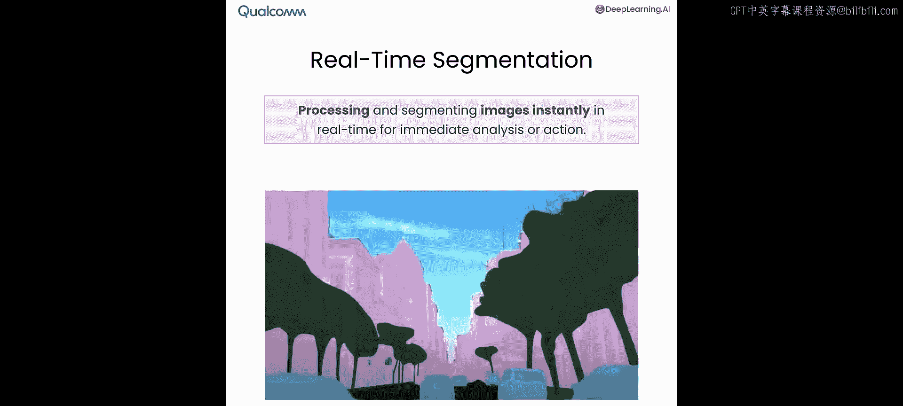

There are several different models that are used for semantic segmentation。

 Here are four of the most popular ones。 The first one is Resnet。

 which uses a residual connections for training very deep network。

 It's pretty popular for segmentation applications。

 High resolution network or HRnet is another algorithm that's popular for realtime segmentation。

 And this network operates by taking higher resolution representations through the network。

 to capture finer grain details。 The next one that's popular is called fnet or feature agglomeration network。

 which focuses on agglomating various different features from different scales again。

 to get the best detail possible for prediction。 And another popular network is DDrnet。

 which is a dual dynamic resolution network that employs dual path architectures to balance efficiency and accuracy。

 now， all of these networks can run entirely locally on the device。 So in this particular lesson。

 we will be focused on a network called。😊，FFnet or a fastsfree network。

 which has a simple encoder decoder architecture with a resnet like backbone and a small multiscale head。

 the performance from an accuracy standpoint of this particular network is just as good as complex semantic segmentation networks like HRnet or FNnet that I introduced you earlier too but it has one big advantage of being computationally very efficient。

 thereby making it perfect for deployment on device。

 Another advantage of this particular network is that it's extremely configurable。

 so you can have various sizes of encoders and decoders depending upon the needs of your environment as well as the accuracy needs for your application。

 So here are a few variants of the FFnet architecture that you will get to explore in today's lesson。

 So this includes the FFnet 4054 and 78 S architectures that are all based on a resnet backbone they operate on a 1024。

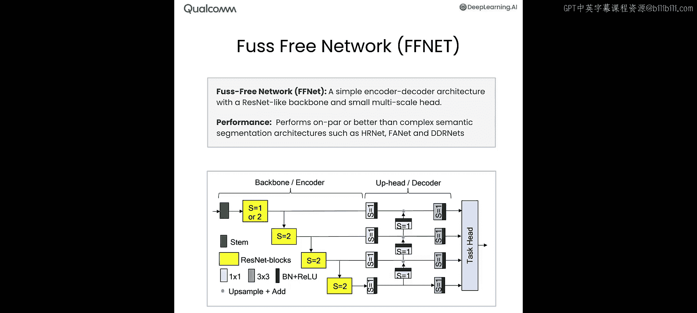

248 resolution。 So it's a pretty high resolution。 These models range from about 55 mebytes to about 100 mebytes in size and they have between 13 and 27 million parameters and they take about 62 to 96 gigablops of computation to run on the device There are also low res variants of the FF net architecture that operate on lower resolutions。

 These are the 78 low res and the 122 low res。 they operate on 512 cross 1024 resolution。

 They are a little bit larger between 100 to 130 mebytes in size and their parameters are somewhere around 26 to 32 million。

 The low resolutions obviously require fewer operations and as a result require lesser number of gigablops。

 Now let's see how you can deploy all of these networks on a device。

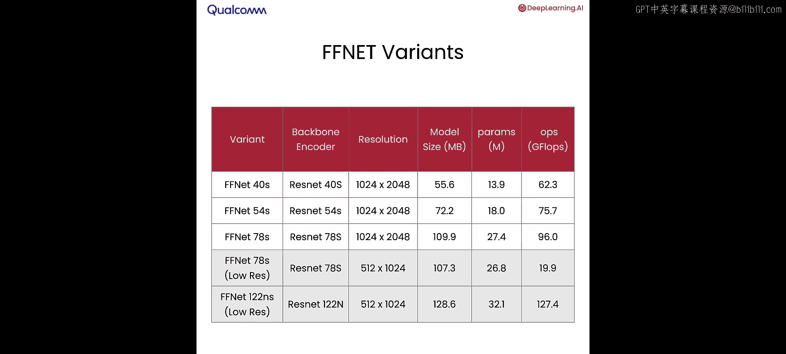

In this notebook， you will deploy a real time segmentation model on device。

 The goal of this notebook is to give you a high level overview of how to deploy models on device in the next lesson you will learn a lot more details of every concept being covered in this particular notebook。

This notebook deploys the FF net model。 I have shared a link to the FF net paper for your reference。

 Now you will explore the various different variants of the FFnet network。

 and you will do so with the Qcomm AI hub Python package。

 which contains a lot of Pytoch models that are ready for you to try out right away in order to get computational summaries of a particular model。

 you will use the torch info package that gives you a very detailed description of the total number of parameters。

 the size of the model， as well as the computational complexity。 Now。

 let's run some code to provide a computational summary of the model。

 So this takes the pretrain weight of the model with the input resolution of 1，0，2，4 cross 2，0，4，8。

 As you have learned in the lesson and uses the torch info package to provide a summary of the model for this particular input resolution。

 The summary contains the。😊，A of parameters， the computational complexity as well as the size of the network。

So if we scroll down below the total number of parameters is about 13。9 million。

 all of which are trainable， the total computational complexity of this network is about 62 gigps and the input size of this particular model is about 25 mebys。

 so this gives you a rough sense of how big this model is how much compute power is going to take and the total number of parameters that are required to deploy this particular model。

I've created an exercise for you to recreate the table that was shown to you in a lecture。

 This exercise allows you to explore different variants of the FFnet architecture and the computation complexities associated with each variant so the top three variants here that are highlighted operate on the higher resolution of 1024 cross 2048 while the next two variants operate on the low resolution variance of 5 to12 cross 1024 you can get the computation summary including the number of parameters。

 the computation complexity as well as the model size for each of these FFnet variants。

The next step is for you to set up AI Hub in order to configure the device in the loop deployment。

AI hubub is available as a Python package Next， we will set up Qcom I hubub for the device in the loop deployment。

 You can install it as a Python package and configure it with the API token。

Now you will run a simple demo of the FFNe40S network in the notebook now this particular line downloads pretrained weights of the FFNe 40S model directly from the source and runs through sample inference on a simple image and provides the predictions of that particular model on that particular image。

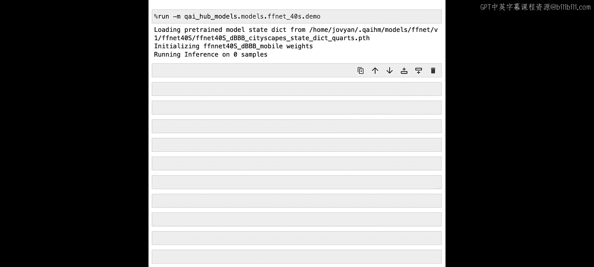

This specific line of code runs inference on a sample image that was pre provided to the network and provides the predictions along with the annotations。

 red being people green being trees， gray being the road。

 blue being other cars Note that this particular demo runs entirely in the notebook in the cloud environment。

 and the goal of this lesson is for you to be able to take this particular model and this particular example and run it on a smartphone。

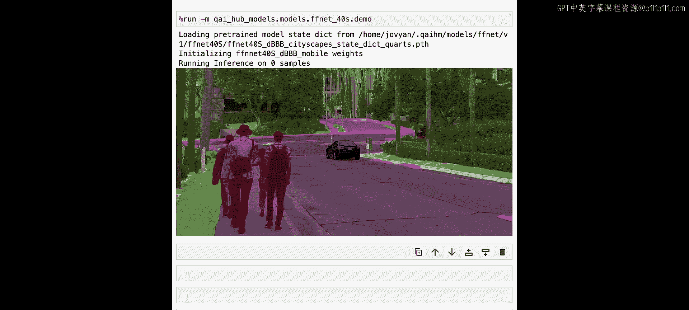

Now let's run this particular model on a real smartphone。For that。

 we will use the FFNe export function and provide a device。

 example device being the Samsung Galaxy S23。Running this specific piece of line of code does all the four steps that you were shown in the slides。

 The model is taken from Pytoch and converted and compiled for the Samsung Galaxy S23 that is done through this specific compilation job。

Once the compilation is completed， a real physical Samsung Galaxy S23 is provisioned in the cloud。

Once this real device is provisioned， a performance profile is run to get a sense of how long this specific model is going to take to run on the device。

 And then finally， once the performance profiling is completed。

 we run through inference on device on the same sample that was shown to you earlier so that you get a sense of how accurate it is to run on the device。

 So this particular process takes about2 to5 minutes， depending on the load on the server。

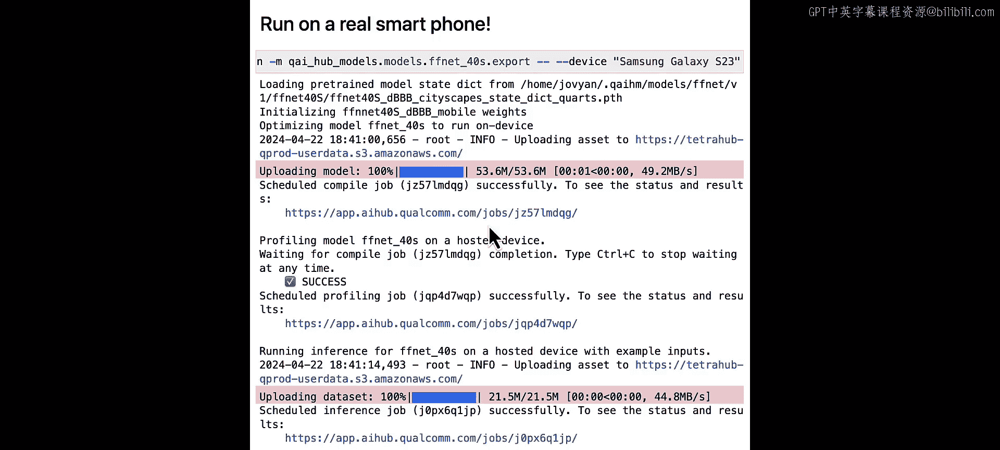

The outcome of this particular script is a very simple performance summary that's highlighted here。

 So this says that this model was run on a Samsung Galaxy S 23。 It ran in about 22 milliseconds。

 and the total number of operators are about 92。 It ran entirely on a neural processing unit。

 You will explore each of these concepts in the next lesson in a lot of detail。

 The numerical correctness is also displayed here。 So this shows a specific measure called peak signal to noise ratio。

 where it's comparing the numerical correctness of the inference that ran on the device with the one that ran locally in the notebook environment。

 and anything more than 30 is typically considered good。 This specific PNR is 62。

 which means that the on device inference matches the cloud almost exactly。😊。

Note that many of these links may not be accessible to you。

 so we've provided a simple set of Explororable links for you that you can explore for all of the variants of FFNe that has a detailed view that describes performance that describes the number layers。

 the memory consumption for all of the different variants of the FFnet architecture。Now。

 in the last step of this particular notebook， you will run the image segmentation model on a physical device。

 This runs the same demo that you saw earlier on in the notebook。

 but instead of running it in the local notebook environment it's going to run on a Samsung Galaxy S23 that's provision in the cloud for you。

Note that this particular line takes about a few minutes and in the few minutes。

 the Pytoch model is sent to the server and compiled for the Samsung Galaxy S23。

 a Samsung Galaxy S23 is provisioned in the cloud for you to be able to access the image is then passed through the model that's compiled for the device and the output predictions are given back to you and then you will see a displayed output of the results coming from the Samsung Galaxy S23。

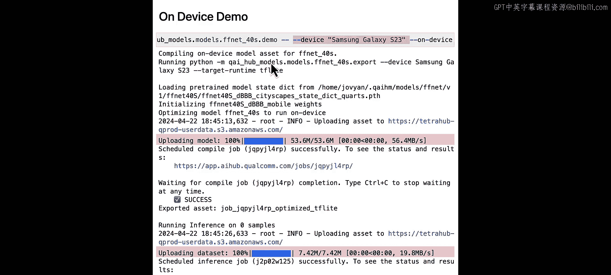

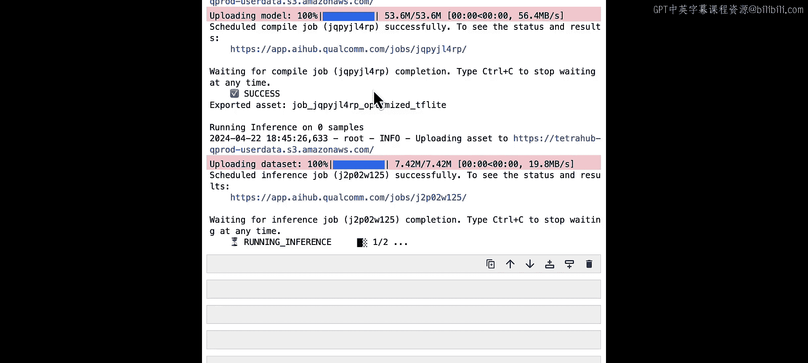

Okay， great。 you see the result。 It looks exactly the same as what I got in the notebook。

 The red being the people， the blue being the cars。

 the green being the trees and the gray being the road。

 But this particular inference came from a real Samsung Galaxy S 23。 So in this lesson。

 you learned about the various different variance of the F F net。

 you exploded the computational complexity of each of those variants。

 You were able to run a demo locally in the notebook environment。

 You were able to export the model for a Samsung Galaxy S 23。

 and you were able to measure performance at about 22 milliseconds for the FFnet 40 S variant。

 and you noticed that the P SNR between the cloud inference。

 and the on deviceev inference was about 62， which meant that it provided the same results as the cloud。

 And finally， you saw an end to end demo of all of this working where you provided an image。

 and you got the results back and it looked visually exactly the same as what you got in the cloud。

 In the next lesson， we'll go into a lot more。😊，Detail of each of these concepts， break them down。

 understand what's happening behind the scenes on each of these areas so you can fully understand what it takes to deploy models on the device。

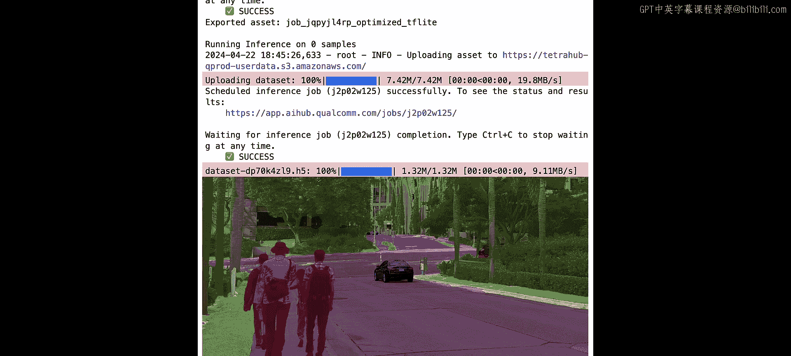

All right， see you there。