# 吴恩达《设备端人工智能简介｜Introduction to On-Device AI》中英字幕（英文可关） - P4：4.L3 Preparing for on-device deployment.zh - GPT中英字幕课程资源 - BV18m421K7uc

In this lesson， you will learn four key concepts for on device deployment。

 The first is around neural network graph capture， which captures computation that you're going to take to the device。

 The second is around on device compilation。

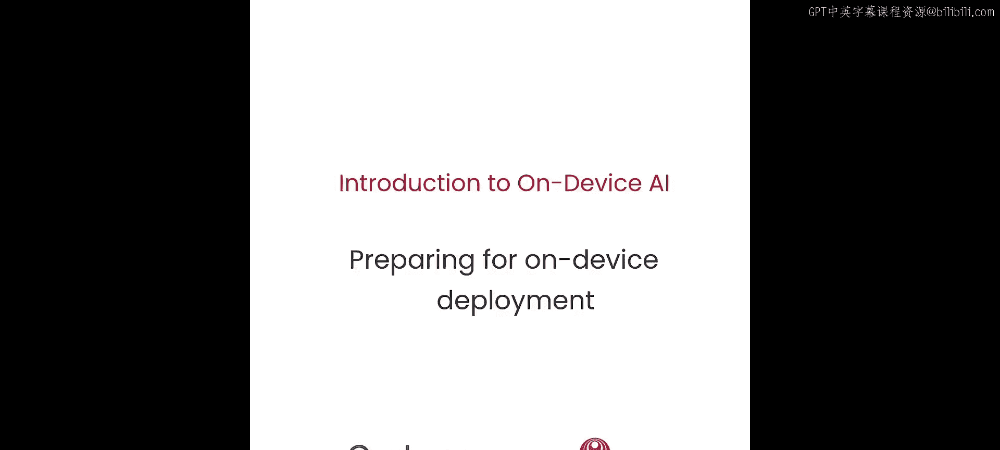

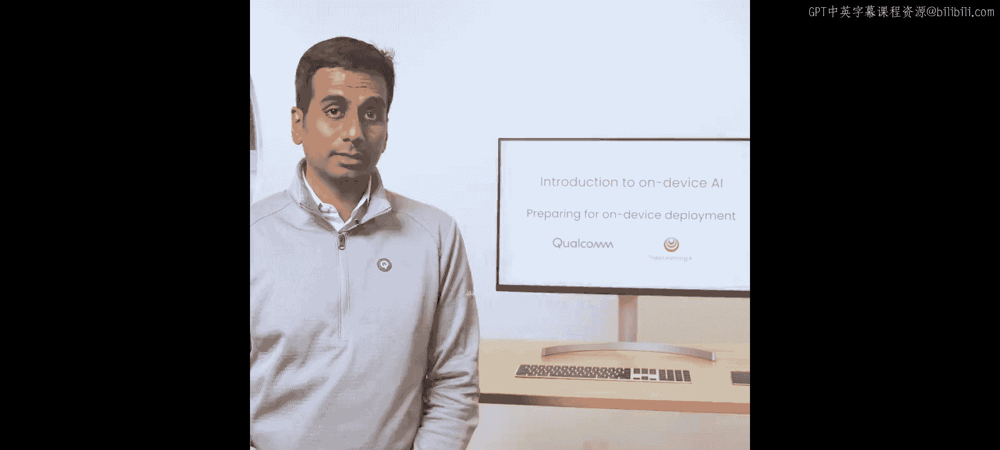

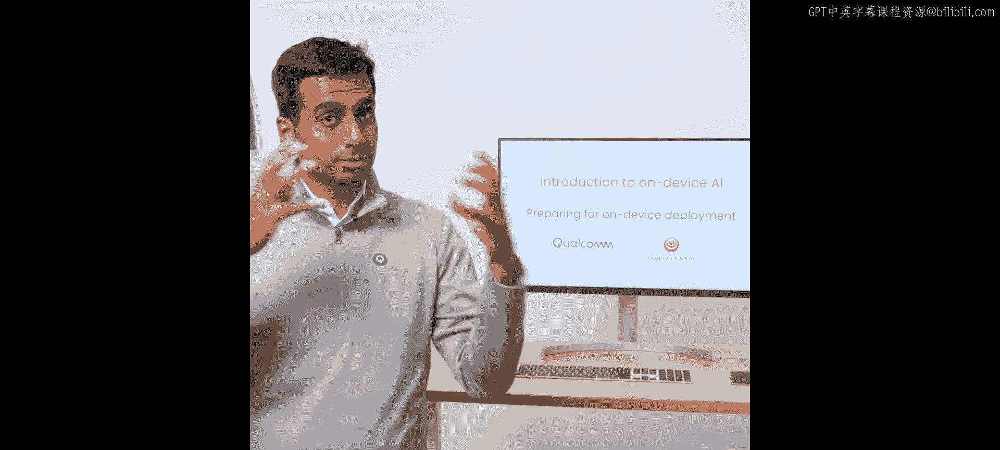

The third around accelerating with hardware the models on the device and the fourth is around the importance of validating on device numerical correctness al right。

 let's go。

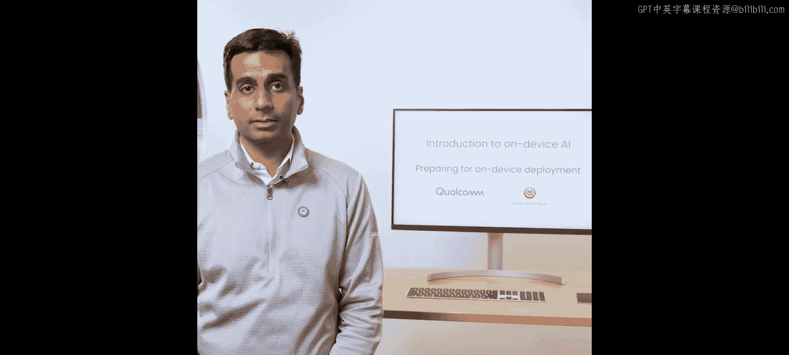

You will go over key concepts to enable you to take a model train in the cloud and deploy on device The first is graph capture。

 where you will learn how to capture the computation of a neural network into a portable format that you can take for the device The second is compilation where you will learn how to compile models for a target device。

 Third， you will learn how to validate the compile model on device so that your cloud and device produce the same results。

 and finally you will run a performance profile on device so you can be confident that your model can meet the constraints of the device。

So what is graph capture？You might be familiar with a block of code in Pytoch that looks a bit like this here you have two convolutions。

 con 1 and con 2， and each of those convolutions are followed by value based activations。

 Now the key thing that you should know is that this particular representation of the model in code can be turned into a graph representation and that is the concept called graph capture。

As you can see， the same model is now represented as a graph where the input is x。

 and you have the two convolutions and you have the two values。

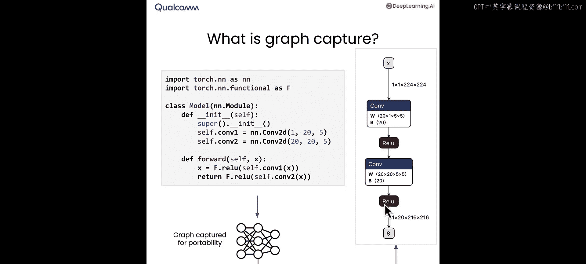

Now let's see how to do this in a notebook。 Let's start by importing the FFnet 40S model using the Qualcomm Eh package This loads the Pytoch model in memory in your notebook in order to capture the computations of the FFnet 4TS network you will use the Pytoch Jit trace functionality in order to do so first you have to set up your Pytoch model with the input shapes that are required for the network This particular network takes an RGB image of size 10。

2，4 cross 2，0，48 that is described in this particular input shape as a3 channel 10，2，420，48 tensor。

Next， you generate some random input in order to provide it to the network so you can trace it。

And finally， you will call the torch Jit trace function that takes the sample input。

 passes it through the model。 This particular function processes all the computation as it goes through the network to understand what is needed in order to capture the entire computation as a graph。

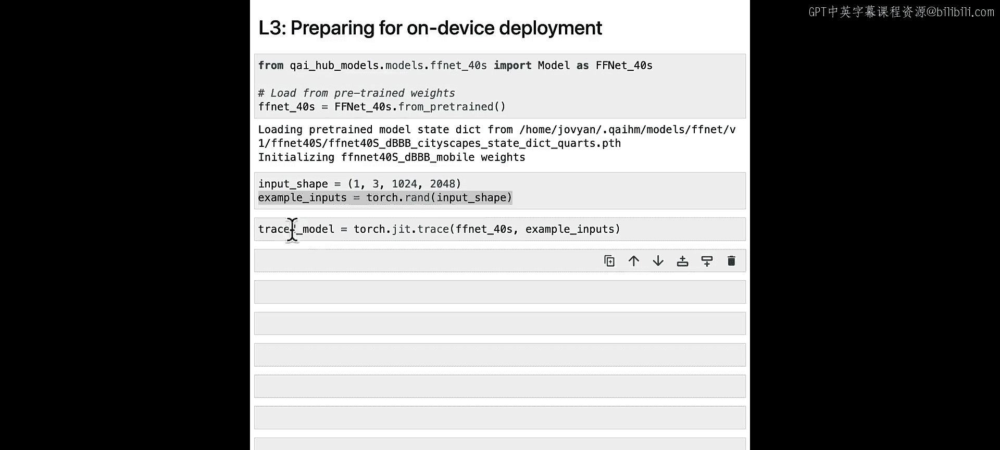

The resulting output is a Pytoch traced model that looks a bit like this， as you can see。

 this trace model captures all the computations that describe this FFNe 40S network。

 except these computations are entirely portable so that you can take it for deployment on device。

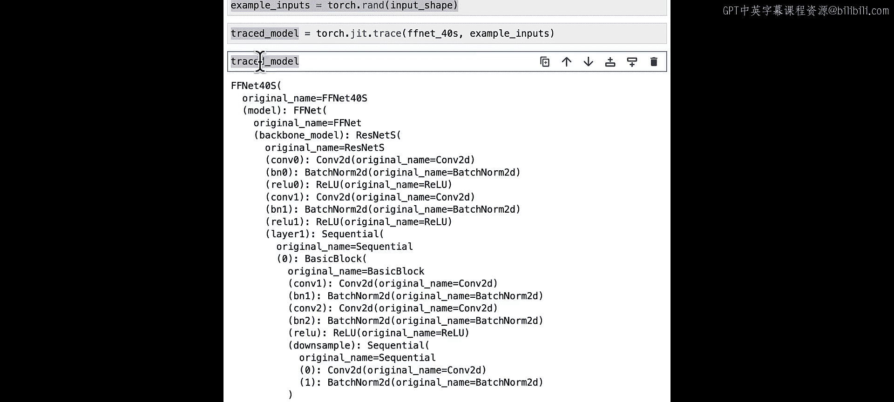

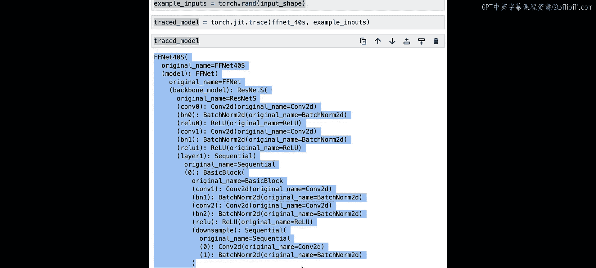

Now， in the next step， we're going to take this graph that is captured the computation of the particular network and compile it for consumption on the device。

 Let's look at that in the notebook。Now let's look at how you can compile this model for device。

In order to do so， first， you'll set up Qualcomm AI Hub。

And you will use the Get devices API to get a list of all the devices that are available to you in the cloud。

 These are real physical devices that are provisioned that you can call in with APIs in order to run models on them。

As you can see， there are Samsung devices， there are Google devices， there are Xiaomi devices。

 there are various robotics devices as well。In order to compile the traced model for the device。

 all you need to do is use the submitit compile Job API。

Pick the device that you'd like to compile for and provide the traced model。

And provide the input specification in this case， an RGB 124 cross 248 image。

When you run this block of code， the trace model gets sent over to the cloud and optimize for this particular Samsung Galaxy S23 device。

The output of the compile job is a target model that's compiled for that specific device。

 you can get access to the target model using the get target model API that provides you with a downloadable artifact that is deployable on the device。

Now， let's learn what these compatible artifacts are。

You may have been wondering what the dot Tf light extension was in the compile model that we downloaded that is an artifact that is compatible with the Tensorflow light runtime There are three popular runtimes for on deviceev deployment One is Tensorflow light that I recommend for Android applications。

 Another is onx runtime that I recommend for Windows based applications。

 and the third one is the Qualcomm AI engine that is suitable for fully embedded applications on Qualcomm hardware。

Let's learn a little bit more about the Tensorflow light run。

This is specially designed for mobile platforms and embedded devices for extremely efficient performance。

 It provides fast response times by reducing computation overhead。

 It's pretty flexible in deployment。 So you can use it for smartphones， various Iot gadgets。

 making it very portable and ubiquitous。😊，It's extremely energy efficient because it uses traditionally less power。

And it's also hardware accelerated and fully compatible with the neural processing units or NPUs using a mechanism called delegation。

Now let's explore this in an exercise that I've created for you in the notebook。

This exercise allows you to try out different runtimes， including Tensorflow light， onyx runtime。

 as well as the Quacomm AI engine。This can be called as an option passed in to the Subit compile job API。

 and the option specifies the target runtime。You can explore more options。In the URL provided here。

Now that you have compiled a model for the device， let's look at how you can execute it on the device。

 It's really important to understand the computational resources that are available to you on a device。

 There are three popular compute units available on a modern device。 The CPU。 the GP。

 and the neural processing unit or the NP。 The CPU is the most flexible general purposepo computation engine。

 You can do computations。 You can do branches。 You can do four loops。

 It's extremely easy to program against Next is the GP。

 which is designed for high performance complex parallel computation。

 It's slightly harder to program than a CPU。 but still relatively easy。

 and it's designed for highly performing pa computation。😊。

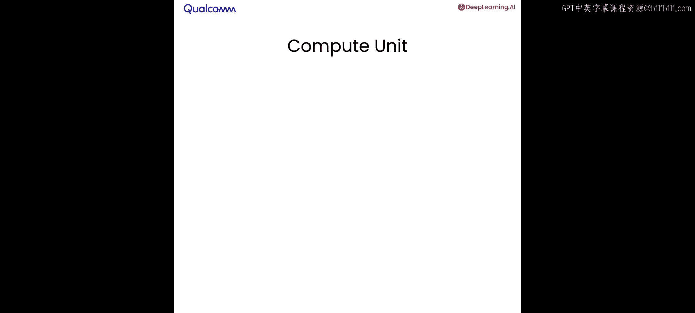

The third unit is the neural processing unit， which is extremely efficient。

 sometimes up to 10 times more efficient than the CPU for neural network。

 The downside of the NPU is that it's slightly less flexible than the CPU and the GPU。

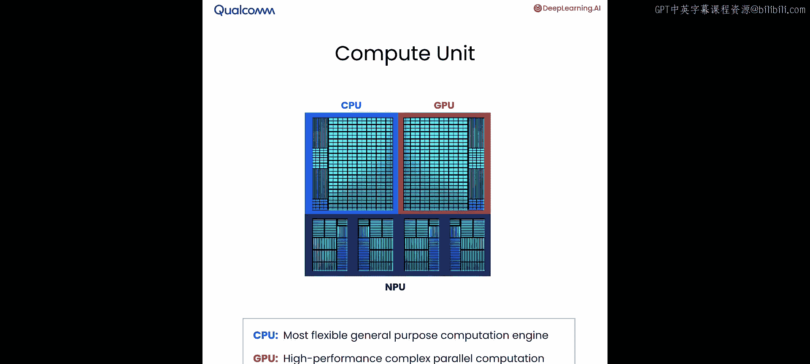

Each of the runtime that you learned about in the previous lessons have backends that allow you to tap into the CPU。

 the GPU， or the NPU。And you have control as an application developer to be able to target each of these compute units separately。

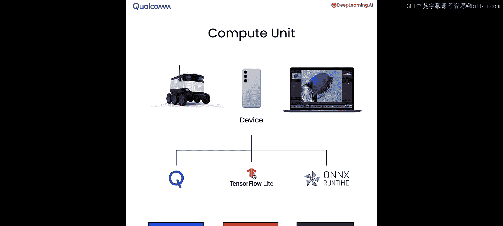

It's also important to understand that different devices have different capabilities Now devices that are more than7。

8 years old typically don't have a neural processing unit。

 they only have a CPU and a GP whereas modern devices， especially quaualcomm power devices。

 have neural processing units that allow you to do computation extremely efficiently Now let's see this in the notebook。

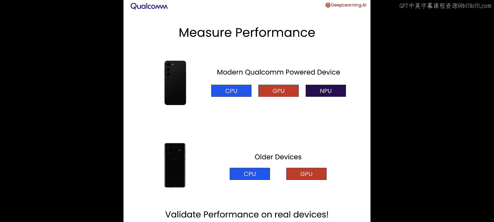

Now you will be able to deploy the compile model on a device and perform a performance profile。

In order to do so， you will use the Subit profilele job API by selecting a specific device。

 in this case， the Samsung Galaxy S23。And providing the target model that was previously compiled using the compile job。

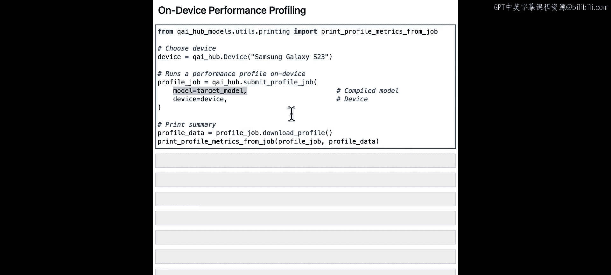

Now this particular block of code submits the target model to the cloud provisions a Samsung Galaxy S23 and runs a profile。

 the profile is then downloaded using the download profile API。

 and you can visualize the performance profile using this print profile metrics from job function。

This particular function takes a couple minutes， and you will see the results displayed below The model ran using the Tensorflow light runtime at about 27。

9 milliseconds。 it ran entirely on the neural processing unit and consumed about 3 to5 MBby of application memory。

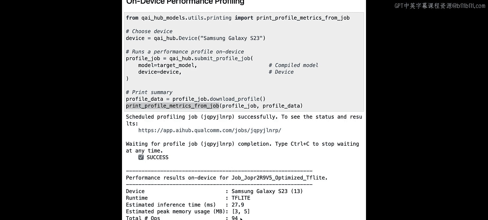

Next， you will explore in an exercise how you can try different computation units to get a sense of how the model performs with each of those computation units。

 You can do so by submitting options to the submit profile job function and providing the compute unit。

 it can either be CPU， GP or NPU。 Note that each of these compute units has a fallback。

 So if certain operations of the neural network graph are not supported by those compute units。

 the default fallback for those specific operations to the CPU。

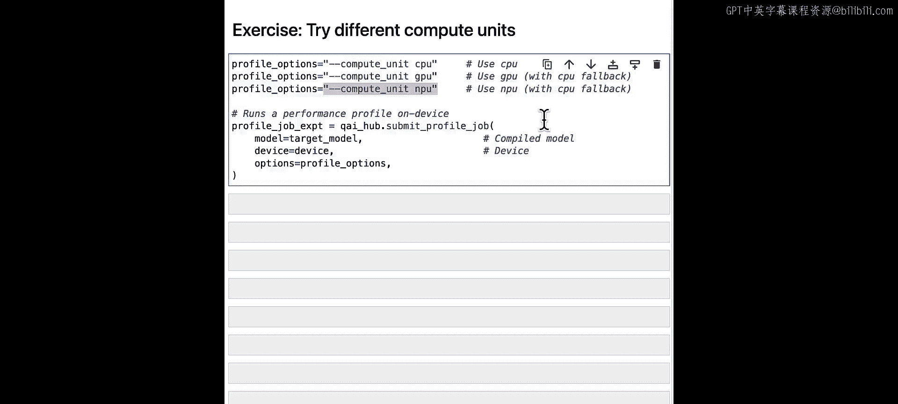

Now you will learn how to check the accuracy of the model on device。In order to do so。

 you will take a sample input。 It can be a few samples or a single sample。

 You will run inference with the Pytoch runtime in your notebook environment。

 you will also run inference on the device on the neural processing unit on the same image and then you will compare the results between the cloud environment and the device environment。

 and in order to compare these two results， we will use the peak signal to noise ratio measurement that measures the delta between the image produced here。

In the cloud and the image produced on the device， Let's see this in the notebook。

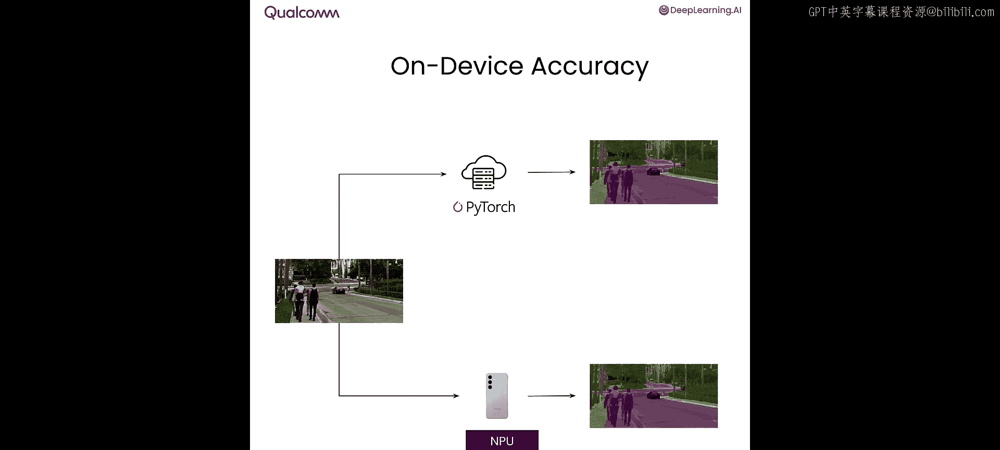

Yeah。Now let's look at how to perform on device inference To do so。

 you've been provided with some sample inputs associated with the FFnet 40S network using the FFnet40s work do sample inputs command these sample inputs correspond to a Ny array of size 3 cross 102。

4 cross 2048， which is an RB image of size 102，4 cross 2048。

 which is what the model requires note that the values of these tensors are scaled between 0 and1。

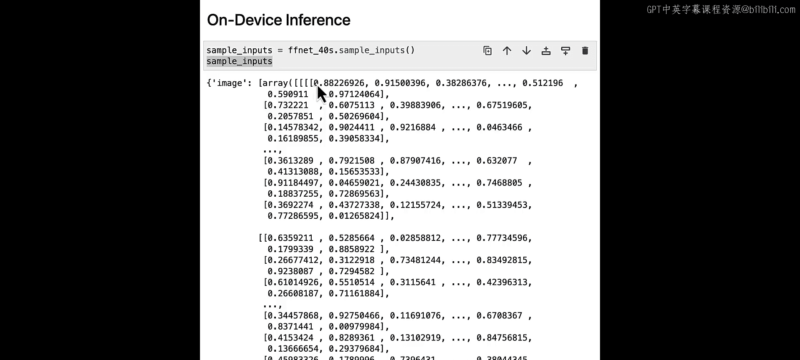

Now let's take the sample inputs that are provided here and pass it through the FF network 40S network defined in torch and get outputs。

 These are outputs that are running locally in the notebook。

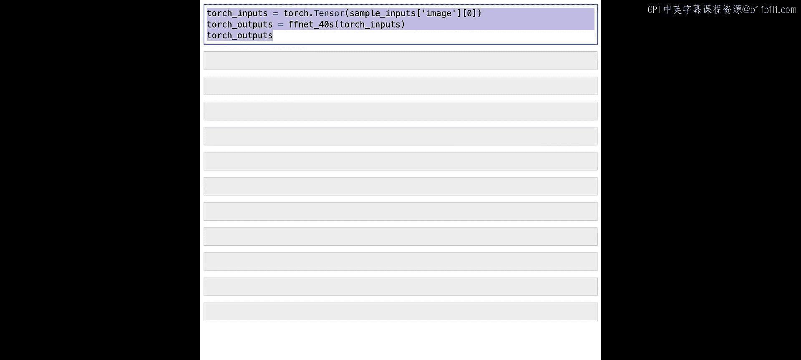

The goal now is to compare this with what you get on device。

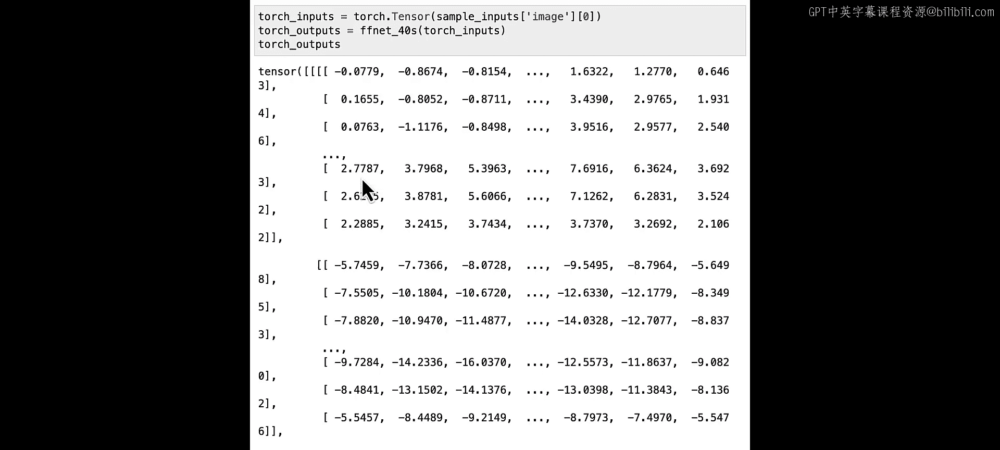

And you can do that with the submit In jobb API。 you pass in the target model。

 which is the compiled artifact sample inputs， which we just saw and choose a device in this case。

 the Samsung Galaxy S 23。When you run this command。

 inference is run through that cloud hosted device， and you get back the results in Numpy format。

You can get access to the results using the download output data API。

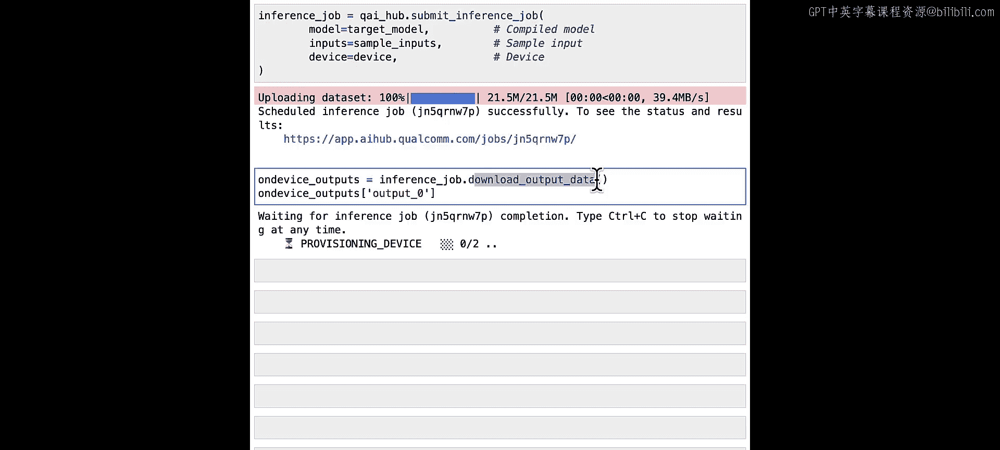

This job takes about a minute or so to complete， and the output is a Ny array。

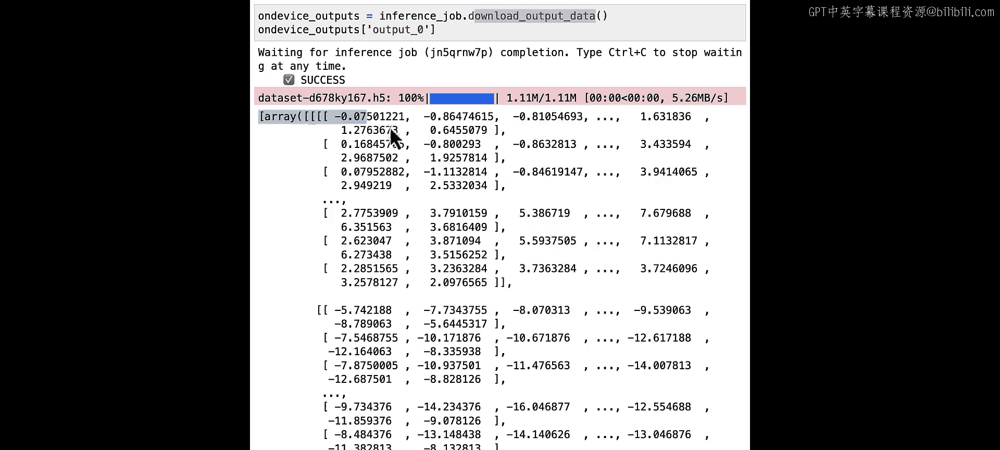

Now you can compare the result between the local CPU inference that ran in your notebook and one that ran on the device that's hosted with a cloud As you can see the peak signal to noise ratio is about 60。

 Anything more than 30 is typically considered pretty accurate。

 so this implies that the results that you got on the device match up very well with what you get on the cloud so you can be confident to deploy this particular model。

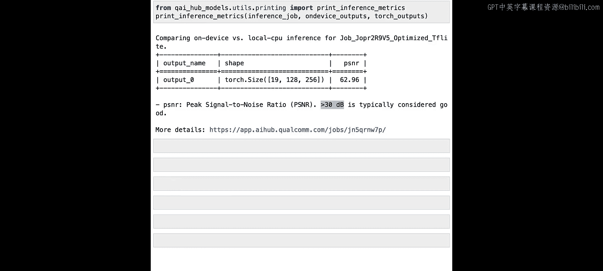

Now let's get ready for deployment。The model has been validated on device for performance as well as numerics。

 and you can use the get target model API to download the model and you have an artifact that you can deploy on device。

In this lesson， you learn four key concepts。 The first was on how to capture a pythage graph with a trace。

 The second was how you take that traced function and compile it for the device。

 The third is how you profile that particular device for the neural processing unit for maximum hardware efficiency。

 And finally， you learn how to validate the model on device to make sure your cloud environment and your device environment produce the same results。

 In the next lesson， you will learn how to take this particular model。

 Quaize it and make it up to four times faster and four times smaller。 See you there。😊。

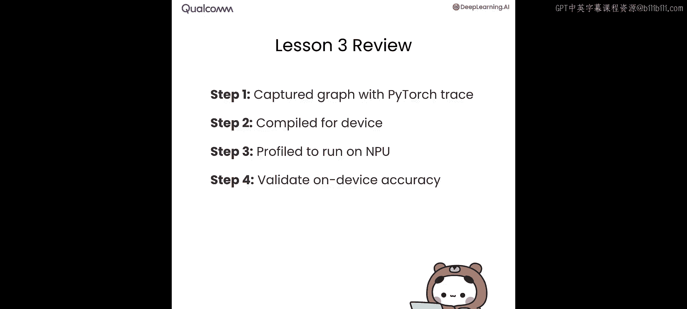