# 吴恩达《设备端人工智能简介｜Introduction to On-Device AI》中英字幕（英文可关） - P5：5.L4 Quantizing Models.zh - GPT中英字幕课程资源 - BV18m421K7uc

This lesson is all about quantizing models for additional performance improvements。

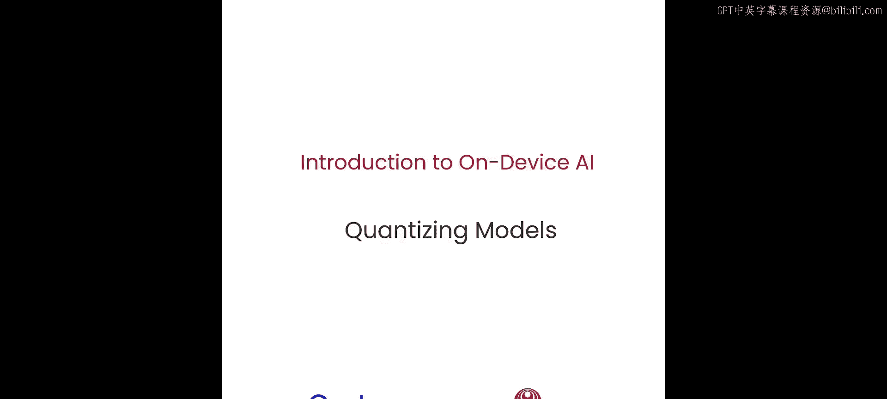

You will quantize a model thereby improving performance by nearly 4 x。

 while also reducing model size by 4x。Let's get started。

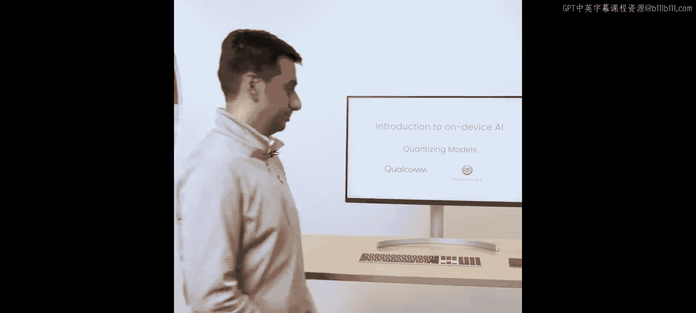

First， I'd like to explain what quantization is and why you should consider quantizing your model。

Quantization is the process of reducing precision of your model to speed up computation and reduce model size。

It can make your models four times smaller and up to four times faster。

 There are three main benefits of quantization。 The first is reduced model size。

 which enables better storage on devices that have limited capacity。

 The second is faster processing because you have fewer computations to deal with。

 Your models will run faster。 And finally， you have lower power consumption。

 which makes it really crucial for battery operated devices。

 Let's now enter the next level of detail of what quantization is。

 Let's say you have a floating point tensor。 It takes 32 B per value。 So in this case。

 you have8 total values。 each occupying 32 B of space。😊。

Quantization can convert that into an integer representation that contains 8 bits per value。

So each of these values in the floating point tensor here can be represented in integer and translated back and forth with just the scale and the zero point Let's learn what the scale in zero point is with a simple example。

Now in this particular figure， the floating point range is represented as a number line above here in red。

And the integer range is represented as a number line here in blue。

 The floating point range is typically much larger than the integer range。

 because this is 32 B of information， While this is 8 bit of information。

 The scale and the 0 point are two concepts that enable you to translate a number from the floating point scale to the integer scale and back。

 Let's look at one particular example。 Let's say you consider the number 12。5。 The scale is set to 2。

35 in the 0。80。 So the quant operation which converts a number from the floating point range to the integer range will divide it by the scale and subtract the 0 point。

 Hence 12。5 by 2。35 gets stored as a 5。😊，Now， in order to convert the integer back into its floating point representation。

 you need to perform the de quantize operation that's described to you in the right。

 the d quants will take the5 at the zero point and multiply it by the scale。

Notice that you do see an error in here because the number 12。5 when converted to integer provided 5。

 which when converted back to floating point gave you 11。

75 and this is the error that's called quantization error。

The goal of the quantization process is to have the minimal error while converting from the floating point range to the integer range。

 and this can be done for a wide variety of applications。

Let's now learn about how you can quantize and what are the ways in which you can get the minimal quantization error there are two main types of quantization。

 one is weight quantization where you only reduce the precision of the model weights so you optimize only storage。

The second is called activation quantization， where you apply a lower precision to activation values so that you can accelerate the entire inference using lower precision nuumatics。

Here's an example of what weight quantization does。 We took float 32 tensors。

8 of them and converted them into int8 tensors。 This reduced the model size by 4 x in activation quantization。

 we can take a function in floating point like this sig point in red and convert it to a function that can be done with integer computation which is described in blue。

 As you can see， there is an error in approximation of the red function with the blue function。

 and the goal is to minimize this error。Now there are different flavors of weight and activation quantitization。

 the most aggressive being the W8 in8， which means you convert the weights to 8 bit。

 as well as the activations to 8 bit you have the W 8 in 16 quantization where you convert the weights to 8 bit。

 but you keep the activations in a 16 bit range This gives you more to play with when you're approximating the activation while keeping the weights at 8 bit you can even go aggressive with quantization and go all the way down to W4 which involves the weights in 4 bit and activations in 16 bit this is extremely popular for large language models and generative AI applications。

There are two common ways in which you do quantization。

 one is posttrain quantization and the other is quantization aware training Posttrain quantization applies the quantization process after the model has been trained and it does it using calibration which is a process where you learn and minimize the amount of quantization error with some sample data typically you need a few hundred samples to calibrate your model well for posttrain quantization。

Quantization aware training is a process in which quantization is incorporated into the training process and make sure that the model is learning fundamentally integer values This can provide more accurate models in scenarios where post training quantization doesn't work。

The chart on the left describes the posttraining quantization workflow where you have a train model in Fat 32 precision。

 you then provide a quantized representation of the model and integrategerrate representation in order to reduce the quantization error。

 you go through a calibration process where you provide calibration data。

 this is typically a few hundred samples and this calibration process minimizes the accuracy loss and produces a post-train quantization model。

Quantization aware trainings workflow is slightly different where you have to provide training data as part of your training process。

 and as part of the training process， you learn the entire weights of the model and integerrate representation。

 Hence quantization is incorporated into the training process。

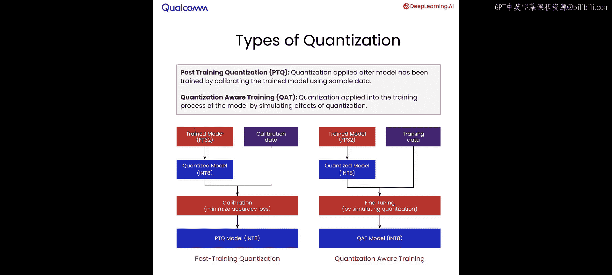

Now let's see this in action in a notebook in this notebook。

 you will learn how to prepare the calibration data set， how to prepare a model for quantization。

 you will perform posttrain quantization， and you will validate the model for off target accuracy as well as sound device performance。

First， you will set up the calibration data， you will use the dataset package with the urban scenes data。

The calibration data here is about 100 RGB images of the urban scenes data。

 The input resolution of the network is 3 cross 1，0，2，4， cross 2，0，4，8。

 Once the data set is downloaded， you will hold out a little bit of the dataset set for testing purposes。

Let's see what one of the images in the calibration dataset set looks like this is an urban scene that has some roads。

 some cars， a train， some buildings and some people。

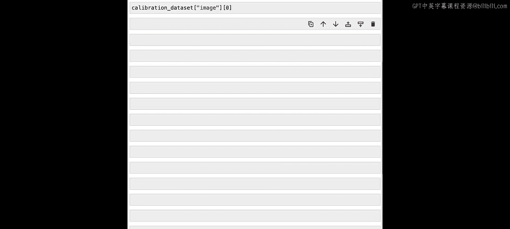

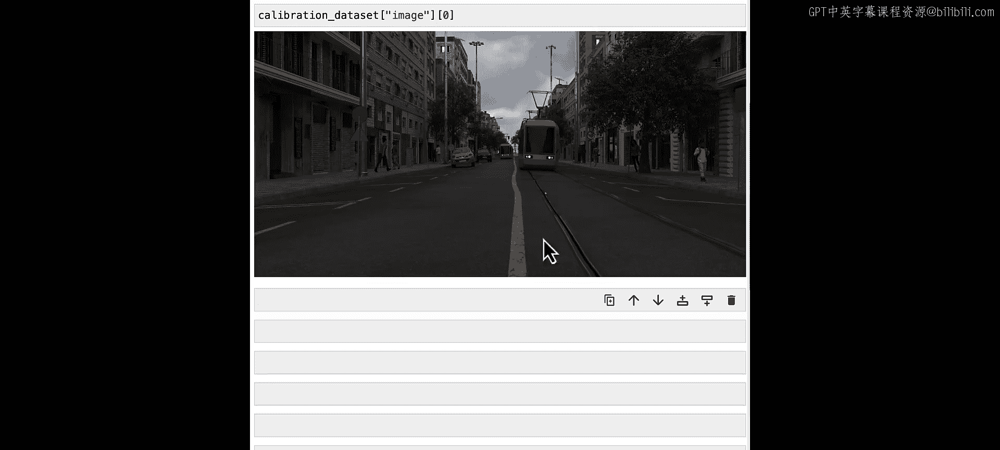

Next， let's set up the calibration or inference pipeline。

You will use the Torch vision transforms package。This particular function will take the image that you saw above and transform it to a torch tensor using the two tensor API。

 Once it's converted to a torch tensor， the dimensions of this particular array are reduced in order to be a  four dimensional array of size 1 cross 3 cross 1。

0，2，4 cross 2，0，4，8。You also need to post process the output of the model that's done using the post process function here。

 which takes the output tensor from the model， ups samplesles it to the original output size。

 and then overlays the image on top of the predictions so that you can view the colors appropriately。

Now that the preprocess and the post processing is set up， let's load up the model in floating point。

 we load that up in Pytoch using the from pretrained API。

 We then take the test sample and pass it through the model to get the output results in floating point 32 we apply the post processing that we just defined so you can view the results in line in the notebook as you can see the output is the predictions overlaid on top of the original image。

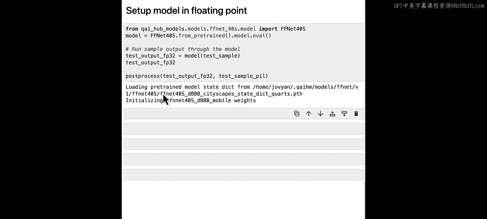

The light pink refers to the road， the darker pink， the pavements， the red， the pedestrians。

 the yellow are the lights， and the blue are the vehicles。

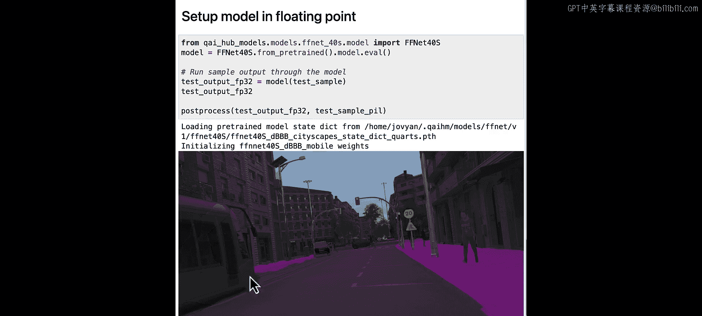

Now let's prepare the model for quantization in order to do so。

 we will use the Python package called EmAT。The quantization preparation process requires you to call this preparepa model function of AE。

This particular prepare model function annotates all the floating pointarrows that are there in your model。

 this includes the weights as well as the activations。

And sets up the automatic integer versions of that same graph。

 so you can set everything up for the calibration process that comes right after。

Now let's perform post training quantization on this model。

 we've written a simple function that passes calibration data to this model and learns all the calibration parameters that are required for post training quantization。

This particular function will take a few minutes， and the compute encodings is the main aspect of this computation。

 The compute encodings function make sure that it learns the correct zero points in the scales for all of the parameters in the graph so that you can have minimal quantization accuracy。

Once the calibration process is complete， you can then provide the same test sample through the fully calibrated and quantized model in your Pytoch environment and get the sample outputs that are also fully quantized。

 The resulting output will pass through the same post processing function that we wrote down for the float 32 version and you can see the results in line。

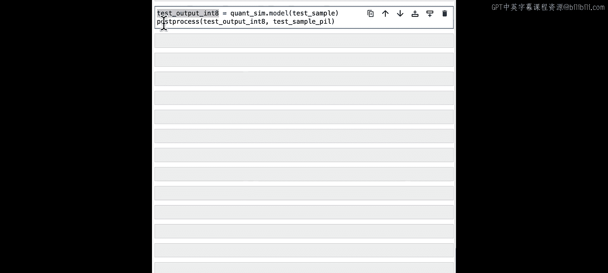

As you can see， the output predictions from the integer model match up the float model quite well。

 You have the road that's depicted here in light pink， dark pink for。

The paymentsvements red for the pedestrians， yellow for the lights and blue for other cars。

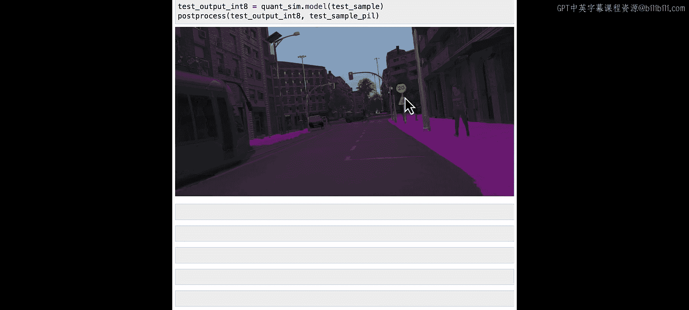

As the final step， you will export the quant model for the device。

 you will use the same quantized export function that you used。

In the second lesson with the Samsung Galaxy S 23 device。

Now the Qas model is then submitted to the server， optimized for the device。

 a device's provision to measure performance， and a summary of that particular model's performance is provided to you。

This particular function takes about a couple minutes to run。As you can see。

 the performance results on the device shows that this particular model ran in about 6。

4 milliseconds， so that's about 4 x faster than our model。

 It ran entirely on the neural processing unit and memory consumption was between 1 and 10 meby。

 The peak signal to noise ratio was a little bit lower than the floating point model because this is doing integer computation and the model was about 33 Db with PSnR。

 just as a reminder， anything more than 30 is typically considered good。

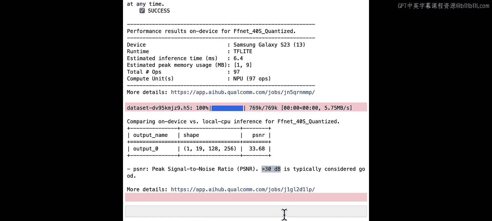

The impact of quantization both on model size as well as performance is significant。

 the model size reduced here from 55 mebytes down to 13 mebytes， and the latency improved from 16。

9 milliseconds to 4。6 milliseconds， giving you about a 3。7x speed up。

These measurements were performed on a Samsung Galaxy S24。

This concludes the lesson on quantization here you learned how to take a model that was trained in the cloud in floating point precision。

 quantize it to integer precision， thereby producing a model that's up to four times smaller and up to four times faster In the next lesson。

 you learn how to take this particular model and produce an end to end mobile application that you can deploy to do real time segmentation。

 See you there。

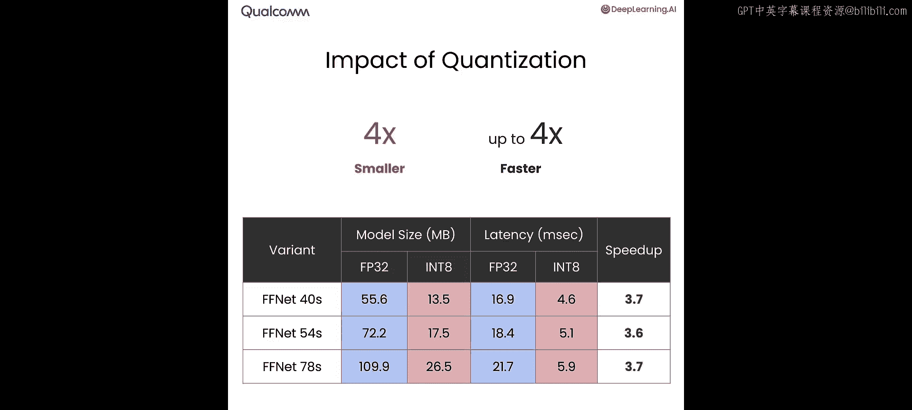