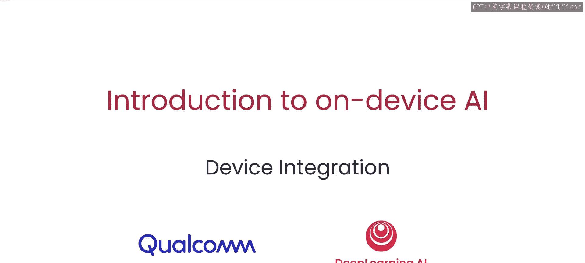
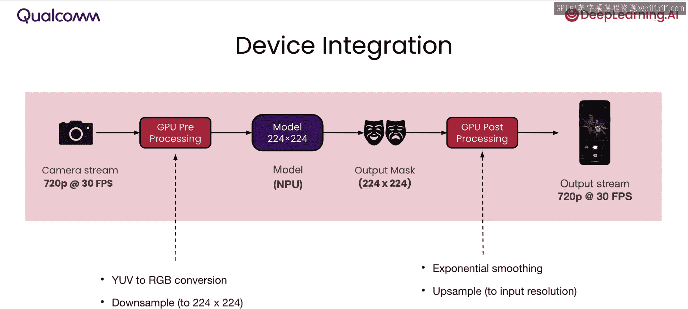
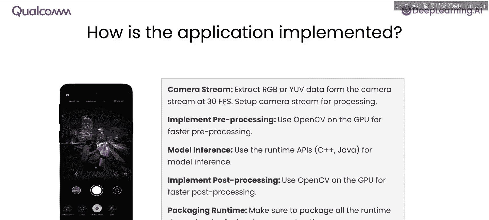
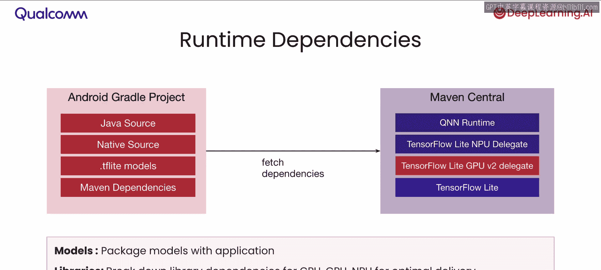
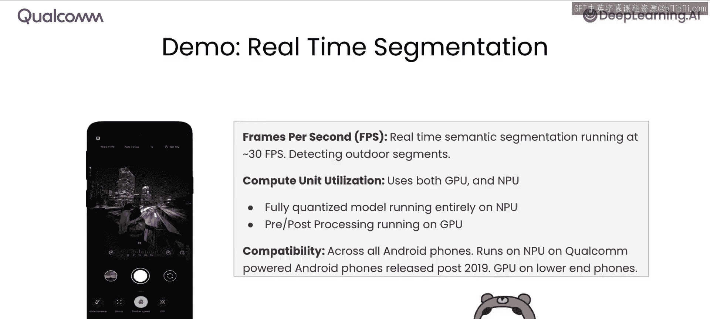
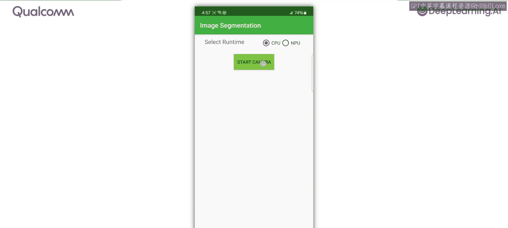
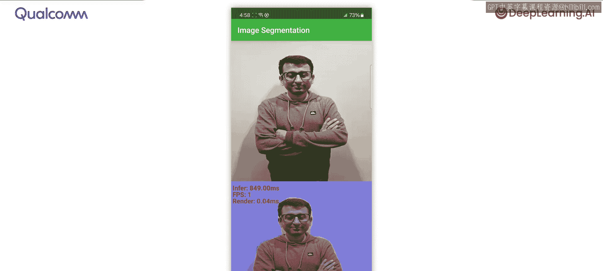
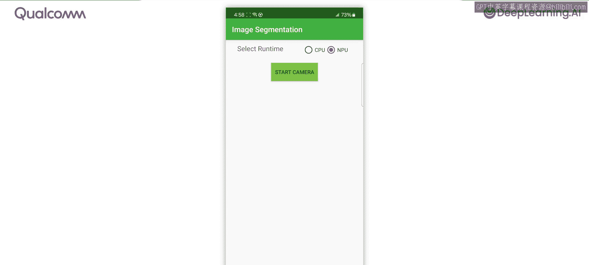
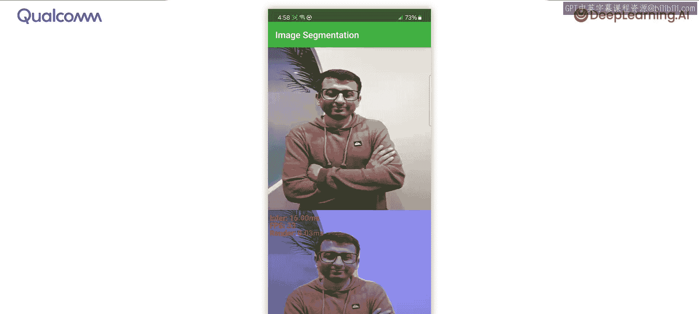
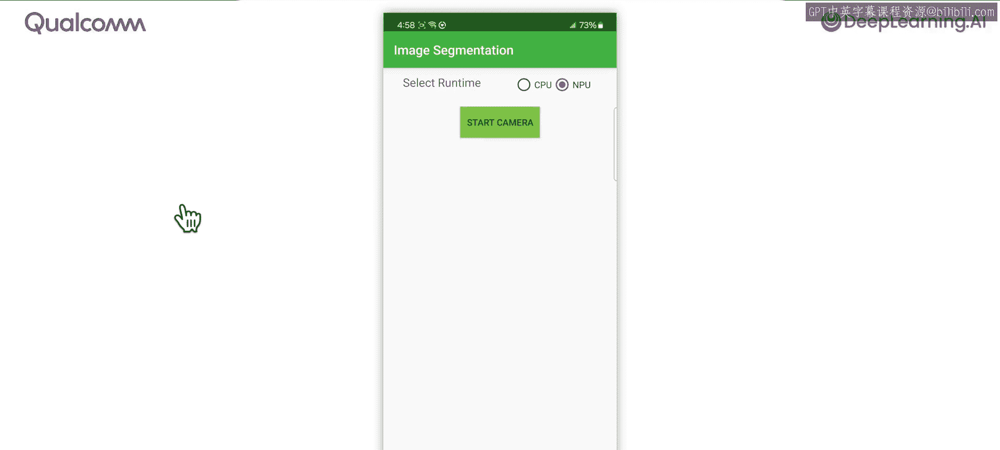

# 吴恩达《设备端人工智能简介｜Introduction to On-Device AI》中英字幕（英文可关） - P6：6.device integration.zh - GPT中英字幕课程资源 - BV18m421K7uc

In this lesson， you will learn how to integrate the AI model into a smartphone application on device。

The model will take frames directly from the camera and give you results that you will be able to see in a live demo of real time segmentation operating at 30 frames per second on a smartphone。

Let's have some fun。Now let's look at how you can integrate a model into an on device application。

In this particular application， integration requires you to have an understanding of how data gets transformed all the way from the camera stream into the output stream。

Deivvicice integration typically is the process in which you integrate your model as part of a processing pipeline。

The pipeline starts with the camera stream， which gives you data either in RGB format or YUV format。

 the GPU preprocessing phase takes the data from YUV to RGB because the model requires RGB and it typically down samplesles to the resolution in which you train the model if you have a model that's trained。

 let's say， in 224 cross 224 resolution。 the downsampling requires you to take the resolution of the camera stream。

 which is 720p and convert it to the resolution of the model which is 224 cross 224。

The model is run on the neural processing unit as efficiently as possible in segmentation applications。

 you get an output mask， which is typically the same resolution of the model。

 so in this case the output mask is 224 cross 224。Once you get the output mask from the model。

 you then perform GP based post processing， which typically involves smoothing up sampling to the output resolution。

 thresholding， as well as blurring in order to nicely fuse the output mask on top of the image。

 The result is an output stream with the predictions overlaid on top of the camera stream。

So how is this application going to be implemented。

 There are five main parts of how this application is implemented。

 The first is camera stream where you have to extract the frames from the camera stream。

 let's say at 30 frames per second。 and you have to understand what the camera stream provides。

 It's typically either RGV data or Y Uv data。 Then you have to implement the preprocessing。

 This is done using Open CVv on the GPU for faster preprocessing。

 It is extremely important to use the GPU to get the best performance。Third is model inference。

 which is done on the device using the runtime APIs。

 which are typically C plus plus or Java based APIpis for model inference。

 You should ensure that the model runs on the neural processing unit for best performance。Next。

 you should implement post processing， which takes the output of the model and uses open Cv on the GPU for faster post processing in order to overlay the outputs on top of the display。

 And the most important bit is the packaging of the runtime。

 You should make sure your application packages all the runtime dependencies to maximize hardware acceleration。

So to give you a sense of how runtime dependencies are managed。

 a typical Android project has your Java source， your native source。

 and various dependencies for your source code。Applications that have AI based models typically require the models to be packaged as part of the application。

 So this is the box here with the Tf light models。 Now。

 the runtime also need to be packaged with your application and these are also bundled up separately。

 you have the Tensorflow light runtime， which is the package that has only the CPU implementation。

 you have the GP delegate， which is an extra dependency to be able to use the GP for processing on older devices。

 and then you have the NP based delegates， which are specialized libraries that are provided in order for you to tap into the NP。

 So you have options to package your model either with application or downloaded over the air if it's large in the same way the libraries can also be deployed either with your application or bundled over the air to reduce the size of your application。

These are all really important considerations for you to be able to provide the best possible user experience for your application users。

Now， let's see this particular application in action in a real demo In this demo。

 you will see a 30 frames per second real time segmentation model that we've trained and quantized here。

 We will showcase the compute unit utilization with the NP and see the difference between the NP and the CPU。

 This application is compatible across all Android phones。

 It runs on the NPus on quacomm powered devices that release post 2019 and GPus on all other phones。

 Let's see this in action。 So let's load up this real time segmentation demo。😊。

I'm going to start off by running this on the CPU so you get a sense of how the CPU performs for this model。

I'm going to click the start camera button。

And you can see the real time segmentation of Ismail here。The dark blue being the background。

 and the red being。Ismailel， you only get about one frames per second。

 It takes about 800 milliseconds to run the model on the CPU。 It's extremely slow。

So now I'm going to switch over to use the neural processing unit。

And press the start camera button again， as you can see， things are much snapier。

 You can run this at 30 frames per second as Ismail moves around， the tracking is much more accurate。

Real time segmentation running on the device， on the neural processor。

So that was exciting。 you saw realtime segmentation running a neural processing unit at 30 frames per second extremely efficiently being able to detect people accurately。

 so in this lesson you learned how to deploy the model that you had quantized and trained for the device for realtime segmentation you learned how to deploy this model inside of a camera pipeline that involved preprocessing as well as postprosing and finally you saw a demo of this particular model in action。

