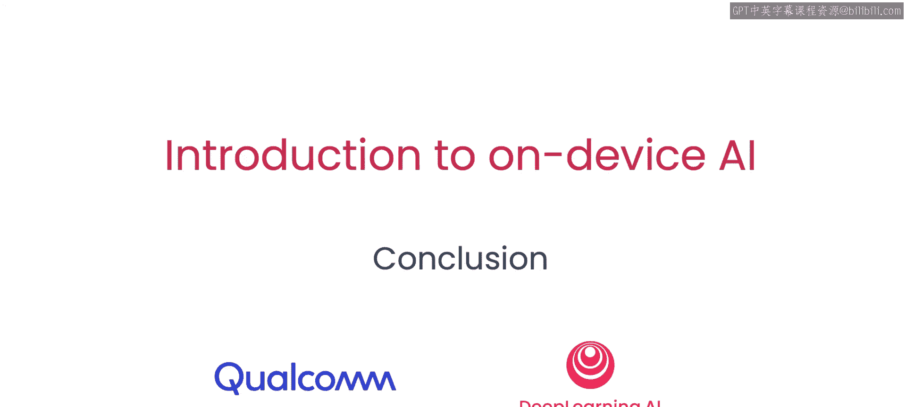

# 吴恩达《设备端人工智能简介｜Introduction to On-Device AI》中英字幕（英文可关） - P7：7.conclusion.zh - GPT中英字幕课程资源 - BV18m421K7uc

Congratulations on completing this course in this course you learn about the importance and ubiquity of on device AI。

😊，You learned how to take models that were trained in the cloud and prepared them for on deviceice deployment。

 you ran your first model on device with just a few lines of code。

 you learned how to quantize your model to improve efficiency by as much as 4x and finally you saw how to build an end to end application running on your smartphone in real time and looking forward to seeing what you will build on your own。

