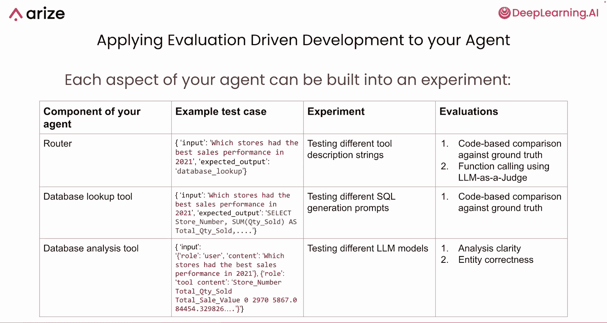
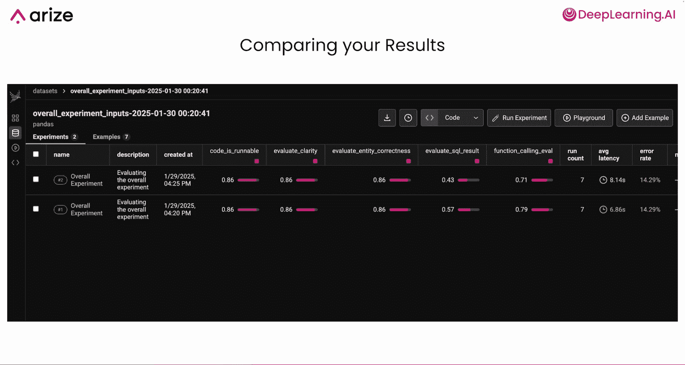
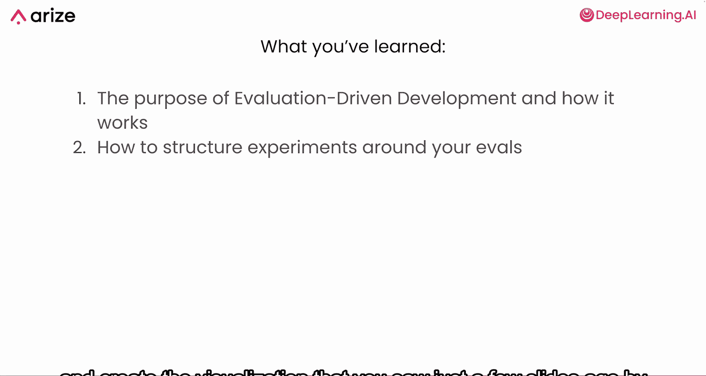

# 吴恩达《评估 AI 代理｜Evaluating AI Agents》中英字幕（deepseek-R1翻译 - P10：10.adding structure to your evaluations.zh_en - GPT中英字幕课程资源 - BV1HTAHebEuj

So far， you've learned how to evaluate your agent's skills， router and path convergence。

 You'll now learn how to combine your evaluators into a structured experiment to iterate on and improve your agent。

Let's dive in E driven development is a concept that involves using evaluations and measurements from your agent to help guide where you spend your time improving and iterating on and developing your agent。

Evaluation driven development is made up of a few different steps。 First。

 you curate a data set of test cases or examples that you could send through different variants of your agent。

Next， you send each of those different test cases through those different variants of your agent。

 each time changing things like the model you're using， the prompts you're using or the agent logic。

And then once you run those different test cases through those different variations of your agent。

 you take the results of all of those different experiments and run them through your evaluators。

Those evaluators will give you a set of scores that you can then use to compare the different iterations of your agent on an apples to apples basis。

Now this is presented linearly in the visualization here。

 but in practice this tends to be more of a cycle， especially as you move your agent into production。

LLM apps require kind of iterative improvement as you're working on them。

 and so typically what' will happen is you'll go through this full process。

 you'll release your agent or you'll get it into some other people's hands。

 and then you'll realize that you wanted to add in different test cases or different evaluators and so you can always update and change each of these different pieces as you're going and then you can create a flywheel here where you're incorporating information from production back into your development process using evaluation driven development。

 diving into each of these steps in a little bit more detail。

You start by curating a data set of test cases。The idea here is to be more comprehensive than exhaustive。

 you can have a set of examples that are representative of the inputs that you expect your agent to receive。

 and you just really need one or two examples from each of the different types of inputs that you might get。

 you don't need to have hundreds and hundreds of examples。

 especially if there's similar types of examples。And these examples can come from either live runs of your agent or can be constructed beforehand manually。

 or even in some cases generated using another model In practice。

 you often start by constructing the examples yourself and then add to them from live data as you release your agent。

And then wherever possible， it's always good to include expected outputs along with your test cases。

 you may not always have expected outputs， but if you can include those it unlocks different types of evaluations that you can run。

LLM as a judge EVs can be used even if you don't have expected output。

 but certain code based EVs do require an output to compare against。

With your data set in place and your test cases is in place。

 then you can start to make changes to your agent and track each of those changes。

So some tests that you can often do are changing things like your prompts used by your agent。

 changing the tool definitions that you're passing into your router。Changing the route logic itself。

 changing some of the skills or the skill structure。

 or just swapping in a new model that you want to test out。

And the practice of sending each of your test cases through a variation of your agent is often referred to as an experiment。

 where you are experimenting with a certain version of your agent。

And you can use those experiments to record and measure results from each of those different runs。

Once you have all your experiment data collected， then you can use all of your evaluators from the previous lessons that you've built and apply them to the results of those experiments so you can use your codebased evaluators。

 your comparison against ground truth or checking if generated code is runnable。

 as well as the convergence evaluators that you've run。

 and you can use your LLMs of judge evaluators like function calling。

 analysis clarity and entityTT correctness。Now， how can you apply this to your agent？

As a quick reminder， your agent is set up to use this open AI router with function calling and then three different skills that you can evaluate。

First， taking an example of how you would set up an experiment around with the router。

You might have an example test case that looks something like this where you have an input。

 which is which stores have the best sales performance in 2021 and then an expected output。

 in this case， the database lookup tool is the tool that should be chosen by the router。

And then you might want to experiment with trying different tool descriptions。

 so if you think back to the JSON object that you pass into your LLM router。

 you might want to modify the description that's given to each tool to see if that improves your router performance。

And once you have those experiments run， you can evaluate the results using either code based comparison against ground truth because here you have that expected output。

 you have that ground truth data。Or you can use a function calling LOM as a judge。

Taking another component of your agent， you have your database lookup tool or skill。

And you might have a test case that looks something like this where you have the same input from the previous round。

 and then in this case the expected output is some SQL code that you see there。

And so if you notice here that SQL code is an intermediate step within your database lookup tool。

 first it generates SQL and then it runs that SQL and gets an output。

 so that's one thing to keep in mind here is that again you can evaluate just the SQL generation part of your database lockup tool。

Invite you to pause the video here for a second and see if you can think of an experiment and some evaluations that you could run on this database lookup tool。

So one experiment you could do would be testing different SQL generation prompts。

You could also test different models or other pieces of that as well。

 and then you can use your code based comparison against groundund truth evaluator similar to what you had looked at in previous notebooks as well。

Because you have that ground truth to compare against。Next。

 you look at the database analysis tool in this case you might have a test case like the one you see here where you have message from a user and then you actually have some retrieved data because the database analysis tool takes in both the user question as well as some data to analyzeize so you'd have to have both those pieces in your test case。

And then you don't actually have an expected output in this test case。So once again。

 invite you to pause the video and see if you can think of an experiment and then an evaluation that you can run in this case。

So here one experiment could be testing different LLM models。

 you'd also test different prompts or other kind of logic changes there too。

Then you can use the analysis， clarity and entity correctness。

 LLM as a judge evaluations from previous slides and notebooks that you've seen to evaluate the results。

And as you structure all of these together and start to run multiple iterations of your agent with multiple different evaluators and create a whole process around this。

 you can end up with a dashboard or heads up display that looks something like this。

 you have each row as one run of your agent and then all of your evaluators as different columns here and you can measure okay what are the effects of each change that I'm going to make to my agent across not just one part of the agent but each part of the agent holistically。

And then again， as you start to move your agent into production。

 you'll find that you're going to come up with new test cases。

 new evaluations and new changes that you want to make using some of that production monitoring data that you have。

 and then you can bring that back into your testing and development process so this whole experimentation framework and this whole evaluation- drivenn development framework enables you to not just create a strong application and development。

 but also incorporate production learnings that you have into your development process and create a large flywheel here that you can use to create a better and better agent over time。

In this lesson， you've learned the purpose of evaluation driven development。

 what it is and how it works， and you've learned how you can structure experiments around your EVs to scale them as you continually improve your agent。

In the next notebook， you're going to implement some of these techniques and create the visualization that you saw just a few slides ago by adding lots of evaluations to the agent you've been working on so far and structuring them into an experiment。

