# 吴恩达《评估 AI 代理｜Evaluating AI Agents》中英字幕（deepseek-R1翻译 - P11：11.adding structure to your evaluations(code).zh_en - GPT中英字幕课程资源 - BV1HTAHebEuj

In this final notebook here， you can take everything that you've learned and compose it all together to create one large experiment to be able to test out all the different parts of your agent at once。

 so you'll combine some of the evaluators that you created in previous notebooks along with the experiment structure here to create an easy way to iterate on your agent As before。

Import some different libraries that you're going to use。

You should look familiar at this point in your LLM classify some of the experiment functions that you might use。

 and then from UTLs， some functions， including the agent that you've been working on so far。

Now you're going to run a few different evaluators。

 so it's helpful to define a you eval model at the beginning。

 saying this is the evaluator LOM judge model you're going to use throughout。

And then you're also going to be accessing the Phoenix client so you can go ahead and add in the Phoenix client。

Now you're going to use one big experiment to actually structure this code here。

 and so the first step is creating the data that will be run through for that experiment。

So to start out with， you can create a data set here。And this is a pretty big data set here。

 you have the questions that are being inputted， you also have some ground truth data like the SQL results that you expect for those questions。

 as well as some ground truth data about the SQL generated for some of those questions。

 because you're combining multiple different evaluators here。

 you have some multiple examples of ground truth data that's being added。But again。

 you can use the same syntax as you used previously to create a data frame out of those examples。

 and then upload that data frame into Phoenix under the name， overall experiment inputs。

And one other thing that's important to note is because you have multiple keys this time。

 when you upload a data into Phoenix， you define which of those keys are input values。

 so in this case just a question and then which of them are output values。

 so these are your expected outputs， so your SQL result and SQL generated keys。

You can run that and your data set will be uploaded into Phoenix。

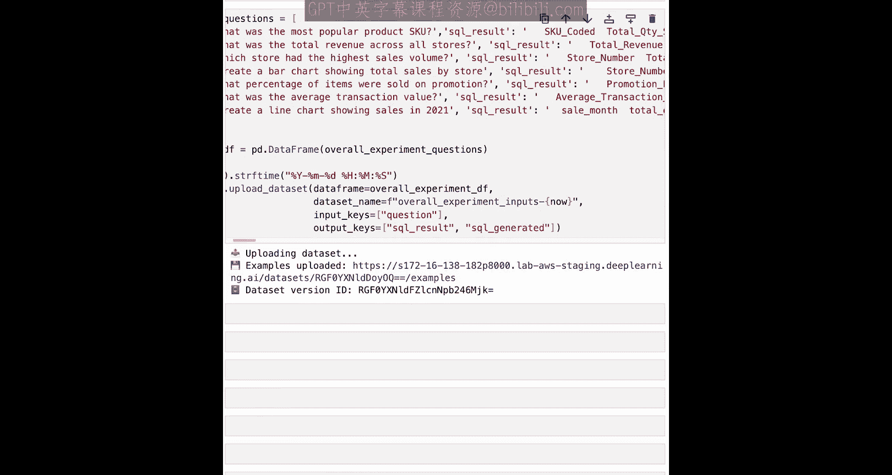

You can take a look and in Phoenix within the datas section。

 you may need to refresh your Phoenix to have that appear。

And then you'll now see you have this overall experiments input data set。

And if you click into any of these examples， you'll see that each one has input keys for question and then expected output keys for SQL result and SQL generated。

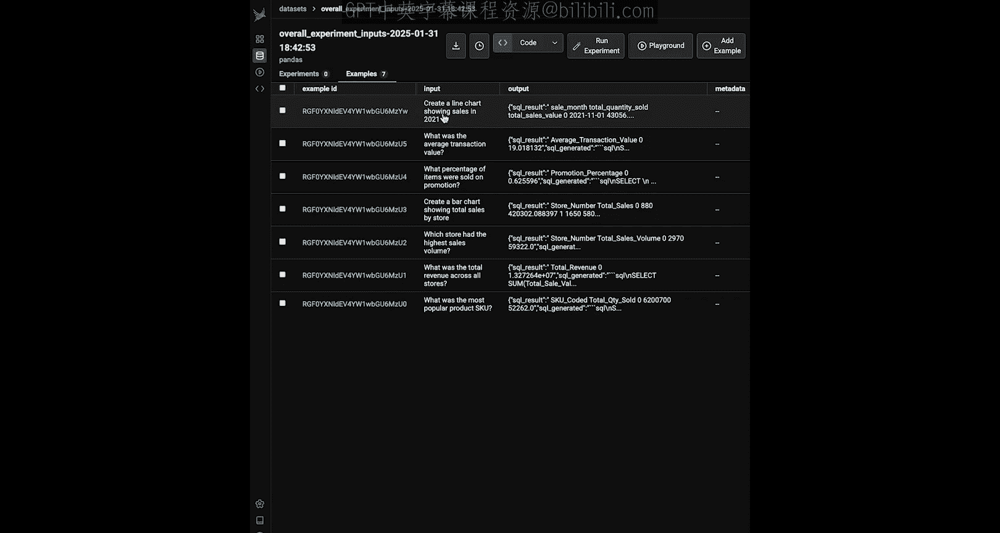

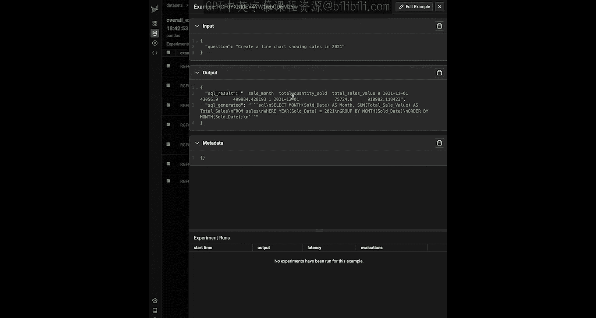

Now you might be asking why we just have groundund truth The for the SQL result in SQL generated。

 the reason for that is that you can still use LLM as a judge when you don't have expected ground truth The to compare against。

 so for some of the other tools you can use an LLM as a judge approach or you don't need that expected value。

So on the subject of as a judge， now it's time to define all of your different evaluators that you're going to use。

And there's two different LMs of judge prompts that you might want to use here。

And these should look familiar from the previous notebooks that you've run。

 so if one is your LM as a judge for clarity in your response。

And then another here is for what we're calling entity correctness。So in this case。

 this is another type of LLM as a judge that you can run on the output of your model or your data analyzer step to check to make sure that any variables that are mentioned。

 any SQL columns， anything like that are mapped correctly in the input the data throughout the run。

 and then the output， this is basically making sure that your agent doesn't start referring to SKU or SkeU columns as store IDs or something along those lines。

Now you can define your evaluator functions。 And so you can go one by one for these。

 starting with the router。So for your router， you're doing a function calling eval and because you're using this in the context of an experiment。

 you can expect that this is going to be sent an input and then an output。

In some cases you'll also have expected output in this case you don't have ground truth data for function calling so you just have an input and then the output。

 this is the original input that the agent got and then this is going to be your output from running your agent So what you'll do is from that output grab some of the tool calls that were made that'll be one of the entries in the output。

And then you can construct together a data frame using the question as one key and then any of the different function calls as the other rows here。

 and the reason that you're constructing a data frame is one so that it works nicely with the LN Classify method and two because you might actually have multiple tool calls per question here so you might have a case where a question came in and your agent decided to call two different tools so this structure here will create a data frame that's two rows with the question and the tool call column。

And then you're going to use your LLM as a judge， LLM Class method here again， using that data frame。

 the tool calling prompt template as before， exactly the same code that you ran app previously to run your LLM as a judge for function calling。

 a couple of notebooks other。So you can define that method and then here you're returning back the score。

 this is going to be the mean score here because again。

 you could have two different LLM as a judge or two different functions that were called by your agent。

 so you're going to have to have some way of reporting back the overallall score for this run。

Now you can start evaluating your tools。So one of those tools is going to be your database lookup tool。

And so you can grab。A method to evaluate your database lookup tool and so in this case it's evaluating the SQL result。

 and now if you think back to the data frame， you'll remember that you have some ground truth data。

 you have some expected responses for SQL generation so in this case you will still have the output of your agent but then you're also going to ask of the expected value。

 so these are going to be the expected ground truth responses that you have that you defined in your data frame。

And so first it's checking to make sure the output's there。

 and then it's grabbing any kind of SQL result from the actual output that was run， and in this case。

 it's going to grab all the tool responses from the output。

And then this code here will actually loop through all the different tools that were called in that particular run of the agent。

 and then it's going to look for one that matches the name， look up sales data。

And the idea there is you want to make sure that you're just looking at the tool call responses here that are for that look up sales data method。

 you don't want to look for your other two tools in this case。

And then once you have that as your SQL result， then you're going to grab the actual response from that particular tool。

 so all of this code here is just getting you to a point where the SQL result equals the SQL that was generated by your agent when it ran。

And now you can do one more step here， which is to pull the numbers。

 specifically the numerical values out of that sQL result。And then also out of the expected。

getSQL result， so this here is your expected value that's in your data。

And the reason to pull out just the numbers is because in SQL you can define columns in your responses and things like that using different names。

 and this just allows you to make sure that you're not having a case where your agent used a slightly different column name in its response and still got the correct numerical result。

And then this will return true or false， depending on if those numbers match。

Now one thing you'll notice here is that in this case you're using a code based evaluator to evaluate your SQL generation。

 if you think back to a couple notebooks ago， you actually use an LLM as a judge to evaluate your SQL response。

Either of those approaches can be used if you think back to the slides， LLM as a judge will work。

 it may not be 100% accurate， so the method you're looking at here to compare against ground truth is generally going to be a more accurate kind of evaluation。

 but at the same time it relies on you having some of that ground truth data。

 so it relies on you having those expected values which you may not have in large amounts or large scales。

Okay， now moving on to your second tool， you have your data analysis tool。

And there's actually two different evaluations you can run for your data analysis tool that match the two prompts you saw above。

 one is to evaluate the clarity of the response。And so in this case。

 you can use an evaluate clarity method here that takes in the output of your agent and the original input to your agent。

 and then it will construct a quick data frame out of those using the query and response columns because that's what's expected by your LLM as a judge prompt。

 and then it will call the LLM classify method and classify the result of that particular run of your agent。

So this one is exactly the same as the previous LOM as a judge that you ran a couple notebooks ago for clarity。

 it's just now put into this function that you can call that knows to expect things like the input and the output from different steps。

Similarly， you can add another evaluator here for entity correctness， again， same exact kind of flow。

 so you'll have a method you'll create a data frame out of the input and the output。

 and then you'll call LLM Classify using your LM as a judge prompt。

So now you've got evaluators for your router， your tool one， your tool2。

 finally the last piece here is your tool3， which again。

 you can use one that you've used previously here to check if the generated code is runmable。

But to evaluate 203， you can use a code as runnable evaluation here。

 where this time you don't need the input， you don't have any expected values to compare against you just have the output。

So what you can do is you can take that output and you can again pull out any tool call responses。

 this is similar to what you did for the database lookup tool。

 so all of this code here is just getting you to a point where generated code equals the code that was generated when the tool name equals generated visualization。

And then you can take that and make sure that you have stripped away any extra characters that are used there。

 and then at the end here， you can just run your execute on that generated code if it executes correctly return true。

 if not return false， so this is the same evaluation that you used a couple notebooks ago just with some extra manipulation to get it to look for this specific output here。

Great， and now you have your data set as well as all the evaluators that you want to run on your experiment。

 The last piece that you need is your task。 so you can define a task method here， in this case。

 run agent task， and it's going to take that example。

 grab the input question from it and then run your agent on that。 and now you can define that。

And one other thing to call out here is there's this process messages method that's called this is also in your u function and it's just going to take the output of your agent and process the messages to match a little bit cleaner of a format to read。

Now with your data and your task and all of your evaluators defined。

 you're ready to run your giant experiment here， so you can use the run experiment method。

 you're passing in the data， the run agent task， and then for evaluators you can pass in all your different evaluator functions here and what will happen is now each row of that data will be run through that agent task。

 and then the outputs of that will be run through all of your different evaluators。

Go ahead and run that and that will take a second to run it。So once that completes。

 you'll see that you've run seven different tasks through your agent。

 and then you'll see a bunch of output here around all of the different evaluations。So you'll see。

 again you're running 35 evaluations your total because it's five evaluations for each seven case。

 so you'll have quite a bit of output here， that's all normal， that's all looking good。

 you'll have some graphs， and then you'll finally have some scores at the bottom for some of those different runss。

And now if you jump over into Phoenix you'll see a detailed view there as well too。

 make sure you go to your overall experiments input here and then you'll see a bunch of different columns for all those different es so it looks like all the code is runnable。

 the evaluation analysis is clear， the entities are correct。

 looks like some issues of SQL generation and then function calling。

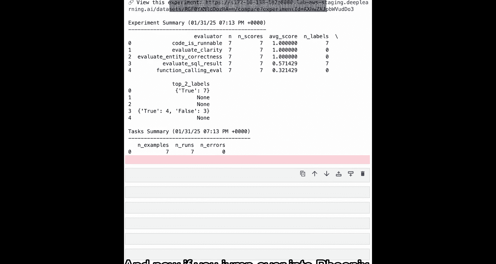

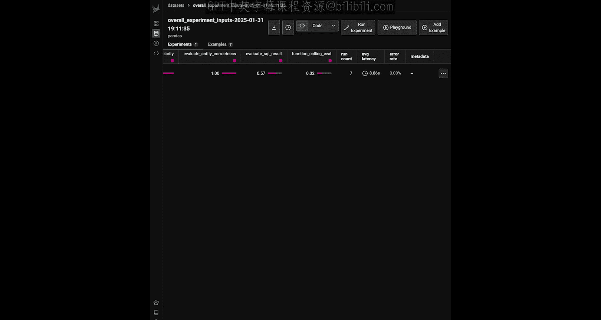

So you could jump into this experiment and see it in more detail so you could see all the tool calls and all the formatted response that you have here for some of these pieces so you could click into those and see more if you wanted to。

And now the question becomes， what do you do with this information and how do you improve your agent？

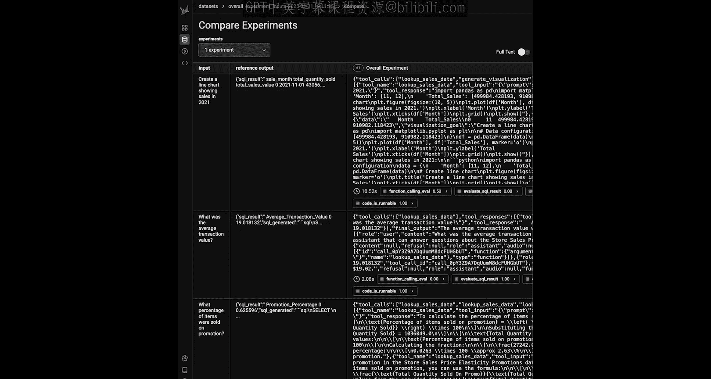

And so you've got really two options here for how to improve your agent。😊。

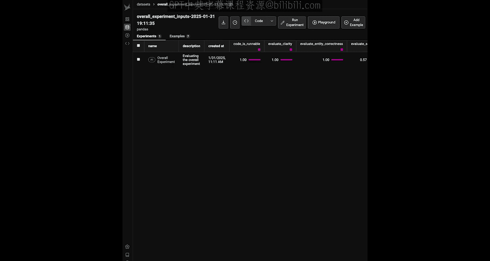

One is in code， you can go in and start making some changes to your agent and running different versions of your agent using the experiment。

So SQL generation was a little bit tough there。 so why not start with changing up the SQL generation prompt So this is your base SQL generation prompt that's being used by your agent and we can add something here like think before you respond。

 you might make bigger changes to it。 this is just a pretty basic change， but one you could try out。

And then I can give a helper function here to just update that SQL generation prompt in practice。

 you probably go into your Asian code， you would actually make the change in the Asian code this way。

 we'll do that same kind of thing here。And then you can rerun your experiment and you'll because you've updated your agent。

 that task is now a new task， so I might want to actually change this experiment name to say V2 and evaluating the overall experiments。

With。Changes to SQL prompt。And then you can run that experiment again and you'll get a comparable line。

And so now if you scroll through those results， you'll see similar kinds of outputs before。

And then you can continue going down see all the results that were run and you'll have your same scores for before and jump over into Phoenix to see those in detail and now you might have to refresh your page you should see a new entry for your second experiment for your V2 and then changes to the SQL prompt and so it looks like if you look at the scores there it looks like SQL didn't really have the changes that you wanted so you might have to have some more changes from there and one of the things it looks like some of the responses that came back are less clear or correct this time that could be due to the change you made it could be due to just the fact that you're running with seven test cases here。

 which is a sort of small amount， so it's always good to do multiple runs of each experiment to get some more statistically significant kind of data back as you're testing your agent's performance。

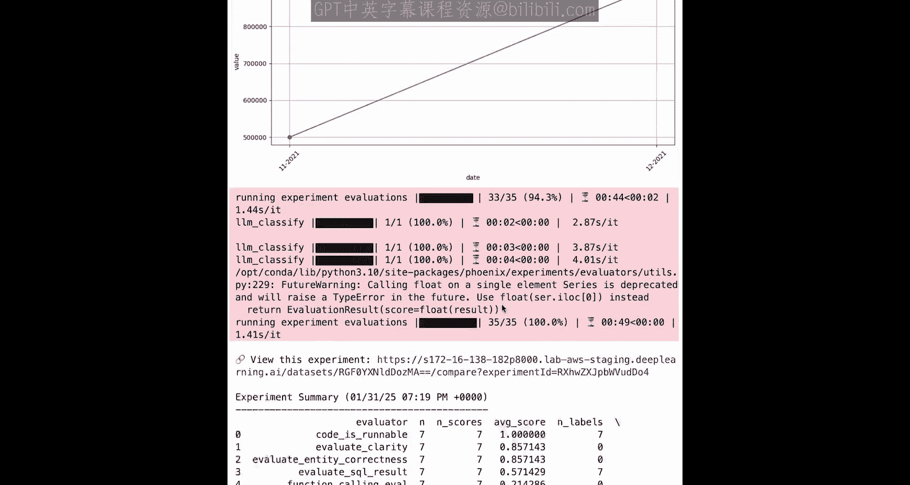

So you can continue to make changes inside of your agent。

 either to one part of your agent or multiple parts of your agent to try to boost these scores over time。

And you can continue to make those code changes until you get to the results that you want with your agent。

There is one of the reports that you can use as well too， which is in Phoenix。

 there's a tool called Playground where you can jump into the playground button here and that will bring your dataset into a playground environment where you can make whatever queries you want over your dataset。

And so you could actually take that same SQL generation prompt and run it directly here on your data if you wanted to。

So you could copy over your prompt from your notebook and paste that in here， and then in this case。

 you might want to have it look for specific variables from your inputs and outputs。 So in this case。

 if I use。Curly braces， you can add these curly braces and then you'll actually pull in the question from that particular row so you could use this and if you then ran this。

 you would then have results for each row that you could look at。

 you can use the compare button that will add a second iteration of the prompt。

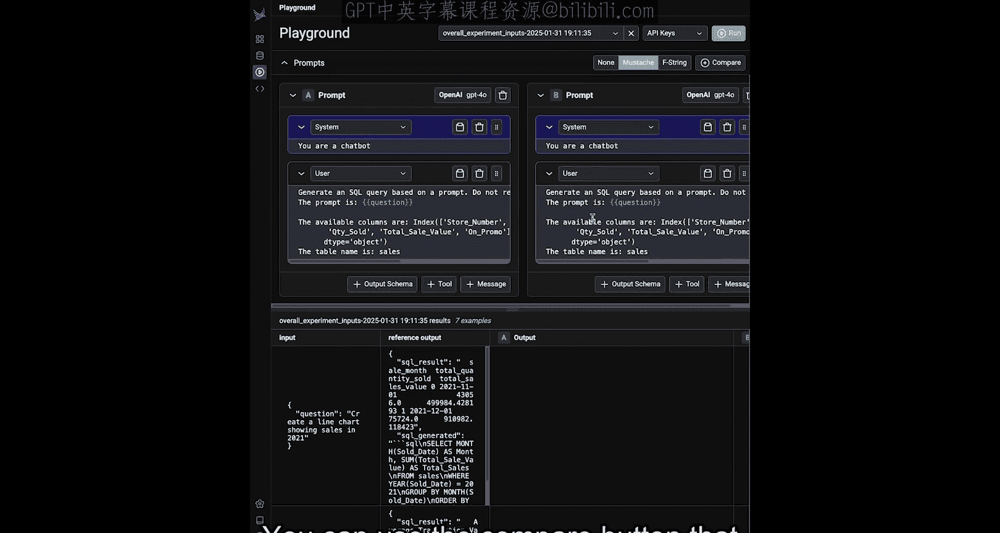

In this case， you're using GP 40 mini， so you can switch that to 40 mini and then similarly over here。

Have consistency there。 And so you can actually make your changes to your prompt directly in the UI here。

 And then this will give you。

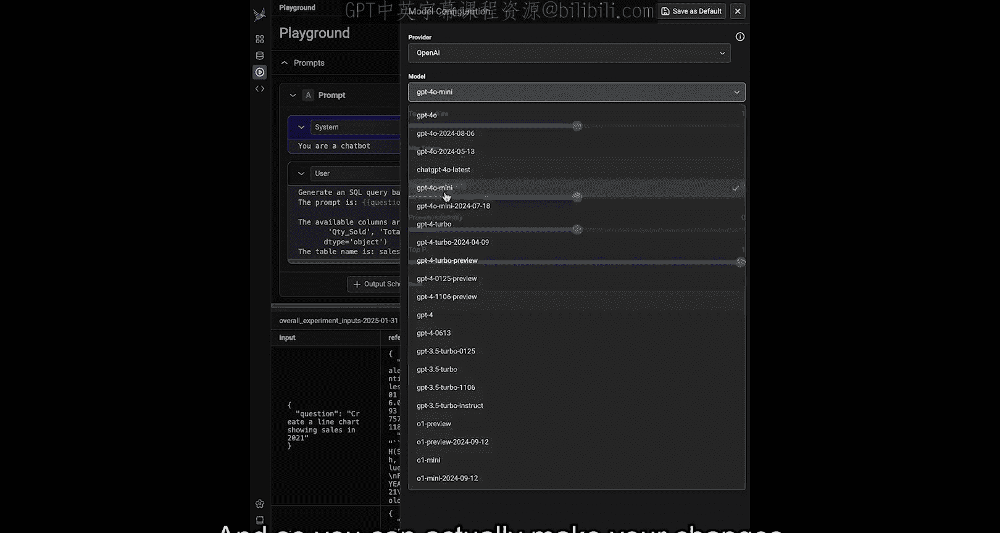

A side by side comparison of the responses， so you could always make the changes to your agent in your code itself and then run them as a new experiment。

Alternatively， you can use this prompt playground tool to run changes directly in the UI and have loaded faster of an iteration cycle as you change them。

No matter if you use either of these different techniques。

 you can make changes to your agent and use your new experiment that you've created to have a really easy apples to Apple's way to compare what are the actual effects of each of those changes so that you're not just moving things around without understanding what the effect of each change to your agent might be。

 so you now have a structure that you can use to iterate on your agent and compare all of those different iterations to each other in a structured way。

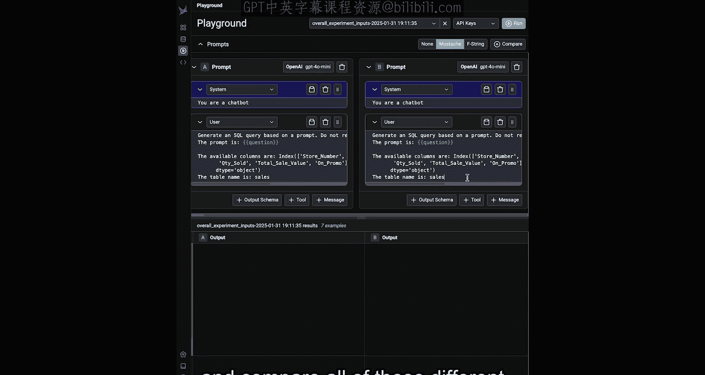