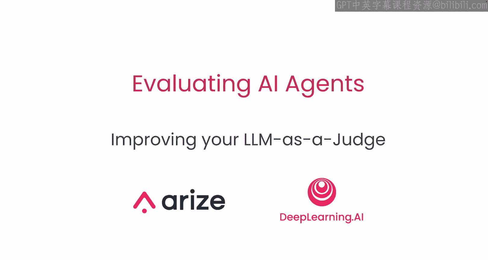
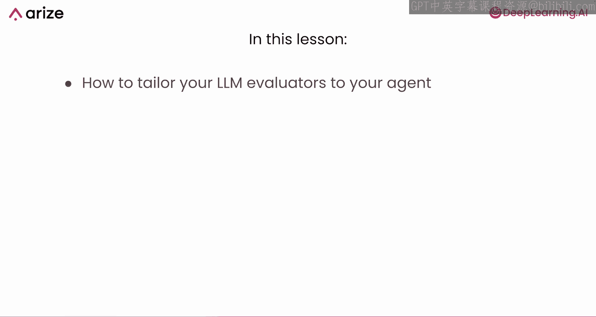
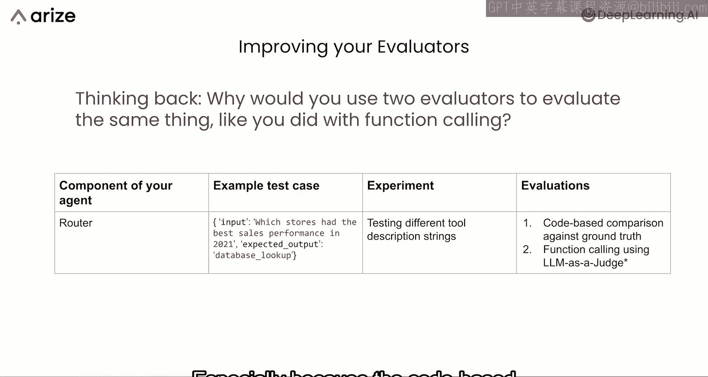
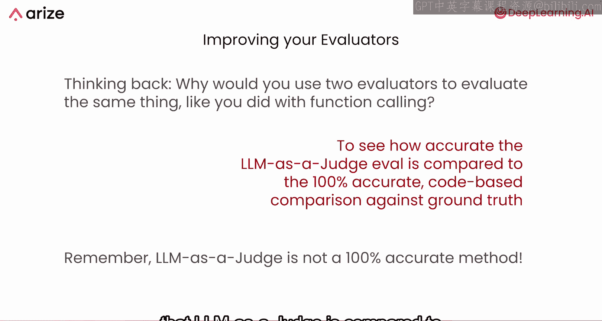
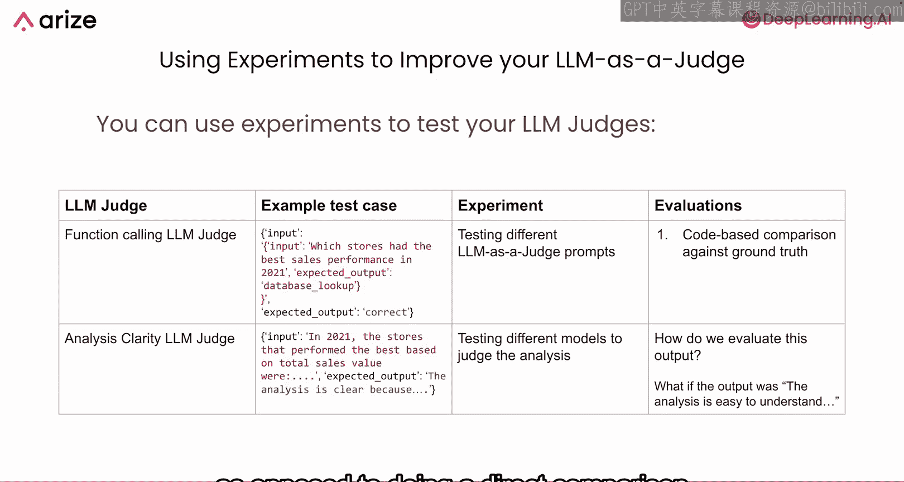
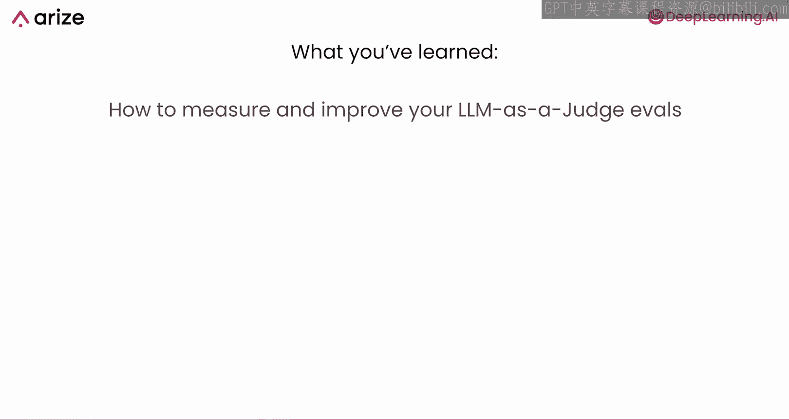

# 吴恩达《评估 AI 代理｜Evaluating AI Agents》中英字幕（deepseek-R1翻译 - P12：12.improving your LLM-as-judge.zh_en - GPT中英字幕课程资源 - BV1HTAHebEuj

For this lesson， you'll dive into how you can improve your LLM evaluators and LLM as a judge evaluations within your agent。

The idea here is that as you use LLM as a judge， you may want to improve the evaluators themselves as those are never going to be 100% accurate。

 as you've learned in previous lessons， so this serves as a bonus lesson here where you can learn how to improve those evaluators as you go through the process of improving your agent itself。

So if you think back to the previous slides lesson， you might have noticed a case where。

You used both a code based comparison against ground truth and an LLM as a judge function calling evaluation to measure the performance of your router。

And you might be thinking， why would you need to use two different evaluators to evaluate the same thing。

 especially because the code based evaluator is going to be 100% accurate。

 so why would you add in the yellow and as a judge evaluator。

Well， the answer there is that you can use this technique to actually measure how effective and how closely your LLM as a judge evaluator aligns to your 100% accurate code based comparison grants ground truth。

Because as you remember， LLM is a judge is not 100% accurate method。

 however it can scale a lot further beyond the comparison against ground truthth。

 you could apply an LLM as a judge eval to all of the runs of your application if you want to。

But it pays to know how accurate that LLM as a judge is compared to your 100% accurate evaluation method。

So you can use experiments to actually improve your ElN as a judge itself。

And experiments that you just learned about in a previous lesson can still be applied this time to your LLM as a judge as opposed to to your agent itself。

It's a little bit meta， but you can use the same techniques to judge your judge in this case。

So you could set up an experiment on the function calling LLM judge。

And you might have an example test case that looks something like you see here where you have an input that's which stores had the best sales performance in 2021。

 and then an output in this case， the database lookup。

 and the important thing is that everything in red there is the input to your LOM judge because you're having your LOM judge。

Judge the performance of that agent So everything in red there is the input and then you'd have your expected output in this case is correct so that expected output is your ground truth data。

And then you could set up the experiment to test different versions of your LMS of Judge prompt。

You might change some of the wording there， or you could add things like few shot examples。

 so you could add in some examples of previous judgments made that were correct to help align the judge into that prompt as well。

And then you can evaluate the performance of your L as a judge using the code based comparison against ground truth。

 in this case comparing to that correct or incorrect expected output label。

And you can use the same approach for another LLM as a judge that you're using， in this case。

 the one you're using to evaluate analysis clarity。And so in that example。

 you might have an input that looks something like you see here in 2021。

 the stores that perform the best ya yada， and then the expected output of the analysis is clear because of x。

 Y， and z。And this time you might judge different types of models that are being used to create that judge label。

 you could also test different LLM as a judge prompt similar to what you did in the previous example。

Now the question here though becomes how do you evaluate that output because while you have expected output。

 it's no longer a clean， just correct or incorrect label。

 it's this expected output of the analysis is clear because of something。

And so what if your LMS as a judge comes back with the analysis is easy to understand because of x Y and z。

 that should be correct， but you can't just compare those strings exactly。

 that's where you can use something like semantic similarity to compare the meaning of each of those strings in a numeric way as opposed to doing a direct comparison between output and expected output。

So in this lesson， you've learned how you can measure and improve your LLM as a judge Evals using structured experiments。

In your next and final lesson， you'll learn about moving your agents into production and monitoring those agents in production。

 as well as wrap up all the lessons that you've learned here in the course。

