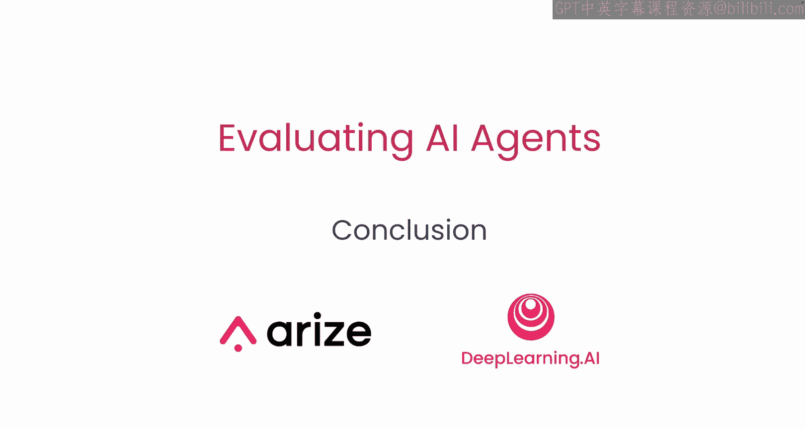

# 吴恩达《评估 AI 代理｜Evaluating AI Agents》中英字幕（deepseek-R1翻译 - P14：14.conclusion.zh_en - GPT中英字幕课程资源 - BV1HTAHebEuj

Throughout this course， you learned how to trace， evaluate and improve a code based agent。

 You can now take what you learned and apply it to any other agent framework。

 Please check out the resource section that we've included after this lesson and I can't wait to see what you'll build on your own。

