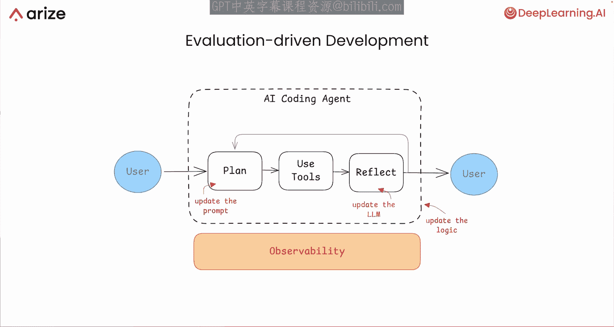
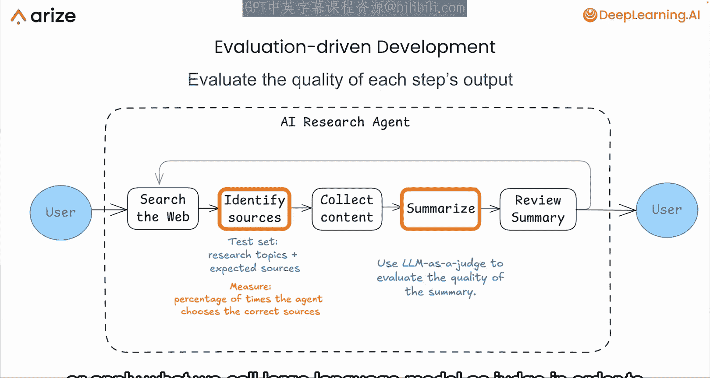
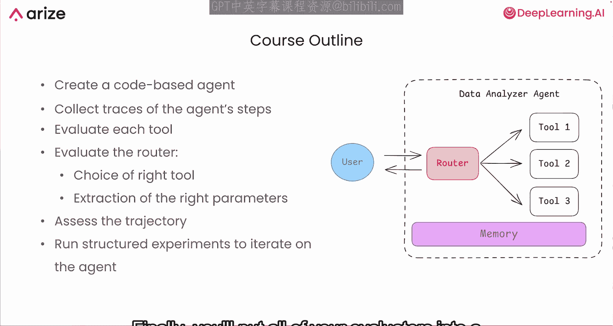
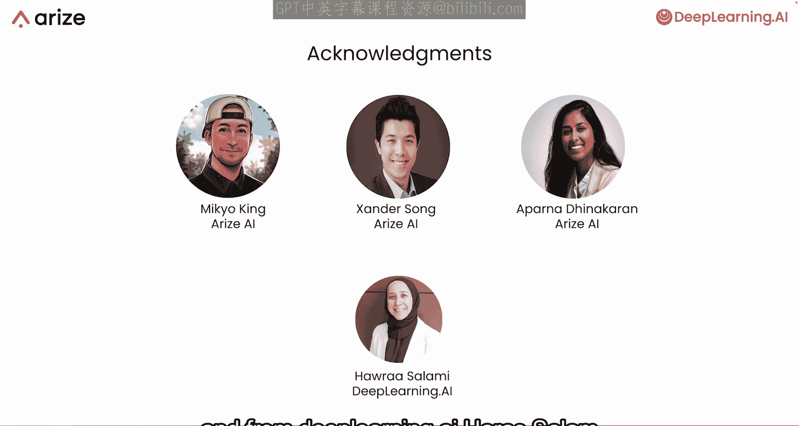

# 吴恩达《评估 AI 代理｜Evaluating AI Agents》中英字幕（deepseek-R1翻译 - P1：1.intro.zh_en - GPT中英字幕课程资源 - BV1HTAHebEuj

Welcome to evaluating AI agents built in partnership with arise AI say you're building an AI coding agents it might have to carry out a lot of steps to generate good code such as plan use tools reflect and so on and using an evaluation- drivenriven development process will make your development much more efficient in this course。

 you learn how to add observability to your agentbased applications that is you will see what it is doing every step of the way so they can evaluate component wise and efficiently drive improvements at the component and then also at the whole system level So if you're asking yourself questions like should you update a prompt a particular step or should you update the logic of the workflow or should you change the large language model you're using having a disciplined evaluation- drivenn process will help you a lot in terms of making these decisions in the systematic rather than the random。

 try lot of things and see what works and a way。😊。

If you've heard of the idea of error analysis， which is a key concept of machine learning that teaches you how to do that in the agent workflow development process。

 if you haven't heard of error analysis that's fine too。

 but it discourse takes an important set of ideas and shows you how to do it to develop agent workflows efficiently。

😊，TheInstructs of this course are John Gurui， who's head of developer relationslations and Aman Khan。

 who is director of product at RIise AI， it's been fun working you on this course Thank you， Andrew。

 we're excited to teach this course， Thank you。So you're building a research agent that searches a web。

 identifies sources， collects content， summarizes findings。

 and then maybe areass if it identifies any weaknesses as an output。

When you're building this complex system you need to evaluate the quality of each step's output For example。

 for source selection， you might create a test set that comprises research topics and the corresponding set of expected sources and then measure the percentage of times that the agent chooses the correct sources or for open-ended tasks like summarization you can prompt a separate large language model or apply what we call large language model as judge in order to evaluate the quality of this more open-ended output of a text summary。

 apart from testing and improving the quality of your agent's output。

 you can also evaluate the path taken by the agent to ensure it doesn't get stuck in a loop or repeat steps unnecessarily。

And so in this course you'll learn how to structure your evaluations to iterate on and improve both the output quality and the path taken by your agent You'll do this by creating a code based agent that operates as a data analyzer。

 the agent will have access to a set of tools that allow to connect to a database and perform analysis。

 a router that identifies what tool to use and a memory that keeps track of the chat history。

You'll collect and evaluate traces of the steps taken by your agent to process a query and visualize the collected data You'll then learn how to evaluate each tool in your agent workflow using different types of evaluators you'll also evaluate if the router chooses the right tool based on the user's query and if it extracts the right parameters to execute the tool and assess the trajectory taken by the agent Finally。

 you'll put all of your evaluators into a structured experiment that you can use to iterate on and improve your agent。

While the course focuses on applying evaluation during development。

 you'll also learn how you can monitor your agent during production Many people have worked to create the course。

 I'd like to thank Niko King Zander Song and Ana Dia Karan from Arise AI and from Deepleental AI Harra Salami has also contributed to this course。

John and Amman are both experts on the important topic of how to evaluate AI agent workforces。

 let's now go into the next video and I hope you enjoy the course and learn a lot from John and Amman。

