# 吴恩达《评估 AI 代理｜Evaluating AI Agents》中英字幕（deepseek-R1翻译 - P2：2.evaluation in the time of LLMs.zh_en - GPT中英字幕课程资源 - BV1HTAHebEuj

AI agents are software applications powered by LLMs In this first lesson。

 you'll learn how evaluating LLM based systems differs from traditional software testing。

 We'll then examine what agents mean and discuss what you need to consider when evaluating agents。

 Let's dive in。

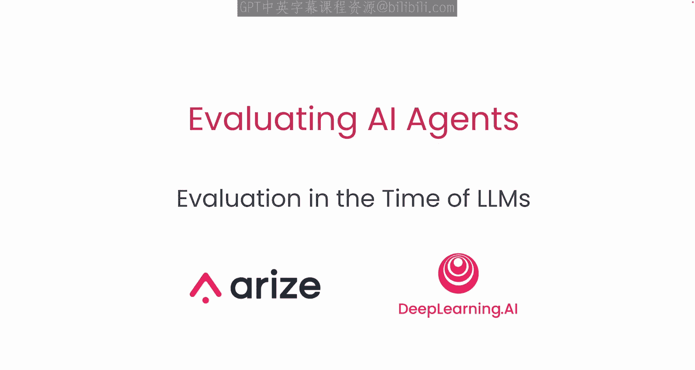

When you think about evaluation in general， there are typically two layers。On the left hand side。

 you have LLM model evaluation。 This focuses on how well a large language model performs a specific task。

 You might have seen benchmarks like MMLU for questions spanning math， philosophy。

 medicine and more or human Eval for cogeneration tasks Provis often use these benchmarks to showcase how their foundation models stack up。

On the right hand side， you have LLM system or application evaluation。

 this zeros in on how well your overall application， of which the LLM is just a part of performs。

Here， the data sets being used for evaluation are created， either manually。

 automatically or synthetically using real world data。

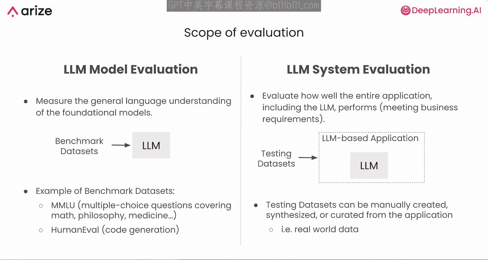

When you incorporate an LLM into a broader system or product。

 you'll want to understand that the entire system， including the prompts， tools， memory。

 and routing components are delivering the results that you expect。

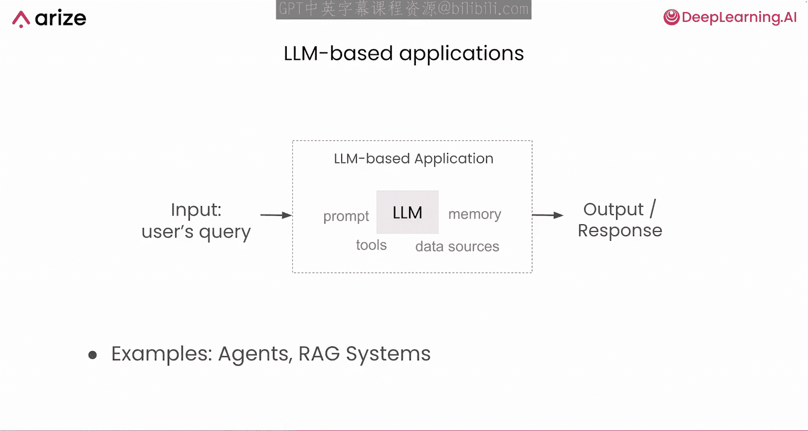

You may have experience with traditional software testing， where systems are largely deterministic。

 You can picture that like a train on a track。 There's usually a well defined start and end。

 and it's often straightforward to check whether each piece。

 the train or the track is working correctly。LLM based systems， on the other hand。

 can feel more like driving a car at the a busy city。 The environment is variable。

 and the system is non deterministic。With software testing。

 you rely on unit tests to check individual parts of the system and integration tests to make sure they fit together as intended。

 and the results are usually pretty deterriministic。Unlike traditional software testing。

 when you give the same prompt to an LLM multiple times。

 you might see slightly the different responses， just like how drivers can behave differently in city traffic。

You're often dealing with more qualitative or open ended metrics。

 like the relevance or coherence of the output， which might not fit neatly into a strict past fail testing model。

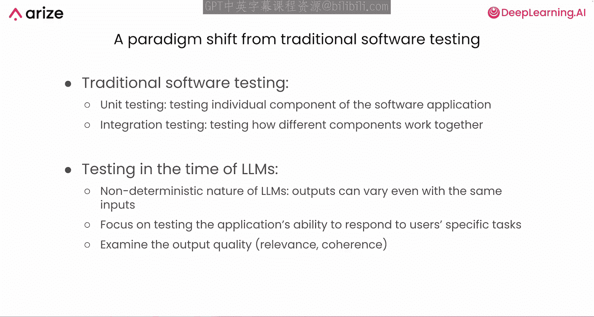

There are a number of common evaluation types for LLM systems。 We have hallucination。

 is the LLM accurately using provided context or is in making things up retrieval relevance if the system retrieves documents or context。

 Are they actually relevant to the query Que answering accuracy。

 does the response match the ground truth or user needs。

 toxicity is the LLM outputting harmful or undesirable language and overall performance。

 how well is the system performing at its goal。There are many open source tools and data sets that can help you measure these aspects。

 as well as help you develop your own evals， and we'll cover a few of these later in the course。

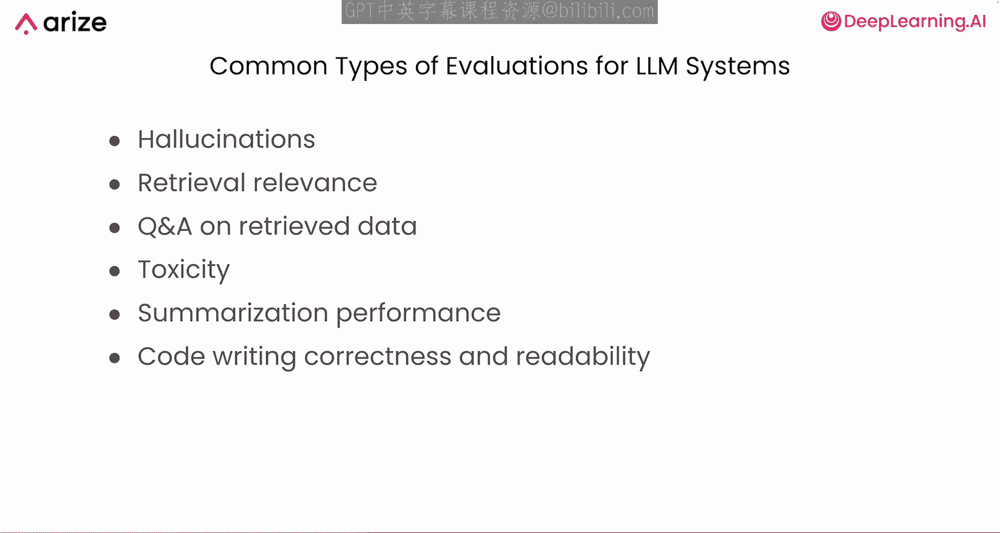

As soon as you move from an LLM based app to an agent， you're adding an extra layer of complexity。

Agents use LLMs for reasoning， but they also take actions on your behalf by choosing among tools。

 APIs， or other capabilities。

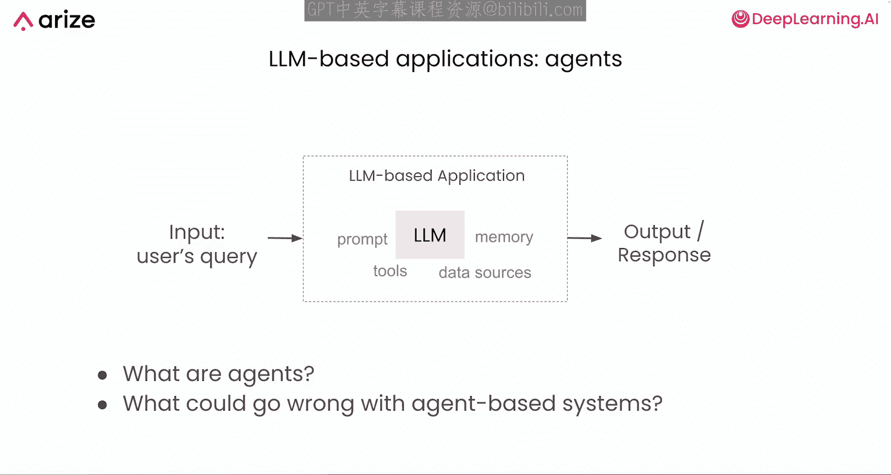

An agent as a software based system that can take actions on behalf of a user utilizing reasoning。

 an agent typically has three main components。 We have reasoning。

 which is powered by the LLM routing， which is deciding which tool or skill to use and the action。

 which is executing the tool call， API call or code。

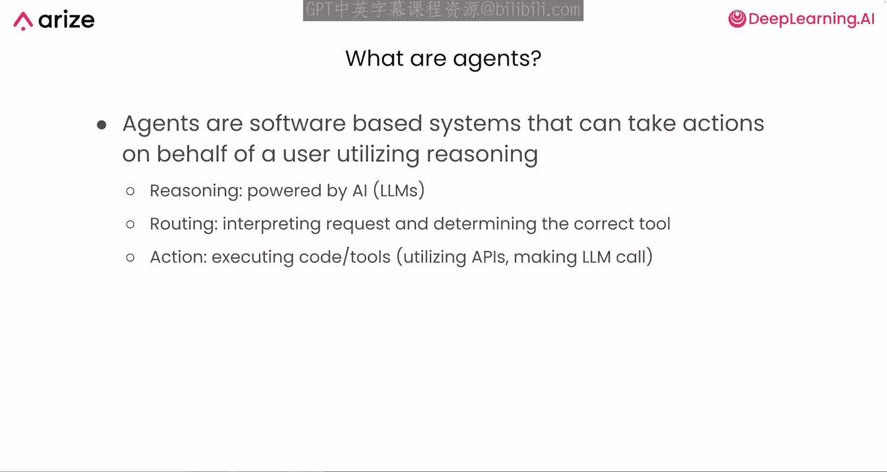

You may have already seen examples of agent use cases like personal assistant agents that help you take notes or transcribe information for you。

 desktop or browser based agents that help automate repetitive tasks。

 agents for data scraping and summarization， and agents that can conduct search and compile research。

Let's use an example use case to illustrate how an agent actually works。

 Suppose you want an agent to book a trip to San Francisco。 There's a lot going on behind the scenes。

 First， the agent has to figure out which tool or API it should call based on your request。

It needs to understand what you're really asking for and which resources will help。Next。

 it might call a search API to check available flights or hotels。

 and it could decide to ask you follow up questions or refine how it constructs the request for that tool。

 Finally， you wanted to return a friendly and accurate response。

 ideally with the correct trip details。Now let's think about how you evaluate this step by step。

Did the agent pick the right tool in the first place when it forms a search or booking request。

 Did it call the correct function with the right parameters。 Is it using your context， For instance。

 the dates， preferences and location accurately。How does the final response look。

 Does it have the right tone and is it factually correct。

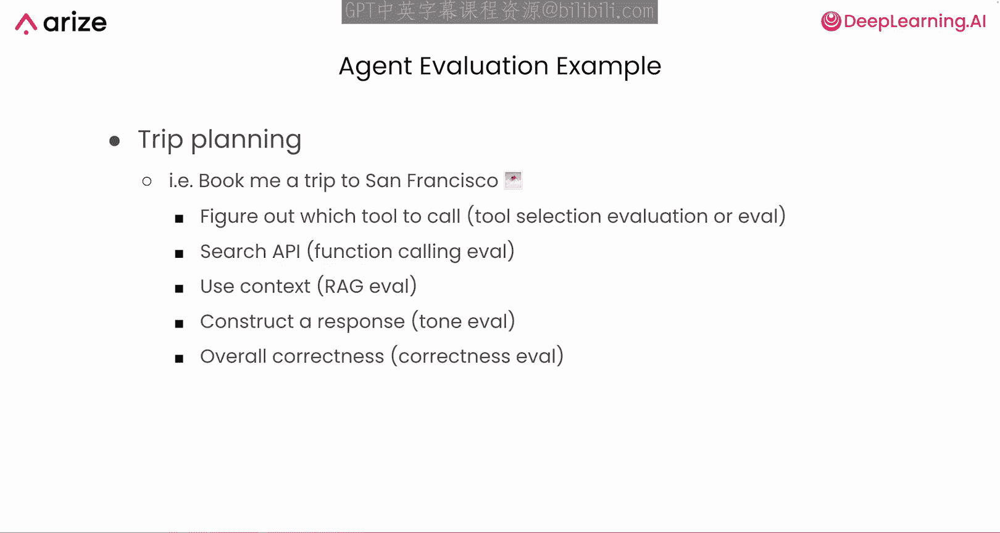

In this system， there's plenty that can go wrong。 Maybe the agent returns flights to San Diego instead of San Francisco。

 That might work for some people， but most folks would be unhappy if they wanted San Francisco and ended up with San Diego。

 This highlights why you need to evaluate not just the LLM's raw output。

 but also how the agent decides on each action along the way。

You might see issues like the agent calling the wrong tool。

 misusing context or even adopting a snarky or inappropriate tone。

 Sometimes users also try to jailbreak the system， which can create even more unexpected outputs。

To evaluate each of these factors， you can use human feedback or human in the loop。

 or unless an LLM itself as a judge to assess whether the agent's final response is truly fulfilling your requirements。

 we'll dive deeper into how LLM as a judge works with agent evaluation later in this course。

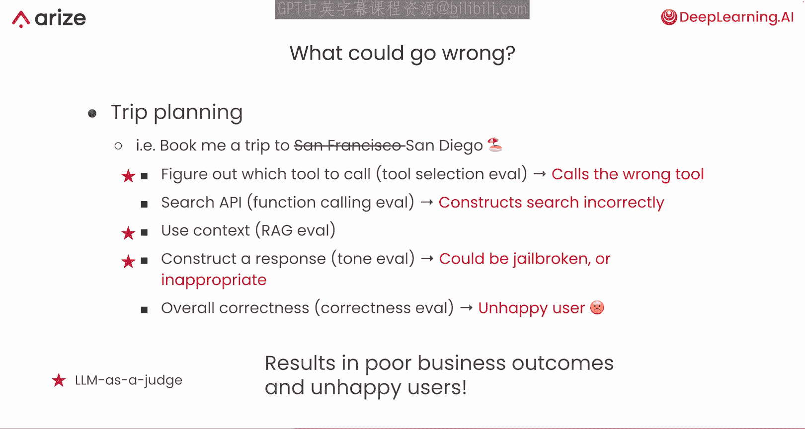

Finally， remember that even small changes to your prompts or code can have unexpected ripple effects。

 for instance， adding a simple line in like remember to respond politely might help you improve on a number of use cases。

 but can also cause a regression in test cases that you may not expect。

That's why you'll want to maintain a representative set of test cases or data sets that reflect your critical use cases Each time you adjust your system。

 you can rerun eVals on these data sets to catch regressions and keep building out new agent capabilities over time。

 This approach is key to developing robust agent evaluations。

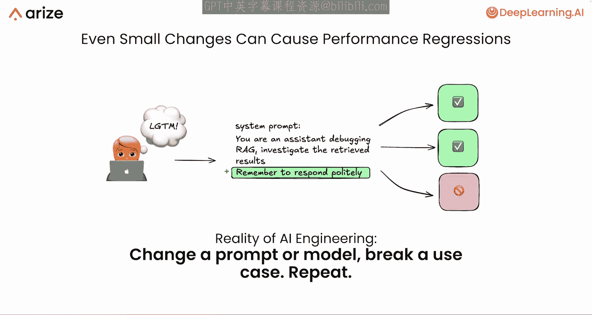

Just like you do a traditional software， you want to iterate on an agent's performance， however。

 you can't rely on purely deterministic checks。 Agents themselves are non deterterministic。

 can take multiple paths and might regress in one scenario even as they improve in another。

To handle this， you want a consistent set of tests covering different user cases that get run every time you make a change。

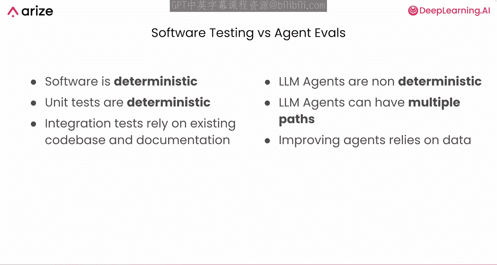

These tests often loop back from production data， like real world queries and real user interactions。

 back to development where you can refine on prompts， tools or your approach。

 This can help you catch regressions when your agent is deployed in production and continuously expand your test coverage to improve on your system over time a few of the tools that we're going to be covering in this courserus are trace instrumentation to understand what's happening with your agent underneath the hood。

 an evalile runner， which contains LLM as a judge。

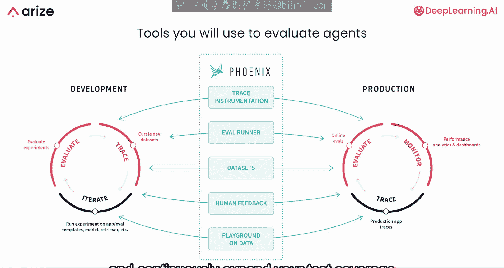

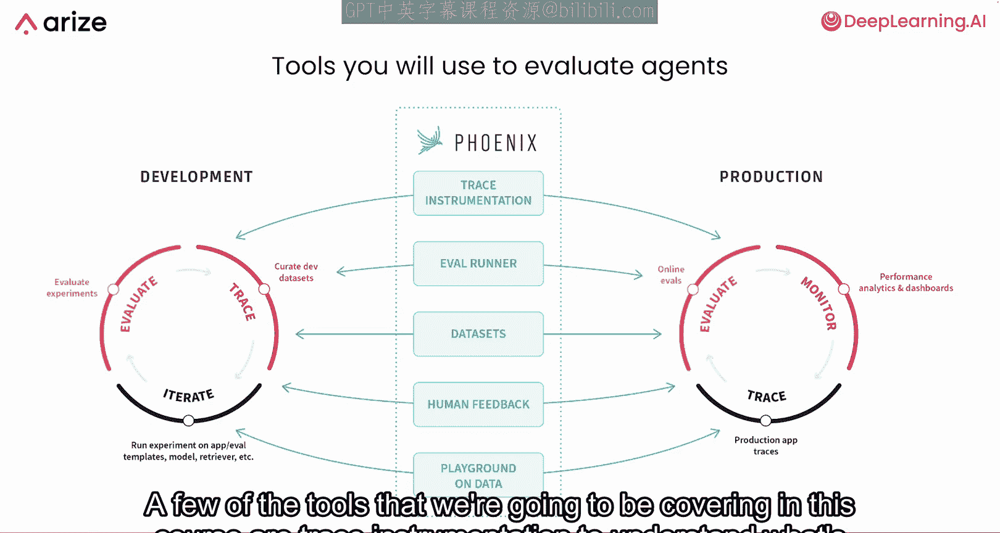

Dataets which you can use to rerun experiments， human feedback that allow you to capture human annotations and production。

 and a prompt playground you can use for your data for iterating on your data。

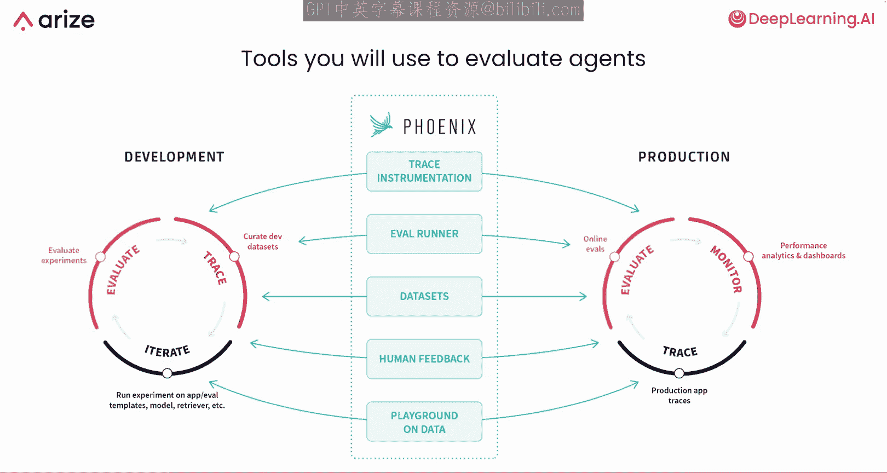

In this lesson， he took a broad look at how LLM model evaluation compares to system evaluation。

 why LLM based apps require different testing approaches than traditional software。

 the extra complexity that agents bring with reasoning， routing and action。

 common pitfalls with agents like long tool selection， poor context usage。

 and the importance of iterative testing， using a single set of tools for development to production。

You'll get to see all of this in action and dive into practical code soon。In the following lessons。

 you'll look even more closely at how to evaluate an agent， what data to collect。

 and how to structure these evaluations to keep your agent on track in the real world。

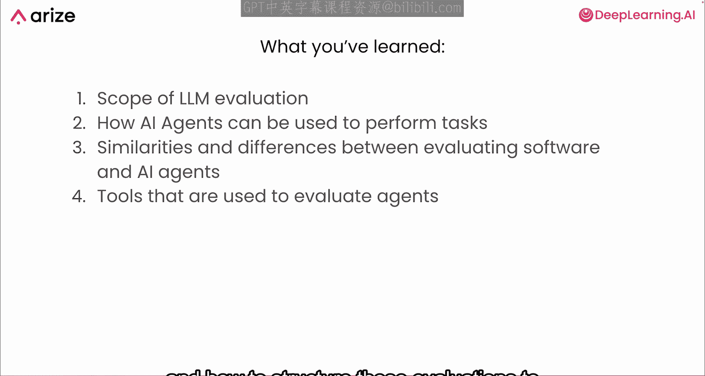