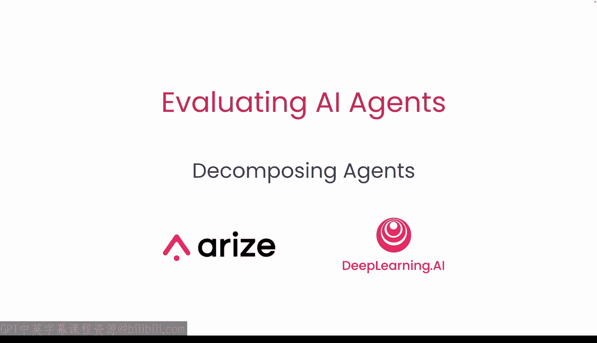
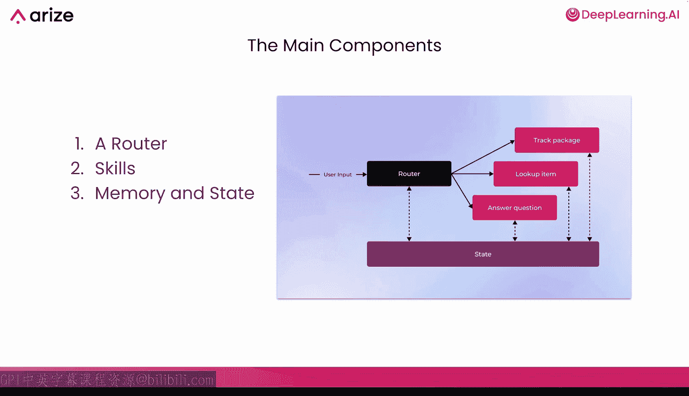
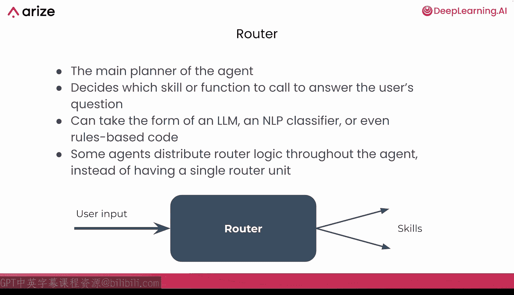
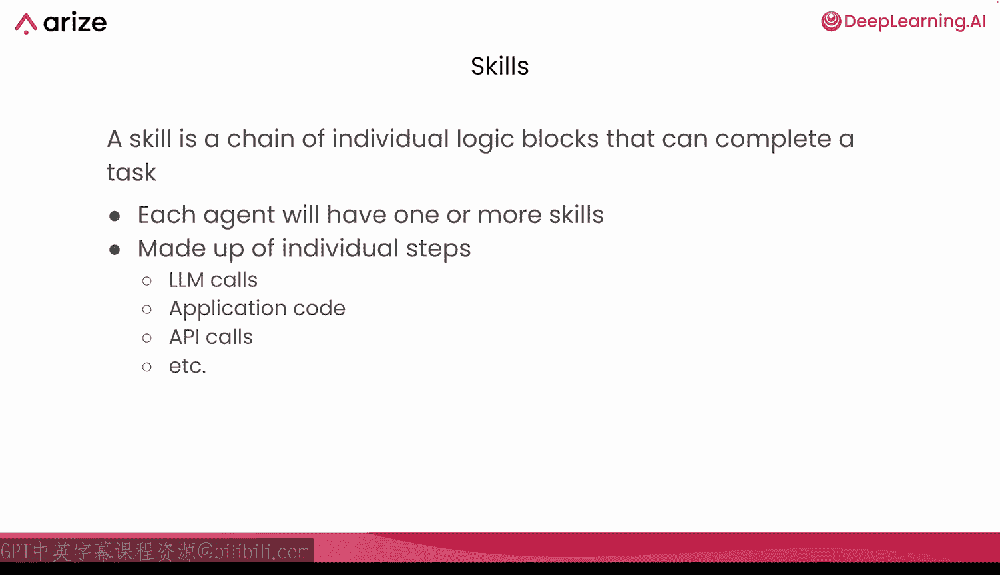
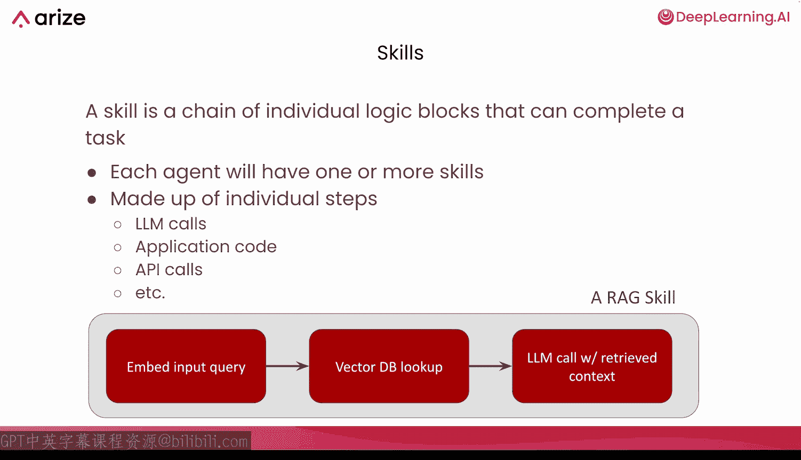
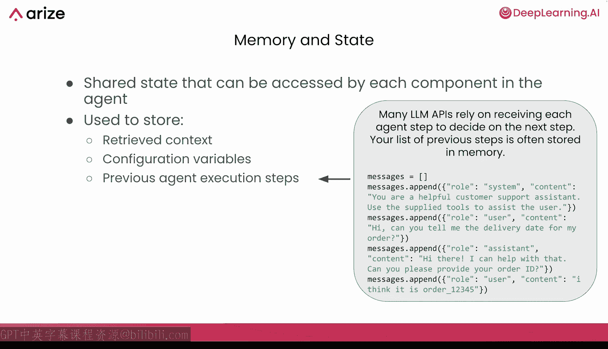
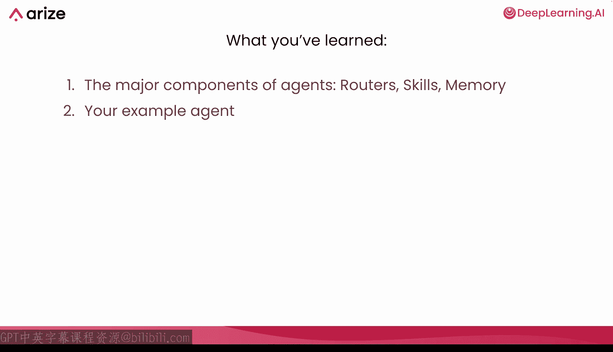

# 吴恩达《评估 AI 代理｜Evaluating AI Agents》中英字幕（deepseek-R1翻译 - P3：3.decomposing agents.zh_en - GPT中英字幕课程资源 - BV1HTAHebEuj

In this course， you'll build an AI agent from scratch and learn how to evaluate it。 In this lesson。

 we'll dive into the details of this agent structure and then go through an agent example that can perform data analysis。

 You'll then learn how to code such an agent and Python。All right， let's go。

Agents are typically made up of three main types of components， a router， skills。

 and then memory and state。The image on the right here shows an example of an agent。

 with the router in black， the state as the dark purple at the bottom。

 and then a set of three different skills that that agent can call， in this case， track package。

 look up item and answer a question。Each of those different components can interact with the state and the routers responsible for handling user input and then output back to the user。

Looking first at the router， the router is the main planner of the agent。

 sort of the agent's brain in a way。The router is responsible for deciding which skill or function the agent will call to answer a user's question。

 so when the router receives user input or a response back from a different skill。

 the router will then decide which other skill to call from there。

Ruterrs can take a few different forms， they can either be an LLM equipped with function calling as you'll use in this course。

Or a more simple NLP classifier， or even just a rules based code。

Generally the simpler type of router that you have。

The better your performance will be and the more consistent your performance will be。

 but you'll also scope down the capabilities of that router。

 Something like an LLM with function calling has a very broad ranging capabilities。

 but is a little bit more unreliable than rules based code。

 That's also where evaluation can help you close the gap。Some agents。

 instead of using a single router step will distribute that logic throughout the agent。

 popularular frameworks that use this are lane graph as well as opening Iwarm。

 they still have routing logic， but instead of having one single router step。

 they distribute that responsibility throughout the agent itself。

Next， skills are the individual logic blocks and capabilities that an agent has。

So skills are what allow the agent to actually do anything。

 they're what allowed to connect with the outside world through APIs or call databases or really do any of the different tasks that your agent can accomplish。

Every agent will have either one or more skills， an agent without any skills doesn't really do anything。

 not a real use case there。Skills are made up of individual steps， LLM calls， application code。

 API calls， or really any other code that you want to use there。

One example of a skill that's very common is a RAG skill。

 so in this case you could have a retrieval augmented generation capability within your agent that would handle everything from embeddings to looking up data from a vector database to making an LLM call with retrieved context and all of that is encompassed in a single RAG skill so you can see how skills can encompass multiple different steps and entire LLM applications can be thought of as skills in the context of agents。

Once skills complete， they'll also return back to the router in most agent contexts so that the router can choose either to return to the user or call another skill from there。

Memory and state are also used by agents to store information that can be accessed by every component within the agent。

 typicallyypically memory and state are used to store things like retrieved context。

 configuration variables， or very commonly a log of previous agent execution steps。

This last one's probably the most common that you'll see many LLM APIs actually rely on being passed in a whole dictionary or list of messages about what the agent has done previously before choosing the next step to call the OpenAI function calling router that you'll use throughout this course uses this approach so you'll get very familiar with that approach。

Turning to your example agent that you're going to build throughout this course。

Examp agent that you're going to create is a data analysis assistant that can help you understand and ask questions over a sales database that you have。

 That agent has a few different skills。It has a data lookup skill that can query information from that attached database。

It has a data analysis skill that can draw conclusions from that data， spot trends。

 and make calculations。And then finally， it has a data visualization skill that can generate Python code and create graphs through that code and visualizations。

Looking at your example agent visually here， you see you have a user who's sending in queries to a router。

 in this case a GPT 40 mini call with function calling。

 and then that router will call one of three different tools here， the lookup sales data tool。

 data analysis tool or data visualization tool， and then those tools will return back to the router which then decides to either return to the user or call another tool from there。

Now we're using the word tool here because that's what's expected by GPT40 mini。

 that's analogous to skills in this case， so your lookup sales data tool would be analogous to a lookup sales data skill。

Diving into each of these skills a little bit more deeply。

 you see that each skill has a few different steps that I can actually go through to accomplish its task。

The Lookup sales data tool， for example， first prepares a database。

 so it loads in a local database and make sure that it's ready to query that database。

Then it will generate SQL using another LLM call to query that database and then finally execute that SQL and return the result all the way back to the router。

Similarly， the data analysis tool makes a single call to generate analysis。

 so it just makes a single LLM call and then returns that response back to the router。And finally。

 the data visualization tool actually makes two sequential L calls， burst to generate a chart config。

 and then to generate Python code based on that config。

The reason for the two calls in that case is that while you could just ask an LLM to generate code straight away and do both steps at once。

 you'll get more unreliable responses that way， and because chart visualizations in Python are somewhat formulaic。

 it helps to first generate this chart config with a few key variables and then generate the Python code based on that chart config。

 so splitting out the task into two simpler tasks instead of asking for the LLM to complete one more difficult task。

In this lesson， you've learned about the major components of agents， routers， skills and memory。

 and you've examined the example agent that you're going to build。In the next video。

 you're going to go through a notebook and actually implement and build this example agent。

