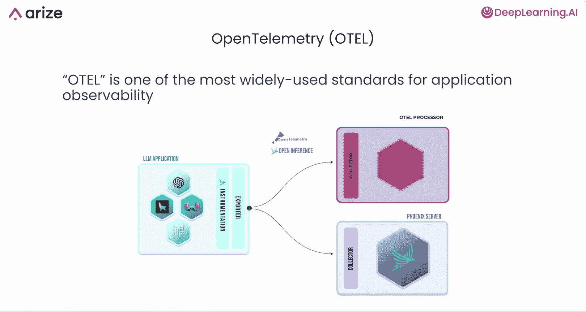
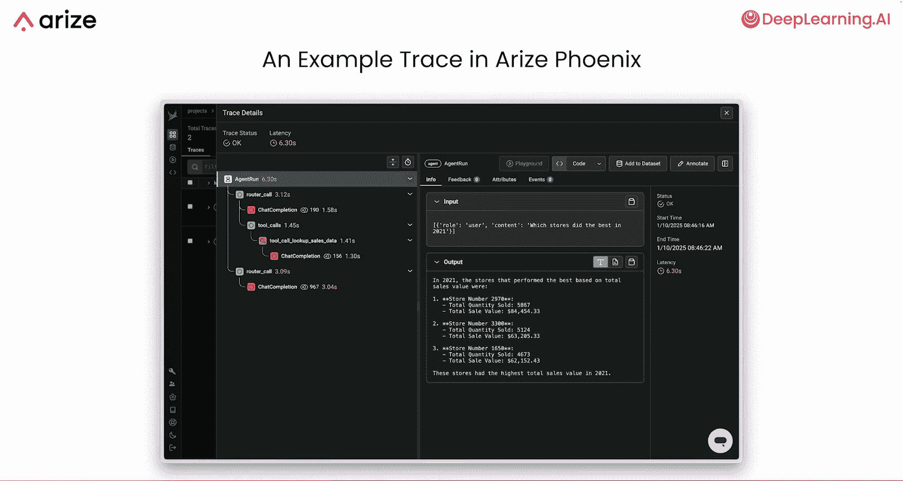
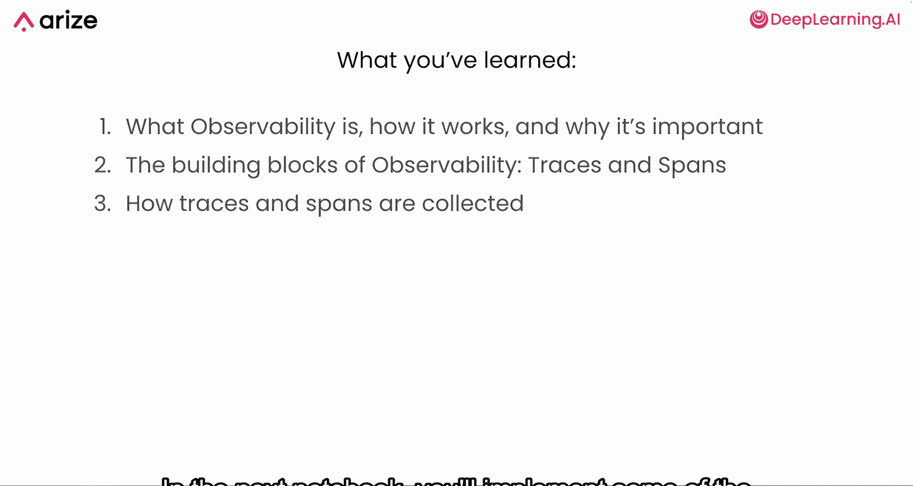

# 吴恩达《评估 AI 代理｜Evaluating AI Agents》中英字幕（deepseek-R1翻译 - P4：4.tracking agents.zh_en - GPT中英字幕课程资源 - BV1HTAHebEuj

Now that you understand your agent example， the next step is to add observability to your agent code。

This will give you insight into the trajectory or sequence of steps your agent takes to respond to a user's query。

You'll learn how to instrument your agent， which means adding code， track your agent steps。

 and then visualize the collected information or traces in the Phoenix UI。All right。

 let's have some fun。When it comes to observing your agent。

 there are a few key concepts that are important to know。

The first is observability Observability is a general software concept that refers to having complete visibility into every layer of your application in the context of LLM applications。

 that's often tracking things like the prompt， the response， token usage。

 and at any calls that happen around the calls that you're making to LLMs。

Observability is typically made up of traces and spans。

Tracces refer to full runs of your application， so a single trace would be one end and run of your application from an input all the way through to an output。

 and then traces are comprised of multiple spans， spans are individual steps of calls to LLMs or code or lookups to databases or whatever it might be。

 so one trace is made of multiple spans， and they're typically presented in this hierarchical way where spans can be nested underneath each other to show that they're operating within another span and then a set of spans will make up one trace hierarchy。

Sands are typically presented in this hierarchical manner here where you have individual spans that are nested within each other。

 all making up one trace。And you might have spans for LLM calls， as you see in the image here。

 you might have spans for tools， you might have chain spans which are just general logic steps that happen within a trace。

Craces and spans come from a framework called open Telemetry。

 Open telemetry is often abbreviated to OTL， and it's one of the most widely used standards for application observability。

 even outside of LLMs and AI agents。Otel includes the idea of traces and spans that are captured within your application。

 as well as some standards for how to capture those traces and spans。

 Often this process is referred to as instrumentation， which you'll learn more about in a second。

And then open telemetry also includes a concept of collectors and processors to receive those traces and spans and then enumerate them in a platform that allows you to visualize those traces and run later evaluation on them Throughout this course。

 you're going to use a tool called Arise Phoenixix。

 which serves as one of those collectors to allow you to receive visualize and evaluate traces。

This is what a trace looks like in Phoenix， you're going to see a lot more of this throughout the notebooks as you start implementing some of these techniques。

 but you'll notice there's one trace here of agent run in the image。That's made up of multiple spans。

You have an LLM span in orange， you have your chain spans in blue。

 and then your tool spans in yellow。

Traces and spans are captured in your application through a process called instrumentnstruation Instruation refers to the practice of marking which functions or code blocks within your code you want to track as spans and what attributes you want to attach to those spans。

You can do this manually with clauses or decorators as you'll see in the next notebook as well。

 however， tools like Phoenix do automate some of this process for you。

 especially if you're using popular libraries like Open AI or Lama indexdex or Lank。

Observability is important for a few different reasons。First。

 when you're getting off the ground and building your application。

 observability really simplifies the debugging process as you're building it's much easier to debug by going through a nicer visual trace than it is to pour over print statements and logs in your application。

So it makes it easier to get going。But then as you start launching your application to multiple different users。

 you start moving towards production or testing even。

 then it gives you a detailed log of all of the calls made to your application and all of the different inputs that you're receiving。

 so it gives you a large database of information of all of your different application runs so you can monitor how it's performing。

And then these traces will become the bedrock that is used to run evaluation。

 so later notebooks will have you export data from Phoenix that you can then use for evaluations at scale across multiple runs of your application。

Finally， putting these together， observability helps you really start to understand and eventually control some of the more unpredictable behavior of LLMs LLMs are by their very nature。

 unpredictable in some cases， and the best way to deal with that is by monitoring them and later evaluating them within your application。

In this lesson， you've learned what observability is， how it works and why it's important。

 as well as some of the basic building blocks of observability， like traces and spans。

 and how those traces and spans are collected。In the next notebook。

 you'll implement some of the instrumentation techniques that you saw in these slides and you'll set up your first Phoenix instance here to collect those traces。

