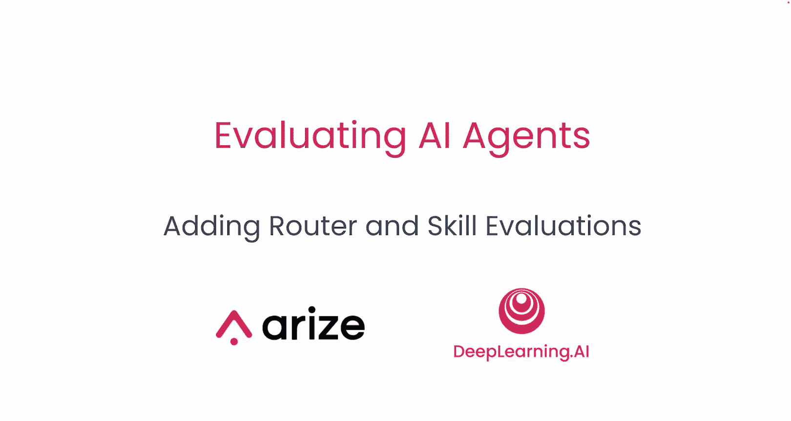
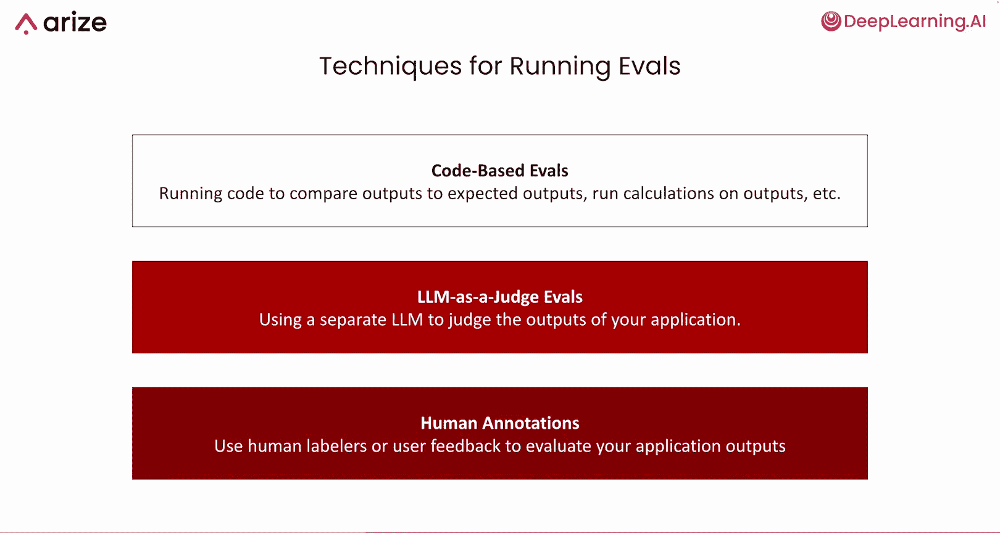
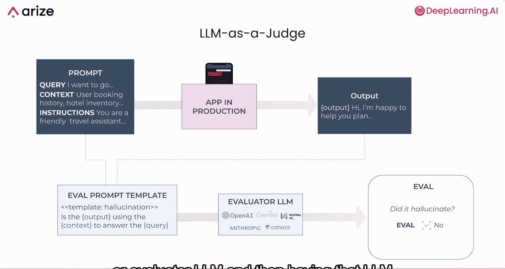
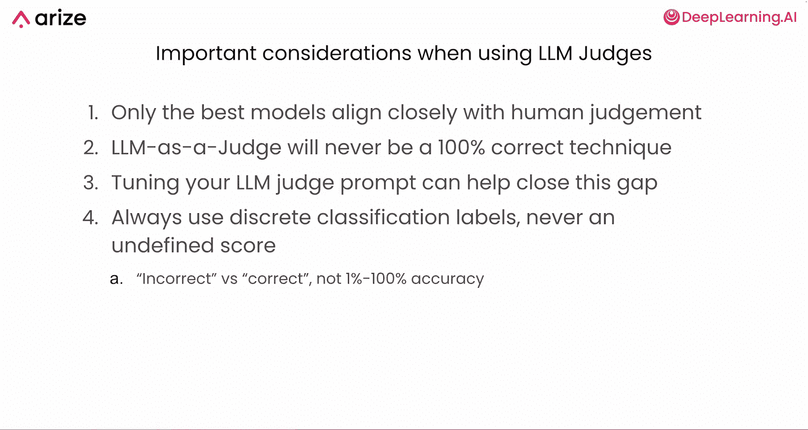
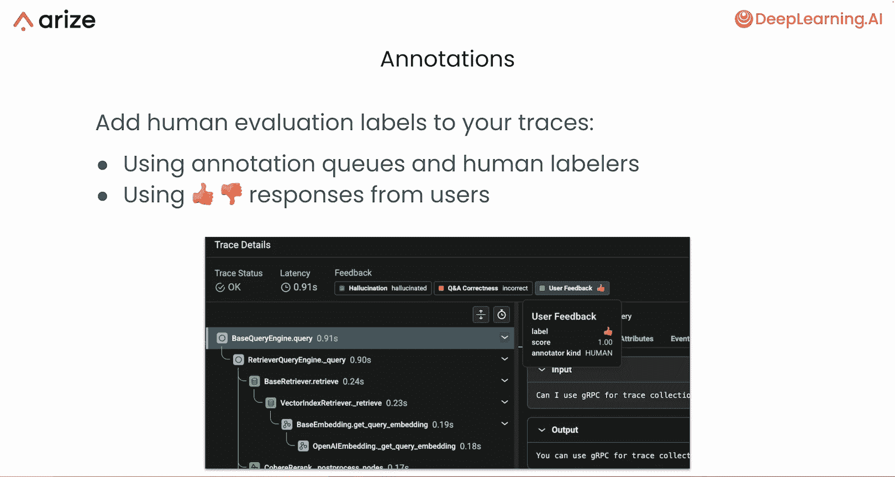
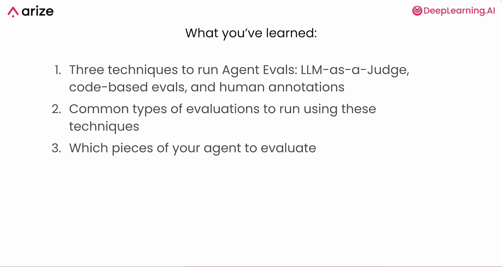

# 吴恩达《评估 AI 代理｜Evaluating AI Agents》中英字幕（deepseek-R1翻译 - P6：6.adding router and skill evaluation.zh_en - GPT中英字幕课程资源 - BV1HTAHebEuj

Now it's time to start setting up your eVs in this lesson。

 you'll focus on evaluating each of your agent' skills。

 as well as the router's ability to choose the correct tool and execute it correctly given a user's request you will learn about three types of evaluators。

 code based evaluators， LLM as a judge and human annotations。

 you will then apply the appropriate evaluators to your agent example。Let's get to it。

There are three main techniques used for running evaluations。 The first is code based Els。

 Second is LLM as a judge evaluations， and finally， human annotations。

Each of these techniques can be applied to agents to measure and evaluate different parts of your agent。

 but they can also be applied to other LLM based applications。

 so each of these techniques works for both agents and your more traditional LLM applications as well。

Code based evaluations are the simplest kind of evaluations when it comes to LLM or agent EVals。

 and are the most similar to traditional software integration tests or evaluations。

Code based evaluations involve running some sort of code on the outputs of your application。

Some common examples of these are checking to see if your output matches a certain rex。

 so maybe you want a response to only contain numbers or no alpha numeric characters。

 you can use a rex to check to make sure that your response matches that filter you might also want to make sure that your response is Json parsable or a very common one that you see especially in chatbots is checking to see if the chatbot's response contains certain keywords like most often companies don't want their chatbots to mention a competitor so you can do a codebased e to see if that competitor name is ever in one of the agent responses。

But perhaps maybe the most common type of codebased EVvalL is to use these eVvals to compare your applications' outputs to expected outputs。

 so if you have ground truth data of what the expected output is for an input。

 then it's very effective to use codebased eVvals to either directly compare the output of your application to that expected output or to use something like cosine similarity or cosine distance to do more of a semantic match between those two different values。

The next technique for running evaluations is called LLM as a judge。LLM as a judge。

 as the name implies， involves using a separate LLM to measure the outputs of your application。

Typically the way it's done is by grabbing the input and output of your application as well as potentially a few other key pieces of information from one run of your application。

Constructing a separate prompt that's going to evaluate a specific criteria based on those inputs and outputs。

Sending that prompt over to a separate judge or evaluator LLM。

And then having that LLM assign a label on a specific access to that response。

For one more example of how that works， you can examine this case of evaluating the relevance of a document that was retrieved in a rag system。

The retrieval of span in this case is made up of a user query and then the documents that were retrieved for that given query。

That query and then the reference documents are then sent into the separate EGL template that you see here。

And then populated so as to ask another LLM。Are these reference retrieved documents relevant to the user's question？

And then that separate LLM will either say those documents are relevant or irrelevant。

Now LM as a judge is really powerful because you're able to run large scale evaluations across both quantitative and qualitative metrics。

However， it's important to keep a few things in mind when using LLM as a judge。

The first is that only really the best models actually align closely with human judgment。

So if you're going to run LLM as a judge， you often need to use a GPT 40 or cloud 35 sonnet or a similarly high end model to do so。

Even with these though， LLM as a judge is never going to be 100% accurate。

There will always be some margin of error because at the end of the day。

 you are using an LLM to assign that particular label。

You can mitigate some of this by tuning either your LLM judge prompt or even your LLM judge model。

 and you'll learn a little bit more about these in later modules in this course。Finally。

 it's always important to remember to use discrete classification labels as opposed to undefined scores when setting up the outputs of your LLM judge。

 so you should always use things like correctr versus incorrect， relevant versus irrelevant。

 and never measure like score this response on a scale from 1 to 100。

The reason for that is that LL Ms don't have a great sense of what constitutes an 83 out of 100 versus a 79 out of 100。

 especially when they're evaluating each case independently。

 so always use discrete classification labels wherever you can。

The third evaluation technique that you can use is using annotations or human labels。

The idea here is that you can use。Tools like Phoenix or other observability platforms to construct a queue of lots of runs of your application。

 to construct an annotation queue， and then have human labelers work their way through that queue and attach。

 feedback or judge the responses of your application。

The other method that you can use is actually gathering feedback from your end users。

 so you might have seen cases in the wild where LLM systems have a thumbs up。

 thumbsdown response system where you can rate the responses of that LLM system。

 and you can use the same technique inside your application to gather some feedback or evaluation metrics about how your app is performing。

When you have these few different techniques， it can be tricky to decide which one to use for a given evaluation。

One way to think about this is how qualitative versus quantifiable or quantitative is the metric that you're trying to measure。

If you have something like evaluating the quality of a summarization or evaluating the clarity of analysis。

 that's a very hard metric to assign quantitative or code based measurement to。

 so that's where you might want to rely on LLM as a judge or human labels to understand that qualitative metric if you have something that's a little bit more inflexible or can be defined in code like whether an output matches a certain rex and a code based evaluation will work in that case。

The other way to think about these is whether the evaluation needs to be 100% accurate or if it can afford to be less than 100% accurate。

If you remember， LLM as a judge is never going to be 100% accurate or 100% deterministic technique。

 so if you need 100% accuracy， then you'll need to rely on either human labels or code based es。

What you might notice here is that human labels is sort of the best version of evaluation in this case it's flexible and it's deterministic。

 however in practice it can be hard to get human labels at scale because it's a very labor intensive process to do lots of labeling on your data and if you rely on end users to provide feedback。

 there is some selection bias there over Hugh chooses to supply feedback to your application。

 so it's generally not advisable to use that as a large scale evaluation technique。

Now that you understand the techniques that you can use to evaluate an agent or really an LLN application。

Now you'll learn about the different pieces of your agent that you can apply these techniques to to run these evaluations。

This lesson will go through evaluating the router and the skills。

 and you'll have a future lesson in this course that goes into evaluating the path in detail。

Starting off with a router， routers are typically evaluated in two different ways。First。

 you'll evaluate the function calling choice OK did the router make the right choice and choosing a function to call。

 and if you're using an LLP based classifier as opposed to an LLM with function calling。

 you can still evaluate the function calling choice and you still use this sort of evaluation metric。

The second kind of thing that gets evaluated in routers is typically the parameter extraction。

 so once the router chooses which function to call。

 does it extract the right parameters from the question to pass those into whatever function it's decided to call。

One way to evaluate a router is by using an LLM as a judge。

 This is an example of the prompt template that you would use for your LLM as a judge to evaluate a router in this case。

 So you'll notice at the top you have some instructions for the LLM judge to say what it's going to be evaluating you have some places where data will be added into the prompt in this case。

 the user's question and then the tool call that was chosen。

And then you have some instructions saying the LLM judge should respond with a single word。

 either correct or incorrect。And then you have some more details on what incorrect means and what correct means in this case。

And finally， you have some tool definitions， information so that the LLM judge knows all of the possible options that your application had when choosing which tool to call。

Looking at an example here， you might have a case where a user asks your agent。

Can you help me check on the status of my order number 1，2，3，4？And the agent says，De。

Makes a tool call in this case choosing to call an order status check method and then extracts that 1234。

 it says this is an order number， so it passes it through as an order number to that order status check method。

And this all looks good。 It gets back a response saying the order has been shipped。

 goes back to the user， says the order has been shipped。And the user follows up and says， okay。

 when will it arrive？And the agent decides to make another call here this time using the shipping and status check method that all looks good so far。

 And then it takes that same 1，2，3，4。 and this time adds it as a shipping tracking I D。

In this case that's an order number， not a shipping tracking ID。

 so here the agent actually failed in the parameter extraction task。

 even though it succeeded in the function calling task that it had。

Now when it comes to evaluating skills， you can use a few different techniques to evaluate skills。

Here standard LLM based evaluations or LLM is a judge evaluations or code based detailss。

And one important thing to call out here is that skills themselves are really either just other LLM applications that have been composed into a skill the agent can use or other software applications like API calls or application code that have again been compressed into a skill。

So all the techniques that you can use to evaluate skills are really just the same techniques that you can use to evaluate either standard software applications or LLM applications。

So you might use an LLM as a judge to evaluate things like relevance， hallucination， question answer。

 correctness， generated code readability or summarization。

And then you might use code based evaluators to evaluate redgx matches。

 Json parsability in your response， or comparison against ground truth。Looking at your example agent。

 you have three different skills here， you have a database lookup skill， a data analysis skill。

 and a data visualization code gen skill。I invite you to pause the video here and think of a few different evaluations that could be used to evaluate each of these three different skills。

Whether the entire skill or one single part of the skill。

 as in the case of this lookup sales data tool， you have a step to prepare the database。

 generate SQL and execute SQL， so you might have evaluations on the full lookup sales data tool or on one step of that process。

So here are a set of evaluators that you could use to evaluate each of those different tools。

 so for the database lookup tool， you could use either LLM as a judge or a code based Eval to do SQL generation correctness and see if the SQL that's generated is correct。

For the data analysis tool， you could use an LLM as a judge to check for clarity in the analysis and make sure all of the entities that are mentioned in that analysis are correct and match back to entities in the input or other sections of their data。

And for the data visualization and Code Gen tool， you can use a code based EVval to make sure the code is actually runable。

 fairly straightforward EVval that you can run there。

Now it's important to mention that you could have come up with different Evals to use here and again EVals is sometimes more of an art pen of science。

 and so if you came up with different ideas， don't be discouraged。

 those could be just as correct or in some cases more correct here too。

The last thing to mention is that you have SQL generation correctness being run with either LLM as a judge or codebased EVs。

 you'll see what both those look like in future notebooks。

 you can either use an LLM as a judge to judge whether the SQL is correctly generated。

 or you can use a codebased EV to compare the SQL that's generated against some ground truth data or the result of that SQL against some ground truth data。

In this lesson you've learned three different techniques to run agent Evals， LLM as a judge。

 code based evaluations， and human annotations。You've also learned common types of evaluations to run using each of these techniques and finally which pieces of your agent should apply these techniques to to evaluate。

In the next notebook， you're going to apply an LLM as a judge and code based EVval to understand how these work in detail with your example agent。

