# 吴恩达《评估 AI 代理｜Evaluating AI Agents》中英字幕（deepseek-R1翻译 - P7：7.adding router and skill evaluation(code).zh_en - GPT中英字幕课程资源 - BV1HTAHebEuj

In this lesson， you're going to take the agent that you've already built and traced and now add some evaluations to measure its performance。

Similar to before， you're going to start by importing some libraries that will be used here。

So there's some that you've seen before， like Phoenix and some other libraries here。

 and then you're adding in some new ones， so specifically from Phoenix Evalals。

 importing some things like a LLM as a judge prompt template that's going to be used and some methods like LLM Classify that are going to help you run LLM as a judge evaluations。

One other one that's important to call out here is this Ns asinchio that you might see。

 this is used to run multiple calls asynchronously and simultaneously to speed up some of your evaluation。

 you'll see where that comes in in a second。Now again， in Phoenix。

 there's a concept of projects and so just to separate things out from a previous notebook。

 you may want to use a different project name here， in this case you could use a evaluating agent。

And then in this notebook， just to keep things simple。

 what's been provided for you is the entire agent that you've run that you set up previously。

Is in the Us file that that's attached to the notebook。

And so you're going to import a few different methods from there。But if you run this。

 you'll see the same output that you saw before in the previous notebook saying tracing has been connected and set up there again。

 this is all the code that you created in the last notebook。

 it's just a pretty long notebook already so it's been separated out into a UtT file for you。

 but this has been set up with your agent to run and connected to the evaluating agent project So here anything that you call to run agent start main spans。

 either of those methods will be traced and sent through into the evaluating agent project within Phoenix it just lives in that separate Ut file to keep things clean here。

You also imported tools which are going to be used for one of your evaluations as well too。

So now when you're evaluating your agent， you can go for two different kind of approaches to start evaluating it。

 one starts from a data set of examples you can run through your agent and you'll learn more about that in the next modules where you'll cover experiments。

The other way is to run real world examples through your agent， trace those examples。

 and then evaluate the performance of the agent using those traces。So in order to do that。

 you can set up some basic questions for your agent。

 things like what was the most popular product Sw， total revenue across stores。

 some other kind of queries that are going to come through there。And then。

You can loop through your agent and call the start main span method that you imported above with each of those questions。

 so this will just loop through， put each of those questions to your agent and have those traced in Phoenix。

So this cell will take a minute or two to run。Go ahead and kick it off。

Great now once your calls have all finished running。

 you can jump back into Phoenix and see the traces for all of those different runs。

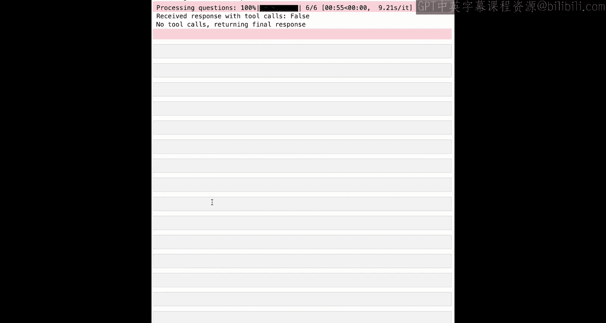

If you start from the project view， you should now have a new project that says evaluating agent and you should have six traces in there。

 so you'll see a row for each run of your agent and you could click into those and see more details on what that agent executed for that given step。

 including some calls that are using multiple different tools that you can trace。

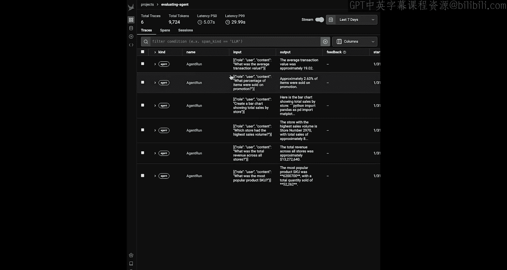

Now， in order to evaluate your agent， there's a few different pieces of the agent that makes sense to evaluate as you learned in the previous slides so one of those is the router。

 so you could evaluate this router call that's being made where it's deciding which particular tool to call。

 so that would be one thing to evaluate or you can evaluate some of the skills like the sales lookup data skill or the generate visualization skill。

And now the pattern of evaluation in Phoenix typically involves exporting spans from your Phoenix instance。

Either using LLM as a judge or code based EVval to add labels to each row of those spans。

 and then uploading them back into Phoenix。

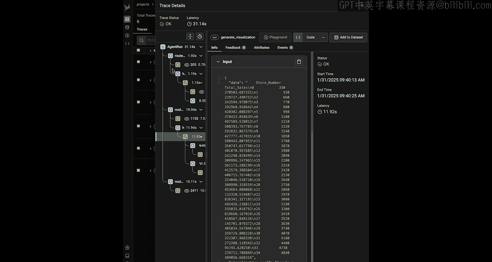

So。Let's start by evaluating the router itself and using an LLM as a judge to do that router evaluation。

 So you're going to want to export some of these spans from Phoenix。 You can do that using code。

 but just to show how you would filter down to the spans that you care about。

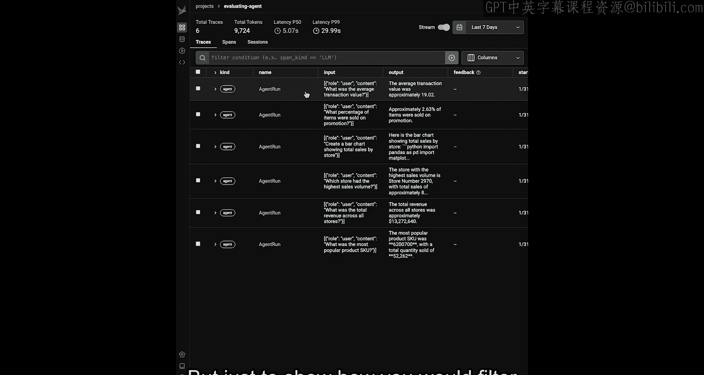

For the router here， you really care about within the router call this first LLM call that's being made。

 So if you look at this first LLM call， you can see this is where you have a user's question and then you have the response here is one of these tools。

 So in this case， the look up sales data tool。 that was the response back from the router。

 So this is all the information that you want to be able to grab and export from Phoenix。

And you can actually look at some of the attributes here to see the information associated with these。

The first is that you can see that there's an open inference span kind of LLM。

 and so that's one way that you could filter by this。

 or you can use any of the other information inside of the attributes here to filter for this particular kind of span that you want to use。

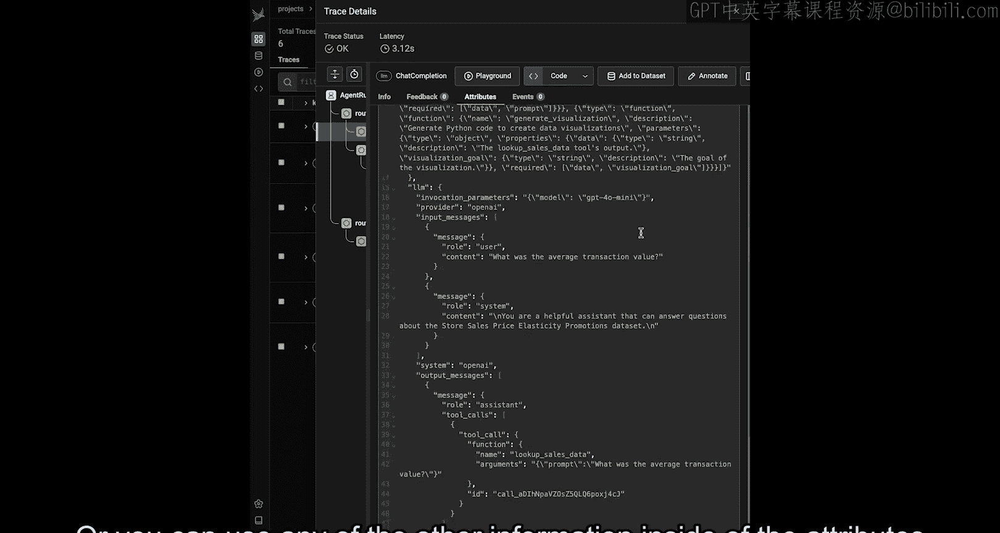

Now back in your notebook to evaluate your router using LOM as a judge。

There's a template that's provided as part of the Phoenix library for this kind of evaluation。

 because this is a very common evaluation that oftentimes people want to run。

So this tool calling prompt template is an LLM as a judge template that you can use to evaluate your function calling of your router。

So if you look through what this is looking for， you can see all of the instructions given to the judge and one thing that you'll see here is that there's two variables in this case up here and one variable down below that need to be passed into the template。

So first is the question the user asked and then the tool call that was made。

It also looks for the tool definitions， which is a set of all of the possible tools and their definitions that could be called so the LLM can compare against that。

So next you can export the required spans from Phoenix using some of those filters you just saw in Phoenix。

So there's a few things that you can do here， So first off。

 you can use this span query method to set some sort of filter。

That will filter down the spans in your project and export any spans that match the filter。

Here you can use span kind equals LLM and this will give you all of the LLM spans for both the router calls as well as other LLM spans。

 so you're going to do a little bit more filtering in a second there。

And then you can choose which columns or attributes you want to export as part of that call。

 And so here you want to export import。 value and LLM。 toolsol。

And you want to export them using the headers question and tool call。

Those headers are important because they match， if you scroll up a bit。

 they match what's going to be looked for by your template， so question and tool call。

And then as for the input dot value and LLM do tools， those are attributee names inside of Phoenix。

 So if you want to quickly jump in over to Phoenix one more time， you can see in this case。

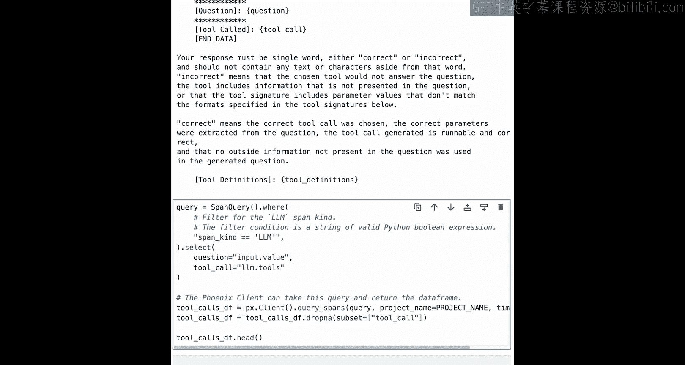

In your attributes， you can see input here， dot value will give you the full messages object that was input there。

And if you scroll down further， you can see LLM dot。Tools here。

 you can see the tools that were chosen。

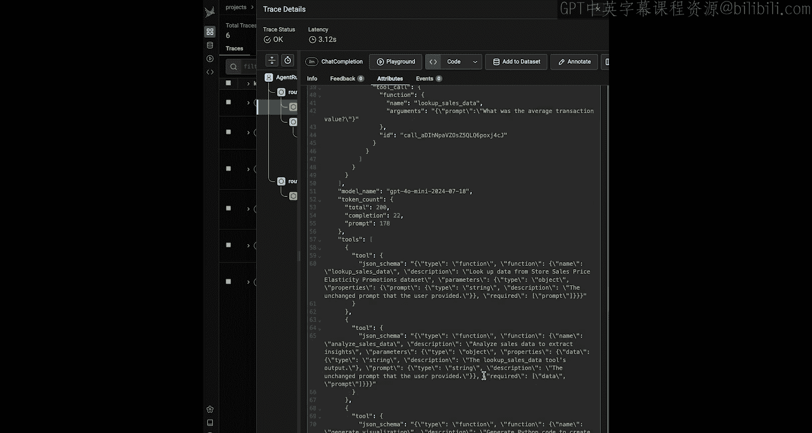

So now you can export those different values， run this query on your Phoenix client。

 and that will export those particular spans。 You can see they're also passing in the project name。

And then one other thing that's being done here to filter down because again。

 this will pull up all of the LLM spans， even those that are not to do with tool calling。

However we're routing in this case， so you can also just use this drop NA method to remove any spans that were exported that don't have a tool call。

 so they have no value here for LLM tools， that's an easy way to just filter down to just the LLM spans that have to do with routing。

So if you run the cell， now you should see your tool calls data frame， it's been exported。

 should have two columns， question and tool call， and again。

 those match what the template above is going to look for。

And then you'll have the question from the user as well as the tool calls that were made You'll also have this context spanid column。

 This is what corresponds to the particular span inside of Phoenix and it's going to be what allows you to upload the data back into Phoenix and have it match up in a little bit here。

So now you have this data frame， the next step is to add labels to each row of that data frame。

Based on your template above。So here's how you can do that。

There's a few things going on here first the LLM Class method is a method that's supplied by Phoenix that will take each row of your data frame and run it through some provided template。

 so in this case your' tool calling prompt template。And then it will take the response。

 and in this case， it will snap it to either a correct or incorrect value that just ensures that you have really specific labels that are being used。

 Sometimes the LLM might respond with correct with a capital C as opposed to lowercase。

 and so this rails function here will snap it so all the values are consistent。

And then providing a model that's going to be used to actually run this prompt。

 so this is your judge model in this case， using GT 40。

And then this variable here will allow to provide an explanation for why it shows that particular label。

There's a couple other things going on inside the code here。

One is that this suppressed tracing tag up top。This has been added because if you remember your agent is set up to trace any calls that are made to open AI。

 so if you didn't have this method saying hey， turn off tracing for everything happening inside here。

 then you would actually see some spans tracked to your project for all of the evaluation calls that are being made So you want to make sure your LOM as a judge spans themselves don't get traced so you're suppressing tracing there。

And then on the template row here， there's some kind of wizardry going on here to add in and replace the tool definitions with your tools object hence's the idea here。

 So if you quickly see your template from earlier。It's being passed in this tools's definition。

 which is a definition of all of the possible tools that could be called。

And you want to make sure that that's being replaced with the JSON dictionary of tools that your agents's using so that your LLM judge knows all the possible tools that could have been called so it can make its judgment appropriately。

And finally， one other thing that's happening here after your LLM judge runs is you're also adding in a score column that is just one if the LLM judge label is correct。

 zero otherwise。That's used to have a numeric value attached to your OM judge。

 which is used in some of the visualization。So now you can go ahead and run that and you'll see some Ellen classifiedify progress bar being made。

These calls are made asynchronously because of the Ns as Cchio library you imported all the way at the beginning of this notebook。

And then you should see a response that looks like this where you have some labels as well as explanations。

 and then if you scroll to the right you'll also see you have some scores values。1 orzeure。

So now you've appended some labels onto your span IDs。

 the last thing to do here is upload these back into Phoenix so you can visualize the data there。

So if you can use this log evaluations method， which will take a couple things here。

 it'll take the name of the Eval that you want to use as well as the data frame that you just created with all of those labels in context。

 span IDs。

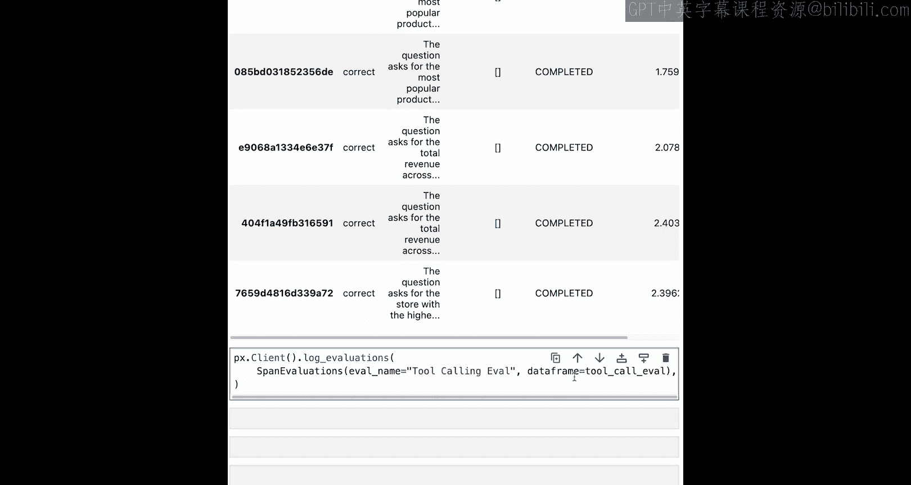

Now， if you jump back into Phoenix， you may need to refresh your project and then you'll see there's a new value at the top here of your tool calling EV and so you'll see a numeric value again because you added that score and it's able to have a numeric and a percentage value here。

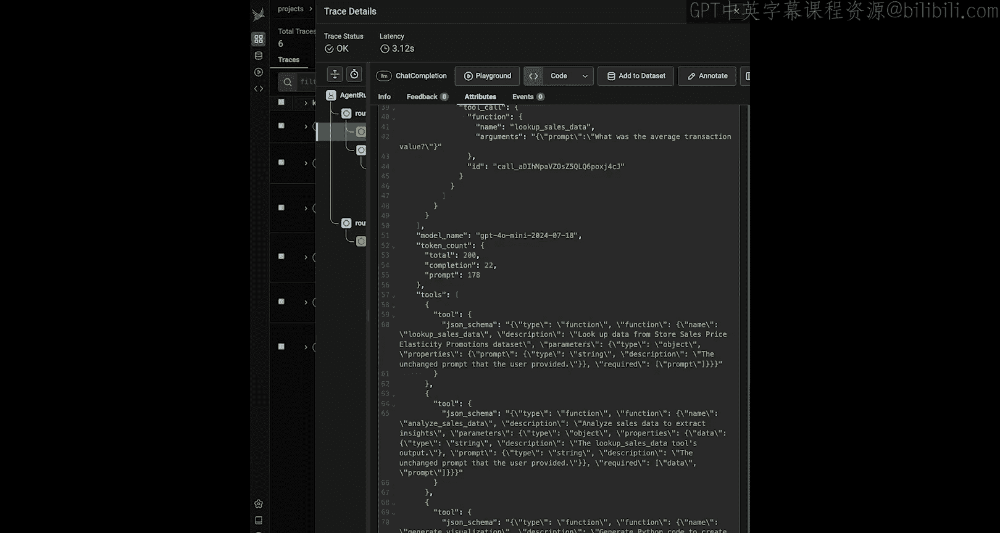

And then if you start going into any of your runs。

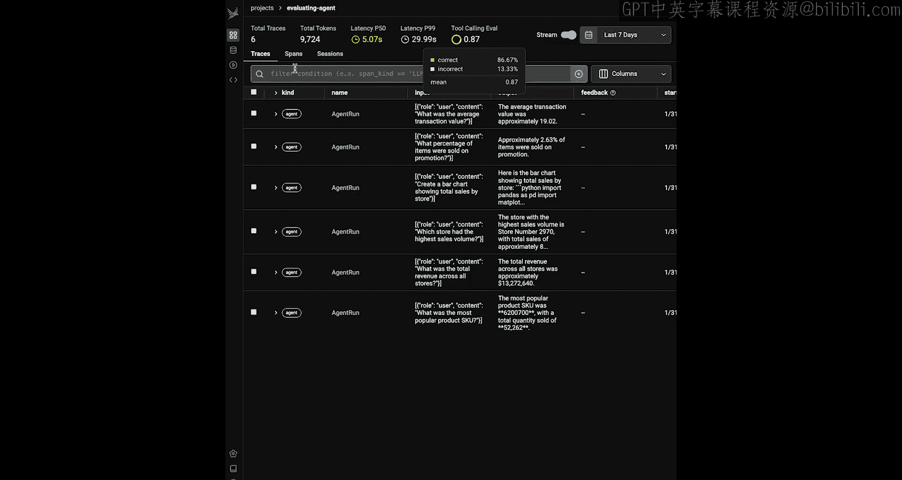

And you click on your router span right here， you'll now see that the feedback tab here has a new entry。

 and you'll see it's now labeled either correct or incorrect。

 and then it has an explanation as to why that particular label was chosen。

And so you can use these to get some more information about what's happening inside of your application。

 and you can actually filter down as well if you want to go to spans as opposed to traces to see all of your spans in Phoenix。

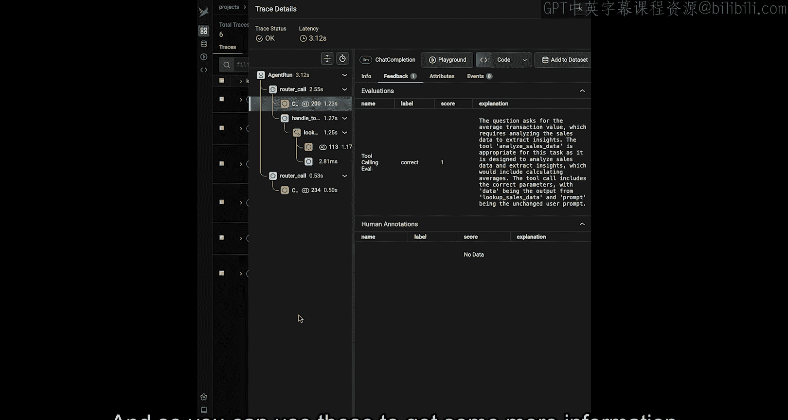

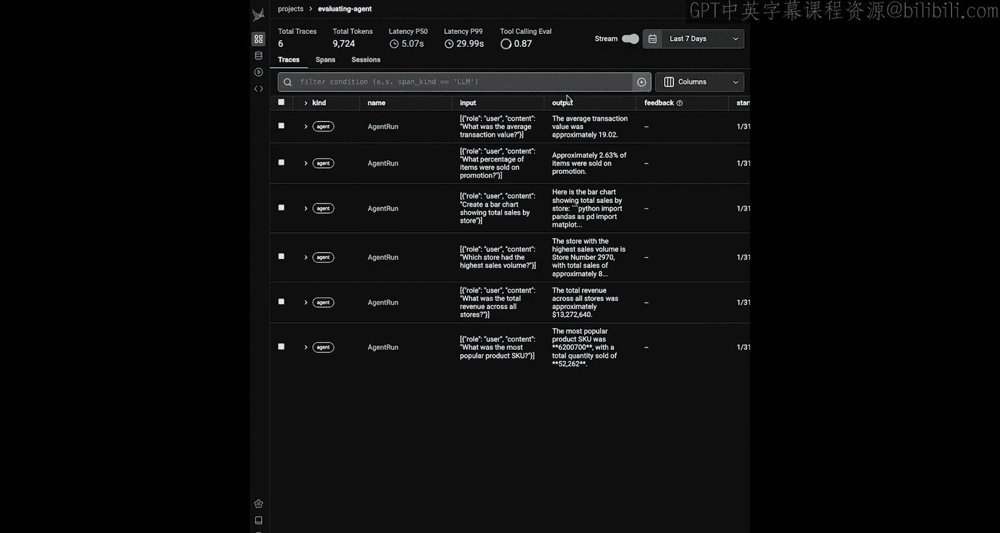

And then you can set a filter for your evals。

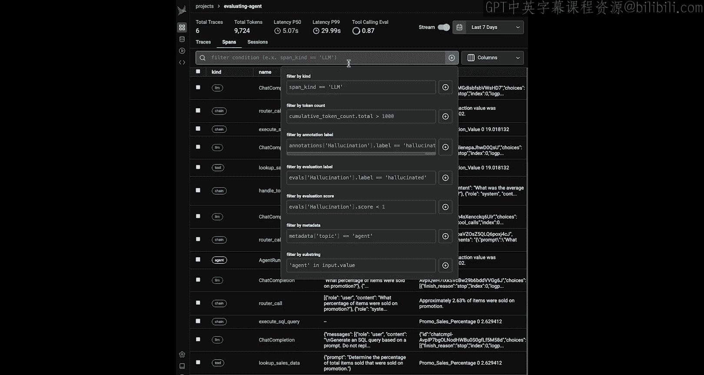

To be。😔，To。😔，Calling Eval as a name of Eval， and then let's look at just the incorrect ones。

You can look at， and now you'll see the cases where your router was incorrect there。

 and you could click into those and see the feedback as to why that particular run was incorrect。

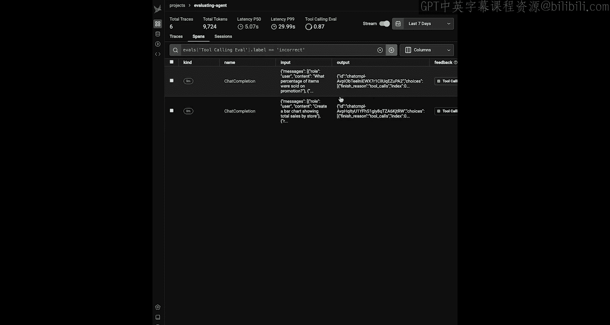

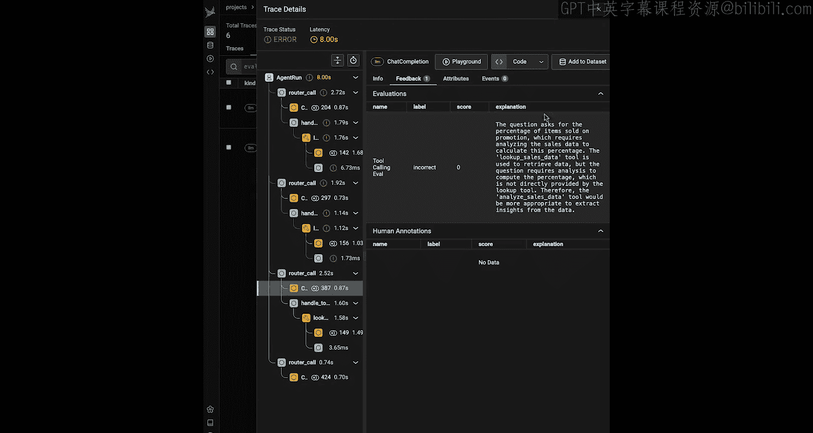

Awesome。😊，So now you've evaluated your router using LLM as a judge。

 you can add in some evaluations for your skills as well。

 One that might make sense to do would be evaluating your generated code for your generate visualizations。

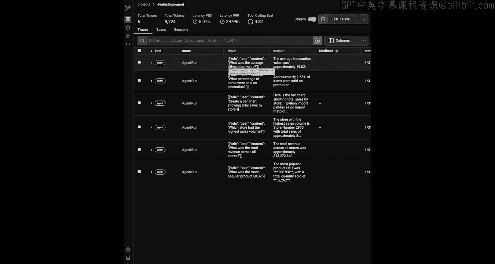

And so one way you could do this is you can say， okay， I've got my tool here。

Called generate visualization， why not export all of the spans for that generate visualization and then you can。

Evaluate the code that's been generated there。

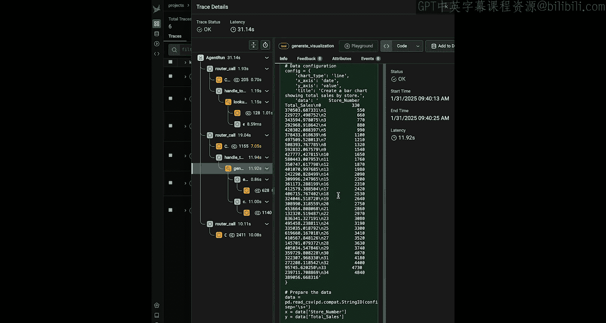

So you'll follow the same kind of pattern as before。

Start by exporting the spans that you want to evaluate and in this case。

 you can just use the name of the span equals generate visualization super easy there。

 and then you'll want to export the output of that span。So you can run this。

 youll probably just have one entry here， given the examples that have been run。

And then instead of using LLM as a judge shear， you can define a code based evaluator instead。

And so in this case you can do a very simple evaluation of just is the generated code runnable and so you can say。

 okay， here's a method that will check for that， it will take some generated code and it will do some quick checks to make sure it doesn't have any extra string values inside of it。

 and then it will try to execute that code， returning true or false depending on if there were exceptions。

And now you can take that method。And apply it to your code and data frame that you exported above so you can apply。

The code is runnable method here to your generated code column。

And then map the return values of true to runnable and false to not runnable。And then again。

 you'll want to add a score so you can say that one is runnable and zero is not runnable。

And now if you run that method， you'll add in some labels there。

Can take a look at your generated data frame， and now you have some labels and scores。And finally。

 you can upload this data back into Phoenix using that same log evaluations method。

And now if you look in Phoenix， you'll have a new entry at the top this time for runnable code and looks like the generated code wasn't runable。

 so in this case there good Evalla caught that for us。

 so you could use this at scale to run more checks of your runnable code this time using a code-based evaluator as opposed to an Lm as a judge evaluator。

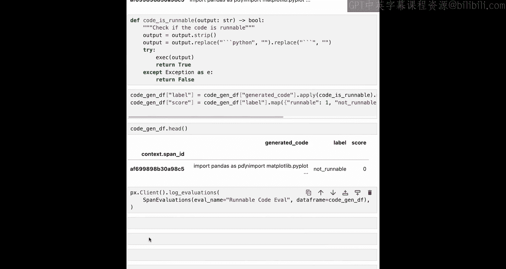

AndThere's a couple other tools that you had that might make sense to evaluate。

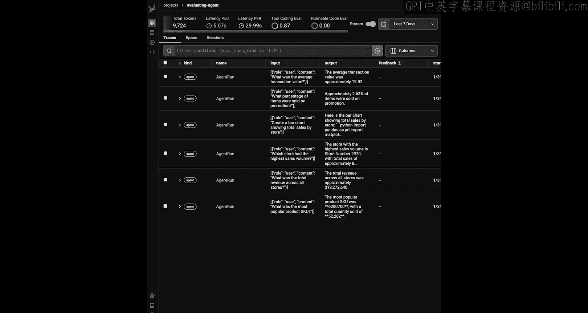

Another good example would be the data analysis tool that you're using to generate analysis on top of any data that's been exported。

 and so this one's another good one to use LLM as a judge for。However。

 there's not actually a template built into Phoenix for clarity of analysis。

 so you might want actually define your own template in this case。

 so you can actually just define your own template as text using whatever variables。Makes sense here。

 and so in this case， you can create your own template。And then follow the same pattern as before。

Export the information you care about and in this case。

 one way you could export relevant information is that you could look for all of your agent spans。

 which are that top level span and just look at the overall output value because that's what you can evaluate whether or not that was correctly and clearly communicated。

So you can export your top level agent spans and then again， make sure that when you're doing this。

 you're matching any of the names here or the column headers here to whatever is expected by your LOM as a judge prompt。

And now you can use the same L L M classify method with tracing suppressed this time using your manually defined prompt。

To run your Elm as a judge。And then once that completes。

 you'll have your new data frame that you can upload back into Phoenix。

YouCan call this one a response clarity Eval。

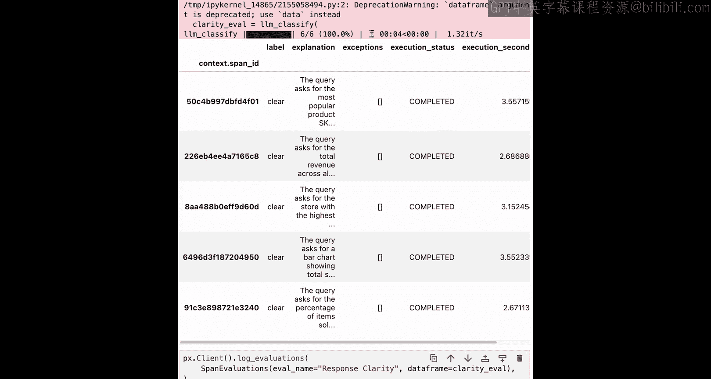

And you should see that appear in Phoenix under response clarity。 In this case。

 looks like 100% out of 100%。 And you had one third and final tool。

 which is your SQL code generation and database lookup tool。

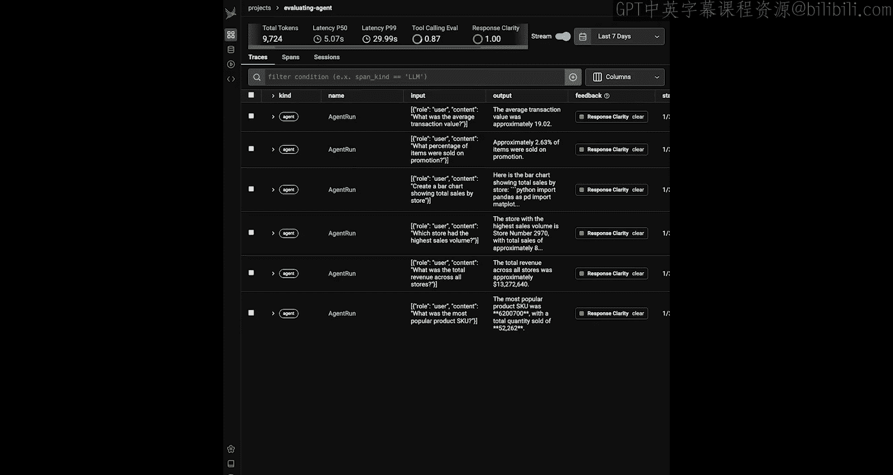

So you can add a similar evaluation for that again， defining an LLM as a judge prompt。

 So in this case， you can see a SQL el Gen prompt。And then you can export relevant spans， so again。

 in this case you can export your LOM spans， and then you can later filter down a little bit more specifically here to filter whether the question that's being asked contains this generate a SQL query based on a prompt method。

Oftentimes the hardest part of setting up the Evals is filtering down the right set of spans and coming up with the right criteria。

 so just know that you can filter based on anything inside of the spans。

 including string manipulation here or just looking to see if the prompt contains a certain kind of value。

Export your data there。Once again， run your。LLM as a judge prompt。

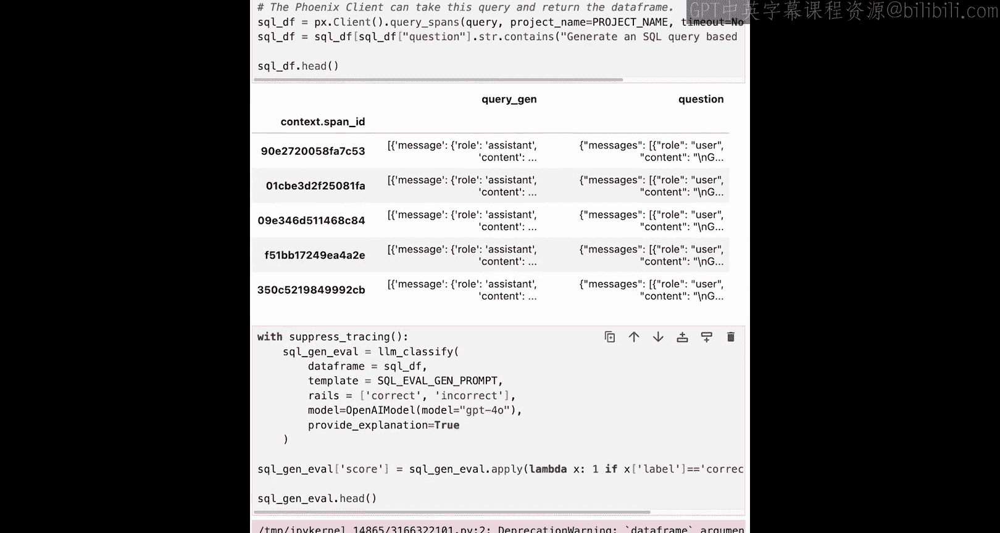

And then finally， upload that data into Phoenix。And so now you should have four different evaluators in Phoenix。

 you have one evaluator for your tool calling and your router。

 you'll have one evaluator for your SQL code Gen， your response clarity and your generated code visualizations。

 so at this point you now have at least one evaluator set up for each main part of your agent and you can use these to get some directional indications of how your agent is performing across different types of queries。

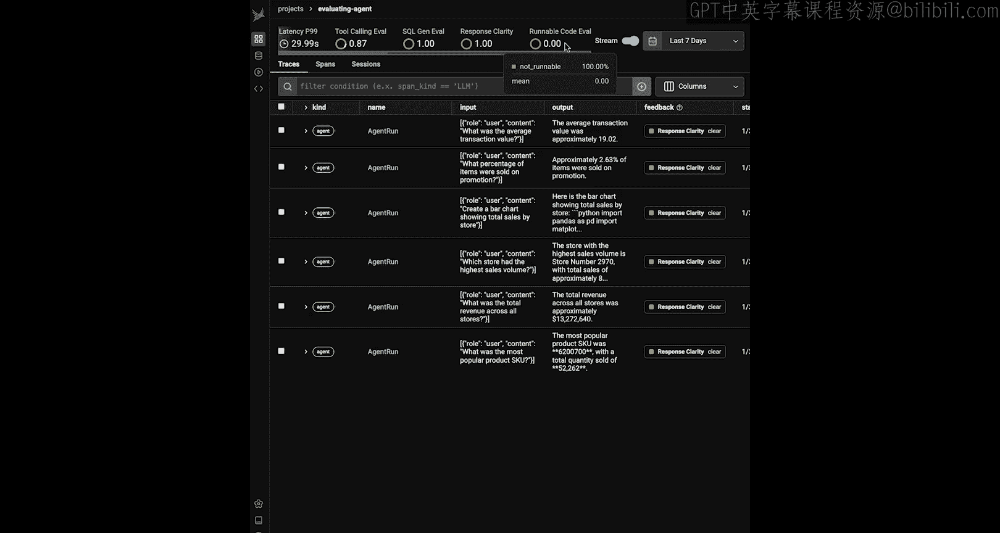