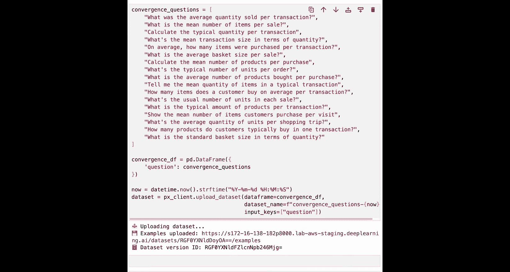
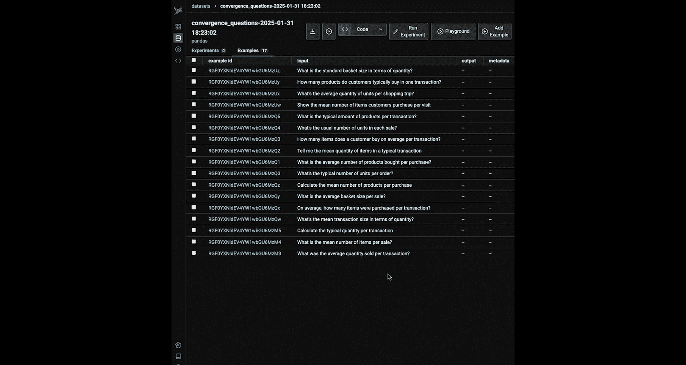
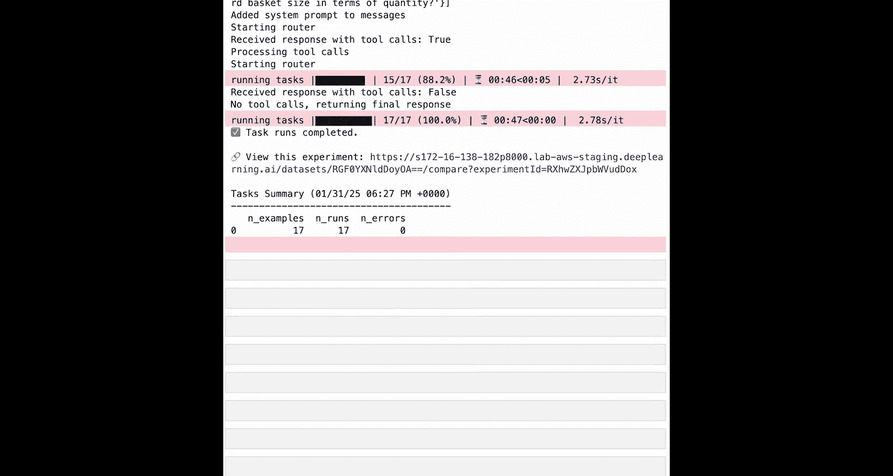
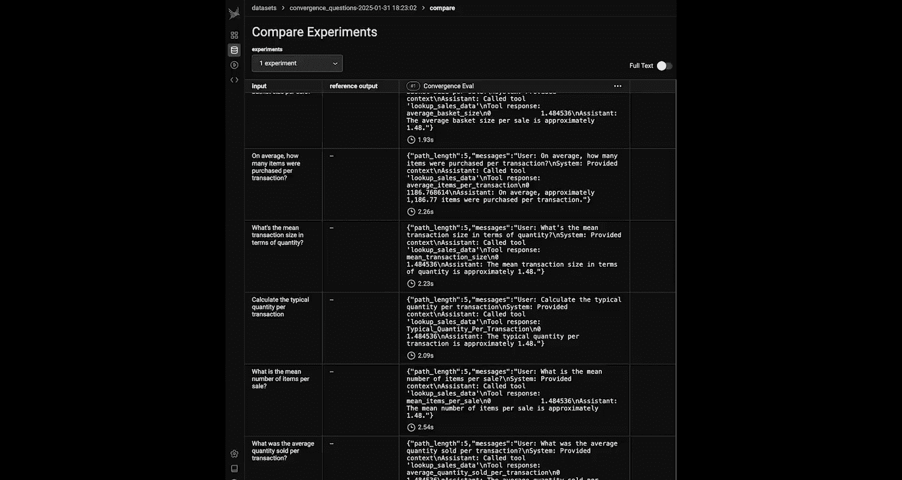
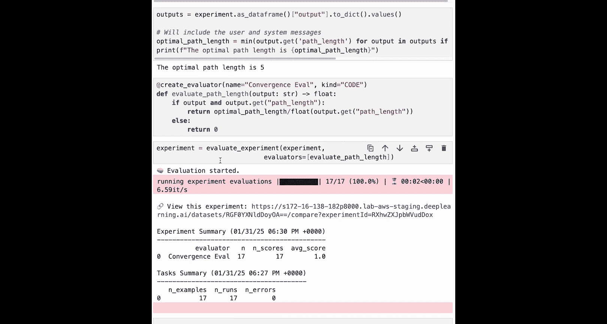
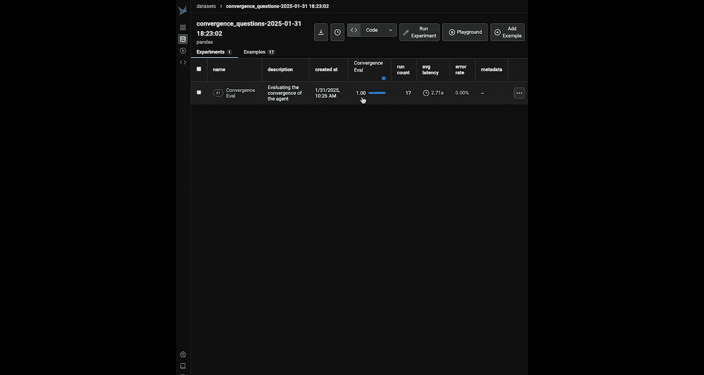

# 吴恩达《评估 AI 代理｜Evaluating AI Agents》中英字幕（deepseek-R1翻译 - P9：9.adding trajectory evaluations.zh_en - GPT中英字幕课程资源 - BV1HTAHebEuj

So now that you've added some evaluations to your router and skills for your agent。

 the next step is to evaluate the path or understand if it's taking an efficient path for a given query。

 so in order to do that again you're going to start by importing a few libraries that will be useful here。

 mostly things you've already seen for Phoenix and then now you've got some new things from Phoenix for what's called experiments which you'll learn about in just a second here。

So you can import those libraries and one other thing to call out is that again。

 the agent's been imported from your Us method here。

 so you have the same agent that you've been working with the whole time you're importing that run agent method。

 so just know that that code is sitting in the background。

And then here you're still going to need to connect to the Phoenix client。

 so in this case you'll just save that Phoenix client variable。

And then the way that you can evaluate your trajectory， as you' learned in the previous slides。

 is by running a set of queries through your agent and then tracing the number of steps taken by each of those queries。

So in order to evaluate the trajectory here， you have to actually compare multiple runs of the agent together。

 so in order to do that you're going to use a tool called run experimenti within Phoenix which allows you to run multiple different runs of your agent and then compare those to each other in certain ways。

So here's a good point to pause and dive a little bit more into experiments and how they work。

Experiments in Phoenix are made up of a few different steps。

 first it's taking a data set of different test cases。

And sending those into a particular task or job to run and then evaluating the results of that task so a data set of test cases is going to have a bunch of different queries or questions that you might run through your agent and typically you'll have an input value inside of those examples as well as maybe an expected output in this first case you won't have an expected output you'll just have an input。

 sometimes you have expected outputs sometimes you don't and that dictates some of the evaluators you can use later on。

So you have a set of examples here， and then you'll run those through a version of your agent。

 so in this case just going to use one single version of your agent。

 you'll get the outputs from that particular round and you'll see actually that you made some slight modifications to your agent to actually track the number of steps taken as well as part of that task。

So you can define the task for your experiment。And then once you've collected all the results of each example through your task。

 you can then send those to a set of evaluators so those evaluators could be the ones you set up in previous rounds。

 or in this case you can do more of a comparative evaluator comparing different runs of your agent and so in this case。

 there's another variable that will be added to each example。

 which is the output of that particular example through the task。

And you'll learn a lot more about experiments in the next lesson as well too。

 this is sort of just your primer for them in this case。

So step one there is creating a data set of test cases。

So the way that you can do that is you have a set of questions in this case convergence questions and if you think back to the slides。

 one of the ways that you test for convergence here is you send a lot of different variations of a similar type of query through your agent and then track the number of steps taken so you'll notice that each of these different examples here is all about the number or the average quantity of items per transaction so you see the average quantity sold per transaction mean number of items per sale calculate the typical quantity per transaction。

 you see these are all kind of variations on the same question so the agent should take the same path through each of these but sometimes there's variation。

So you can take this list of questions， create a data frame out of them。

 and then upload that data frame into Phoenix。So now you have a data set that lives in Phoenix。

If you want to， you can quickly visualize it here。Now， if you want to look in your Phoenix window。

 you can actually see under the datasets tab here， you'll now have an entry for the dataset that you have just uploaded。

 you can click into that and you can see all of the different examples that you've uploaded。

And I can use this data set to start running experiments。So for the next step here。

 you have to define the task for your agent。Now you could just run these examples through your agent。

 but again， you want to have some count of the number of steps that were taken。

 you may want to format some of the messages so you can make slight tweaks to your agent as well and when you're setting it up as a task。

 So in this case you're going do a couple things here。

One is actually create a method that will format some of the message steps。

 which you can come back to in a second， and then you'll create a task here。

That is run agent and track path so starting with this task you'll see it takes in an example so if you remember each row of that data set is an example。

 so you can see in this case you're taking in an example variable and then it's calling it's taking the input value from that example and then calling the run agent method on that particular example and then finally calling that format messages step so the return from this run agent and track path it's going to be the length of the messages inside the agent as the path length and then the actual messages object and then this format message step really just is going to go through all of the messages in your agent's log and it's going to format them in a little bit easier to read sort of ways you can see the tool calls that are made and make it a little bit easier to compare here。

So now with your task ready and your data set defined， you can start an experiment。So to do that。

 you'll call this run experiment method。And then what this will do is it'll take in your data as well as your task or your kind of function that gets applied to each row of that data set。

And then you can come up with a name some this case convergency valve in a description。

 So if you run that now， each row of your dataset set will be run through the run agent and track path method and you'll get results back that'll take a second to run because it's equivalent to 17 runs of your agent。

 so give that a second to complete。Now you should have some results that look like this。

 you'll see all those runs completed， and you can actually click and see the results of that experiment inside of Phoenix。

 So if you click into that what you'll see。

Is in your data， you now have an entry for experiments and you have this first run of your experiment that you named Convergence Eval and you can actually click and see all of the outputs for each run there。

And this case looks fairly successful in each of our runs。

And so now what you can do is you can actually go back into the code and you can apply evaluators to each of those different experiment runs。

 and so here's where you can essentially implement your convergence evaluator and so because you just run your experiment。

 you have retained that experiment has something that you can apply and access in your code so you always view the re of that experiment as a data frame where you have the output input and other various columns there。

And so that's one thing that you can actually use to run your convergency valve as well。

And so in order to calculate the convergence， first you need to calculate the minimum number of steps that was taken by all the runs of your agent。

 and so to do that， add in code here to first take your experiment as a data frame like youve just done above and then look at the output column and turn all of those different variables into values that you can access。

And then calculate the minimum or optimal path by using the minimum function on the path length variable within each of those different outputs。

 so this is just going to give you a number for the minimum path length taken。

So if you run that and you should get something that says the optimal path length is。

You probably see five in here， that is the optimal path length that's being used。

And one important thing to note is just the way that this has been set up so far is it's counting every message has the path length。

 so it is including things like the system message and the user message that's fine in this case because you're comparing a bunch of different examples that all include both those variables or both those messages。

 you just want to make sure that you're consistent so if you include the user message and the system message again that's fine。

 you just got to make sure that you do it on every example that you're testing with。

So now you can create a method to use as your evaluator。And in this case。

 you can use this evaluate path length method， which is going to take an output and compare it the path length of that output to the minimum or optimal path length that you calculated earlier。

Here also you're going to use this。Create evaluator decorator here， this is totally optional。

 but it allows you to name the evaluator that you're going to run here and so you'll it'll mark how it shows up inside of Phoenix。

And so now you can take the experiment that you've already run and use this evaluate the experiment method to take in the experiment and then this evaluate path length method that you've run above。

 and that will take all of the results from your experiment and run them through any evaluators that you add in here。

 aK， in this case， the evaluate path length and it will give you a score at the end of it。

That'll go pretty quick because it's just a basic code based eval and if you jump over into Phoenix now。

You'll see that your experiment， you go back to your dataset。

 you'll now have a column here for convergence eval。

 It name that because of the decorator that you attached。 and in this case。

 we've got a perfect score of one， our agent has taken the correct path with every example here。

 you might see a different value here。 every time we've run this we've gotten a different value。

 So you may see a different value here for one， and I'll give you an idea of whether or not your agent is converging towards the correct path。

