# 吴恩达《软件开发的生成式AI技能（简介、结对编程、数据库设计-3课全）Generative AI for Software Development Skill》 - P10：9_迭代式提示.zh_en - GPT中英字幕课程资源 - BV1ucxLeUEHD

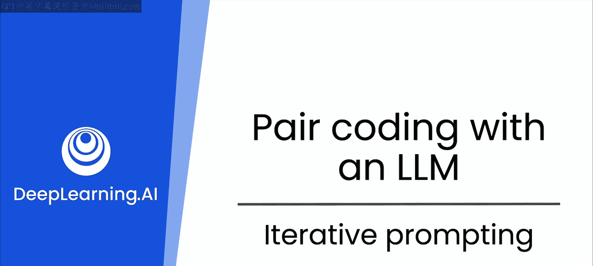

Welcome back。 Earlier， you saw how to write prompts that instruct an LLM to generate code and how effective prompts helped you to generate better code。

Let's take a closer look at some best practices for effective prompting。

 The clarity of your prompt directly influences the accuracy of the code that you receive。😊。

Let's compare two examples。If we start with a vague prompt like this。

You'll get a confused response from the LLL。😊，So add more details to your prompt to help the model better understand what you wanted to do。

And the model will respond with a more detailed answer。

The precise prompt results in a proper Python function。 It might even be ready to use as it is。

 but it's always best practice to test， test test before accepting the model suggestion。

 So let's go deeper and explore the idea of context in prompting。😊。

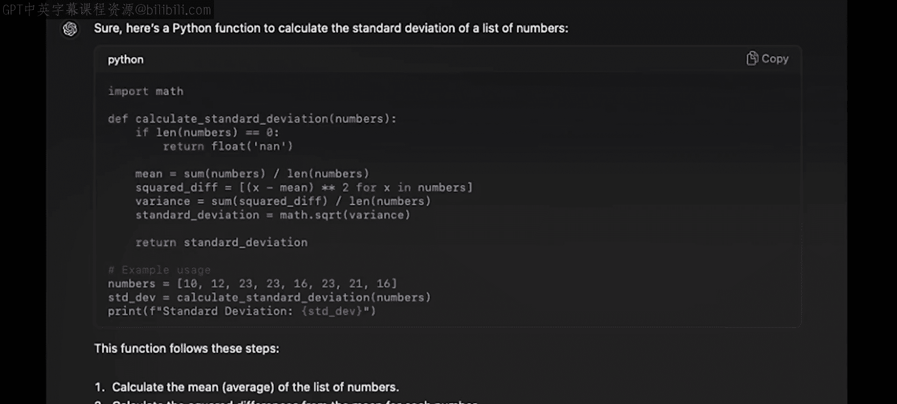

Context is basically information in your prompt that can steer the LLM to a better answer。

Adding context can drastically change the output， making it more aligned with your actual requirements。

😊。

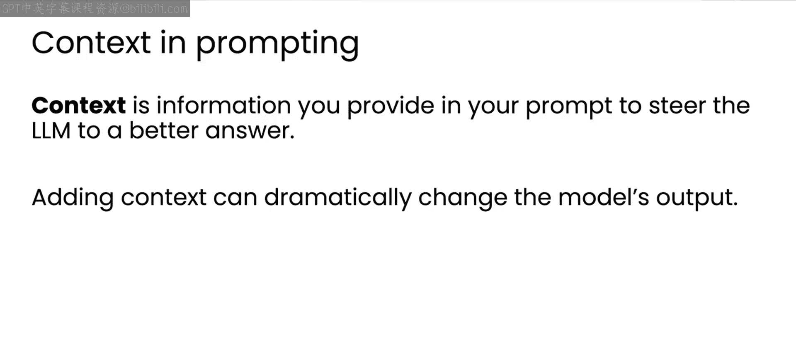

So let's say you wanted to write a Python function to download a file and save it to De。

With detailed context about how to do this， like not using W get。

 your prompt may look something like this。 And here is how the model responds。

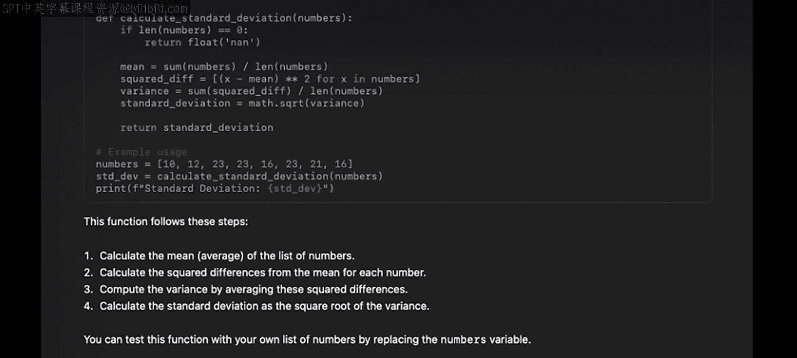

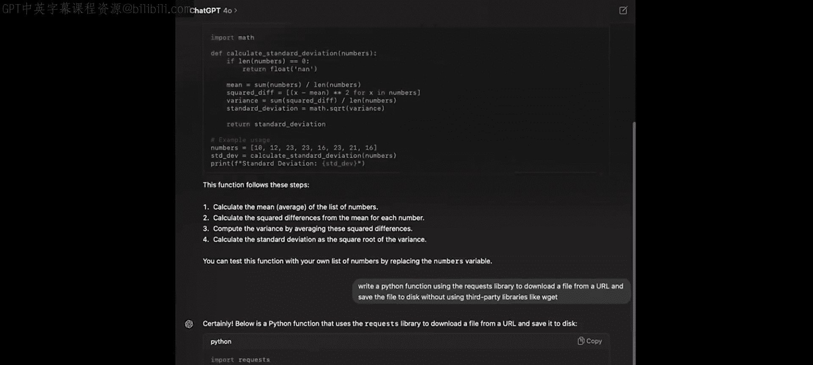

This tailored function meets the specific criteria that you provided in the prompt。

 I don't expect you to weed through this entire function。

 but notice that it did use the requests library。 like I asked。

 and it didn't make use of any other third party libraries by carefully testing this function。

 you could determine if it appropriately solves the problem at hand。

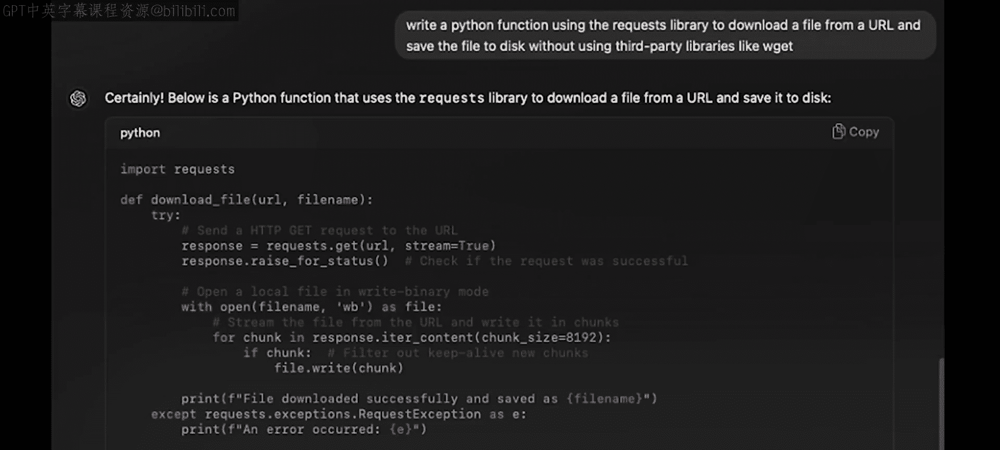

In the previous section， you saw how you can refine the output of an LLM by iterating on the prompt。

Let's explore that in more detail now。

Here's a prompt with some quick and dirty instructions to create an API。

 It's not too much detail here。So the model returns this code。

Even if you are not familiar with flask， you can see that it's creating a short list of user objects。

 Alice， Bob and Charlie， Then it seems to be including different endpoints in the app for tasks like getting the full lists of users or information about a single user。

 If the individual user can't be found， it seems like this function would throw a 404 error。

 That's a nice starting point。 But there's currently no code to handle that 404 error。 In fact。

 this code doesn't include good any error handling at all。

 So let's ask the model to add that to the API in the follow up prompt。

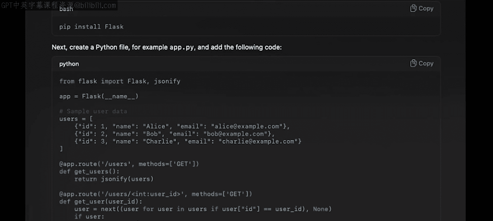

And again， just to note here that this is another great example of where your domain expertise makes you a better prompter。

 The fear that people with no skills will completely disrupt the role of a developer because of prompting is。

 in my opinion， unjustified， because code like this is only trustworthy。

 when you have error handling like this within it， and the knowledge of web development， deployment。

 testing and error handling is paramount for any code。 whether it's generated or human written。😊。

So here's the code the model generated in response to the follow up prompt。

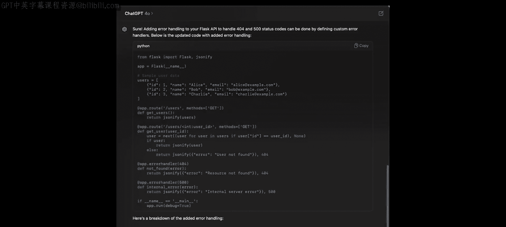

This looks pretty good。And you can see the new error handling code that the model added。Okay。

 it is looking good。But the code isn't that well documented。

 So let's follow up with a request to comment the code thoroughly to make it easier for someone who might inherit it from me to know what it does。

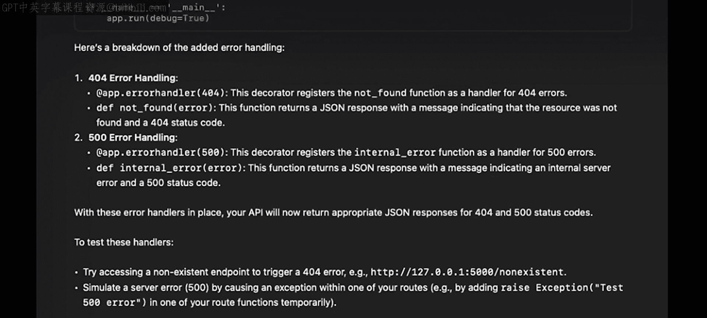

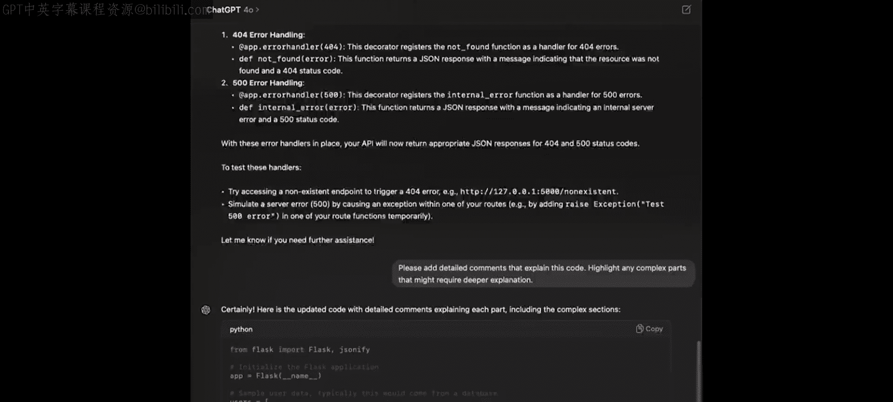

And here's the output。 The model responded with the same code it generated last time。

 but now it has added helpful comments throughout the code。 As you can see。

 you iteratively improved both the functionality and the readability of your API through this back and forth with the LLM。

😊。

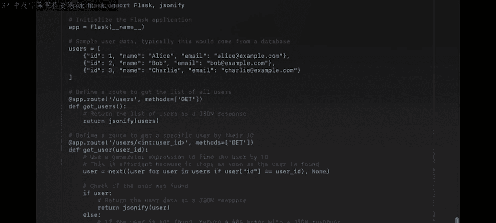

No code is ever truly finished， so the ability to continually improve on your code through prompting is a really important skill to have。

 and mastering it will make you a much better developer。😊。

