# 吴恩达《软件开发的生成式AI技能（简介、结对编程、数据库设计-3课全）Generative AI for Software Development Skill》 - P12：11_为LLM分配角色.zh_en - GPT中英字幕课程资源 - BV1ucxLeUEHD

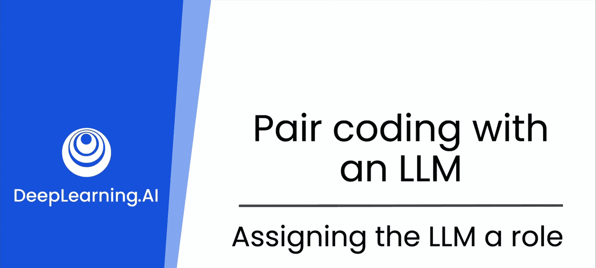

So far， you've seen how being specific and clear with your requirements and using your domain expertise to ask directly for things like well known dependencies to be used can help the model write good。

 efficient code。You also saw how an iterative development strategy through continuous prompting of the model can help you refine and improve the code that it writes。

In this video， you'll see how you can get even more specific by assigning a role for the LLM to play when it responds to your prompts and generates code。

 when you interact with an AI like ChatyP， the way you frame your prompts plays a crucial role in shaping the AI's responses。

By specifying a role for the model to assume in your prompts。

 you set expectations and guide its tone， level of detail and the perspective from which it addresses the query。

The idea here is that you want to guide the complete output from the model， not just the code。

 to be something that suits your needs。 depending on your level of expertise。

 you might want different code to be generated。 A beginner might want code that's easier to read。

 whereasas an expert might want code that is shorter， compact and more efficient。For example。

 when I was starting out in C++， I wrote code like this。

Whereas my expert friends wrote code like this， which I completely didn't understand。

 This second form is called a tarernary operator， and it's a shorthand way of writing an F。

 L statement。 It's great because it's compact， but it's hard to intotu it what it's doing if you're a new C plus plus coder。

😊。

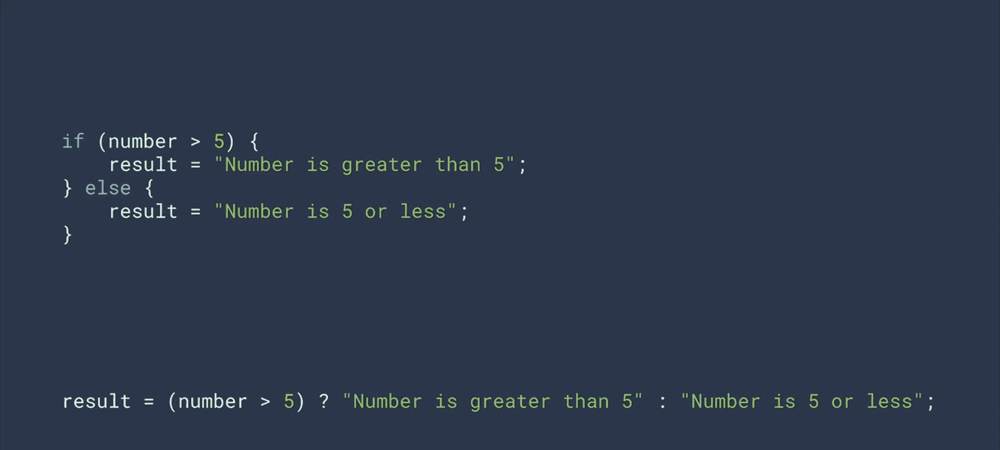

So when you're interacting with an LLM like Chaty PT。

 you can ask it to fulfill a role that's suitable for your scenario。

 Let's explore this in more detail。😊，For example， look at these two prompts。

 How would you expect the LLM to respond to each？

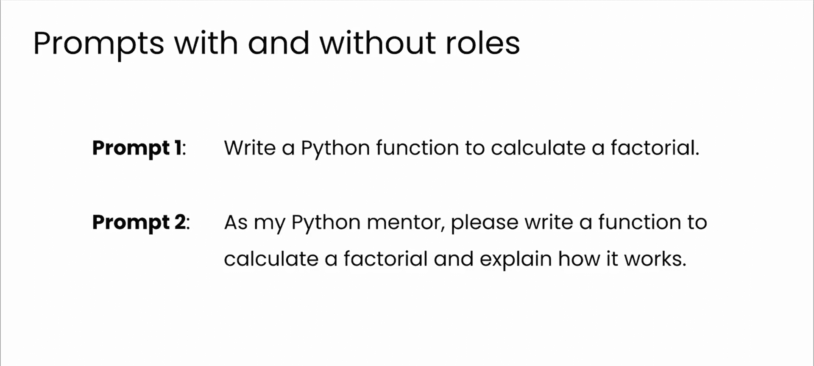

In the first case， the model row code like this， I think it took a pretty straightforward approach。

 first checking if the input is negative and then handling the special cases of 001。

 and for the cases of valid inputs greater than1， calculating the factorial by iteratively multiplying number starting at 2。

 all the way up to add。😊，Now， let's have a look at how the model responded to the second prompt with the roll assigned。

 Notice that the approach it took this time is a little different。

 It still checks the negative inputs and then handles the special cases of 0 or one。

 But for numbers of two or greater， the model decided to take a recursive approach。

 The response also includes a much more detailed explanation of the code it wrote。

 including a step by step description of how recursion works in this instance。 That's pretty cool。😊。

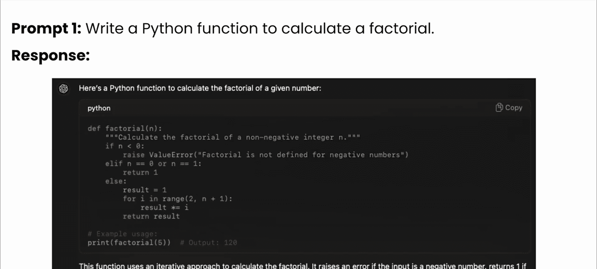

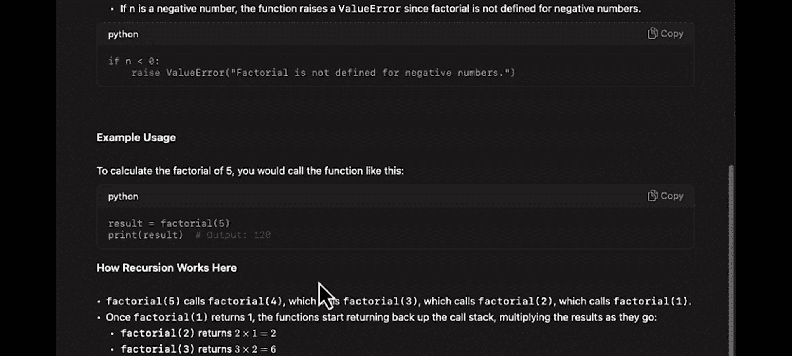

So for the rest of this lesson， you're going to explore how defining roles can transform your interactions with at ET。

You'll start with basic concepts that are perfect for beginners。

 and you'll gradually move towards more complex and sophisticated examples suitable for advanced users。

 By the end of this session， you'll be equipped to tailor your prompts to fit specific needs。

 enhancing both your productivity and your projects。

 So let's get started and unlock the full potential of your interactions with AI。

 in the context of AI prompts， a role is the character or perspective that you assign to the AI。

 This could be a tutor， a coach， a code reviewer or even a fictional character。😊。

The role you choose influences how the AI structures its response。

 tailoring its language and content to fit the expected knowledge and behavior of that role。

Let's see this in action。Here's a simple task。 you want to know how to create a listed Python and add elements to it。

First， let's ask without defining a role。 here's the prompt。

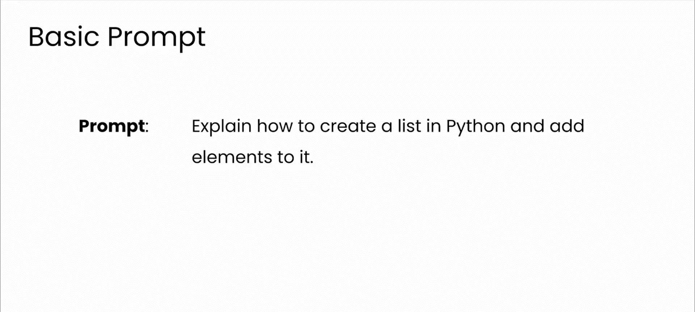

And here's what happens when using that pro with GPT。😊，It's a great response。 It's straightforward。

 and it's technically accurate。But let's see what happens if you revise the prompt to specify a role in this case of a Python tutor for beginner coders。

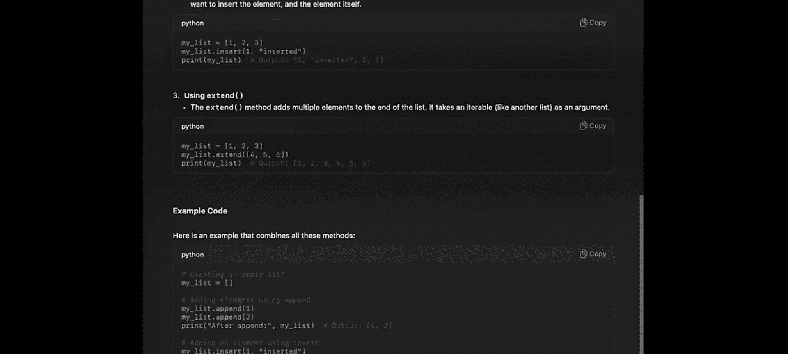

I tend to say as a when prompting， but you aren't limited to that。

 You could use things like you are a friendly coding mentor， and that would also work。

Find what you're most comfortable tea use。

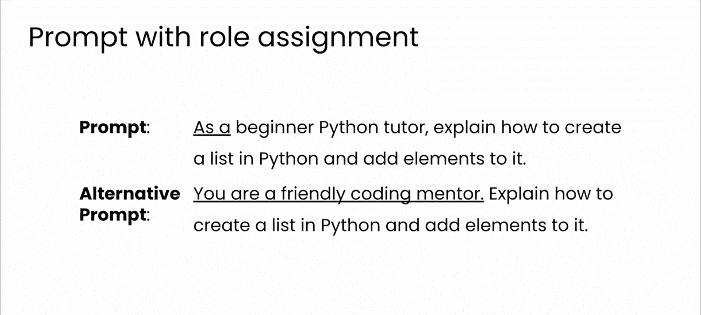

Here's how the model responds now。Look at how detailed that answer is。

The role of a beginner tutor transformed the response to be more visual and relatable。

 which is super useful for someone new to programming， or indeed， even an expert。

 who might want a refresher on how lists work。😊。

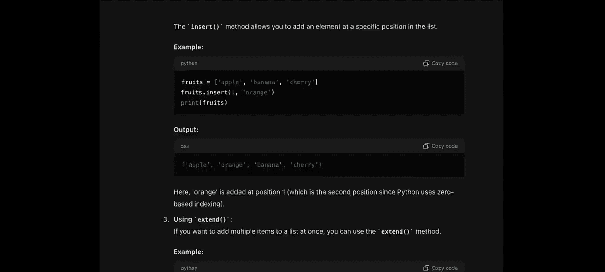

Defining a role effectively sets up a feedback loop where the prompt guides the AI and the AI's response is better aligned with the user's expectations。

 This makes your interactions more intuitive and effective。Let's try another example。

 Suppose you want the model to explain the concept of a looppin Python。

And here you're going to use the role of a friendly code guide。 Here's the prompt。

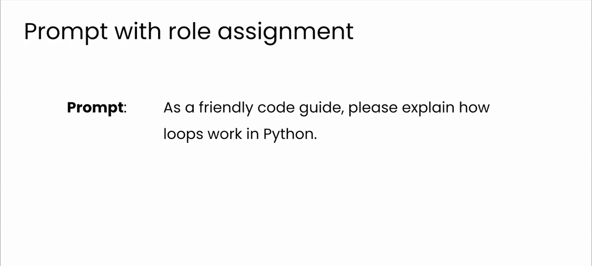

And here's the response。GP T did a really nice job of explaining it。

 It's better Tuor than I am with the role of a friendly code guide。

 The explanation is inviting and reassuring， emphasizing ease and practicality。

 which is great for building confidence and beginners。😊。

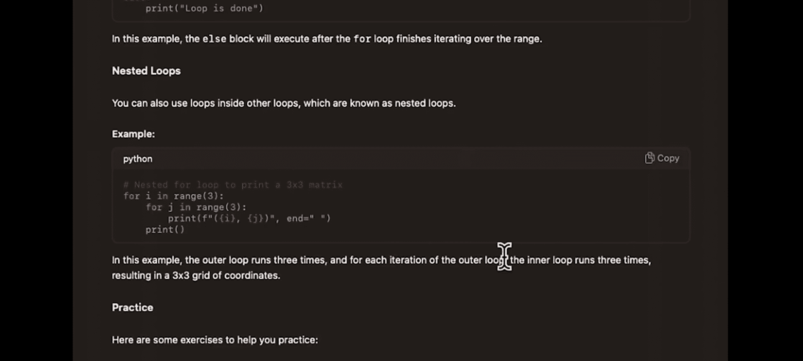

So always remember that the role you assign will help frame the conversation and drive the best results。

 whether you are learning a new language， debugging code or exploring advanced concepts。

 the right role can make your interaction more productive and enjoyable。😊。

