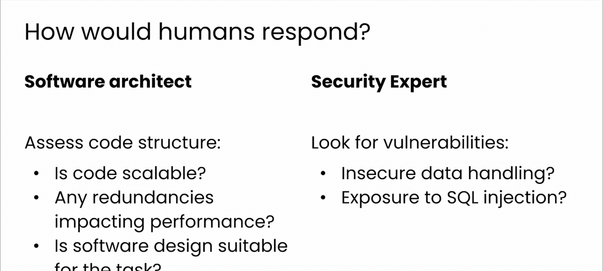
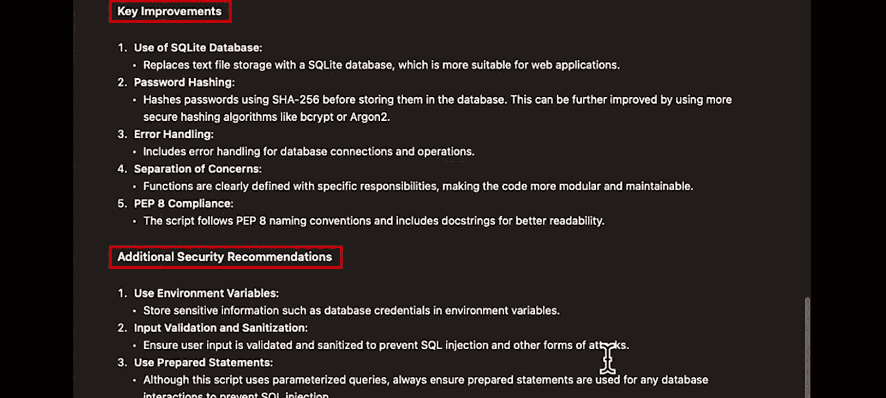

# 吴恩达《软件开发的生成式AI技能（简介、结对编程、数据库设计-3课全）Generative AI for Software Development Skill》 - P13：12_通过多重角色提升能力.zh_en - GPT中英字幕课程资源 - BV1ucxLeUEHD

So you've seen how roles can have an impact on the output of the model。Now。

 let's explore how combining roles can allow the model to create responses that are not only complex。

 but also incredibly insightful。😊，Imagine you have a Python script for a web application and you need comprehensive feedback that covers both architecture and security。

Here's how you might frame your a prompt to get the model to act as both a software architect and a security expert。

You're asking Chat ET to wear two hats， one of a software architect and one of a security expert。

 Let's add some code to the prompt like this。 Now， with the role defined in the prompt and the code you want to analyze。

 here's how a human would think。A software architect would assess the script's structure。

Is the code scalable Other redundancies that affect performance I the overall design pattern suitable for the application's purpose。

In contrast， a security expert would scrutinize the script for vulnerabilities。

 Are there any insecure data handling processes。 Does the script expose the application to SQL injection or crossite scripting attacks。

Let's see the response that Chat EPT generates when asked to take on these roles。😊，Okay。

 so the model spotted a number of things， like the fact that the code uses a text file as a database and that the username and password are stored in clear text。

 these are beinging vulnerabilities。😊，The model also suggested an improved script。

 which is really useful。And as you can see， you get specific。

 actionable advice that enhances your code。😊。

So as you can see， using advanced roles effectively transforms an LLM into a more powerful tool for software development and project planning。

😊，Stay tuned for our next section on experter level prompt engineering。😊。

