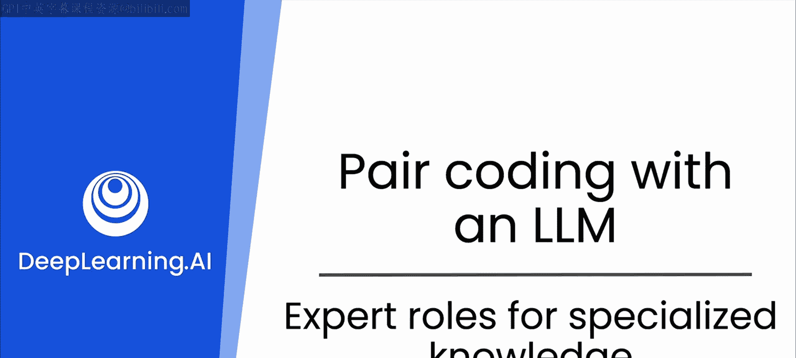
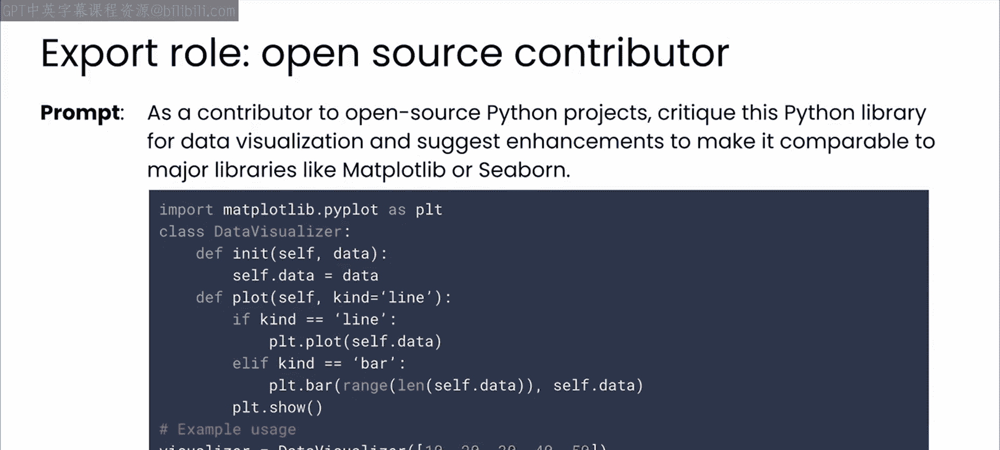
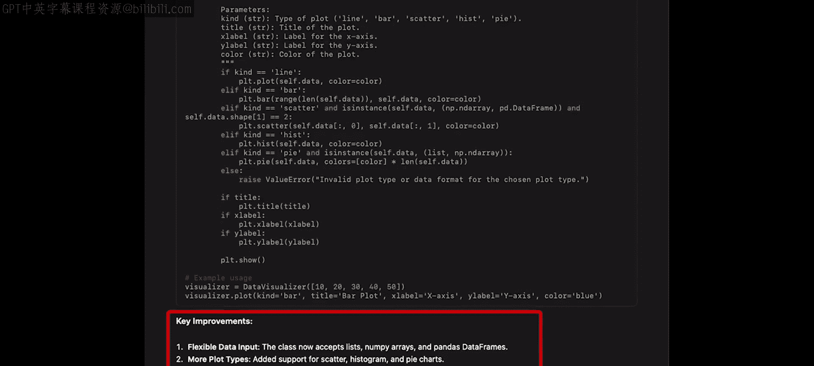
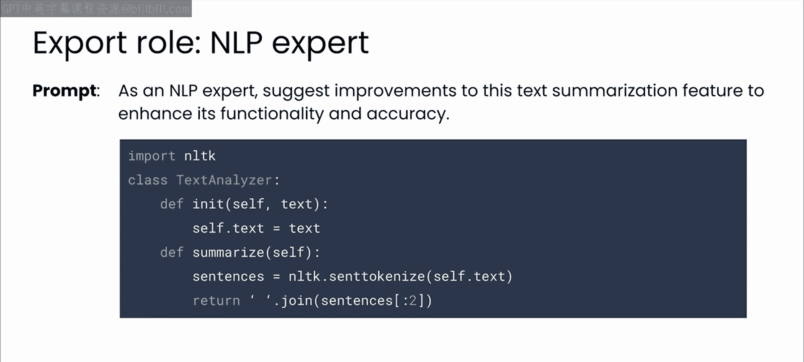
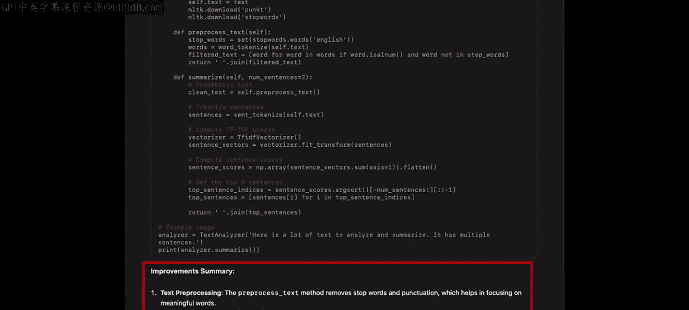
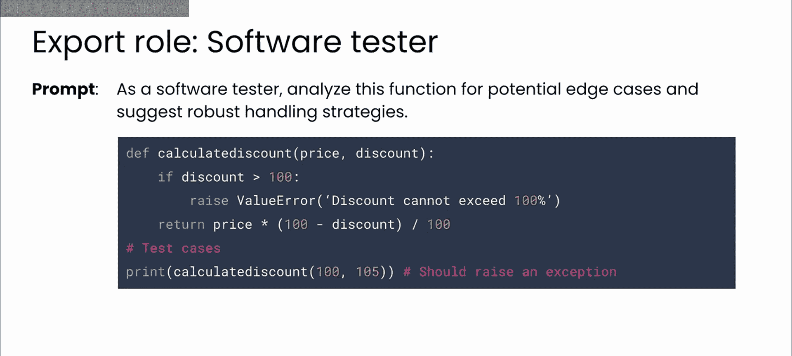
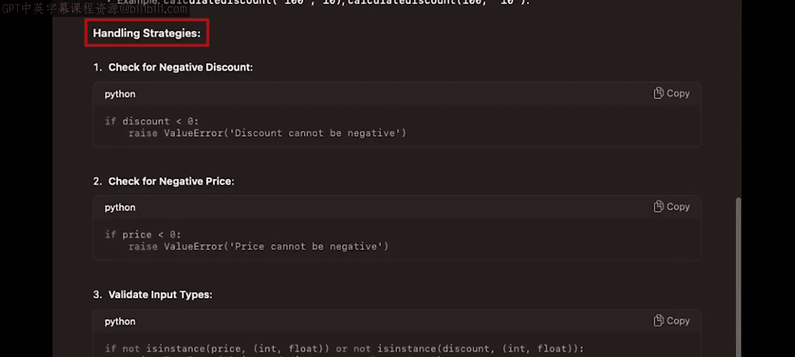
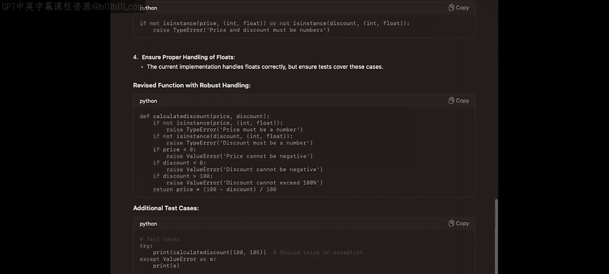

# 吴恩达《软件开发的生成式AI技能（简介、结对编程、数据库设计-3课全）Generative AI for Software Development Skill》 - P14：13_专业角色用于专门知识.zh_en - GPT中英字幕课程资源 - BV1ucxLeUEHD

Using roles has helped you optimize the responses of the LLM。

 and let's take this to the next level by instructing G to be more than just a co generator。

 It should act as a key member of your developer team offering insights based on the vast data that it's been trained on and bringing in experienced programmer's perspective to its responses。

 Our first example instructs the model to carry out a Python library critique。

 You'll use a sample library design for data visualization and prompt chat GT to evaluate it critically。

 suggesting improvements to make it comparable with industry standards。😊，Let's start with this code。

Then will'll prompt the model to adopt the role of a contributor to open source software projects and instruct it to compare your code to well known similar libraries。

By specifying this role， you expect the model to provide a detailed critique on the features。

 performance and usability of your code， and to suggest specific improvements。

So let's go ahead and run this in GPT。As you can see。

 the model responds with a deep critique of the code， followed by suggestions for how to enhance it。

 Take some time to read the contents or try the same prompt with an LLM yourself。😊。

But you can see that the answer here is very detailed and has lots of actionable items to improve the code。

😊，For example， in this key improvement section at the end。

 the LLM summarizes changes it has implemented， including flexible data input， more plot types。

 customization options， and a whole lot more。

Next， let's take a look at how to work with an LLM to explore the integration of advanced features。

Suppose we want to enhance an existing application with AI capabilities like natural language processing。

So you'll start with this code。And assign GPT the role of an NLP expert to analyze it。Here。

 you're encouraging the model to not just critique。

 but also provide suggestions for applying state of the art NLP techniques to improve the functionality of your app。

😊。

And here's how it responds。It fixes an error in the class initialization and then offers some suggestions to improve the code like text pre processing and more advanced NLP methods for summarization。

This is exactly the kind of thing you'd expect from a code reviewer working alongside you。

 particularly if they were an NLP expert。

Let's pivot to another role and use the expertise of the role to help us be a better coder。

 And that's the role of a software tester。 Software testers have many skills。

 But one of my favorites is their innate ability to find corner and edge cases for code。

 So let's see if GT can help us with that。😊，Here's some code。

You'll assign the model the role of a software tester to see how it can help you identify and mitigate edge cases here by focusing on robustness in software。

 you're directing the AI to consider not just normal operations。

 but also unusual or extreme conditions that could cause failures。

So if you just use GPT with this role， prompt and code， you'll get feedback like this。

There's a lot here。 Sopend some time to watch the video and read through the feedback。 Also。

 take some time to try this prompting code for yourself。

 The most important takeaways here are that the model understood what you wanted when you assigned the software tester role。

 It has identified a number of potential edge cases。 described them。

And then suggested strategies for handling them。

It also wrote a nice Python script that contains tests for these edge cases。

Lastly， let's discuss how AI can be integrated into typical development workflows from planning through to testing and deployment。

 enhancing all of these processes with AI driven insights。

You could use AI to automate part of the code review process。

 identify potential optimizations during development。

 or even assist in generating documentation based on the code base。

 The possibilities are extensive and can significantly increase efficiency and accuracy in development by carefully crafting prompts that result in detailed knowledgeable responses。

 You can harness AI's potential to tackle complex problems and streamline workflows。😊。

I would encourage you to keep experimenting with these techniques and see how they can transform your projects。

