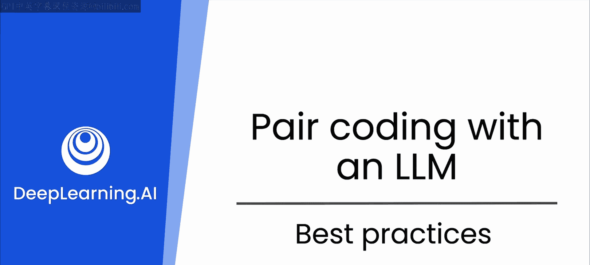
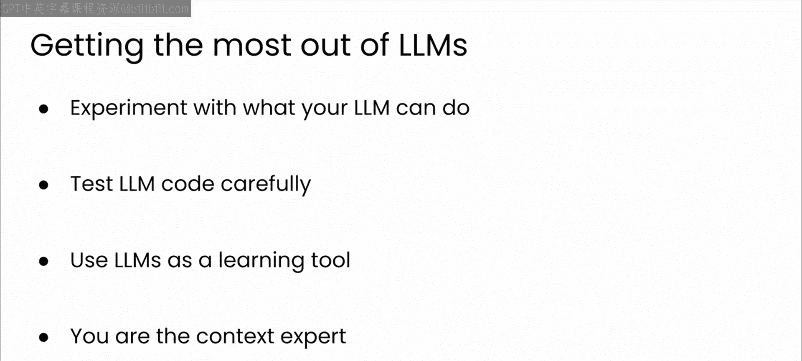

# 吴恩达《软件开发的生成式AI技能（简介、结对编程、数据库设计-3课全）Generative AI for Software Development Skill》 - P15：14_LLM最佳实践.zh_en - GPT中英字幕课程资源 - BV1ucxLeUEHD

I want to conclude this module by summarizing the prompting best practices you've seen and also sharing some thoughts about how your role as a developer changes when working alongside an LLM。

 So let's start with prompting best practices。 First， you saw it's important to be specific。

 provide detail and context about your problem to help the LLM understand exactly what you need。

 And as you learned earlier in this course， the transformer model underlying an LLM can easily handle large amounts of text。

 This means that you can write long prompts that include extensive details about your project or even large portions of code that need edits or feedback。

 The more specific your prompt， the better the response you'll get。 Second， assign a role。

 This helps the LLM tailor its output to what you need by explaining the perspective with which you'll wanted to approach its response。

 If you assign the role of a helpful coding tutor。 you might get code that's。😊。

Bener friendly with more comments than if you assigned a role of an expert and efficient programmer。

 experimentment with different roles to see what gets you the output that you need。 Third。

 request an expert opinion。 assignsign the LLM the role as an expert in one or more domains and then ask it to evaluate your work。

You could assign the role of an expert on software testing or cyber security。

 and then you could request feedback on code that you have already written。

 This can help you identify potential flaws， suggest optimizations and enhance the overall quality of your work。

Finally， give feedback， iteratively prompt the LLM and provide feedback on the output that you receive so that you can get closer to your expected results。

 The LLM will remember the context of an ongoing conversation。

 So if you' are not happy with the initial response。

 You can ask it to make changes to get closer to what you're looking for。

 Most interactions with an LLM will require a few back and forth prompts before you get to something that you're ready to actually try using。

 Work alongside an LLM may feel like a substantial shift to your process as a software engineer。

 So I do want to share some good ideas that I think will serve you well in your ongoing journey of integrating this new tool into your work。

 First， experiment with what your LLM can do。 LLMs are powerful and they can often surprise you with just how much they're capable of。

 I recommend that you set aside time to try out different tasks that an LLM can help you with。

 and intentionally push the limits of what it can do。😊。

Can it understand the most complex parts of your code base， can it refactor an entire library。

 even if some of those experiments fail， approaching LLMs with an attitude of curiosity will help you uncover new possibilities。

Second， test your LLM code carefully。 LLMs can quickly generate code。

 but that doesn't mean it always works as expected。

 Avoid the temptation to just copy and paste LLM generated code into your project and move on。

 review what was written and test it to ensure that the code not only works well。

 but it's compatible with the rest of your code base。Third， use LLMs as a learning tool。

 LLMs can suggest designs， software libraries or even broader approaches that you wouldn't have considered。

 You can always ask follow up questions， request example code。

 or just have the model present pros and cons of the solutions that it provides。Web searches。

 documentation， online forums are asking a coworker a friend for help。 Of course are still valuable。

 but the conversational nature of LLMs make them great tools to help personalize your ongoing learning。

Finally， I think it's important to remember that you are the context expert。

 even with detailed prompts and lengthy back and forth conversations。

 LLMs will know a lot less about the context of your project than you do。😊。

Ultimately， you still need to be the one that critically evaluates the code that's been written and decides whether it fits the needs of your project。

 A successful LLM interaction should feel like you and the needs of your project are driving the code that you develop。

 So with all of these best practices for interacting with an LLM in hand。 Now。

 it's time for you to go forward and be a better coder。😊。

