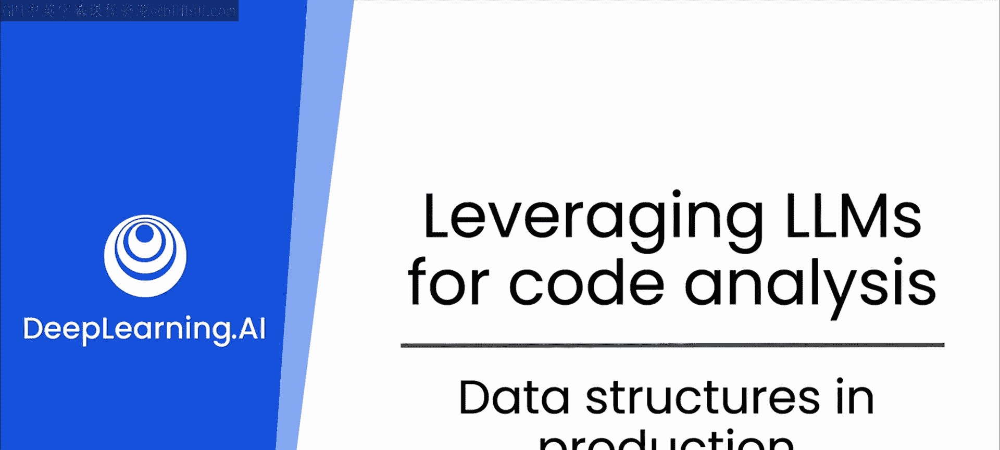

# 吴恩达《软件开发的生成式AI技能（简介、结对编程、数据库设计-3课全）Generative AI for Software Development Skill》 - P16：15_生产环境中的数据结构.zh_en - GPT中英字幕课程资源 - BV1ucxLeUEHD

You've now started experimenting with using an LLM like Chat GptT to help you be a better coder by exploring prompting。

 ongoing conversations to improve code and using roles like expertert software Engineer or beginginner's Tutor。

In this module， you're going to explore data structures。

 the kind that you might study in undergraduate computer science。

 Now you might be thinking what I already understand data structures like a raise or linked lists and you'll be right。

 But what I find exciting is how these can really help you go deeper into understanding engineering problems like scalability。

 maintainability， security and a whole lot more。 So let's have some fun in this module dusting off some of our old ideas about things like linked lists。

 trees or graphs。😊，But we're going to go much deeper into building production code with an LLM by our side。

