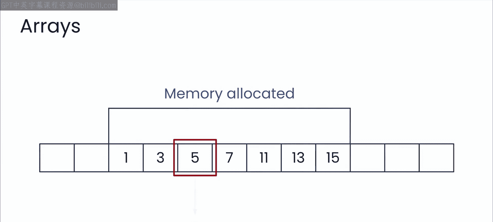
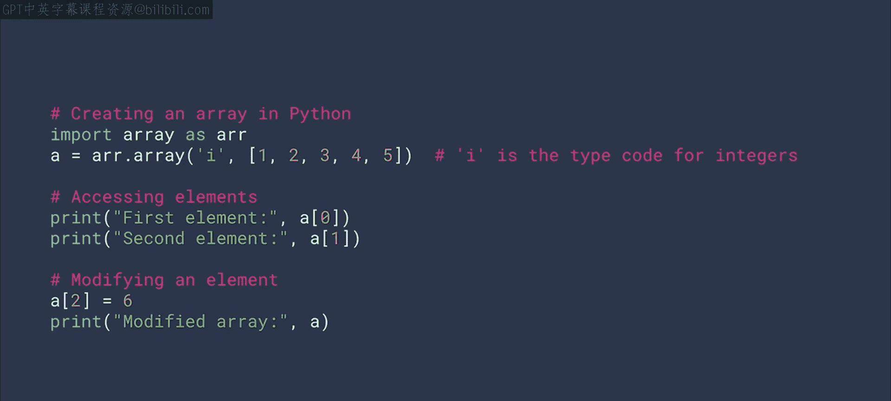
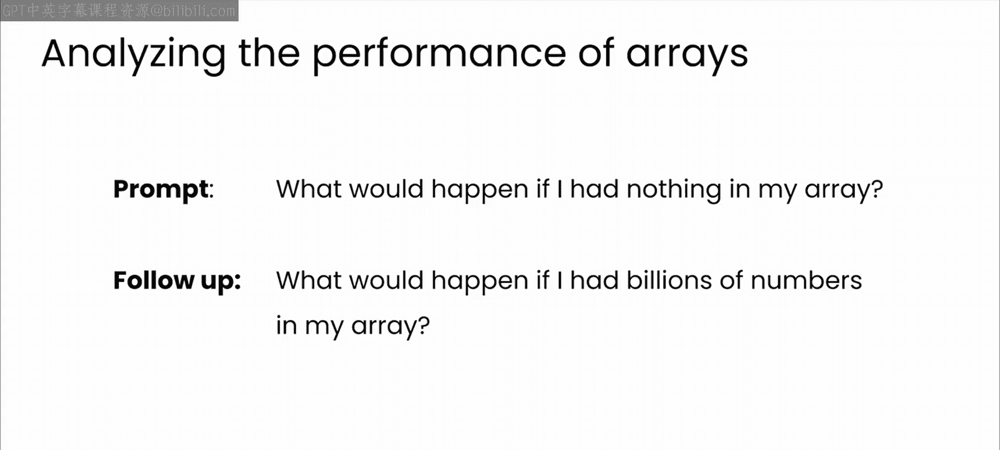
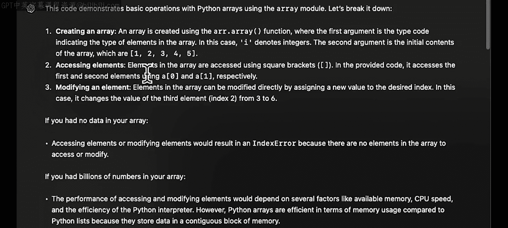
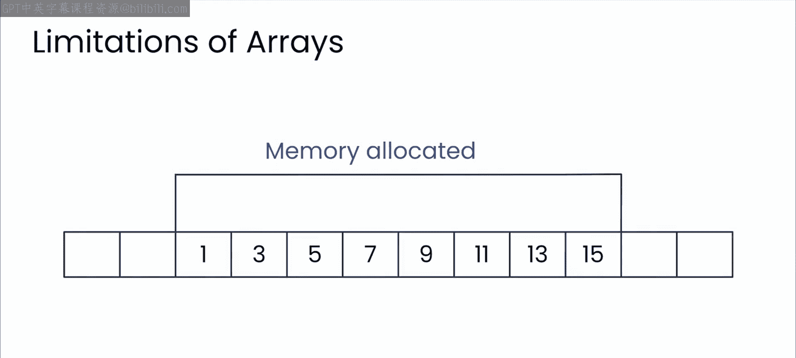

# 吴恩达《软件开发的生成式AI技能（简介、结对编程、数据库设计-3课全）Generative AI for Software Development Skill》 - P17：16_数组.zh_en - GPT中英字幕课程资源 - BV1ucxLeUEHD

The most fundamental of data structures is the array。

 It has many limitations that are often overcome by more exotic structures like linked lists。

 and we'll look into them。But the important thing is this。

 this is not a computer Science 101 class where you're expected to learn these data structures from first principles。

 it's very likely that you've seen them before。😊，Instead。

 you're going to take a deep dive into the features of an LLM like GPT and see how it can help you be a better computer scientist or software engineer by revisiting some of the basics and having the model reasoned through your code alongside you to help you explore the properties of these fundamental data structures and how you can implement them efficiently。

😊，First， we'll talk about array。An array is a collection of items stored at contiguous memory locations。

 This means that they're great for quick access and very efficient。

 if you know the index of the item that you need。😊。

As you can see， accessing and modifying elements in array and Python is straightforward and really quick。

But how does this impact performance？It's always important to think through all of the cases。

 like we did in an earlier video when we asked the model to take on the role of a software tester。

So let's ask ChatyP to explain。😊，So， for example， you could write a prompt like this。

What would happen if I had nothing in my array。Oh， and a little pro tip here。

 often when interviewing tech companies that deal with a lot of data like a Google。

 you'll be asked to solve a problem in code。 But then the real question would follow。

 and that would be what would happen if you had a lot more data like billions of rows and how would you change your solution。

😊，So I'm going to work through that lens， starting simple。

 and then scaling up while interacting with an LLN。😊。

And here is the response of the model。 Now， your results may vary slightly from what you see here in the video because LL Ms are non deterministic。

 but you'll likely see similar topics and key points， in particular for the billions question。

 where the model emphasizes the need to take into account memory and stuff like that。

Python is very efficient for arrays as it stores data in a contiguous block of memory。

But whenever memory comes into question， there are risks。

 so you could ask the model about those risks。 What would happen if you implemented billions of numbers using an array。

 What risks would you face。

So you can write a prompt like this。😊，And get lots of great information back。

 detailing issues like memory consumption， fragmentation， performance issues， limited flexibility。

 etc。Also， maybe things like accessing my data would be highlighted。

 and while an array operates in order one for access， there's no easy way to search an array。

Or as you saw in the previous module， you could assign the model a role， and in this case。

 an expert software engineer and then have it profile your code， I'll give you advice like this。😊。

Now， all of this interaction with the model and the analysis it has provided has given you a lot of information to consider when deciding whether to use an array or not。

Ultimately， you'll make a decision based on your exact scenario。

 As you may recall from computer science 101， Some of the constraints of the array data structure can be mitigated by implementing more complex data structures。

 For example， one of the constraints of the basic array is that there's no inherent order。

 You just keep adding stuff to the end of the array。😊，And if you want order data like sorted numbers。

 then to insert a new value， you're going have to shift everything else down to create a location to store a new value win。

 or if you want to remove an item from the array， you have to delete the item and then shift everything else up。

😊。

In an array with billions of items in it， these moves aren't feasible。

 So the idea of a linked list was born。And we'll take a closer look at linked lists in the next video。

