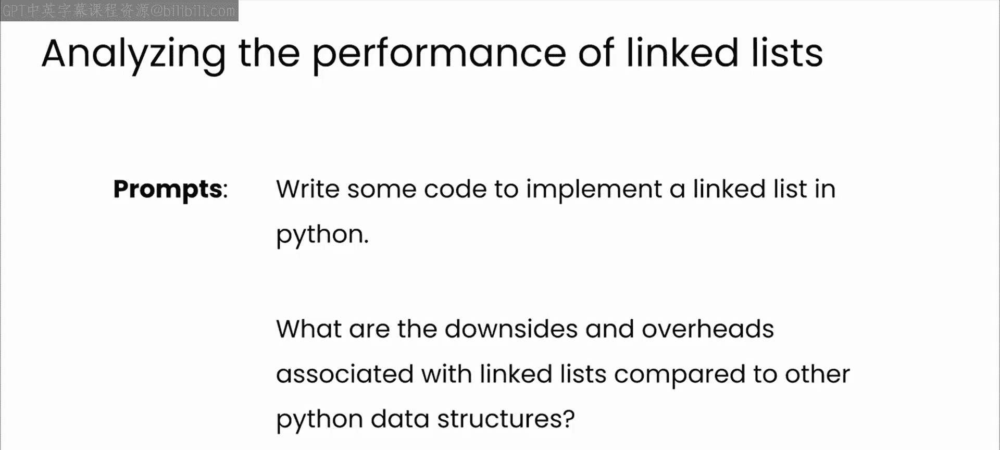
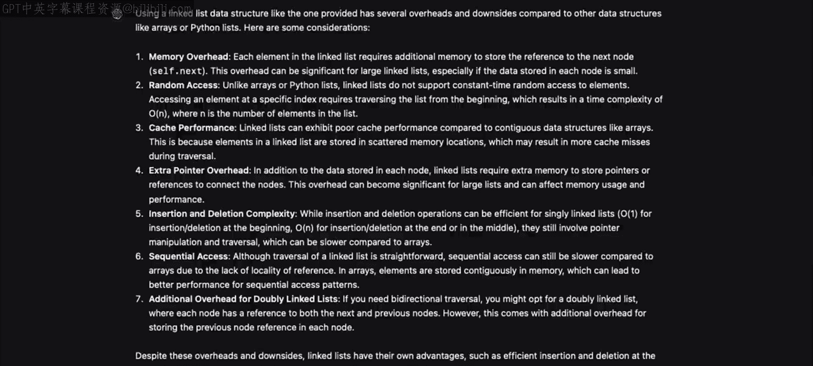
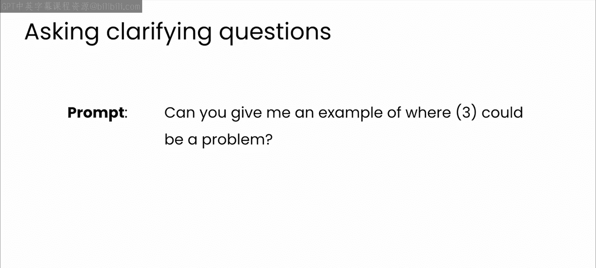
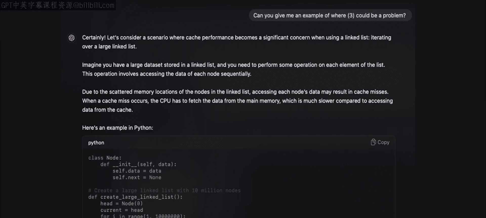
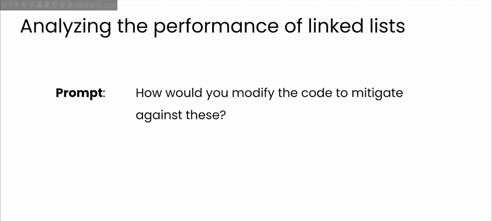
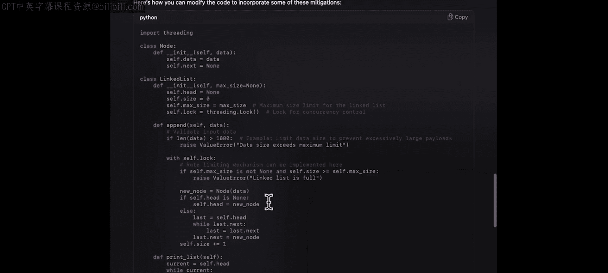
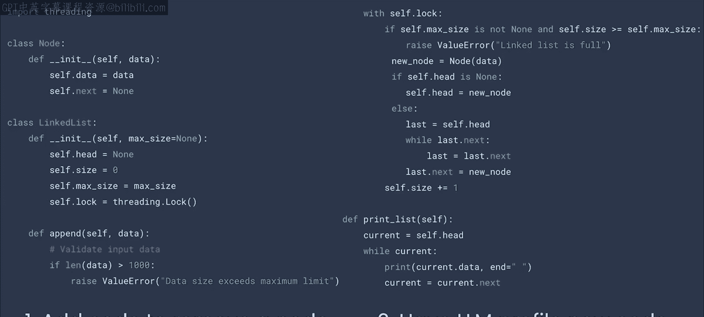
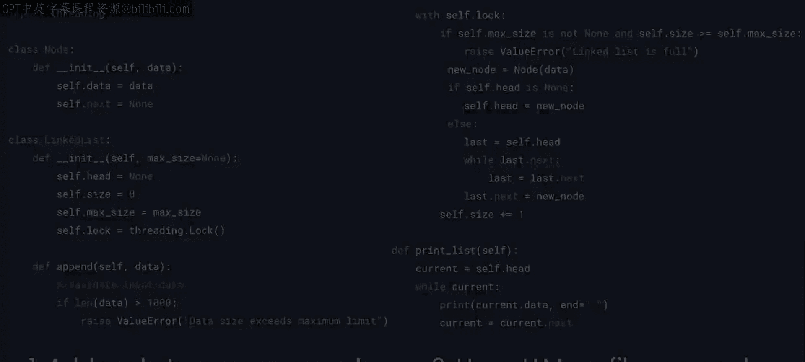

# 吴恩达《软件开发的生成式AI技能（简介、结对编程、数据库设计-3课全）Generative AI for Software Development Skill》 - P18：17_链表.zh_en - GPT中英字幕课程资源 - BV1ucxLeUEHD

It's a common computer Science 101 assignment to ask students to implement a linked list。

Nowadays with LLNs of the scene， you could probably just ask the model to write the code for you。

But this is a very bad habit。It's easy to have chat GPT implement code for you。

 but if you don't understand the codeic rights， or perhaps more importantly。

 you don't understand why the model decided on a particular implementation。

 you can make bad decisions that accumulate technical debt。

 which you or a future colleague are going to have to pay off someday。

So as you work to write code with an LLM， be sure to quiz the model about why it's making the recommendations that it does。

Anyway， back to linked lists。😊，The idea of these data structures is to overcome the deficiencies of the arrays that we just saw。

 insertting or removing elements， particularly for large arrays， is extremely expensive。

With a lead list， instead of the values just being stored in contiguous memory。

 items are stored in a place in memory with a pointer to the position of the next item。

 So now if you want to insert a value into the array。

 you can put it anywhere in memory and have the pointer from the previous item point to it and then have its pointer point to what the previous item had point to before you inserted this one。

 They're pretty cool。 and they give you the flexibility to insert and delete elements without all of the shifting of elements around that impairs array。

😊，It's a pretty cool and useful data structure， and while it fixes some problems with arrays。

 linked lists have their own overheads and downsides。Can you see what those might be？

Pause the video and think about this for a bit。O， there are a few potential issues with this data structure。

 and don't worry if you didn't think of them all。 This is where an LLM's ability to act as a pair coding partner comes in really handy。

You can ask the LLM to write code to implement a linked list。

 and then you can ask the model to talk you through the potential downsides and overheads。😊。

Before walking through what the model has to say， pause the video again and then try asking an LLM these questions。

 Once you've done that， I'll show you how Cha ET responded to me。

So here's Cha Ept's response to my prompt。 As you can see。

 the model provides details and a long list of potential issues to consider。 I'll be honest。

 and I'll tell you， I only got four of these seven items myself。

 I didn't consider things like cash performance。 Again。

 This is another good example of how pair programming with an LLM can make you a better developer。😊。

Take a little time to read through the feedback that you get from the model。

 And it's just like working with real people。 Different conversations will give you different insights。

 And if you think about your own work with your teammates。

  different colleagues will often offer different opinions on how to solve a problem based on their own distinct experiences In the case of LLMs。

 the exact responses will differ based on changing random seedss。 But the overall effect is the same。

 You can get multiple opinions and insights， use them to learn more about the fundamentals of your work。

 And if there's something you don't fully understand。

 don't be afraid to ask for clarification or more explanation。😊，For example。

 I was curious about the cash performance point here。So I asked for a bit more information。😊。

And the model responded with a detailed answer， including some code that could be used to test the hypothesis。

So again， take a moment to pause the video and go back to the conversation you started with the LLM a moment ago。

 Choose one of the points that the model raised and asked it to tell you more。😊。

Don't hesitate to ask follow up questions as the model goes into greater depth and use that back and forth to learn and understand your code and the underlying problem better so that you can solve your business problems more effectively。

😊，Welcome back。 I hope you are able to learn something new from your chat with the LLM or at least feel like your own expertise was validated by the model's responses。

 I would thoroughly encourage you to get into the habit of this kind of back and forth when using L L Ms to write code。

 This is the value that you bring to the table。 your experience， your insight， your intellect。

 don't fall into the trap that many people will， the trap of generating code with an LLM。

 using it without question， and then moving on without thinking of the deeper implications。 Now。

 even for a relatively simple structure like a linked list。

 there are serious implications that you need to consider。

 if you implement them in a production environment。😊，Going back to roles。

 let's ask the LLM to profile my code， assuming a role like this。

 an expert software developer at a company that suffers from denial of service attacks。

 What risks am I going to face in this scenario。 Let's take a look。The model provides some feedback。

 that's kind of scary。Resource exhaustion， slow operations， algorithmic complexity attacks。

 memory leak vulnerabilities， concurrency issues。Lots of different risks here with just this simple data structure。

So to mitigate these problems， you can ask the LLM to help you to improve the code。

And if you p the model with that request， you'll get some really useful insight from the model on techniques to make the linked list more secure。

 like rate limiting， memory management and a whole lot more。

 You'll also get new code that does things like doing input validation checks。

 implementing a maximum size limit and having concurrency control via threads and stuff like that。😊。

I'd like you to pause the video now and to start with this code。

 It's the linked list that I generated using chat Ept。

 And I want you to consider something that's missing。 The ability to remove a node。

 I'd like you to spend a little time figuring out how to add that functionality。

 either by hand coding it or by generating it and then go back and ask the model to profile the code again。

 with its denial of service expert hat on to ensure that it mitigates security risks。

 scales effectively performs well， all of that stuff。 Take your time and explore how to get it right。

😊。

As a professional developer， there are huge expectations on you to deliver。

 and these expectations will only go up as the code writing abilities of LLms become more powerful。

 I do hope that this content will help you get out in front of that by becoming familiar with what LLMs can do and how you can use them。

 Now， to be frank， you probably won't be implementing simple structures like Sly linked lists in production systems。

 but they do serve to help you see that main point that LLms can help you analyze and think deeply about your code。

 So let's start looking into some more complex data structures and see what you can learn about implementing those in production environments。

 And what kind of issues and problems that you might need to consider。 Thankly。

 LLms are a terrific friend to guide you through all of that complexity。😊。

