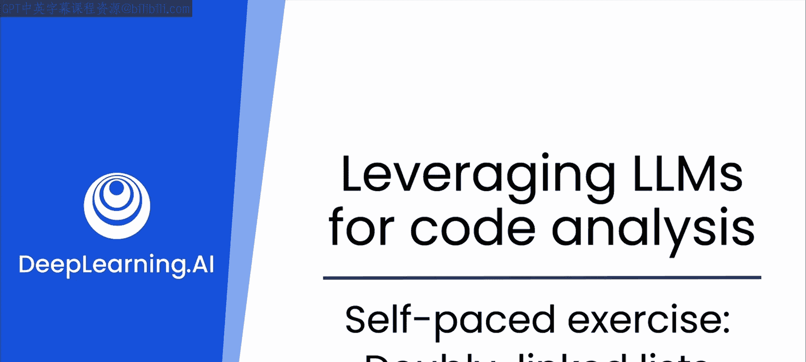
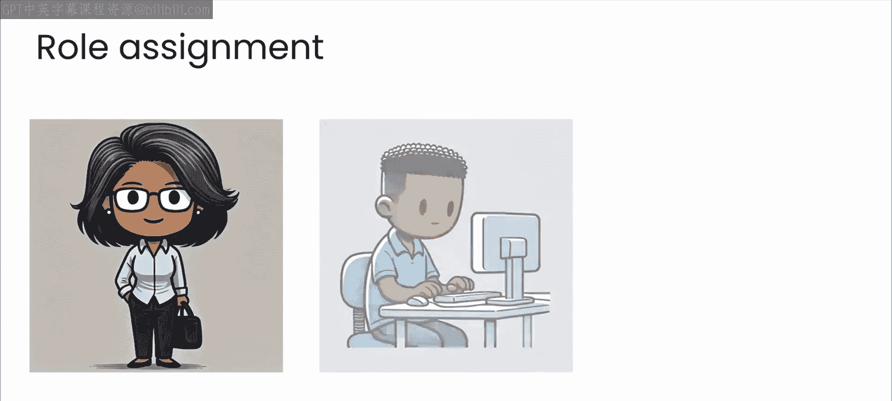
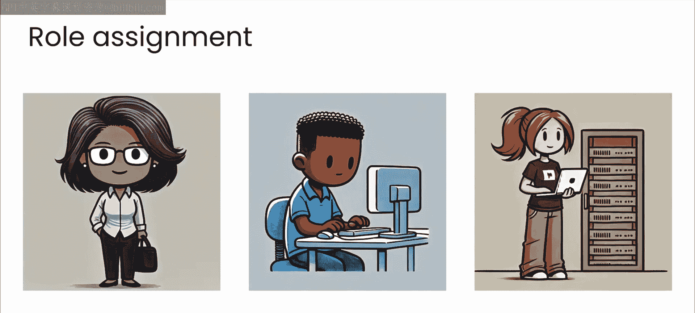
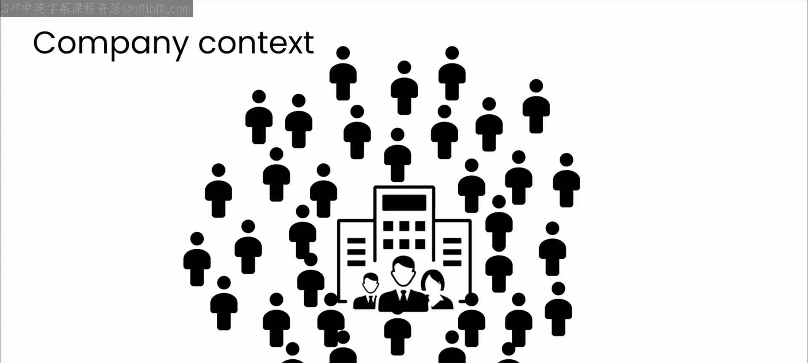

# 吴恩达《软件开发的生成式AI技能（简介、结对编程、数据库设计-3课全）Generative AI for Software Development Skill》 - P19：18_自学练习：双向链表.zh_en - GPT中英字幕课程资源 - BV1ucxLeUEHD

So you just looked at a array and had linked lists and in particular singly linked lists。

 where each node in the list held both a piece of data and a pointer to the next node。😊。

This gave you the ability to insert or remove data quite easily because you avoided the problem of having to move around lots of elements in memory you also added code to your linked list implementation to remove a node。

 Nice done。😊，But now I'd like you to spend a little bit more time taking your linkedless code to the next level。

You've already implemented a Sly linked list， and typically in computer science programs。

 your next step would be to implement a doubly linked list。

 where each node doesn't just point to the next one， but also to the previous one。😊。

And when you do things like inserting a new node， it then has to point to both the previous and the next node。

Pause and think for a moment about why somebody would want to implement a doubly linked list instead of a singly linked one。

 When you learn this stuff the first time around， you might have just jumped straight from single to doubly linked lists without a lot of analysis as to why you might want this new data structure。

After thinking about it for a moment， maybe prompt Cha ET the same question and see how the model responds。

As you can see here， the model provided me a lot of feedback。

 some of which was obvious like being able to go backwards。

 as well as forwards from a particular node。 and the extra memory cost then， of course。

 that comes with storing another pointer。😊，But it also provided insights into more complex scenarios where doubly linked list is more powerful。

 like for caching and memory management algorithms such as LRU， which is least recently used。

Some of these responses were things that just didn't come to mind immediately for me。 again。

 demonstrating how useful it can be to revisit the fundamentals with an LN by your side。As before。

 pause the video here and have a good read through the feedback and also the response that the model gave you when you prompted it。

And remember， you can always ask for more details or an explanation on any item that you're curious about。

😊，So the next step is a self paced exercise for you to work through in the coding environment that's available to you in the lab item。

 your task is to implement a doubly linked list。😊，You can start from my Sly linked list one if you like。

 the one that you added a remove node to earlier。Then have a brainstorm with the LLM to think through how you would implement this data structure。

 Expre the feedback that the LLM gives when you ask it to assume different roles。

 Try to be creative here。 Ask the model to behave like a seasoned software engineer or a paranoid security expert or a site reliability engineer and see how a respond each time。

 You can also explore how implementation might proceed in different scenarios。

 such as a company that suffers denial of service attacks or a company that will have to quickly scale from thousands of users to billions of users and then consider the impact of these scenarios on your code。

😊。

For example， when scaling Chat EptT might offer alternative data structures。

 don't worry about those for now， just stick with the doubly linked list。

 even if it has limited size。

Finally， try to get your code documented and explain thoroughly。

 Think back to the first module where you saw how an LLM could help you write detailed comments that make your code easy to follow。

 Take your time to get it right。 It is easy to get into bad habits of just having code created for you。

😊，Always critique what the model responds with and test to make sure that the code works just the way you want。

 And when you're done， I'll see you in the next video。

