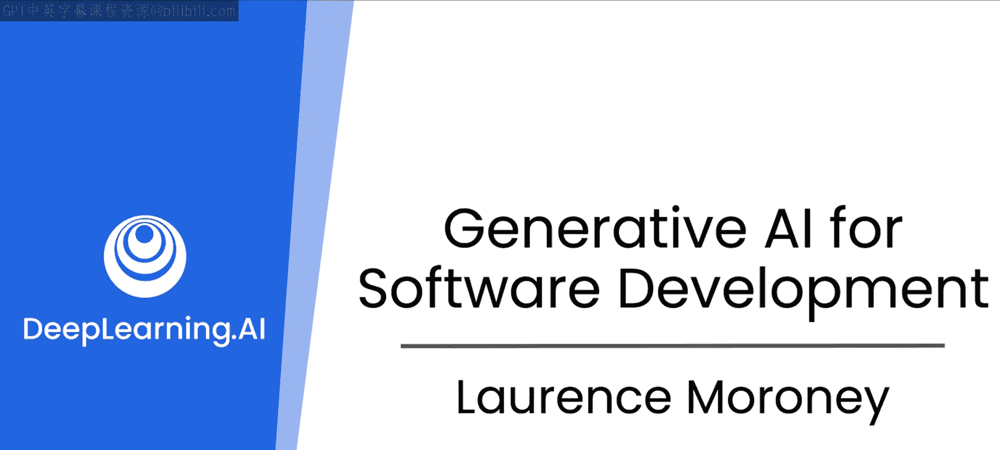
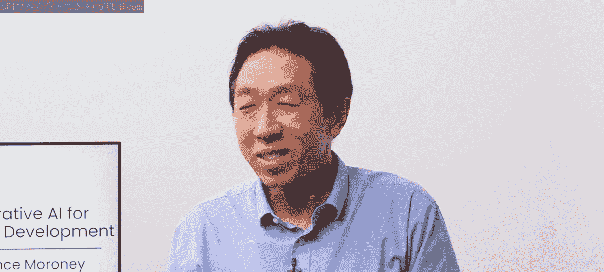

# 吴恩达《软件开发的生成式AI技能（简介、结对编程、数据库设计-3课全）Generative AI for Software Development Skill》 - P1：01_conversation-between-laurence-moroney-and-andrew-ng.zh_en - GPT中英字幕课程资源 - BV1ucxLeUEHD

Welcome to generative AI for software development。 generative AI is helping many software developers write faster better code and just be clear。

 this specialization is not about writing generative AI applications is about how generative AI can help with software development。

 whether you're data scientist or frontend or back in a fullsag of mobile。

 whatever type of developer I'm here with Lawrence Moroni who will the instructor for these course you might be familiar with Lawurrence from the Tensorflow courses。

 he had taught with deep learned AI some time back。

 Lawrence is also the author of more than 30 books some Scifi。

 some programming many machine learning and I'm excited to have him teach best practices for how you can write software better using geneative AI always be delighted to be here Andrew and to work alongside you and your team So one of the things that we've I know you've been thinking about is really the impact of generative AI on the day-to-day role of a software developer and how you feel it。

😊，Going to impact what what's that going to look like You know。

 the thing that surprised me was how much more fun coding is with Genoc VI than without。

Three weeks ago， I was trying to deploy something to cloud service。

 had to done it for a while and I forgotten how to do it。 and I thought， boy。

 I've had to go and read that documentation that figured out I could have done it， but frankly。

 it was much faster to prompt an Lm to guide me through the sense。

 which turned out to be almost correct to help me Pakistancker container pushed to the cloud service are using just get the job done。

 So I find myself looking forward to coding more now that I know I have this coding companion like gen bug to help me along it's those kind of drudgery tasks sometimes that take away from the joy of like solving a particular problem And when you have that pair of programmer alongside you to help you through those it does make the overall task of that offer and productivity is one thing all that I guess there's a McKinzey study than a Cisco study that estimated something like 35 is maybe more percentage improvements and productivity booze for cogeneration and various tasks So productivity boostoze is great All that。

Fun know isnt a big bonus too Oh totally it's like I found myself I'm sitting down and I'm enjoying coding much more than I had been previously because I'm spending more time thinking about the problem than I'm working on and thinking about how to implement that solve that problem as opposed to what do I do for a user interface。

 What do I do for like a Docker container to push to the cloud and those type of things it's really fun。

 So elephant in the room on social media there have been some very strident voices saying you know no one ever needs to write code anders will be obsolete because of generative AI I think we share some of you on that。

 Yeah， I mean I honestly think that that viewpoint is wrong and I'll come out and say that because I think you know your expertise as a software developer if anything is more important than ever in the age of generative AI because it can make you have those superpowers be more effective be able to solve those domain problems and have fun while you're doing it so you can as we've been sharing so you can have a more fulfilling thing and just。

😊，Have a better time at work。 In fact， what I suspect will happen is if indeed， the estimates of。

 let's say， 35% productivity boosts are accurate， then I think what will happen is。

People that use AI will replace people that don't， but AI won't replace software developers。

And when I think about the study showing meaningful productivity boost already today。

 I think with the rapid pace of development， these gains will only expand and get even much bigger over time so today we promise to help us explain code de code managed dependencies all that is great as you look in the future with future generations of more agent technologies most of those things I think it actually become more and more productive and more and more fun to have all these tools that you disposal Oh absolutely and I also think that if the word is shrinkification the fact that LLMs are getting smaller but still being as effective I really see that trend continuing and increasing and making again the job of a developer that bit easier so now instead of outsourcing to a thirdpart via a chat bot or those kind of things with your code you could have an LLM running on your local machine that's trained on your code base that's an expert on your domain that you can then use as that。

Programr alongside you and I see that being a major trend and in addition to that， of course。

 that then many companies won't allow their source code to be shared outside。

 you can't bring it to chatyB or Clade or anything like that。

 but when you have an internal model running on your own development box that's when again I think the floodgates can open on these for a lot the developers when we get stuck on a both an novices even for experience developers you're learning something you sometimes get stuck you got to find a human expert to help you get unstuck and I really like this analogy of hair programming you always have a budgy with you now they can ask you question from right away and I think compared to waiting a day or whatever to track down that domain expert not that them always knows every answer but the fact that your buddy can give you an answer right away give you some options I see this hoping developers get unstuck all the time but at much more rapidly。

For me personally， sometimes if it's not helping solve the immediate problem。

 it sparks inspiration right some of the answers that I give will help me find a different track that I'm going to follow to be able to fix a particular problem or to go a whole new direction that I hadn't previously thought of and's it's that sparking of inspiration is one of the things that really can make the task more enjoyable one of the things I really appreciate about insights you brought to our conversations was I think a lot of us have been using GeneI to help with coding in ad ho but effective ways one of the things that I saw you do that really appreciated was going through。

Frankly， a lot of tasks that developers have to go through and then to think through best practices but how can Gen VI hope with different tasks So for example I just had not thought of using gender AI to hope with test drivenn development to write tests until I heard about that from you quite a while back now but I think those systematic analysis of one of the things you could do what the best practices I really appreciated you're thinking that to putting together thank you thank you yeah and it's another one like in that realm that I love is dependency management because often bugs there's nothing wrong with your code it's just your dependency set there's something mismatching in there and to be able to use your friendly pair program or LLM to help you through that and has that understanding of dependencies and breaking changes and those type of things to guide you through that there's a whole lot more to the universe of being a developer than just writing code and I think having that LLM beside you through all of those tasks is really powerful and fun we speak of dredgery and not fun a few years ago down。

There's some open source code that uses Python 3。12 there's some weird features that I've never used and then thank goodness and tell me how to modify the code to be compatible with Python 3。

10 or whatever I was using and I think that kind of thing really save the a lot time and it does know Python 3。

10 and Python 3。12 much better than I did to help me solve problem quickly exactlyact exactly and so changing T for a second like we're looking at all these advancements and all these improvements and what if we were to cast a ride down the road of time and think like what do you think software development will look like in five years with this。

😊，I think it's exciting and it feels like syntax is already becoming less important so there's one fewer thing we need to memorize as much of and then I think as AI becomes increasingly able to autonomously write code test it with agent gen workflows。

 AI can writecode test it debu it， I feel like software developers can operate at a higher and higher level。

 I think we probably it work for us as humans to do to guide and supervise AI for a long time but then you know knowing where the technology is and staying with the technology even as a mature I are trick call for us really doing the best work that we can sometimes when we start building a system。

 we start at the whiteboard and we start drawing all these boxes and arrows between them and thinking about the constraints and you know given the idea that today we generate code or we generate documentation or we generate test cases and other things from a prompt。

 it might be very interesting that in the not too distant future like those systems。

Spation designs that we draw those boxes on a whiteboard could be the next prompt and like to be able to design systems off of those with multimodal models now being able to recognize imagery and being able to pass that kind of thing that I can see that going back to that domain expertise that when you have a domain expertise to solve a particular problem and you can draw the architecture of that that that architecture can be implicitly turned into code which would execute and you may not even be interfacing that much with raw code unless you want to tweak and debug and it's like know five years from now that could be a way that software developers will be even more effective and it's something that I'm looking forward to that's in the future but what do we have today so in this specialization so we have three courses the first thing that we do want to emphasize that this isn't a series of courses on how to build generative AI this is a series of courses on how to use generative AI to be a better software developer and the skills that we're looking at building here are really relevant。

F you in all areas you know as we've touched on a little bit already it's not just coding。

 it's documentation， dependency management testing， a little bit of architecture。

 all of that kind of stuff with GenI as your friend So with these courses anyone theres code we're gonna adopt best practices and using GensI to help with these can you say a bit more about what the three courses are so we kind of broke the three courses into themes So the first course is really for you as an individual software developer it's going to introduce you a little bit to LLMs and how you can use them as a pairpror but then you're going to get into like prompting and system prompting and having an LLM play roles like software tester or any of those kind of roles of the type of people that you'd be working alongside to build better code The second one then is really when you start thinking about collaboration with other people as a software engineer you're going to work with testers you're going to work with people who do documentation you're going to be working with people who give you dependencies they may be internal to your company or it might be thirdpart。

encies like Python ones and you know we're going to work through the skills of you being able to use an LLM to just be better at doing all of that and then in the third and final course it's like we're really going to take that to the professional software developer level where you can understand the full workflow of building and launching applications from the design phase with design patterns and the famous gang of4 patterns through things like data serialization and database management so that's really the whole idea of this like to help you start as an individual developer go on to working in a team and then go on to really being able to deploy professional solutions and do these causes of any prerequisites。

I think the only prerequisite here would be it's good to know a little bit of Python so if you're a Python developer it's good we're also going to touch some other languages like Java and Java but we'll be primarily working in Python so lots of things to learn in these courses and with that let's jump into how you can use large languagegg models right away to help you with your coding let's go into the next video to get started。

😊。