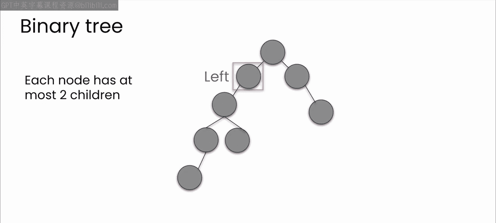
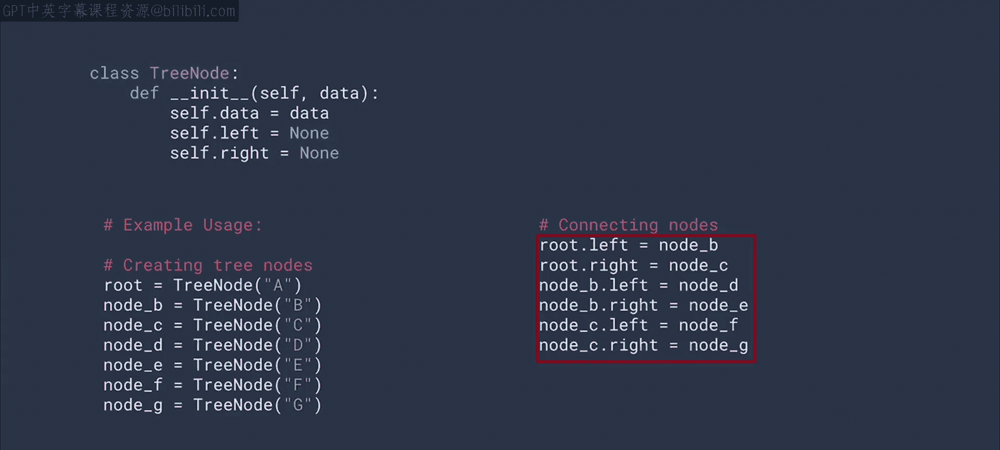
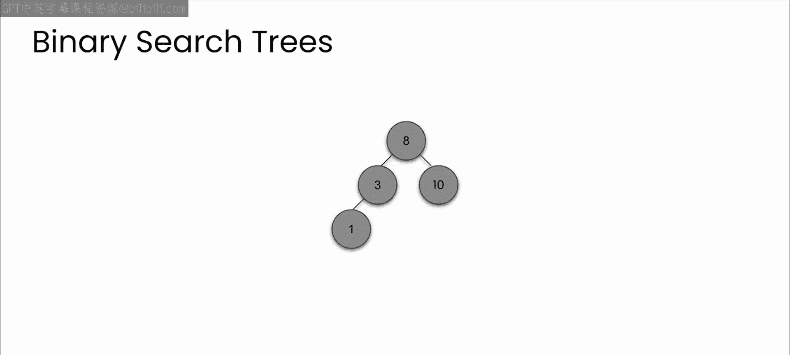
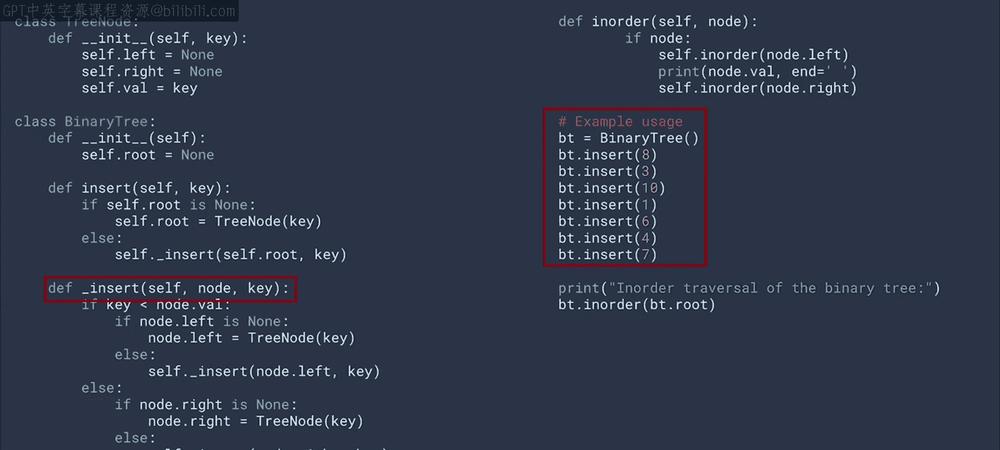
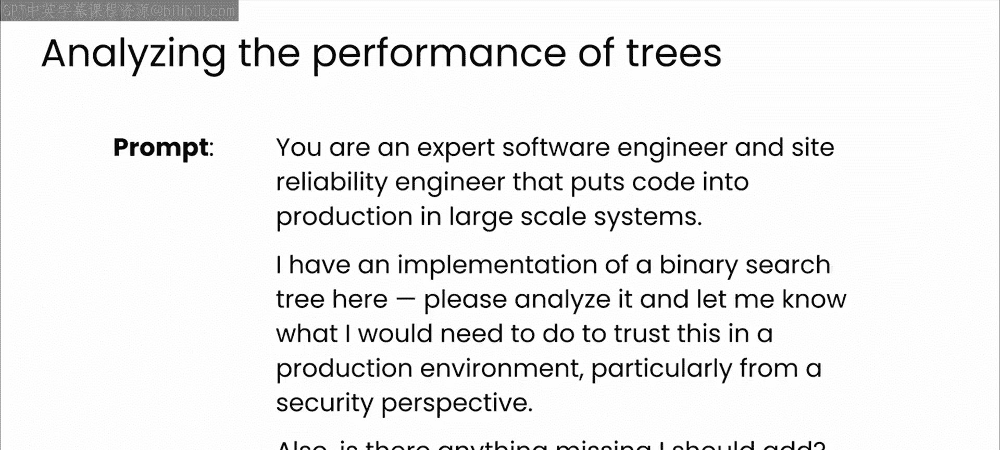
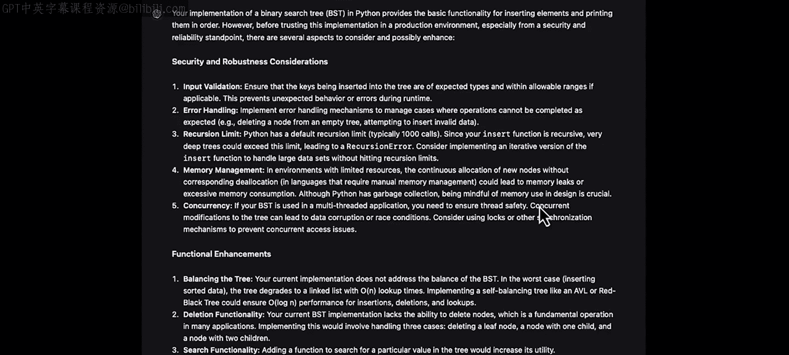
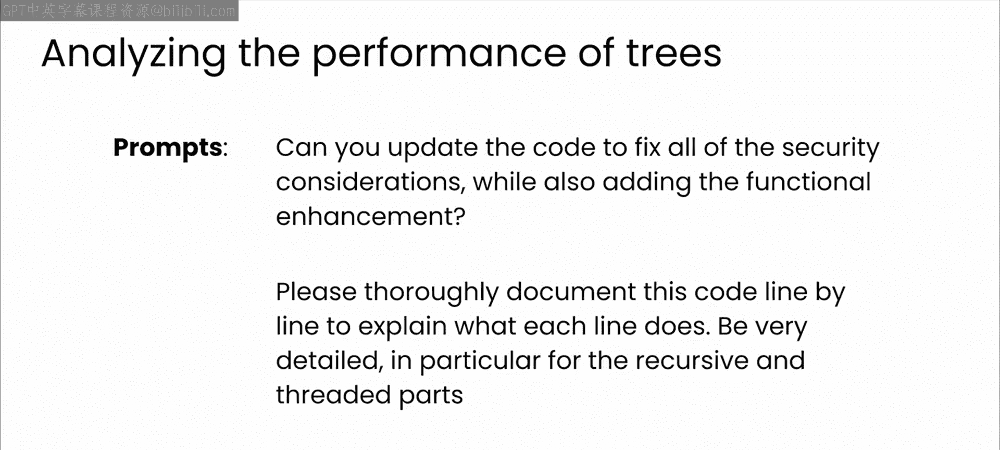
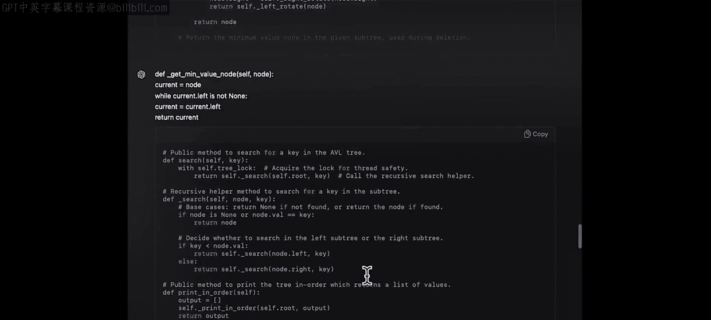

# 吴恩达《软件开发的生成式AI技能（简介、结对编程、数据库设计-3课全）Generative AI for Software Development Skill》 - P20：19_树.zh_en - GPT中英字幕课程资源 - BV1ucxLeUEHD

Earlier， you looked at arrays and you explored when you should and you shouldn't use them。

 You then implemented similar data structures that overcame some of the limitations of arrays first with singly linked lists and then the doubly linked list one that you created in the hands on exercise。

Now， you might be wondering if you've used a large language model to help create the code。

 including all the stuff to make it scalable and secure， Does it still work。

 And that's a great question。 And something I would encourage you to continue to look into with your own code。

 Test， testing， testing as much as possible。If you're using Python。

 a great way to do this is with an online hosted notebook like Google ColLab。Run the code。

 think up some test cases， and then try to break your code。For other languages。

 the same principles apply， and you can use the environment of choice。Laterer in this specialization。

 you'll explore using Chat EPT as a partner to create code that helps you test your work。

But don't wait until then to get into the habit of testing anyway， back to data structures。

One benefit of the linked lists that you created over simple arrays is this efficient storage and retrieval。

 it is very easy to move from one node to the next or move back to the previous。😊，However。

 you can't search the data within these linked lists without traversing through the entire data structure。

 So as you store more data， it becomes prohibitively more expensive to search for specific item。

So with that in mind， let's explore the properties of some other data structures using an LLM as your guide。

 You're going to take a look at trees， graphs and even hash tables。😊。

These data structures are the bread and butter of many coding interviews。

 So it is good to have an in depth understanding， not just of how they work。

 but also how to scale them and make them more secure。 Let's start with trees。

 Whether you're refreshing your knowledge or looking to gain a deeper understanding of tree structures。

 I hope this video will provide valuable insights。 Let's just grow our knowledge together。😊。

Here's a reminder of the fundamentals， a tree is a nonlinear data structure consisting of nodes which store data connected by edges。

A defining feature of a tree is that a single node is designated as the root node。

 and this node forms the top of the tree。 The root node then has links to one or more child nodes。

 And in this case， you can see two child nodes。 The child nodes can themselves have one or more children。

😊，Any node below the root node without children is called a leaf node。

 Note that there are no cycles in a tree。One of the most common types of tree is the binary tree where each node has at most two children。

 typically referred to as the left and right child。

Now， here's one way that you could code up this particular type of binary tree。

 Instead of thinking in terms of the entire tree， you could start by coding a tree node class where each node instance has a left and a right child。

You could then create the binary tree from the previous slide like this by specifying all of the individual nodes and then assigning them to be the child node of the appropriate parent。

Well， this works quite well， but the code isn't the friendliest。 Also， more importantly。

 there's no concept of ordering nodes。 So when you insert a node。

 you just make one node the child of another。

The nice thing that trees give you that linear data structures like a arrays and linked lists don't is the ability to search if you have chosen an order when you insert or delete items。

 So let's modify our tree to make it a searchable one， a BST or binary search tree。

And this is where the tree should be modified so that you don't just blindly add children。

 You're going to start with a root node。 And every time you insert a value， you follow this pattern。

 If the value you want to add is bigger than the current one， you insert it as the right child。

 Otherwise， you insert it as the left child。 Now， this can get recursive because the right child might already be filled。

 and then you have to do the same decision you get。So let's say you start with the value 8。

 This is going to be the root。 Now， if you want to insert 3 into the tree， it's less than 8。

 So it becomes the left child。 Now， if you want to insert 10 into the tree， it's bigger than 8。

 so it becomes the right child。Now， if you want to insert one， it's smaller than8。

 So you insert it to the left child。 But this is already occupied by three。

 And because one is smaller than three， it will then become three's left child and so on。

Why is this important， Well， now， if you get recursive while printing out the string by traversing left to right。

 you will actually end up with an ordered set of numbers。

 Here's an example implementation of a binary search tree that works like that。

 the numbers were not ordered to begin with， But when you call print in order。 they are。

But this isn't computer Science 101。So as an engineer and as someone who has been doing this course。

 what would you think is the next thing to consider before putting code that uses a BST into production。

 pause the video and think about it a bit before continuing。Okay， what did you find？

Well first of all， the easy one， this implementation doesn't have a remove operation， just an insert。

But then think about things like the fact that the code here used recursion for the inserts。

And when you do recursion in code， it can make your code very neat and elegant that will get you very high scores from your undergrad professor。

But is it the right way to do it， Think about the memory impact of having to keep a recursion stack。

This implementation also assumed simple integers。 But what if， for example。

 you were keeping large data structures instead， the memory cost of using recursion there might be excessive。

Or maybe you thought about input validation。 This assumes that you are inputting integers。

 but does it give the possibility of some kind of denial of service attack because we're not filtering our inputs。

And one last issue is subtle， but it is important。 What would happen if the numbers were already ordered before you inserted them。

You'd have a tree that was effectively a late list with the root having one child。

 and then that has one child。 and then that has one child and so on。

 If you were to try to access content on the tree， you wouldn't be getting the best of the tree。

 So sometimes it's better to balance the tree。 A perfectly balanced binary tree would have n layers of depth。

 when there are two to the N items of data。 So if you had 8 items of data。

 you could balance the tree so that it's only  three nodes deep。 Or if you had 1000 items of data。

 it could be only 10 nodes deep。 So searching can be really fast。😊，Now。

 maybe you've identified all of these issues， or maybe you've realized just a few of them。

 But here's the good news。 And I'm sure you've guessed by now。

 you could have an LLM help you more fully consider the problem by playing the role of an expert software engineer or site reliability engineer or something like that。

 Now， let's see what that looks like。😊，Here's the prompt。And after assigning the role。

 you can paste the code into the context window for the model to assess。

And here， GPT writes a lengthy response covering necessary stuff like input validation。

 error handling， and so on。

I'll be honest。 I only learned that Python has a default recursion limit when I read this。

 It's typically 1000 calls。 So a perfectly balanced binary search tree could conceivably hold  two to the power of 1000 values。

 which is an inconceivably high number， but， of course， the deeper the tree。

 the deeper the recursion stack， So， again， one could potentially use insert calls for a denial of service attack。

 You might want to cap the Python recursion limit。😊，Can you figure out how to do that？

I'll leave that as an exercise for you。So now having prompted GPT to do the expert and SRE analysis and having gotten lots of feedback。

 think about how you would ask it to follow up on that feedback。

Here's a couple of examples that I did。

But at this point， you should be thinking of your own prompts and evaluating the code that comes back。

Check out this video on how I interacted with GPT to continually improve and solidify the code。

 and then try it for yourself and see what you can do to improve your own code。

You can find the tree implementation code from this video。

 which was created with the assistance of Chat Ept in the downloads for this course。

 It's called A V L dot Pi。 And A V L， it's named after the inventors of this type of self balancing binary search tree。

 Jogi Aldson Velski and Eugganni Landis。 I hope I prounce their names right。 Download it。

 Test it out and see if you can break it。 There are some obvious bugs in there。

 So play with it and then use an LLM as your coding companion to help you fix those bugs。😊。

Take your time， work through the code。 You'll see that the implementation has grown far beyond our original binary search tree。

 and it looks a lot more like the code that you'd expect to find in a professional production environment。

Once you're done， I'll see you in the next video where you'll revisit your next data structure。

 graphs。😊。